---
metadata-files:
  - references.yml
filters:
  - part-references.lua
format:
  revealjs:
    css: custom.css
    include-after-body: navigation.html
    slide-number: false
    progress: false
    controls: true
    transition: fade
    transition-speed: fast
    auto-animate: true
    auto-animate-duration: 0.3
    background-transition: fade
    center: false
    width: 1600
    height: 1200
    margin: 0
---

## {.cover .defense-cover background-color="#000000"}

<div class="cover-kicker">SOUTENANCE DE THÈSE · 2026</div>
<div class="cover-title">Organisation des Parties Prenantes et Recommandation De Substitution Technologique Respectueuse de l’Environnement : Application à la Décarbonation Ferroviaire Régionale</div>
<div class="cover-methods">
<div class="cover-method fragment fade-in" data-fragment-index="0"><span class="cover-method-label">01 · Organisation de la décision</span><p>Méthodologie de diagnostic, modélisation et réorganisation des contributions des parties prenantes au sein des processus décisionnels complexes</p></div>
<div class="cover-method fragment fade-in" data-fragment-index="0"><span class="cover-method-label">02 · Évaluation environnementale</span><p>Méthodologie pour l’évaluation environnementale paramétrique et prospective pour la comparaison de scénarios de réduction d’impact par l’analyse du cycle de vie (ACV) et l’aide à la décision multicritère (ADMC)</p></div>
</div>
<div class="cover-partners">
<div class="cover-partner cover-ikos"><div class="cover-supervisors"><figure><figcaption>Jeanne-Marie Dalbavie</figcaption></figure></div></div>
<div class="cover-author"><strong>Benoît Volant</strong><span></span></div>
<div class="cover-partner cover-lgi"><div class="cover-academic-logos"><div class="cover-centrale-frame"></div></div><div class="cover-supervisors"><figure><figcaption>Franck Marle</figcaption></figure><figure><figcaption>Yann Leroy</figcaption></figure></div></div>
</div>

<div class="agenda-parts">
<div class="agenda-part fragment fade-in" data-fragment-index="1" style="--part-color:var(--part-1)"><div class="agenda-disc" aria-hidden="true"><span style="left:50%;top:50%"></span></div><div class="agenda-part-content"><div class="agenda-part-heading"><span>01</span><h3>Introduction</h3></div></div></div>
<div class="agenda-part fragment fade-in" data-fragment-index="1" style="--part-color:var(--part-2)"><div class="agenda-disc" aria-hidden="true"><span style="left:50%;top:28%"></span><span style="left:32%;top:65%"></span><span style="left:68%;top:65%"></span></div><div class="agenda-part-content"><div class="agenda-part-heading"><span>02</span><h3>Organisation &amp; parties prenantes</h3></div></div></div>
<div class="agenda-part fragment fade-in" data-fragment-index="1" style="--part-color:var(--part-3)"><div class="agenda-disc" aria-hidden="true"><span style="left:50%;top:28%"></span><span style="left:32%;top:65%"></span><span style="left:68%;top:65%"></span></div><div class="agenda-part-content"><div class="agenda-part-heading"><span>03</span><h3>ACV &amp; ADMC</h3></div></div></div>
<div class="agenda-part fragment fade-in" data-fragment-index="1" style="--part-color:var(--part-4)"><div class="agenda-disc" aria-hidden="true"><span style="left:50%;top:50%"></span></div><div class="agenda-part-content"><div class="agenda-part-heading"><span>04</span><h3>Conclusions et perspectives</h3></div></div></div>
</div>

## {.editorial .part-divider data-part="1" data-subpart="1"}

<div class="divider-number">PARTIE 01</div>
<div class="divider-title">Introduction</div>
<div class="divider-subtitle"></div>

## Accords publique de décarbonation {.editorial data-part="1" data-subpart="1"}

<div class="slide-title">Accords publiques de décarbonation</div>

<!-- Même ordre que sur la diapo suivante : Paris, Pacte vert européen, SNBC.
     Cadres de même taille, entièrement dans le canevas ; object-fit:contain conserve les couvertures. -->
<div class="ppt-canvas">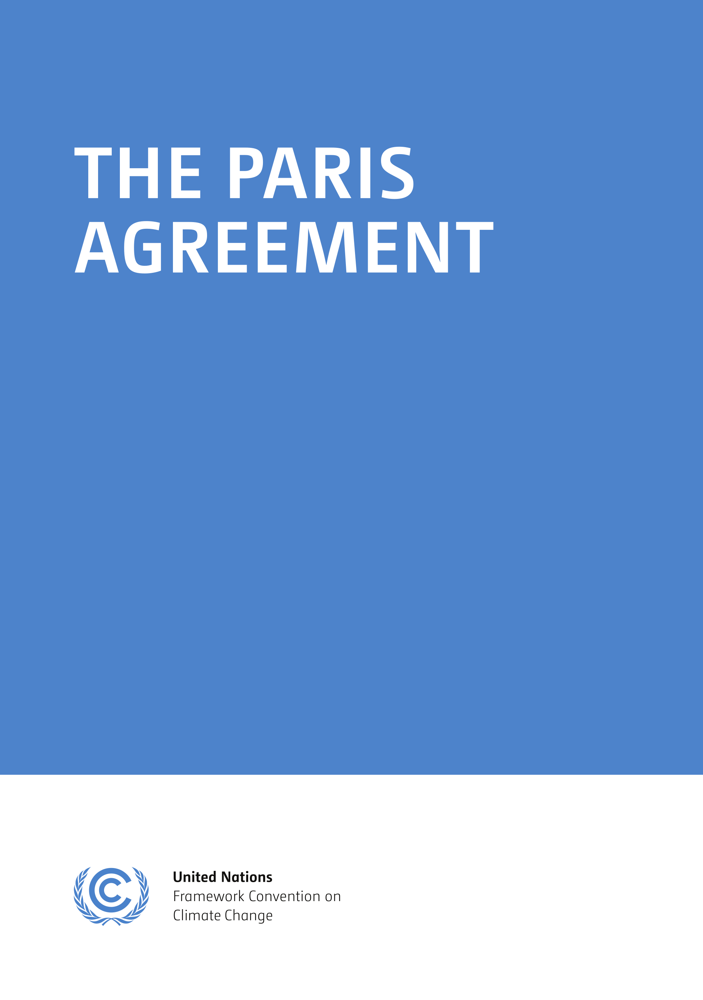

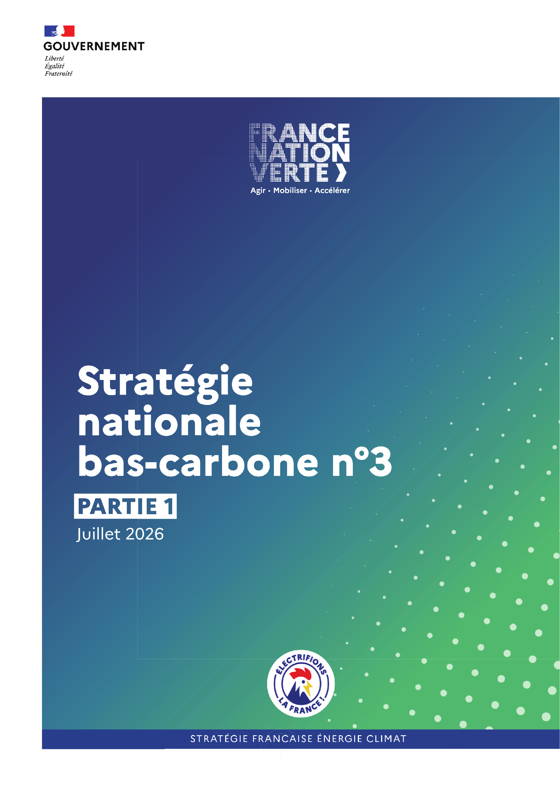</div>

## Décarbonation ferroviaire : changement technologique {.editorial data-part="1" data-subpart="1"}

<div class="slide-title">Décarbonation ferroviaire : alternatives au diesel</div>

<div class="ppt-canvas">


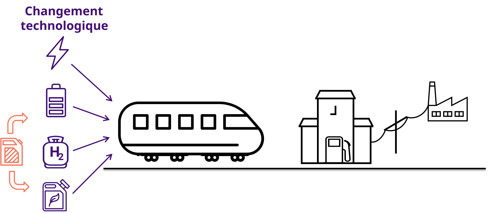</div>

## Décideurs et niveaux institutionnels {.editorial data-part="1" data-subpart="1"}

<div class="slide-title">Décideurs et hiérarchie institutionnels</div>

<div class="ppt-canvas">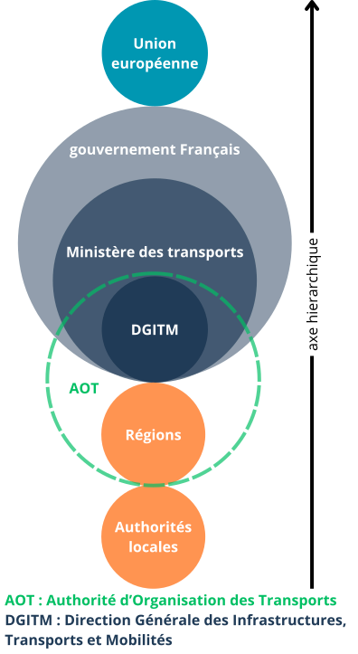
</div>

## Contraintes des services techniques régionaux {.editorial .constraints-slide data-part="1" data-subpart="1"}

<div class="slide-title">Décision régionale</div>

```{=html}
<div class="ppt-canvas constraints-content">
<p class="constraints-intro">Interview des services techniques de décarbonation des trains régionaux par <strong>entretiens semi-structurés</strong>.</p>
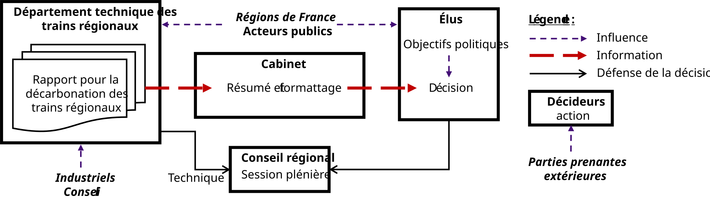
<div class="constraints-findings">
<p>Le <strong>manque de ressources</strong> a été identifié comme leur principale contrainte.</p>
<p>Besoin de <strong>transparence</strong> et de <strong>facilité d’interprétation</strong> pour les décisions publiques.</p>
</div>
</div>
```

## Risques des interactions public-privé {.editorial data-part="1" data-subpart="1" refs="aliyu-2025,kapiriri-2021,pagliara-2025,knamiller-2024,marle-2019"}

<div class="slide-title">Risques des interactions public-privé</div>

<div class="ppt-canvas">
<div class="ppt-table-wrap risk-table" style="left:5%;top:8%;width:90%;">
<table class="ppt-table" aria-label="Risques des interactions public-privé, manifestations et références">
<thead><tr><th scope="col">Risque</th><th scope="col">Effets</th><th scope="col">Références</th></tr></thead>
<tbody>
<tr class="fragment fade-in" data-fragment-index="0"><th scope="row">Participation prématurée ou décalée</th><td><ul><li>Participation improductive</li></ul></td><td><span data-cite="aliyu-2025"></span></td></tr>
<tr class="fragment fade-in" data-fragment-index="1"><th scope="row">Présence excessive ou insuffisante de certains acteurs</th><td><ul><li>Acteurs disposant de ressources sur-représentés : ils monopolisent l’attention et les ressources des décideurs et orientent la décision.</li><li>Acteurs disposant de moins de ressources sous-représentés : perte d’information.</li></ul></td><td><span data-cite="kapiriri-2021,pagliara-2025"></span></td></tr>
<tr class="fragment fade-in" data-fragment-index="2"><th scope="row">Lobbying</th><td><ul><li>Une décision non organisée s’ouvre à des influences par des regroupements d’acteurs aux intérêts communs.</li><li>Avantage du premier entrant, qui oriente la décision.</li><li>Orientation des critères de choix et des scénarios considérés.</li></ul></td><td><span data-cite="knamiller-2024"></span></td></tr>
<tr class="fragment fade-in" data-fragment-index="3"><th scope="row">Désengagement</th><td><ul><li>Surcharge bureaucratique</li><li>Sollicitations répétitives</li></ul></td><td><span data-cite="pagliara-2025"></span></td></tr>
<tr class="fragment fade-in" data-fragment-index="4"><th scope="row">Processus inefficace</th><td><ul><li>Contradictions internes</li><li>Cloisonnement à un champ de connaissances</li><li>Gaspillage de ressources publiques</li></ul></td><td><span data-cite="marle-2019"></span></td></tr>
</tbody>
</table>
</div>
</div>

## Lacunes de la littérature sur l’organisation de la décision {.editorial .literature-overview-slide data-part="1" data-subpart="1" refs="literature-1,literature-2,literature-3,literature-4,literature-5,tsvetkova-2019"}

<div class="slide-title">Lacunes de la littérature sur l’organisation de la décision</div>


:::: {.ppt-canvas .literature-overview}

::: {.ppt-table-wrap .literature-table style="left:3%;top:20%;width:45%;"}

| **Approche** | **R&eacute;f&eacute;rence** |
| :--- | :--- |
| Approche participative et gouvernance locale | <span data-cite="literature-1"></span> |
| Modélisation graphique et cartographie des parties prenantes | <span data-cite="literature-2"></span> |
| Évaluation des impacts organisationnels du changement | <span data-cite="literature-3"></span> |
| Stratégies d’évaluation et de gestion des parties prenantes de l’organisation | <span data-cite="literature-4"></span> |
| Influence des groupes d’intérêt et asymétrie d’information | <span data-cite="literature-5"></span> |
| Modélisation des parties prenantes de l’entreprise | <span data-cite="tsvetkova-2019"></span> |

:::

<div class="module-matrix literature-module-matrix" lang="fr" role="group" aria-label="Répartition des références selon les acteurs et les domaines">
<div class="matrix-head" style="grid-column:1;grid-row:1;">Acteurs</div>
<div class="matrix-head" style="grid-column:2 / 5;grid-row:1;">Analyse des parties prenantes</div>
<div class="matrix-head" style="grid-column:5 / 8;grid-row:1;">Organisation des relations entre parties prenantes</div>
<div class="matrix-head" style="grid-column:8 / 11;grid-row:1;">Organisation du processus de décision</div>
<div class="matrix-label" style="grid-column:1;grid-row:2 / 5;">Acteurs publics</div>
<div class="matrix-label" style="grid-column:1;grid-row:5 / 8;">Acteurs industriels</div>
<div class="literature-row-band" style="grid-column:2 / 11;grid-row:5 / 8;" aria-hidden="true"></div>
<div class="matrix-module literature-reference" data-literature="literature-1" style="grid-column:6 / 11;grid-row:3 / 5;" title="Approche participative et gouvernance locale"><span data-cite="literature-1"></span></div>
<div class="matrix-module literature-reference" data-literature="literature-2" style="grid-column:2 / 11;grid-row:2;" title="Modélisation graphique et cartographie des parties prenantes"><span data-cite="literature-2"></span></div>
<div class="matrix-module literature-reference" data-literature="literature-3" style="grid-column:2;grid-row:3 / 8;" title="Évaluation des impacts organisationnels du changement"><span data-cite="literature-3"></span></div>
<div class="matrix-module literature-reference" data-literature="literature-4" style="grid-column:5;grid-row:3 / 8;" title="Stratégies d’évaluation et de gestion des parties prenantes"><span data-cite="literature-4"></span></div>
<div class="matrix-module literature-reference" data-literature="literature-5" style="grid-column:3;grid-row:3 / 8;" title="Influence des groupes d’intérêt et asymétrie d’information"><span data-cite="literature-5"></span></div>
<div class="matrix-module literature-reference" data-literature="literature-6" style="grid-column:4;grid-row:5 / 8;" title="Modélisation des parties prenantes de l’entreprise"><span data-cite="tsvetkova-2019"></span></div>
</div>


::::

## Sommaire {.editorial .research-agenda}

<div class="summary-title">Questions de recherche et sommaire</div>
<div class="agenda-parts">
<div class="agenda-part" style="--part-color:var(--part-1)"><div class="agenda-disc fragment fade-in" data-fragment-index="2" aria-hidden="true"><span style="left:50%;top:50%"></span></div><div class="agenda-part-content fragment fade-in" data-fragment-index="2"><div class="agenda-part-heading"><span>01</span><h3>Introduction</h3></div><div class="agenda-sections"><span>Contexte de la décarbonation ferroviaire et enjeux de la décision publique</span></div></div></div>
<div class="agenda-part" style="--part-color:var(--part-2)"><div class="agenda-disc fragment fade-in" data-fragment-index="2" aria-hidden="true"><span style="left:50%;top:28%"></span><span style="left:32%;top:65%"></span><span style="left:68%;top:65%"></span></div><div class="agenda-part-content fragment fade-in" data-fragment-index="2"><div class="agenda-part-heading"><span>02</span><h3>Organisation &amp; parties prenantes</h3></div><div class="agenda-sections"><span>2.1 · Modélisation du réseau</span><span>2.2 · Analyse du réseau d’acteurs</span><span>2.3 · Clustering et réorganisation</span></div></div><div class="summary-research fragment fade-in" data-fragment-index="0"><div class="summary-question">Comment formaliser une méthodologie d’aide à la décision qui positionne l’intervention des différentes parties prenantes tout au long du processus décisionnel ?</div><p class="summary-method-name">Méthodologie de diagnostic, modélisation et réorganisation des contributions des parties prenantes au sein des processus décisionnels complexes</p></div></div>
<div class="agenda-part" style="--part-color:var(--part-3)"><div class="agenda-disc fragment fade-in" data-fragment-index="2" aria-hidden="true"><span style="left:50%;top:28%"></span><span style="left:32%;top:65%"></span><span style="left:68%;top:65%"></span></div><div class="agenda-part-content fragment fade-in" data-fragment-index="2"><div class="agenda-part-heading"><span>03</span><h3>ACV &amp; ADMC</h3></div><div class="agenda-sections"><span>3.1 · Modélisation</span><span>3.2 · ADMC</span><span>3.3 · Application</span></div></div><div class="summary-research fragment fade-in" data-fragment-index="1"><div class="summary-question">Comment évaluer les impacts environnementaux et classer des scénarios prospectifs dans des contextes opérationnels variés ?</div><p class="summary-method-name">Méthodologie pour l’évaluation environnementale paramétrique et prospective pour la comparaison de scénarios de réduction d’impact par l’analyse du cycle de vie (ACV) et l’aide à la décision multicritère (ADMC)</p></div></div>
<div class="agenda-part" style="--part-color:var(--part-4)"><div class="agenda-disc fragment fade-in" data-fragment-index="2" aria-hidden="true"><span style="left:50%;top:50%"></span></div><div class="agenda-part-content fragment fade-in" data-fragment-index="2"><div class="agenda-part-heading"><span>04</span><h3>Conclusions et perspectives</h3></div><div class="agenda-sections"><span>Synthèse des contributions et perspectives scientifiques et opérationnelles</span></div></div></div>
</div>

## {.editorial .part-divider data-part="2" data-subpart="1"}

<div class="divider-number">PARTIE 02</div>
<div class="divider-title">Organisation & parties prenantes</div>
<div class="divider-subtitle">Méthodologie de diagnostic, modélisation et réorganisation des contributions des parties prenantes au sein des processus décisionnels complexes</div>


## Formalisation de la méthodologie d’organisation de la décision {.editorial data-auto-animate="true" data-auto-animate-id="decision-steps-detail" data-auto-animate-duration="0.7" data-part="2" data-subpart="1"}

<div class="slide-title">Méthodologie d’organisation de la décision</div>

:::: {.ppt-canvas .methodology-content}

<!-- DIAPO 11 — Guide de modification
Textes : modifier le contenu entre les balises span.
Images : modifier src pour remplacer le fichier.
Position : left = distance depuis la gauche ; top = distance depuis le haut.
Dimensions : width = largeur ; height = hauteur, en % du canevas.
-->

<!-- Bandeau : les quatre étapes de la méthodologie -->
<div class="methodology-steps" role="img" aria-label="Data collection, Modélisation, Analyse, Réorganisation : progression de gauche à droite.">
<div class="methodology-step fragment fade-in" data-fragment-index="0"><span>Collecte de données</span></div>
<div class="methodology-step fragment fade-in" data-fragment-index="3"><span>Modélisation du réseau</span></div>
<div class="methodology-step fragment fade-in" data-fragment-index="4"><span>Analyse du réseau d’acteurs</span></div>
<div class="methodology-step fragment fade-in" data-fragment-index="5"><span>Clustering et<br>réorganisation</span></div>
</div>

<div class="methodology-grid"><div class="methodology-item fragment fade-in" data-fragment-index="1"><h3>Matrice de relation</h3><div class="methodology-visual">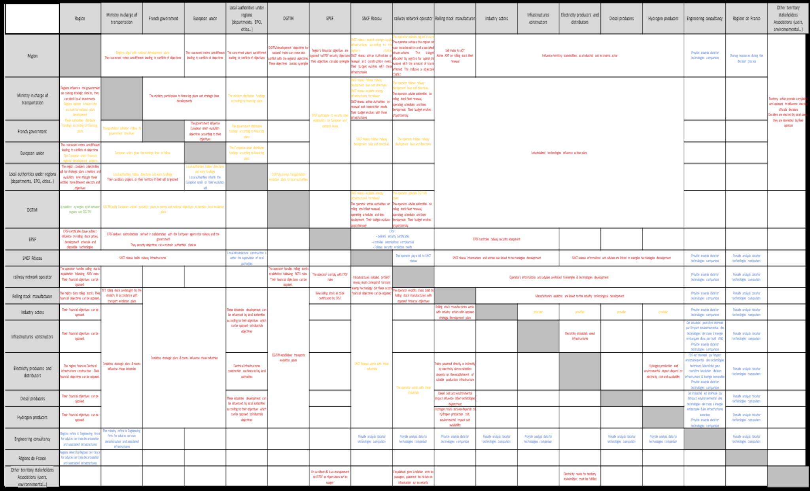</div></div><div class="methodology-item fragment fade-in" data-fragment-index="2"><h3>Pondération</h3><div class="methodology-visual"><table><thead><tr><th>Type de relation</th><th>Poids</th></tr></thead><tbody><tr><td style="color:#FFC000">Interdépendance</td><td>1</td></tr><tr><td style="color:#4472C4">Dépendance séquentielle</td><td>2</td></tr><tr><td style="color:#C00000">Réciprocité conflictuelle</td><td>3</td></tr><tr><td style="color:#70AD47">Réciprocité compatible</td><td>−1</td></tr></tbody></table></div></div><div class="methodology-item fragment fade-in" data-fragment-index="3"><h3>Design Structure Matrix (DSM)</h3><div class="methodology-visual"></div></div><div class="methodology-item fragment fade-in" data-fragment-index="4"><h3>Indicateurs</h3><div class="methodology-visual">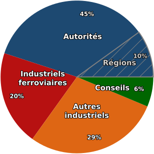</div></div><div class="methodology-item fragment fade-in" data-fragment-index="5"><h3>Regroupement</h3><div class="methodology-visual"></div></div></div>
<div class="methodology-bottom"><div class="fragment fade-in" data-fragment-index="0"><h3>Temporalité de la décision</h3>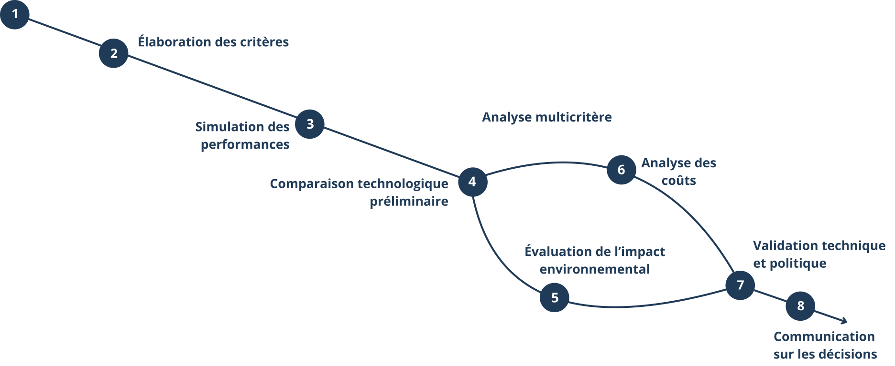</div><div class="fragment fade-in" data-fragment-index="6"><h3>Allocation temporelle</h3>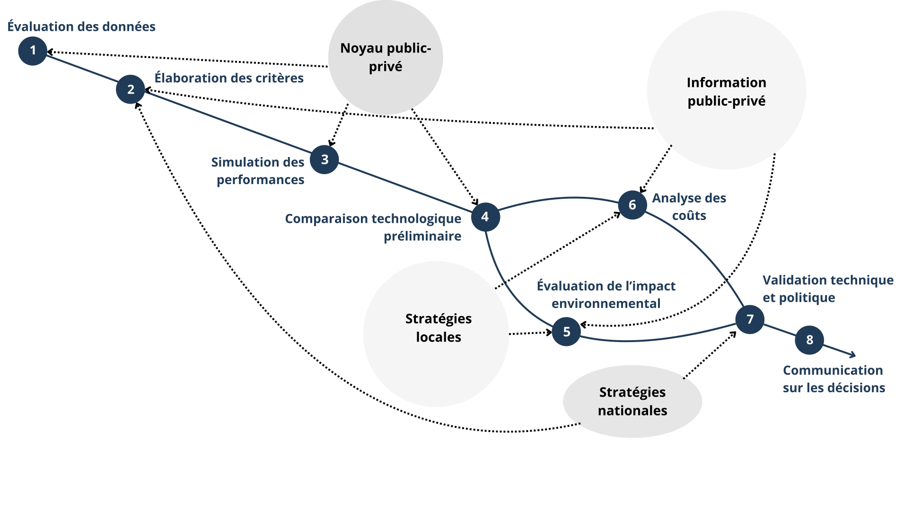</div></div>

::::

## Étapes de décision {.editorial data-auto-animate="true" data-auto-animate-id="decision-steps-detail" data-auto-animate-duration="0.7" data-part="2" data-subpart="1"}

<div class="slide-title">Étapes de décision</div>

<div class="ppt-canvas"></div>

## Modélisation du réseau d’acteurs {.editorial data-part="2" data-subpart="1" refs="tsvetkova-2019"}

<div class="slide-title">Modélisation du réseau d’acteurs</div>

<!-- Grand tableau : une cellule par ligne ; bloc HTML brut pour conserver l'indentation. -->
```{=html}
<div class="ppt-canvas">
<div class="ppt-table-wrap actor-matrix-small" style="left:5%;top:0%;width:90%;height:66%;">
<table class="ppt-table">
  <tr>
    <td style=""></td>
    <td style="background:#D9D9D9;color:#000000;font-size:var(--content-size)">Region</td>
    <td style="background:#D9D9D9;color:#000000;font-size:var(--content-size)">Ministry in charge of transportation</td>
    <td style="background:#D9D9D9;color:#000000;font-size:var(--content-size)">French government</td>
    <td style="background:#D9D9D9;color:#000000;font-size:var(--content-size)">European union</td>
    <td style="background:#D9D9D9;color:#000000;font-size:var(--content-size)">Local authorities under regions <br>(departments, EPCI, cities…)</td>
    <td style="background:#D9D9D9;color:#000000;font-size:var(--content-size)">DGTIM</td>
    <td style="background:#D9D9D9;color:#000000;font-size:var(--content-size)">EPSF</td>
    <td style="background:#D9D9D9;color:#000000;font-size:var(--content-size)">SNCF Réseau</td>
    <td style="background:#D9D9D9;color:#000000;font-size:var(--content-size)">railway network operator</td>
    <td style="background:#D9D9D9;color:#000000;font-size:var(--content-size)">Rolling stock manufacturer</td>
    <td style="background:#D9D9D9;color:#000000;font-size:var(--content-size)">Industry actors</td>
    <td style="background:#D9D9D9;color:#000000;font-size:var(--content-size)">Infrastructures constructors</td>
    <td style="background:#D9D9D9;color:#000000;font-size:var(--content-size)">Electricity producers and distributors</td>
    <td style="background:#D9D9D9;color:#000000;font-size:var(--content-size)">Diesel producers</td>
    <td style="background:#D9D9D9;color:#000000;font-size:var(--content-size)">Hydrogen producers</td>
    <td style="background:#D9D9D9;color:#000000;font-size:var(--content-size)">Engineering consultancy</td>
    <td style="background:#D9D9D9;color:#000000;font-size:var(--content-size)">Régions de France</td>
    <td style="background:#D9D9D9;color:#000000;font-size:var(--content-size)">Other territory stakeholders<br>Associations (users, environnemental…)</td>

  </tr>
  <tr>
    <td style="background:#D9D9D9;color:#000000;font-size:var(--content-size)">Région</td>
    <td style="background:#BFBFBF;color:#000000;font-size:var(--content-size)"> </td>
    <td style="color:#FFC000;font-size:var(--content-size)">Regions align with national development plans<br> The concerned voters are different leading to conflicts of objectives</td>
    <td style=""></td>
    <td style="color:#C00000;font-size:var(--content-size)">The concerned voters are different leading to conflicts of objectives </td>
    <td style="color:#C00000;font-size:var(--content-size)">The concerned voters are different leading to conflicts of objectives </td>
    <td style="color:#C00000;font-size:var(--content-size)">DGITM development objectives for national trains can come into conflict with the regional objectives. These objectives can also synergize</td>
    <td style="color:#C00000;font-size:var(--content-size)">Region’s financial objectives are opposed to EPSF security objectives. Their objectives can also synergize</td>
    <td style="color:#FFC000;font-size:var(--content-size)">SNCF réseau exploit energy supply infrastructures according to the region&#x27;s choices<br>SNCF réseau advise Authorities on renewal and construction needs. Their budget evolves with these infrastructures.</td>
    <td style="color:#FFC000;font-size:var(--content-size)">The operator operate region&#x27;s trains<br>The operator advises the region on train decarbonation and associated infrastructures. The budget allocated by regions for operators evolves with the amount of trains affected. This induces a objective conflict.</td>
    <td style="color:#C00000;font-size:var(--content-size)">Sell trains to AOT<br>Advise AOT on rolling stock fleet renewal</td>
    <td style="color:#C00000;font-size:var(--content-size)">Influence territory stakeholders as a industrial and economic actor</td>
    <td style=""></td>
    <td style=""></td>
    <td style=""></td>
    <td style=""></td>
    <td style="color:#4472C4;font-size:var(--content-size)">Provide analysis data for technologies comparison</td>
    <td style="color:#4472C4;font-size:var(--content-size)"><br>Sharing ressources during the decision process</td>
    <td style="color:#C00000;font-size:var(--content-size)">Territory actors provide complaints and opinions to influence elected officials&#x27; decisions<br>Deciders are elected by local users, they are interested by their opinions</td>

  </tr>
  <tr>
    <td style="background:#D9D9D9;color:#000000;font-size:var(--content-size)">Ministry in charge of transportation</td>
    <td style="color:#C00000;font-size:var(--content-size)">Regions influence the government on coming strategic choices, they can block local investments.<br>Regions opinion is taken into account for national plans development<br>These authorities distribute fundings according to financing plans</td>
    <td style="background:#BFBFBF;color:#000000;font-size:var(--content-size)"> </td>
    <td style="color:#C00000;font-size:var(--content-size)">The ministry participates to financing plans and strategic lines developments </td>
    <td style=""></td>
    <td style="color:#FFC000;font-size:var(--content-size)">The ministry distributes fundings according to financing plans</td>
    <td style="color:#000000;font-size:var(--content-size)"> </td>
    <td style="color:#FFC000;font-size:var(--content-size)">EPSF participate to security rules elaboration on European and national levels</td>
    <td style="color:#FFC000;font-size:var(--content-size)">SNCF réseau follows railway devlopment laws and directives.<br>SNCF réseau exploite energy infrastructures for railway.<br>SNCF réseau advise Authorities on renewal and construction needs. Their budget evolves with these infrastructures.</td>
    <td style="color:#FFC000;font-size:var(--content-size)">The operator follows railway devlopment laws and directives.<br>The operator advise authorities on rolling stock fleet renewal, operating schedules and lines devlopment. Their budget evolves proportionnaly.</td>
    <td style="color:#C00000;font-size:var(--content-size)">Industrialized technologies influence action plans</td>
    <td style=""></td>
    <td style=""></td>
    <td style=""></td>
    <td style=""></td>
    <td style=""></td>
    <td style="color:#4472C4;font-size:var(--content-size)"> </td>
    <td style="color:#70AD47;font-size:var(--content-size)"> </td>
    <td style=""></td>

  </tr>
  <tr>
    <td style="background:#D9D9D9;color:#000000;font-size:var(--content-size)">French government</td>
    <td style=""></td>
    <td style="color:#FFC000;font-size:var(--content-size)">Transportation Minister follow its government directives</td>
    <td style="background:#BFBFBF;color:#000000;font-size:var(--content-size)"> </td>
    <td style="color:#C00000;font-size:var(--content-size)">The government influence European union evolution objectives according to their objectives</td>
    <td style="color:#FFC000;font-size:var(--content-size)">The government distributes fundings according to financing plans</td>
    <td style="color:#000000;font-size:var(--content-size)"> </td>
    <td style=""></td>
    <td style="color:#FFC000;font-size:var(--content-size)">SNCF réseau follows railway devlopment laws and directives.</td>
    <td style="color:#FFC000;font-size:var(--content-size)">The operator follows railway devlopment laws and directives.</td>
    <td style=""></td>
    <td style=""></td>
    <td style=""></td>
    <td style=""></td>
    <td style=""></td>
    <td style=""></td>
    <td style="color:#000000;font-size:var(--content-size)"> </td>
    <td style="color:#000000;font-size:var(--content-size)"> </td>
    <td style=""></td>

  </tr>
  <tr>
    <td style="background:#D9D9D9;color:#000000;font-size:var(--content-size)">European union</td>
    <td style="color:#C00000;font-size:var(--content-size)">The concerned voters are different leading to conflicts of objectives <br>The European union finances regional development projects</td>
    <td style="color:#FFC000;font-size:var(--content-size)">European union gives the strategic lines to follow</td>
    <td style=""></td>
    <td style="background:#BFBFBF;color:#000000;font-size:var(--content-size)"> </td>
    <td style="color:#FFC000;font-size:var(--content-size)">The European union distributes fundings according to financing plans</td>
    <td style="color:#000000;font-size:var(--content-size)"> </td>
    <td style=""></td>
    <td style=""></td>
    <td style=""></td>
    <td style=""></td>
    <td style=""></td>
    <td style=""></td>
    <td style=""></td>
    <td style=""></td>
    <td style=""></td>
    <td style="color:#000000;font-size:var(--content-size)"> </td>
    <td style="color:#000000;font-size:var(--content-size)"> </td>
    <td style=""></td>

  </tr>
  <tr>
    <td style="background:#D9D9D9;color:#000000;font-size:var(--content-size)">Local authorities under regions <br>(departments, EPCI, cities…)</td>
    <td style="color:#C00000;font-size:var(--content-size)">The region considers collectivities will for strategic plans creations and evolutions even though these entities have different electors and objectives</td>
    <td style="color:#FFC000;font-size:var(--content-size)">Local authorities follow directives and earn fundings<br>They can block projects on their territory if their will is ignored</td>
    <td style=""></td>
    <td style="color:#FFC000;font-size:var(--content-size)">Local authorities follow directives and earn fundings<br>Local authorities inform the European union on their evolution will</td>
    <td style="background:#BFBFBF;color:#000000;font-size:var(--content-size)"> </td>
    <td style="color:#FFC000;font-size:var(--content-size)">DGITM conveys transportation evolution plans to local authorities</td>
    <td style="color:#000000;font-size:var(--content-size)"> </td>
    <td style=""></td>
    <td style="color:#000000;font-size:var(--content-size)"> </td>
    <td style=""></td>
    <td style=""></td>
    <td style=""></td>
    <td style=""></td>
    <td style=""></td>
    <td style=""></td>
    <td style="color:#000000;font-size:var(--content-size)"> </td>
    <td style="color:#000000;font-size:var(--content-size)"> </td>
    <td style=""></td>

  </tr>
  <tr>
    <td style="background:#D9D9D9;color:#000000;font-size:var(--content-size)">DGTIM</td>
    <td style="color:#70AD47;font-size:var(--content-size)">Acquisition synergies exist between regions and DGITM</td>
    <td style="color:#FFC000;font-size:var(--content-size)">DGITM adds European unions’ evolution plans to norms and national objectives to develop local evolution plans </td>
    <td style=""></td>
    <td style=""></td>
    <td style="color:#000000;font-size:var(--content-size)"> </td>
    <td style="background:#BFBFBF;color:#000000;font-size:var(--content-size)"> </td>
    <td style="color:#000000;font-size:var(--content-size)"> </td>
    <td style="color:#FFC000;font-size:var(--content-size)">SNCF réseau exploite energy infrastructures for railway.<br>The operator advise authorities on rolling stock fleet renewal, operating schedules and lines devlopment. Their budget evolves proportionnaly.</td>
    <td style="color:#FFC000;font-size:var(--content-size)">The operator operate DGTIM&#x27;s trains<br>The operator advise authorities on rolling stock fleet renewal, operating schedules and lines devlopment. Their budget evolves proportionnaly.</td>
    <td style=""></td>
    <td style=""></td>
    <td style=""></td>
    <td style=""></td>
    <td style=""></td>
    <td style=""></td>
    <td style="color:#000000;font-size:var(--content-size)"> </td>
    <td style="color:#000000;font-size:var(--content-size)"> </td>
    <td style="color:#000000;font-size:var(--content-size)"> </td>

  </tr>
  <tr>
    <td style="background:#D9D9D9;color:#000000;font-size:var(--content-size)">EPSF</td>
    <td style="color:#C00000;font-size:var(--content-size)">EPSF certificates have a direct influence on rolling stock prices, development schedule and disponible technologies</td>
    <td style="color:#C00000;font-size:var(--content-size)">EPSF delivers authorizations defined in collaboration with the European agency for railway and the government<br>They security objectives can constrain authorities’ choices</td>
    <td style=""></td>
    <td style=""></td>
    <td style="color:#000000;font-size:var(--content-size)"> </td>
    <td style="color:#000000;font-size:var(--content-size)"> </td>
    <td style="background:#BFBFBF;color:#000000;font-size:var(--content-size)"> </td>
    <td style="color:#4472C4;font-size:var(--content-size)">EPSF:<br>- delivers security certificates<br>- controles autorisations compliances<br>- Follows security evolution needs</td>
    <td style=""></td>
    <td style="color:#C00000;font-size:var(--content-size)">EPSF controles railway security equipment</td>
    <td style=""></td>
    <td style=""></td>
    <td style="color:#000000;font-size:var(--content-size)"> </td>
    <td style="color:#000000;font-size:var(--content-size)"> </td>
    <td style="color:#000000;font-size:var(--content-size)"> </td>
    <td style="color:#000000;font-size:var(--content-size)"> </td>
    <td style="color:#000000;font-size:var(--content-size)"> </td>
    <td style="color:#000000;font-size:var(--content-size)"> </td>

  </tr>
  <tr>
    <td style="background:#D9D9D9;color:#000000;font-size:var(--content-size)">SNCF Réseau</td>
    <td style="color:#C00000;font-size:var(--content-size)">SNCF réseau builds railway infrastructures</td>
    <td style=""></td>
    <td style=""></td>
    <td style=""></td>
    <td style="color:#4472C4;font-size:var(--content-size)">Local infrastructure construction is under the supervision of local authorities</td>
    <td style="color:#000000;font-size:var(--content-size)"> </td>
    <td style="color:#000000;font-size:var(--content-size)"> </td>
    <td style="background:#BFBFBF;color:#000000;font-size:var(--content-size)"> </td>
    <td style="color:#4472C4;font-size:var(--content-size)">The operator pay a toll to SNCF réseau</td>
    <td style="color:#C00000;font-size:var(--content-size)">SNCF réseau informations and advises are linked to technologies development</td>
    <td style=""></td>
    <td style=""></td>
    <td style="color:#C00000;font-size:var(--content-size)">SNCF réseau informations and advises are linked to energies technologies development</td>
    <td style=""></td>
    <td style=""></td>
    <td style="color:#4472C4;font-size:var(--content-size)">Provide analysis data for technologies comparison</td>
    <td style="color:#4472C4;font-size:var(--content-size)">Provide analysis data for technologies comparison</td>
    <td style="color:#000000;font-size:var(--content-size)"> </td>

  </tr>
  <tr>
    <td style="background:#D9D9D9;color:#000000;font-size:var(--content-size)">railway network operator</td>
    <td style="color:#C00000;font-size:var(--content-size)">The operator handles rolling stocks exploitation following AOTs&#x27; rules. Their financial objectives can be opposed.</td>
    <td style="color:#000000;font-size:var(--content-size)"> </td>
    <td style="color:#000000;font-size:var(--content-size)"> </td>
    <td style="color:#000000;font-size:var(--content-size)"> </td>
    <td style="color:#000000;font-size:var(--content-size)"> </td>
    <td style="color:#C00000;font-size:var(--content-size)">The operator handles rolling stocks exploitation following AOTs&#x27; rules. Their financial objectives can be opposed.</td>
    <td style="color:#C00000;font-size:var(--content-size)">The operator comply with EPSF rules</td>
    <td style="color:#C00000;font-size:var(--content-size)">Infrastructures installed by SNCF réseau must correspond to trains energy technology but these actors financial objectives can be opposed</td>
    <td style="background:#BFBFBF;color:#000000;font-size:var(--content-size)"> </td>
    <td style="color:#C00000;font-size:var(--content-size)">Operator&#x27;s informations and advises are linked to energies &amp; technologies development</td>
    <td style=""></td>
    <td style=""></td>
    <td style=""></td>
    <td style=""></td>
    <td style=""></td>
    <td style="color:#4472C4;font-size:var(--content-size)">Provide analysis data for technologies comparison</td>
    <td style="color:#4472C4;font-size:var(--content-size)">Provide analysis data for technologies comparison</td>
    <td style="color:#000000;font-size:var(--content-size)"> </td>

  </tr>
  <tr>
    <td style="background:#D9D9D9;color:#000000;font-size:var(--content-size)">Rolling stock manufacturer</td>
    <td style="color:#C00000;font-size:var(--content-size)">The region buys rolling stocks. Their financial objectives can be opposed.</td>
    <td style="color:#C00000;font-size:var(--content-size)">TET rolling stock are bought by the ministry in accordance with transport evolution plans</td>
    <td style="color:#C00000;font-size:var(--content-size)">Evolution strategic plans &amp; norms influence these industries</td>
    <td style=""></td>
    <td style="color:#C00000;font-size:var(--content-size)">These industries development can be influenced by local authorities according to their objectives which can be opposed to industrials objectives</td>
    <td style="color:#C00000;font-size:var(--content-size)">DGTIM establishes transports evolution plans</td>
    <td style="color:#C00000;font-size:var(--content-size)">New rolling stock as to be certificated by EPSF</td>
    <td style=""></td>
    <td style="color:#C00000;font-size:var(--content-size)">The operator exploits trains build by Rolling stock manufacturers with opposed financial objectives</td>
    <td style="background:#BFBFBF;color:#C00000;font-size:var(--content-size)"> </td>
    <td style="color:#C00000;font-size:var(--content-size)">Manufacturer&#x27;s solutions are linked to the industry technological development</td>
    <td style=""></td>
    <td style=""></td>
    <td style=""></td>
    <td style=""></td>
    <td style="color:#4472C4;font-size:var(--content-size)">Provide analysis data for technologies comparison</td>
    <td style="color:#4472C4;font-size:var(--content-size)">Provide analysis data for technologies comparison</td>
    <td style="color:#000000;font-size:var(--content-size)"> </td>

  </tr>
  <tr>
    <td style="background:#D9D9D9;color:#000000;font-size:var(--content-size)">Industry actors</td>
    <td style="color:#C00000;font-size:var(--content-size)">Their financial objectives can be opposed.</td>
    <td style="color:#C00000;font-size:var(--content-size)">Evolution strategic plans &amp; norms influence these industries</td>
    <td style=""></td>
    <td style=""></td>
    <td style=""></td>
    <td style=""></td>
    <td style="color:#C00000;font-size:var(--content-size)"> </td>
    <td style="color:#FFC000;font-size:var(--content-size)">SNCF Réseau works with these industrials</td>
    <td style="color:#C00000;font-size:var(--content-size)"> </td>
    <td style="color:#C00000;font-size:var(--content-size)">Rolling stock manufacturers works with industry actors with opposed strategic development plans</td>
    <td style="background:#BFBFBF;color:#000000;font-size:var(--content-size)"> </td>
    <td style="color:#FFC000;font-size:var(--content-size)">provider</td>
    <td style="color:#FFC000;font-size:var(--content-size)">provider</td>
    <td style="color:#FFC000;font-size:var(--content-size)">provider</td>
    <td style="color:#FFC000;font-size:var(--content-size)">provider</td>
    <td style="color:#4472C4;font-size:var(--content-size)">Provide analysis data for technologies comparison</td>
    <td style="color:#4472C4;font-size:var(--content-size)">Provide analysis data for technologies comparison</td>
    <td style="color:#000000;font-size:var(--content-size)"> </td>

  </tr>
  <tr>
    <td style="background:#D9D9D9;color:#000000;font-size:var(--content-size)">Infrastructures constructors</td>
    <td style="color:#C00000;font-size:var(--content-size)">Their financial objectives can be opposed.</td>
    <td style=""></td>
    <td style=""></td>
    <td style=""></td>
    <td style=""></td>
    <td style=""></td>
    <td style="color:#C00000;font-size:var(--content-size)"> </td>
    <td style=""></td>
    <td style="color:#C00000;font-size:var(--content-size)"> </td>
    <td style="color:#C00000;font-size:var(--content-size)"> </td>
    <td style="color:#000000;font-size:var(--content-size)"> </td>
    <td style="background:#BFBFBF;color:#000000;font-size:var(--content-size)"> </td>
    <td style="color:#C00000;font-size:var(--content-size)">Electricity industrials need infrastructures</td>
    <td style="color:#000000;font-size:var(--content-size)"> </td>
    <td style=""></td>
    <td style="color:#4472C4;font-size:var(--content-size)">Cet industriel peut-être intéressé par l&#x27;impact environnemental des technologies de trains à énergie embarquée donc par l&#x27;outil d&#x27;AD<br>Provide analysis data for technologies comparison</td>
    <td style="color:#4472C4;font-size:var(--content-size)">Provide analysis data for technologies comparison</td>
    <td style="color:#000000;font-size:var(--content-size)"> </td>

  </tr>
  <tr>
    <td style="background:#D9D9D9;color:#000000;font-size:var(--content-size)">Electricity producers and distributors</td>
    <td style="color:#C00000;font-size:var(--content-size)">The region finances Electrical infrastructure construction . Their financial objectives can be opposed.</td>
    <td style=""></td>
    <td style=""></td>
    <td style=""></td>
    <td style="color:#C00000;font-size:var(--content-size)">Electrical infrastructures construction are financed by local authorities</td>
    <td style=""></td>
    <td style="color:#C00000;font-size:var(--content-size)"> </td>
    <td style=""></td>
    <td style="color:#FFC000;font-size:var(--content-size)">The operator works with these industrials</td>
    <td style="color:#C00000;font-size:var(--content-size)">Trains powered directly or indirectly by electricity democratization depends on the establishment of suitable production infrastructure </td>
    <td style="color:#000000;font-size:var(--content-size)"> </td>
    <td style="color:#000000;font-size:var(--content-size)"> </td>
    <td style="background:#BFBFBF;color:#000000;font-size:var(--content-size)"> </td>
    <td style="color:#000000;font-size:var(--content-size)"> </td>
    <td style="color:#C00000;font-size:var(--content-size)">Hydrogen production and environmental impact depend on electricity cost and availability</td>
    <td style="color:#4472C4;font-size:var(--content-size)">EDF est interessé par l&#x27;impact environnemental des technologies favorisant l&#x27;électricité pour connaître l&#x27;évolution de leurs infrastructure &amp; énergie demandée<br>Provide analysis data for technologies comparison</td>
    <td style="color:#4472C4;font-size:var(--content-size)">Provide analysis data for technologies comparison</td>
    <td style="color:#000000;font-size:var(--content-size)"> </td>

  </tr>
  <tr>
    <td style="background:#D9D9D9;color:#000000;font-size:var(--content-size)">Diesel producers</td>
    <td style="color:#C00000;font-size:var(--content-size)">Their financial objectives can be opposed.</td>
    <td style=""></td>
    <td style=""></td>
    <td style=""></td>
    <td style="color:#C00000;font-size:var(--content-size)">These industries development can be influenced by local authorities according to their objectives which can be opposed to industrials objectives</td>
    <td style=""></td>
    <td style="color:#C00000;font-size:var(--content-size)"> </td>
    <td style=""></td>
    <td style=""></td>
    <td style="color:#C00000;font-size:var(--content-size)">Diesel cost and environmental impact influence other technologies deployment</td>
    <td style="color:#000000;font-size:var(--content-size)"> </td>
    <td style="color:#000000;font-size:var(--content-size)"> </td>
    <td style="color:#000000;font-size:var(--content-size)"> </td>
    <td style="background:#BFBFBF;color:#000000;font-size:var(--content-size)"> </td>
    <td style="color:#C00000;font-size:var(--content-size)"> </td>
    <td style="color:#4472C4;font-size:var(--content-size)">Cet industriel est intéressé par l&#x27;impact environnemental des technologies de trains à énergie embarquée &amp; les infrastructures associées <br>Provide analysis data for technologies comparison</td>
    <td style="color:#4472C4;font-size:var(--content-size)">Provide analysis data for technologies comparison</td>
    <td style="color:#000000;font-size:var(--content-size)"> </td>

  </tr>
  <tr>
    <td style="background:#D9D9D9;color:#000000;font-size:var(--content-size)">Hydrogen producers</td>
    <td style="color:#C00000;font-size:var(--content-size)">Their financial objectives can be opposed.</td>
    <td style=""></td>
    <td style=""></td>
    <td style=""></td>
    <td style=""></td>
    <td style=""></td>
    <td style="color:#C00000;font-size:var(--content-size)"> </td>
    <td style=""></td>
    <td style=""></td>
    <td style="color:#C00000;font-size:var(--content-size)">Hydrogen trains success depends on hydrogen production cost, environmental impact and availability</td>
    <td style="color:#000000;font-size:var(--content-size)"> </td>
    <td style="color:#000000;font-size:var(--content-size)"> </td>
    <td style="color:#000000;font-size:var(--content-size)"> </td>
    <td style="color:#000000;font-size:var(--content-size)"> </td>
    <td style="background:#BFBFBF;color:#C00000;font-size:var(--content-size)"> </td>
    <td style=""></td>
    <td style="color:#4472C4;font-size:var(--content-size)">Provide analysis data for technologies comparison</td>
    <td style="color:#000000;font-size:var(--content-size)"> </td>

  </tr>
  <tr>
    <td style="background:#D9D9D9;color:#000000;font-size:var(--content-size)">Engineering consultancy</td>
    <td style="color:#4472C4;font-size:var(--content-size)">Regions refers to Engineering firms for advices on train decarbonation and associated infrastructures</td>
    <td style="color:#4472C4;font-size:var(--content-size)">The ministry refers to Engineering firms for advices on train decarbonation and associated infrastructures</td>
    <td style="color:#000000;font-size:var(--content-size)"> </td>
    <td style="color:#000000;font-size:var(--content-size)"> </td>
    <td style="color:#000000;font-size:var(--content-size)"> </td>
    <td style="color:#C00000;font-size:var(--content-size)"> </td>
    <td style="color:#C00000;font-size:var(--content-size)"> </td>
    <td style="color:#4472C4;font-size:var(--content-size)">Provide analysis data for technologies comparison</td>
    <td style="color:#4472C4;font-size:var(--content-size)">Provide analysis data for technologies comparison</td>
    <td style="color:#4472C4;font-size:var(--content-size)">Provide analysis data for technologies comparison</td>
    <td style="color:#4472C4;font-size:var(--content-size)">Provide analysis data for technologies comparison</td>
    <td style="color:#4472C4;font-size:var(--content-size)">Provide analysis data for technologies comparison</td>
    <td style="color:#000000;font-size:var(--content-size)"> </td>
    <td style="color:#4472C4;font-size:var(--content-size)">Provide analysis data for technologies comparison</td>
    <td style="color:#4472C4;font-size:var(--content-size)">Provide analysis data for technologies comparison</td>
    <td style="background:#BFBFBF;color:#000000;font-size:var(--content-size)"> </td>
    <td style="color:#4472C4;font-size:var(--content-size)">Provide analysis data for technologies comparison</td>
    <td style="color:#000000;font-size:var(--content-size)"> </td>

  </tr>
  <tr>
    <td style="background:#D9D9D9;color:#000000;font-size:var(--content-size)">Régions de France</td>
    <td style="color:#4472C4;font-size:var(--content-size)">Regions refers to Régions de France for advices on train decarbonation and associated infrastructures</td>
    <td style="color:#000000;font-size:var(--content-size)"> </td>
    <td style="color:#000000;font-size:var(--content-size)"> </td>
    <td style="color:#000000;font-size:var(--content-size)"> </td>
    <td style="color:#000000;font-size:var(--content-size)"> </td>
    <td style="color:#C00000;font-size:var(--content-size)"> </td>
    <td style="color:#C00000;font-size:var(--content-size)"> </td>
    <td style="color:#4472C4;font-size:var(--content-size)"> </td>
    <td style="color:#4472C4;font-size:var(--content-size)"> </td>
    <td style="color:#4472C4;font-size:var(--content-size)"> </td>
    <td style="color:#4472C4;font-size:var(--content-size)"> </td>
    <td style="color:#4472C4;font-size:var(--content-size)"> </td>
    <td style="color:#000000;font-size:var(--content-size)"> </td>
    <td style="color:#4472C4;font-size:var(--content-size)"> </td>
    <td style="color:#4472C4;font-size:var(--content-size)"> </td>
    <td style="color:#000000;font-size:var(--content-size)"> </td>
    <td style="background:#BFBFBF;color:#000000;font-size:var(--content-size)"> </td>
    <td style="color:#000000;font-size:var(--content-size)"> </td>

  </tr>
  <tr>
    <td style="background:#D9D9D9;color:#000000;font-size:var(--content-size)">Other territory stakeholders<br>Associations (users, environnemental…)</td>
    <td style="color:#000000;font-size:var(--content-size)"> </td>
    <td style="color:#000000;font-size:var(--content-size)"> </td>
    <td style="color:#000000;font-size:var(--content-size)"> </td>
    <td style="color:#000000;font-size:var(--content-size)"> </td>
    <td style="color:#000000;font-size:var(--content-size)"> </td>
    <td style="color:#C00000;font-size:var(--content-size)"> </td>
    <td style="color:#C00000;font-size:var(--content-size)">Un accident dû à un manquement de l&#x27;EPSF se répercutera sur les usager</td>
    <td style="color:#C00000;font-size:var(--content-size)"> </td>
    <td style="color:#C00000;font-size:var(--content-size)">L&#x27;exploitant gère la relation avec les passagers, paiement des tickets et information sur les retards</td>
    <td style="color:#C00000;font-size:var(--content-size)"> </td>
    <td style="color:#000000;font-size:var(--content-size)"> </td>
    <td style="color:#000000;font-size:var(--content-size)"> </td>
    <td style="color:#C00000;font-size:var(--content-size)">Electricity needs for territory stakeholders must be fulfilled</td>
    <td style="color:#000000;font-size:var(--content-size)"> </td>
    <td style="color:#000000;font-size:var(--content-size)"> </td>
    <td style="color:#000000;font-size:var(--content-size)"> </td>
    <td style="color:#000000;font-size:var(--content-size)"> </td>
    <td style="background:#BFBFBF;color:#000000;font-size:var(--content-size)"> </td>

  </tr>
</table>
</div>

<div class="ppt-table-wrap relation-type-legend" style="left:4%;top:70%;width:92%;">
<table class="ppt-table">
  <tr>
    <td style="font-size:var(--content-size);font-weight:700">Relation interdépendante</td>
    <td style="color:#FFC000;font-size:var(--content-size);font-weight:700">Commune</td>
    <td style="color:#4472C4;font-size:var(--content-size);font-weight:700">Séquentielle</td>
    <td style="color:#70AD47;font-size:var(--content-size);font-weight:700">Réciproque-compatible</td>
    <td style="color:#C00000;font-size:var(--content-size);font-weight:700">Réciproque-contentieux</td>

  </tr>
  <tr>
    <td style="font-size:var(--content-size);font-weight:700">Poids</td>
    <td style="font-size:var(--content-size);font-weight:700">1</td>
    <td style="font-size:var(--content-size);font-weight:700">2</td>
    <td style="font-size:var(--content-size);font-weight:700">-1</td>
    <td style="font-size:var(--content-size);font-weight:700">3</td>

  </tr>

  <tr>
    <td style="font-size:var(--content-size);font-weight:700">Définition</td>
    <td style="font-size:var(--content-size);line-height:1.2"><span class="fragment fade-in" data-fragment-index="0">Activités nécessaires au résultat commun sans dépendance technique ni temporelle.</span></td>
    <td style="font-size:var(--content-size);line-height:1.2"><span class="fragment fade-in" data-fragment-index="1">Une tâche attend l’achèvement partiel ou complet d’une tâche préalable.</span></td>
    <td style="font-size:var(--content-size);line-height:1.2"><span class="fragment fade-in" data-fragment-index="2">Un ajustement mutuel aligne les résultats sans conflit d’objectifs.</span></td>
    <td style="font-size:var(--content-size);line-height:1.2"><span class="fragment fade-in" data-fragment-index="3">Un ajustement mutuel aligne les résultats malgré des objectifs conflictuels.</span></td>
  </tr>
</table>
</div></div>
```


## DSM du poids des relations entre acteurs {.editorial data-part="2" data-subpart="1"}

<div class="slide-title">DSM du poids des relations entre acteurs</div>

```{=html}
<div class="ppt-canvas">
<!-- Copie des colonnes ID / acteur de la diapo des résultats ; mêmes couleurs ; ordre croissant des identifiants. -->
<div class="actor-key-frame"><table class="actor-key-table" aria-label="Correspondance des identifiants et des acteurs">
<colgroup><col style="width:14%"><col style="width:86%"></colgroup><thead>
<tr><th data-cell="A1" style="background-color:transparent;color:#000000;font-weight:700;border-left:2px solid #000000;border-right:2px solid #000000;border-top:2px solid #000000;border-bottom:2px solid #000000" rowspan="2" colspan="1" scope="col">ID acteur</th><th data-cell="B1" style="background-color:transparent;color:#000000;font-weight:700;border-left:2px solid #000000;border-right:2px solid #000000;border-top:2px solid #000000;border-bottom:2px solid #000000" rowspan="2" colspan="1" scope="col">Nom de l’acteur</th></tr>
<tr></tr>
</thead><tbody>
<tr><td data-cell="A3" style="background-color:transparent;color:#000000;font-weight:700;border-left:2px solid #000000;border-right:2px solid #000000;border-top:2px solid #000000;border-bottom:2px solid #000000">A1</td><td data-cell="B3" style="background-color:transparent;color:#1D4971;font-weight:700;border-left:2px solid #000000;border-right:2px solid #000000;border-top:2px solid #000000;border-bottom:2px solid #000000">Région</td></tr>
<tr><td data-cell="A4" style="background-color:transparent;color:#000000;font-weight:700;border-left:2px solid #000000;border-right:2px solid #000000;border-top:2px solid #000000;border-bottom:2px solid #000000">A2</td><td data-cell="B4" style="background-color:transparent;color:#1D4971;font-weight:700;border-left:2px solid #000000;border-right:2px solid #000000;border-top:2px solid #000000;border-bottom:2px solid #000000">Ministère chargé des transports</td></tr>
<tr><td data-cell="A7" style="background-color:transparent;color:#000000;font-weight:700;border-left:2px solid #000000;border-right:2px solid #000000;border-top:2px solid #000000;border-bottom:2px solid #000000">A3</td><td data-cell="B7" style="background-color:transparent;color:#1D4971;font-weight:700;border-left:2px solid #000000;border-right:2px solid #000000;border-top:2px solid #000000;border-bottom:2px solid #000000">Gouvernement français</td></tr>
<tr><td data-cell="A9" style="background-color:transparent;color:#000000;font-weight:700;border-left:2px solid #000000;border-right:2px solid #000000;border-top:2px solid #000000;border-bottom:2px solid #000000">A4</td><td data-cell="B9" style="background-color:transparent;color:#1D4971;font-weight:700;border-left:2px solid #000000;border-right:2px solid #000000;border-top:2px solid #000000;border-bottom:2px solid #000000">Union européenne</td></tr>
<tr><td data-cell="A5" style="background-color:transparent;color:#000000;font-weight:700;border-left:2px solid #000000;border-right:2px solid #000000;border-top:2px solid #000000;border-bottom:2px solid #000000">A5</td><td data-cell="B5" style="background-color:transparent;color:#B71111;font-weight:700;border-left:2px solid #000000;border-right:2px solid #000000;border-top:2px solid #000000;border-bottom:2px solid #000000">Constructeur de matériel roulant</td></tr>
<tr><td data-cell="A8" style="background-color:transparent;color:#000000;font-weight:700;border-left:2px solid #000000;border-right:2px solid #000000;border-top:2px solid #000000;border-bottom:2px solid #000000">A6</td><td data-cell="B8" style="background-color:transparent;color:#DE6614;font-weight:700;border-left:2px solid #000000;border-right:2px solid #000000;border-top:2px solid #000000;border-bottom:2px solid #000000">Producteurs et distributeurs d’électricité</td></tr>
<tr><td data-cell="A12" style="background-color:transparent;color:#000000;font-weight:700;border-left:2px solid #000000;border-right:2px solid #000000;border-top:2px solid #000000;border-bottom:2px solid #000000">A7</td><td data-cell="B12" style="background-color:transparent;color:#DE6614;font-weight:700;border-left:2px solid #000000;border-right:2px solid #000000;border-top:2px solid #000000;border-bottom:2px solid #000000">Producteurs d’hydrogène</td></tr>
<tr><td data-cell="A13" style="background-color:transparent;color:#000000;font-weight:700;border-left:2px solid #000000;border-right:2px solid #000000;border-top:2px solid #000000;border-bottom:2px solid #000000">A8</td><td data-cell="B13" style="background-color:transparent;color:#DE6614;font-weight:700;border-left:2px solid #000000;border-right:2px solid #000000;border-top:2px solid #000000;border-bottom:2px solid #000000">Constructeurs d’infrastructures</td></tr>
<tr><td data-cell="A11" style="background-color:transparent;color:#000000;font-weight:700;border-left:2px solid #000000;border-right:2px solid #000000;border-top:2px solid #000000;border-bottom:2px solid #000000">A9</td><td data-cell="B11" style="background-color:transparent;color:#DE6614;font-weight:700;border-left:2px solid #000000;border-right:2px solid #000000;border-top:2px solid #000000;border-bottom:2px solid #000000">Acteurs industriels</td></tr>
<tr><td data-cell="A14" style="background-color:transparent;color:#000000;font-weight:700;border-left:2px solid #000000;border-right:2px solid #000000;border-top:2px solid #000000;border-bottom:2px solid #000000">A10</td><td data-cell="B14" style="background-color:transparent;color:#DE6614;font-weight:700;border-left:2px solid #000000;border-right:2px solid #000000;border-top:2px solid #000000;border-bottom:2px solid #000000">Producteurs de diesel</td></tr>
<tr><td data-cell="A6" style="background-color:transparent;color:#000000;font-weight:700;border-left:2px solid #000000;border-right:2px solid #000000;border-top:2px solid #000000;border-bottom:2px solid #000000">A11</td><td data-cell="B6" style="background-color:transparent;color:#B71111;font-weight:700;border-left:2px solid #000000;border-right:2px solid #000000;border-top:2px solid #000000;border-bottom:2px solid #000000">SNCF Réseau</td></tr>
<tr><td data-cell="A10" style="background-color:transparent;color:#000000;font-weight:700;border-left:2px solid #000000;border-right:2px solid #000000;border-top:2px solid #000000;border-bottom:2px solid #000000">A12</td><td data-cell="B10" style="background-color:transparent;color:#B71111;font-weight:700;border-left:2px solid #000000;border-right:2px solid #000000;border-top:2px solid #000000;border-bottom:2px solid #000000">Exploitant du réseau ferroviaire</td></tr>
<tr><td data-cell="A15" style="background-color:transparent;color:#000000;font-weight:700;border-left:2px solid #000000;border-right:2px solid #000000;border-top:2px solid #000000;border-bottom:2px solid #000000">A13</td><td data-cell="B15" style="background-color:transparent;color:#1D4971;font-weight:700;border-left:2px solid #000000;border-right:2px solid #000000;border-top:2px solid #000000;border-bottom:2px solid #000000">DGITM</td></tr>
<tr><td data-cell="A16" style="background-color:transparent;color:#000000;font-weight:700;border-left:2px solid #000000;border-right:2px solid #000000;border-top:2px solid #000000;border-bottom:2px solid #000000">A14</td><td data-cell="B16" style="background-color:transparent;color:#4D7731;font-weight:700;border-left:2px solid #000000;border-right:2px solid #000000;border-top:2px solid #000000;border-bottom:2px solid #000000">Bureau d’études en ingénierie</td></tr>
<tr><td data-cell="A22" style="background-color:transparent;color:#000000;font-weight:700;border-left:2px solid #000000;border-right:2px solid #000000;border-top:2px solid #000000;border-bottom:2px solid #000000">A15</td><td data-cell="B22" style="background-color:transparent;color:#4D7731;font-weight:700;border-left:2px solid #000000;border-right:2px solid #000000;border-top:2px solid #000000;border-bottom:2px solid #000000">Régions de France</td></tr>
<tr><td data-cell="A17" style="background-color:transparent;color:#000000;font-weight:700;border-left:2px solid #000000;border-right:2px solid #000000;border-top:2px solid #000000;border-bottom:2px solid #000000">A16</td><td data-cell="B17" style="background-color:transparent;color:#1D4971;font-weight:700;border-left:2px solid #000000;border-right:2px solid #000000;border-top:2px solid #000000;border-bottom:2px solid #000000">EPSF</td></tr>
<tr><td data-cell="A20" style="background-color:transparent;color:#000000;font-weight:700;border-left:2px solid #000000;border-right:2px solid #000000;border-top:2px solid #000000;border-bottom:2px solid #000000" rowspan="2" colspan="1">A17</td><td data-cell="B20" style="background-color:transparent;color:#1D4971;font-weight:700;border-left:2px solid #000000;border-right:2px solid #000000;border-top:2px solid #000000">Autres parties prenantes du territoire</td></tr>
<tr><td data-cell="B21" style="background-color:transparent;color:#1D4971;font-weight:700;border-left:2px solid #000000;border-right:2px solid #000000;border-bottom:2px solid #000000">Associations (usagers, environnement…)</td></tr>
<tr><td data-cell="A18" style="background-color:transparent;color:#000000;font-weight:700;border-left:2px solid #000000;border-right:2px solid #000000;border-top:2px solid #000000;border-bottom:2px solid #000000" rowspan="2" colspan="1">A18</td><td data-cell="B18" style="background-color:transparent;color:#1D4971;font-weight:700;border-left:2px solid #000000;border-right:2px solid #000000;border-top:2px solid #000000">Collectivités territoriales infrarégionales</td></tr>
<tr><td data-cell="B19" style="background-color:transparent;color:#1D4971;font-weight:700;border-left:2px solid #000000;border-right:2px solid #000000;border-bottom:2px solid #000000">(départements, EPCI, communes…)</td></tr>
</tbody></table></div>
<div class="dsm-table-frame" style="left:37%;top:13%;width:62%;height:71%;">
<table class="dsm-table" aria-label="DSM du poids des relations entre acteurs" data-sheet="Feuil1 (2)"><tbody>
<tr><th data-cell="A1" style="background-color:transparent;color:#000000;font-weight:400" scope="col"></th><th data-cell="L1" style="background-color:transparent;color:#000000;font-weight:700" scope="col">A1</th><th data-cell="K1" style="background-color:transparent;color:#000000;font-weight:700" scope="col">A2</th><th data-cell="M1" style="background-color:transparent;color:#000000;font-weight:700" scope="col">A3</th><th data-cell="N1" style="background-color:transparent;color:#000000;font-weight:700" scope="col">A4</th><th data-cell="I1" style="background-color:transparent;color:#000000;font-weight:700" scope="col">A5</th><th data-cell="P1" style="background-color:transparent;color:#000000;font-weight:700" scope="col">A6</th><th data-cell="B1" style="background-color:transparent;color:#000000;font-weight:700" scope="col">A7</th><th data-cell="S1" style="background-color:transparent;color:#000000;font-weight:700" scope="col">A8</th><th data-cell="C1" style="background-color:transparent;color:#000000;font-weight:700" scope="col">A9</th><th data-cell="D1" style="background-color:transparent;color:#000000;font-weight:700" scope="col">A10</th><th data-cell="G1" style="background-color:transparent;color:#000000;font-weight:700" scope="col">A11</th><th data-cell="H1" style="background-color:transparent;color:#000000;font-weight:700" scope="col">A12</th><th data-cell="J1" style="background-color:transparent;color:#000000;font-weight:700" scope="col">A13</th><th data-cell="E1" style="background-color:transparent;color:#000000;font-weight:700" scope="col">A14</th><th data-cell="F1" style="background-color:transparent;color:#000000;font-weight:700" scope="col">A15</th><th data-cell="Q1" style="background-color:transparent;color:#000000;font-weight:700" scope="col">A16</th><th data-cell="R1" style="background-color:transparent;color:#000000;font-weight:700" scope="col">A17</th><th data-cell="O1" style="background-color:transparent;color:#000000;font-weight:700" scope="col">A18</th></tr>
<tr><th data-cell="A12" style="background-color:transparent;color:#000000;font-weight:700" scope="row">A1</th><td data-cell="L12" style="background-color:transparent;color:#000000;font-weight:400"></td><td data-cell="K12" style="background-color:#CAE8D4;color:#000000;font-weight:400">4</td><td data-cell="M12" style="background-color:#CAE8D4;color:#000000;font-weight:400">4</td><td data-cell="N12" style="background-color:#FCFCFF;color:#000000;font-weight:400">3</td><td data-cell="I12" style="background-color:#63BE7B;color:#000000;font-weight:400">6</td><td data-cell="P12" style="background-color:#FCFCFF;color:#000000;font-weight:400">3</td><td data-cell="B12" style="background-color:#FCFCFF;color:#000000;font-weight:400">3</td><td data-cell="S12" style="background-color:#FCFCFF;color:#000000;font-weight:400">3</td><td data-cell="C12" style="background-color:#FCFCFF;color:#000000;font-weight:400">3</td><td data-cell="D12" style="background-color:#FCFCFF;color:#000000;font-weight:400">3</td><td data-cell="G12" style="background-color:#CAE8D4;color:#000000;font-weight:400">4</td><td data-cell="H12" style="background-color:#CAE8D4;color:#000000;font-weight:400">4</td><td data-cell="J12" style="background-color:#FCFCFF;color:#000000;font-weight:400">3</td><td data-cell="E12" style="background-color:#FBD7DA;color:#000000;font-weight:400">2</td><td data-cell="F12" style="background-color:#FBD7DA;color:#000000;font-weight:400">2</td><td data-cell="Q12" style="background-color:#FCFCFF;color:#000000;font-weight:400">3</td><td data-cell="R12" style="background-color:#FCFCFF;color:#000000;font-weight:400">3</td><td data-cell="O12" style="background-color:#FCFCFF;color:#000000;font-weight:400">3</td></tr>
<tr><th data-cell="A11" style="background-color:transparent;color:#000000;font-weight:700" scope="row">A2</th><td data-cell="L11" style="background-color:#CAE8D4;color:#000000;font-weight:400">4</td><td data-cell="K11" style="background-color:transparent;color:#000000;font-weight:400"></td><td data-cell="M11" style="background-color:#FCFCFF;color:#000000;font-weight:400">3</td><td data-cell="N11" style="background-color:#FCFCFF;color:#000000;font-weight:400">3</td><td data-cell="I11" style="background-color:#FAB2B5;color:#000000;font-weight:400">1</td><td data-cell="P11" style="background-color:#FCFCFF;color:#000000;font-weight:400">3</td><td data-cell="B11" style="background-color:#FCFCFF;color:#000000;font-weight:400">3</td><td data-cell="S11" style="background-color:#FCFCFF;color:#000000;font-weight:400">3</td><td data-cell="C11" style="background-color:#FCFCFF;color:#000000;font-weight:400">3</td><td data-cell="D11" style="background-color:#FCFCFF;color:#000000;font-weight:400">3</td><td data-cell="G11" style="background-color:#CAE8D4;color:#000000;font-weight:400">4</td><td data-cell="H11" style="background-color:#97D3A8;color:#000000;font-weight:400">5</td><td data-cell="J11" style="background-color:transparent;color:#000000;font-weight:400"></td><td data-cell="E11" style="background-color:transparent;color:#000000;font-weight:700;font-size:1.565em"></td><td data-cell="F11" style="background-color:transparent;color:#000000;font-weight:700;font-size:1.565em"></td><td data-cell="Q11" style="background-color:#FAB2B5;color:#000000;font-weight:400">1</td><td data-cell="R11" style="background-color:#FCFCFF;color:#000000;font-weight:400">3</td><td data-cell="O11" style="background-color:#FAB2B5;color:#000000;font-weight:400">1</td></tr>
<tr><th data-cell="A13" style="background-color:transparent;color:#000000;font-weight:700" scope="row">A3</th><td data-cell="L13" style="background-color:#CAE8D4;color:#000000;font-weight:400">4</td><td data-cell="K13" style="background-color:#FAB2B5;color:#000000;font-weight:400">1</td><td data-cell="M13" style="background-color:transparent;color:#000000;font-weight:400"></td><td data-cell="N13" style="background-color:#FCFCFF;color:#000000;font-weight:400">3</td><td data-cell="I13" style="background-color:#FAB2B5;color:#000000;font-weight:400">1</td><td data-cell="P13" style="background-color:#FCFCFF;color:#000000;font-weight:400">3</td><td data-cell="B13" style="background-color:#FCFCFF;color:#000000;font-weight:400">3</td><td data-cell="S13" style="background-color:#FCFCFF;color:#000000;font-weight:400">3</td><td data-cell="C13" style="background-color:#FCFCFF;color:#000000;font-weight:400">3</td><td data-cell="D13" style="background-color:#FCFCFF;color:#000000;font-weight:400">3</td><td data-cell="G13" style="background-color:#FAB2B5;color:#000000;font-weight:400">1</td><td data-cell="H13" style="background-color:#FAB2B5;color:#000000;font-weight:400">1</td><td data-cell="J13" style="background-color:transparent;color:#000000;font-weight:400"></td><td data-cell="E13" style="background-color:transparent;color:#000000;font-weight:400"></td><td data-cell="F13" style="background-color:transparent;color:#000000;font-weight:400"></td><td data-cell="Q13" style="background-color:#FAB2B5;color:#000000;font-weight:400">1</td><td data-cell="R13" style="background-color:#FCFCFF;color:#000000;font-weight:400">3</td><td data-cell="O13" style="background-color:#FAB2B5;color:#000000;font-weight:400">1</td></tr>
<tr><th data-cell="A14" style="background-color:transparent;color:#000000;font-weight:700" scope="row">A4</th><td data-cell="L14" style="background-color:#CAE8D4;color:#000000;font-weight:400">4</td><td data-cell="K14" style="background-color:#FAB2B5;color:#000000;font-weight:400">1</td><td data-cell="M14" style="background-color:#FAB2B5;color:#000000;font-weight:400">1</td><td data-cell="N14" style="background-color:transparent;color:#000000;font-weight:400"></td><td data-cell="I14" style="background-color:#FAB2B5;color:#000000;font-weight:400">1</td><td data-cell="P14" style="background-color:#FCFCFF;color:#000000;font-weight:400">3</td><td data-cell="B14" style="background-color:#FCFCFF;color:#000000;font-weight:400">3</td><td data-cell="S14" style="background-color:#FCFCFF;color:#000000;font-weight:400">3</td><td data-cell="C14" style="background-color:#FCFCFF;color:#000000;font-weight:400">3</td><td data-cell="D14" style="background-color:#FCFCFF;color:#000000;font-weight:400">3</td><td data-cell="G14" style="background-color:#FAB2B5;color:#000000;font-weight:400">1</td><td data-cell="H14" style="background-color:#FAB2B5;color:#000000;font-weight:400">1</td><td data-cell="J14" style="background-color:transparent;color:#000000;font-weight:400"></td><td data-cell="E14" style="background-color:transparent;color:#000000;font-weight:400"></td><td data-cell="F14" style="background-color:transparent;color:#000000;font-weight:400"></td><td data-cell="Q14" style="background-color:#FAB2B5;color:#000000;font-weight:400">1</td><td data-cell="R14" style="background-color:#FCFCFF;color:#000000;font-weight:400">3</td><td data-cell="O14" style="background-color:#FAB2B5;color:#000000;font-weight:400">1</td></tr>
<tr><th data-cell="A9" style="background-color:transparent;color:#000000;font-weight:700" scope="row">A5</th><td data-cell="L9" style="background-color:#FCFCFF;color:#000000;font-weight:400">3</td><td data-cell="K9" style="background-color:#FCFCFF;color:#000000;font-weight:400">3</td><td data-cell="M9" style="background-color:#FCFCFF;color:#000000;font-weight:400">3</td><td data-cell="N9" style="background-color:#FCFCFF;color:#000000;font-weight:400">3</td><td data-cell="I9" style="background-color:transparent;color:#000000;font-weight:400"></td><td data-cell="P9" style="background-color:#FCFCFF;color:#000000;font-weight:400">3</td><td data-cell="B9" style="background-color:#FCFCFF;color:#000000;font-weight:400">3</td><td data-cell="S9" style="background-color:#FCFCFF;color:#000000;font-weight:400">3</td><td data-cell="C9" style="background-color:#FCFCFF;color:#000000;font-weight:400">3</td><td data-cell="D9" style="background-color:#FCFCFF;color:#000000;font-weight:400">3</td><td data-cell="G9" style="background-color:#FCFCFF;color:#000000;font-weight:400">3</td><td data-cell="H9" style="background-color:#FCFCFF;color:#000000;font-weight:400">3</td><td data-cell="J9" style="background-color:#FCFCFF;color:#000000;font-weight:400">3</td><td data-cell="E9" style="background-color:#FBD7DA;color:#000000;font-weight:400">2</td><td data-cell="F9" style="background-color:#FBD7DA;color:#000000;font-weight:400">2</td><td data-cell="Q9" style="background-color:#FCFCFF;color:#000000;font-weight:400">3</td><td data-cell="R9" style="background-color:transparent;color:#000000;font-weight:400"></td><td data-cell="O9" style="background-color:#F8696B;color:#000000;font-weight:400">-1</td></tr>
<tr><th data-cell="A16" style="background-color:transparent;color:#000000;font-weight:700" scope="row">A6</th><td data-cell="L16" style="background-color:#FCFCFF;color:#000000;font-weight:400">3</td><td data-cell="K16" style="background-color:#FCFCFF;color:#000000;font-weight:400">3</td><td data-cell="M16" style="background-color:#FCFCFF;color:#000000;font-weight:400">3</td><td data-cell="N16" style="background-color:#FCFCFF;color:#000000;font-weight:400">3</td><td data-cell="I16" style="background-color:#FCFCFF;color:#000000;font-weight:400">3</td><td data-cell="P16" style="background-color:transparent;color:#000000;font-weight:700;font-size:1.565em"></td><td data-cell="B16" style="background-color:#FCFCFF;color:#000000;font-weight:400">3</td><td data-cell="S16" style="background-color:transparent;color:#000000;font-weight:400"></td><td data-cell="C16" style="background-color:transparent;color:#000000;font-weight:400"></td><td data-cell="D16" style="background-color:transparent;color:#000000;font-weight:400"></td><td data-cell="G16" style="background-color:#FAB2B5;color:#000000;font-weight:400">1</td><td data-cell="H16" style="background-color:#FAB2B5;color:#000000;font-weight:400">1</td><td data-cell="J16" style="background-color:#FCFCFF;color:#000000;font-weight:400">3</td><td data-cell="E16" style="background-color:#FCFCFF;color:#000000;font-weight:400">3</td><td data-cell="F16" style="background-color:#FBD7DA;color:#000000;font-weight:400">2</td><td data-cell="Q16" style="background-color:transparent;color:#000000;font-weight:700;font-size:1.565em"></td><td data-cell="R16" style="background-color:transparent;color:#000000;font-weight:400"></td><td data-cell="O16" style="background-color:#FCFCFF;color:#000000;font-weight:400">3</td></tr>
<tr><th data-cell="A2" style="background-color:transparent;color:#000000;font-weight:700" scope="row">A7</th><td data-cell="L2" style="background-color:#FCFCFF;color:#000000;font-weight:400">3</td><td data-cell="K2" style="background-color:#FCFCFF;color:#000000;font-weight:400">3</td><td data-cell="M2" style="background-color:#FCFCFF;color:#000000;font-weight:400">3</td><td data-cell="N2" style="background-color:#FCFCFF;color:#000000;font-weight:400">3</td><td data-cell="I2" style="background-color:#FCFCFF;color:#000000;font-weight:400">3</td><td data-cell="P2" style="background-color:transparent;color:#000000;font-weight:400"></td><td data-cell="B2" style="background-color:transparent;color:#000000;font-weight:400"></td><td data-cell="S2" style="background-color:transparent;color:#000000;font-weight:400"></td><td data-cell="C2" style="background-color:transparent;color:#000000;font-weight:400"></td><td data-cell="D2" style="background-color:transparent;color:#000000;font-weight:400"></td><td data-cell="G2" style="background-color:#FAB2B5;color:#000000;font-weight:400">1</td><td data-cell="H2" style="background-color:#FAB2B5;color:#000000;font-weight:400">1</td><td data-cell="J2" style="background-color:#FCFCFF;color:#000000;font-weight:400">3</td><td data-cell="E2" style="background-color:#FCFCFF;color:#000000;font-weight:400">3</td><td data-cell="F2" style="background-color:#FBD7DA;color:#000000;font-weight:400">2</td><td data-cell="Q2" style="background-color:transparent;color:#000000;font-weight:400"></td><td data-cell="R2" style="background-color:transparent;color:#000000;font-weight:400"></td><td data-cell="O2" style="background-color:#F8696B;color:#000000;font-weight:400">-1</td></tr>
<tr><th data-cell="A19" style="background-color:transparent;color:#000000;font-weight:700" scope="row">A8</th><td data-cell="L19" style="background-color:#FCFCFF;color:#000000;font-weight:400">3</td><td data-cell="K19" style="background-color:#FCFCFF;color:#000000;font-weight:400">3</td><td data-cell="M19" style="background-color:#FCFCFF;color:#000000;font-weight:400">3</td><td data-cell="N19" style="background-color:#FCFCFF;color:#000000;font-weight:400">3</td><td data-cell="I19" style="background-color:transparent;color:#000000;font-weight:400"></td><td data-cell="P19" style="background-color:#FCFCFF;color:#000000;font-weight:400">3</td><td data-cell="B19" style="background-color:transparent;color:#000000;font-weight:400"></td><td data-cell="S19" style="background-color:transparent;color:#000000;font-weight:400"></td><td data-cell="C19" style="background-color:transparent;color:#000000;font-weight:400"></td><td data-cell="D19" style="background-color:transparent;color:#000000;font-weight:400"></td><td data-cell="G19" style="background-color:#FAB2B5;color:#000000;font-weight:400">1</td><td data-cell="H19" style="background-color:transparent;color:#000000;font-weight:400"></td><td data-cell="J19" style="background-color:#FCFCFF;color:#000000;font-weight:400">3</td><td data-cell="E19" style="background-color:#FCFCFF;color:#000000;font-weight:400">3</td><td data-cell="F19" style="background-color:#FBD7DA;color:#000000;font-weight:400">2</td><td data-cell="Q19" style="background-color:transparent;color:#000000;font-weight:400"></td><td data-cell="R19" style="background-color:transparent;color:#000000;font-weight:400"></td><td data-cell="O19" style="background-color:#F8696B;color:#000000;font-weight:400">-1</td></tr>
<tr><th data-cell="A3" style="background-color:transparent;color:#000000;font-weight:700" scope="row">A9</th><td data-cell="L3" style="background-color:#FCFCFF;color:#000000;font-weight:400">3</td><td data-cell="K3" style="background-color:#FCFCFF;color:#000000;font-weight:400">3</td><td data-cell="M3" style="background-color:#FCFCFF;color:#000000;font-weight:400">3</td><td data-cell="N3" style="background-color:#FCFCFF;color:#000000;font-weight:400">3</td><td data-cell="I3" style="background-color:#FCFCFF;color:#000000;font-weight:400">3</td><td data-cell="P3" style="background-color:#FAB2B5;color:#000000;font-weight:400">1</td><td data-cell="B3" style="background-color:#FAB2B5;color:#000000;font-weight:400">1</td><td data-cell="S3" style="background-color:#FAB2B5;color:#000000;font-weight:400">1</td><td data-cell="C3" style="background-color:transparent;color:#000000;font-weight:400"></td><td data-cell="D3" style="background-color:#FAB2B5;color:#000000;font-weight:400">1</td><td data-cell="G3" style="background-color:#FAB2B5;color:#000000;font-weight:400">1</td><td data-cell="H3" style="background-color:transparent;color:#000000;font-weight:400"></td><td data-cell="J3" style="background-color:#FCFCFF;color:#000000;font-weight:400">3</td><td data-cell="E3" style="background-color:#FBD7DA;color:#000000;font-weight:400">2</td><td data-cell="F3" style="background-color:#FBD7DA;color:#000000;font-weight:400">2</td><td data-cell="Q3" style="background-color:transparent;color:#000000;font-weight:400"></td><td data-cell="R3" style="background-color:transparent;color:#000000;font-weight:400"></td><td data-cell="O3" style="background-color:#F8696B;color:#000000;font-weight:400">-1</td></tr>
<tr><th data-cell="A4" style="background-color:transparent;color:#000000;font-weight:700" scope="row">A10</th><td data-cell="L4" style="background-color:#FCFCFF;color:#000000;font-weight:400">3</td><td data-cell="K4" style="background-color:#FCFCFF;color:#000000;font-weight:400">3</td><td data-cell="M4" style="background-color:#FCFCFF;color:#000000;font-weight:400">3</td><td data-cell="N4" style="background-color:#FCFCFF;color:#000000;font-weight:400">3</td><td data-cell="I4" style="background-color:#FCFCFF;color:#000000;font-weight:400">3</td><td data-cell="P4" style="background-color:transparent;color:#000000;font-weight:400"></td><td data-cell="B4" style="background-color:transparent;color:#000000;font-weight:400"></td><td data-cell="S4" style="background-color:transparent;color:#000000;font-weight:400"></td><td data-cell="C4" style="background-color:transparent;color:#000000;font-weight:400"></td><td data-cell="D4" style="background-color:transparent;color:#000000;font-weight:400"></td><td data-cell="G4" style="background-color:#FAB2B5;color:#000000;font-weight:400">1</td><td data-cell="H4" style="background-color:#FAB2B5;color:#000000;font-weight:400">1</td><td data-cell="J4" style="background-color:#FCFCFF;color:#000000;font-weight:400">3</td><td data-cell="E4" style="background-color:#FCFCFF;color:#000000;font-weight:400">3</td><td data-cell="F4" style="background-color:#FBD7DA;color:#000000;font-weight:400">2</td><td data-cell="Q4" style="background-color:transparent;color:#000000;font-weight:400"></td><td data-cell="R4" style="background-color:transparent;color:#000000;font-weight:400"></td><td data-cell="O4" style="background-color:#F8696B;color:#000000;font-weight:400">-1</td></tr>
<tr><th data-cell="A7" style="background-color:transparent;color:#000000;font-weight:700" scope="row">A11</th><td data-cell="L7" style="background-color:#FCFCFF;color:#000000;font-weight:400">3</td><td data-cell="K7" style="background-color:#FCFCFF;color:#000000;font-weight:400">3</td><td data-cell="M7" style="background-color:#FCFCFF;color:#000000;font-weight:400">3</td><td data-cell="N7" style="background-color:#FCFCFF;color:#000000;font-weight:400">3</td><td data-cell="I7" style="background-color:#FCFCFF;color:#000000;font-weight:400">3</td><td data-cell="P7" style="background-color:#FCFCFF;color:#000000;font-weight:400">3</td><td data-cell="B7" style="background-color:#FCFCFF;color:#000000;font-weight:400">3</td><td data-cell="S7" style="background-color:#FCFCFF;color:#000000;font-weight:400">3</td><td data-cell="C7" style="background-color:#FCFCFF;color:#000000;font-weight:400">3</td><td data-cell="D7" style="background-color:#FCFCFF;color:#000000;font-weight:400">3</td><td data-cell="G7" style="background-color:transparent;color:#000000;font-weight:400"></td><td data-cell="H7" style="background-color:#FBD7DA;color:#000000;font-weight:400">2</td><td data-cell="J7" style="background-color:transparent;color:#000000;font-weight:400"></td><td data-cell="E7" style="background-color:#FBD7DA;color:#000000;font-weight:400">2</td><td data-cell="F7" style="background-color:#FBD7DA;color:#000000;font-weight:400">2</td><td data-cell="Q7" style="background-color:transparent;color:#000000;font-weight:400"></td><td data-cell="R7" style="background-color:transparent;color:#000000;font-weight:400"></td><td data-cell="O7" style="background-color:#FBD7DA;color:#000000;font-weight:400">2</td></tr>
<tr><th data-cell="A8" style="background-color:transparent;color:#000000;font-weight:700" scope="row">A12</th><td data-cell="L8" style="background-color:#FCFCFF;color:#000000;font-weight:400">3</td><td data-cell="K8" style="background-color:transparent;color:#000000;font-weight:400"></td><td data-cell="M8" style="background-color:transparent;color:#000000;font-weight:400"></td><td data-cell="N8" style="background-color:transparent;color:#000000;font-weight:400"></td><td data-cell="I8" style="background-color:#FCFCFF;color:#000000;font-weight:400">3</td><td data-cell="P8" style="background-color:#FCFCFF;color:#000000;font-weight:400">3</td><td data-cell="B8" style="background-color:#FCFCFF;color:#000000;font-weight:400">3</td><td data-cell="S8" style="background-color:#FCFCFF;color:#000000;font-weight:400">3</td><td data-cell="C8" style="background-color:#FCFCFF;color:#000000;font-weight:400">3</td><td data-cell="D8" style="background-color:#FCFCFF;color:#000000;font-weight:400">3</td><td data-cell="G8" style="background-color:#FCFCFF;color:#000000;font-weight:400">3</td><td data-cell="H8" style="background-color:transparent;color:#000000;font-weight:400"></td><td data-cell="J8" style="background-color:#FCFCFF;color:#000000;font-weight:400">3</td><td data-cell="E8" style="background-color:#FBD7DA;color:#000000;font-weight:400">2</td><td data-cell="F8" style="background-color:#FBD7DA;color:#000000;font-weight:400">2</td><td data-cell="Q8" style="background-color:#FCFCFF;color:#000000;font-weight:400">3</td><td data-cell="R8" style="background-color:transparent;color:#000000;font-weight:400"></td><td data-cell="O8" style="background-color:transparent;color:#000000;font-weight:400"></td></tr>
<tr><th data-cell="A10" style="background-color:transparent;color:#000000;font-weight:700" scope="row">A13</th><td data-cell="L10" style="background-color:#F8696B;color:#000000;font-weight:400">-1</td><td data-cell="K10" style="background-color:#FAB2B5;color:#000000;font-weight:400">1</td><td data-cell="M10" style="background-color:#FAB2B5;color:#000000;font-weight:400">1</td><td data-cell="N10" style="background-color:#FAB2B5;color:#000000;font-weight:400">1</td><td data-cell="I10" style="background-color:#FAB2B5;color:#000000;font-weight:400">1</td><td data-cell="P10" style="background-color:#FCFCFF;color:#000000;font-weight:400">3</td><td data-cell="B10" style="background-color:#FCFCFF;color:#000000;font-weight:400">3</td><td data-cell="S10" style="background-color:#FCFCFF;color:#000000;font-weight:400">3</td><td data-cell="C10" style="background-color:#FCFCFF;color:#000000;font-weight:400">3</td><td data-cell="D10" style="background-color:#FCFCFF;color:#000000;font-weight:400">3</td><td data-cell="G10" style="background-color:#CAE8D4;color:#000000;font-weight:400">4</td><td data-cell="H10" style="background-color:#CAE8D4;color:#000000;font-weight:400">4</td><td data-cell="J10" style="background-color:transparent;color:#000000;font-weight:400"></td><td data-cell="E10" style="background-color:transparent;color:#000000;font-weight:700;font-size:1.565em"></td><td data-cell="F10" style="background-color:transparent;color:#000000;font-weight:700;font-size:1.565em"></td><td data-cell="Q10" style="background-color:transparent;color:#000000;font-weight:400"></td><td data-cell="R10" style="background-color:transparent;color:#000000;font-weight:400"></td><td data-cell="O10" style="background-color:transparent;color:#000000;font-weight:400"></td></tr>
<tr><th data-cell="A5" style="background-color:transparent;color:#000000;font-weight:700" scope="row">A14</th><td data-cell="L5" style="background-color:#FBD7DA;color:#000000;font-weight:400">2</td><td data-cell="K5" style="background-color:#FBD7DA;color:#000000;font-weight:400">2</td><td data-cell="M5" style="background-color:transparent;color:#000000;font-weight:400"></td><td data-cell="N5" style="background-color:transparent;color:#000000;font-weight:400"></td><td data-cell="I5" style="background-color:#FBD7DA;color:#000000;font-weight:400">2</td><td data-cell="P5" style="background-color:transparent;color:#000000;font-weight:400"></td><td data-cell="B5" style="background-color:#FBD7DA;color:#000000;font-weight:400">2</td><td data-cell="S5" style="background-color:#FBD7DA;color:#000000;font-weight:400">2</td><td data-cell="C5" style="background-color:#FBD7DA;color:#000000;font-weight:400">2</td><td data-cell="D5" style="background-color:#FBD7DA;color:#000000;font-weight:400">2</td><td data-cell="G5" style="background-color:#FBD7DA;color:#000000;font-weight:400">2</td><td data-cell="H5" style="background-color:#FBD7DA;color:#000000;font-weight:400">2</td><td data-cell="J5" style="background-color:transparent;color:#000000;font-weight:400"></td><td data-cell="E5" style="background-color:transparent;color:#000000;font-weight:400"></td><td data-cell="F5" style="background-color:#FBD7DA;color:#000000;font-weight:400">2</td><td data-cell="Q5" style="background-color:transparent;color:#000000;font-weight:400"></td><td data-cell="R5" style="background-color:transparent;color:#000000;font-weight:400"></td><td data-cell="O5" style="background-color:transparent;color:#000000;font-weight:400"></td></tr>
<tr><th data-cell="A6" style="background-color:transparent;color:#000000;font-weight:700" scope="row">A15</th><td data-cell="L6" style="background-color:#FBD7DA;color:#000000;font-weight:400">2</td><td data-cell="K6" style="background-color:transparent;color:#000000;font-weight:400"></td><td data-cell="M6" style="background-color:transparent;color:#000000;font-weight:400"></td><td data-cell="N6" style="background-color:transparent;color:#000000;font-weight:400"></td><td data-cell="I6" style="background-color:transparent;color:#000000;font-weight:400"></td><td data-cell="P6" style="background-color:transparent;color:#000000;font-weight:400"></td><td data-cell="B6" style="background-color:transparent;color:#000000;font-weight:400"></td><td data-cell="S6" style="background-color:transparent;color:#000000;font-weight:400"></td><td data-cell="C6" style="background-color:transparent;color:#000000;font-weight:400"></td><td data-cell="D6" style="background-color:transparent;color:#000000;font-weight:400"></td><td data-cell="G6" style="background-color:transparent;color:#000000;font-weight:400"></td><td data-cell="H6" style="background-color:transparent;color:#000000;font-weight:400"></td><td data-cell="J6" style="background-color:transparent;color:#000000;font-weight:400"></td><td data-cell="E6" style="background-color:transparent;color:#000000;font-weight:400"></td><td data-cell="F6" style="background-color:transparent;color:#000000;font-weight:400"></td><td data-cell="Q6" style="background-color:transparent;color:#000000;font-weight:400"></td><td data-cell="R6" style="background-color:transparent;color:#000000;font-weight:400"></td><td data-cell="O6" style="background-color:transparent;color:#000000;font-weight:400"></td></tr>
<tr><th data-cell="A17" style="background-color:transparent;color:#000000;font-weight:700" scope="row">A16</th><td data-cell="L17" style="background-color:#FCFCFF;color:#000000;font-weight:400">3</td><td data-cell="K17" style="background-color:#FCFCFF;color:#000000;font-weight:400">3</td><td data-cell="M17" style="background-color:#FCFCFF;color:#000000;font-weight:400">3</td><td data-cell="N17" style="background-color:#FCFCFF;color:#000000;font-weight:400">3</td><td data-cell="I17" style="background-color:#FCFCFF;color:#000000;font-weight:400">3</td><td data-cell="P17" style="background-color:transparent;color:#000000;font-weight:700;font-size:1.565em"></td><td data-cell="B17" style="background-color:transparent;color:#000000;font-weight:400"></td><td data-cell="S17" style="background-color:#FCFCFF;color:#000000;font-weight:400">3</td><td data-cell="C17" style="background-color:#FCFCFF;color:#000000;font-weight:400">3</td><td data-cell="D17" style="background-color:transparent;color:#000000;font-weight:400"></td><td data-cell="G17" style="background-color:#FBD7DA;color:#000000;font-weight:400">2</td><td data-cell="H17" style="background-color:transparent;color:#000000;font-weight:400"></td><td data-cell="J17" style="background-color:transparent;color:#000000;font-weight:400"></td><td data-cell="E17" style="background-color:transparent;color:#000000;font-weight:400"></td><td data-cell="F17" style="background-color:transparent;color:#000000;font-weight:400"></td><td data-cell="Q17" style="background-color:transparent;color:#000000;font-weight:700;font-size:1.565em"></td><td data-cell="R17" style="background-color:transparent;color:#000000;font-weight:400"></td><td data-cell="O17" style="background-color:transparent;color:#000000;font-weight:400"></td></tr>
<tr><th data-cell="A18" style="background-color:transparent;color:#000000;font-weight:700" scope="row">A17</th><td data-cell="L18" style="background-color:transparent;color:#000000;font-weight:400"></td><td data-cell="K18" style="background-color:transparent;color:#000000;font-weight:400"></td><td data-cell="M18" style="background-color:transparent;color:#000000;font-weight:400"></td><td data-cell="N18" style="background-color:transparent;color:#000000;font-weight:400"></td><td data-cell="I18" style="background-color:transparent;color:#000000;font-weight:400"></td><td data-cell="P18" style="background-color:#FCFCFF;color:#000000;font-weight:400">3</td><td data-cell="B18" style="background-color:transparent;color:#000000;font-weight:400"></td><td data-cell="S18" style="background-color:transparent;color:#000000;font-weight:400"></td><td data-cell="C18" style="background-color:transparent;color:#000000;font-weight:400"></td><td data-cell="D18" style="background-color:transparent;color:#000000;font-weight:400"></td><td data-cell="G18" style="background-color:transparent;color:#000000;font-weight:400"></td><td data-cell="H18" style="background-color:#FCFCFF;color:#000000;font-weight:400">3</td><td data-cell="J18" style="background-color:transparent;color:#000000;font-weight:400"></td><td data-cell="E18" style="background-color:transparent;color:#000000;font-weight:400"></td><td data-cell="F18" style="background-color:transparent;color:#000000;font-weight:400"></td><td data-cell="Q18" style="background-color:#FCFCFF;color:#000000;font-weight:400">3</td><td data-cell="R18" style="background-color:transparent;color:#000000;font-weight:400"></td><td data-cell="O18" style="background-color:transparent;color:#000000;font-weight:400"></td></tr>
<tr><th data-cell="A15" style="background-color:transparent;color:#000000;font-weight:700" scope="row">A18</th><td data-cell="L15" style="background-color:#FCFCFF;color:#000000;font-weight:400">3</td><td data-cell="K15" style="background-color:#FCFCFF;color:#000000;font-weight:400">3</td><td data-cell="M15" style="background-color:#FCFCFF;color:#000000;font-weight:400">3</td><td data-cell="N15" style="background-color:#FAB2B5;color:#000000;font-weight:400">1</td><td data-cell="I15" style="background-color:transparent;color:#000000;font-weight:400"></td><td data-cell="P15" style="background-color:#FCFCFF;color:#000000;font-weight:400">3</td><td data-cell="B15" style="background-color:#FCFCFF;color:#000000;font-weight:400">3</td><td data-cell="S15" style="background-color:#FCFCFF;color:#000000;font-weight:400">3</td><td data-cell="C15" style="background-color:#FCFCFF;color:#000000;font-weight:400">3</td><td data-cell="D15" style="background-color:#FCFCFF;color:#000000;font-weight:400">3</td><td data-cell="G15" style="background-color:transparent;color:#000000;font-weight:400"></td><td data-cell="H15" style="background-color:transparent;color:#000000;font-weight:400"></td><td data-cell="J15" style="background-color:#FAB2B5;color:#000000;font-weight:400">1</td><td data-cell="E15" style="background-color:transparent;color:#000000;font-weight:400"></td><td data-cell="F15" style="background-color:transparent;color:#000000;font-weight:400"></td><td data-cell="Q15" style="background-color:transparent;color:#000000;font-weight:400"></td><td data-cell="R15" style="background-color:#FCFCFF;color:#000000;font-weight:400">3</td><td data-cell="O15" style="background-color:transparent;color:#000000;font-weight:400"></td></tr>
</tbody></table></div></div>
```

## Indicateurs de réseau choisis {.editorial .network-indicators-selected data-part="2" data-subpart="2" refs="bloch-2023,freeman-1978"}

<div class="slide-title">Indicateurs de réseau choisis</div>

:::: {.ppt-canvas}

::: {.network-indicators}

| Indicateur | Interprétation |
|:--|:--|
| **Sorties pondérées φ+** <span data-cite="bloch-2023"></span> | Somme des poids des liens sortants |
| **Entrées pondérées φ-** <span data-cite="bloch-2023"></span> | Somme des poids des liens entrants |
| **Poids normalisé Φ** <span data-cite="bloch-2023"></span> | Part du nœud dans la somme des poids entrants et sortants |
| **Centralité d’intermédiarité Cbet** <span data-cite="freeman-1978"></span> | Importance du nœud dans les plus courts chemins reliant les autres nœuds |


:::
::::

## Indicateurs de réseau : résultats {.editorial .indicator-results-selected data-part="2" data-subpart="2" refs="bloch-2023,freeman-1978"}

<div class="slide-title">Indicateurs de réseau : résultats</div>

```{=html}
<div class="ppt-canvas">
<div class="indicator-focus-label" aria-live="polite">Tous les acteurs</div>
<span class="fragment indicator-focus-step" data-fragment-index="0" data-actor-focus="region" aria-hidden="true"></span>
<span class="fragment indicator-focus-step" data-fragment-index="1" data-actor-focus="top" aria-hidden="true"></span>
<span class="fragment indicator-focus-step" data-fragment-index="2" data-actor-focus="dgitm" aria-hidden="true"></span>
<span class="fragment indicator-focus-step" data-fragment-index="3" data-actor-focus="all" aria-hidden="true"></span>
<div class="indicator-results-frame"><table class="indicator-results-table" aria-label="Indicateurs par acteur">
<colgroup><col style="width:6%"><col style="width:32%"><col style="width:15%"><col style="width:15%"><col style="width:16%"><col style="width:16%"></colgroup><thead>
<tr><th data-cell="A1" style="background-color:transparent;color:#000000;font-weight:700;border-left:2px solid #000000;border-right:2px solid #000000;border-top:2px solid #000000;border-bottom:2px solid #000000" colspan="1" scope="col">ID acteur</th><th data-cell="B1" style="background-color:transparent;color:#000000;font-weight:700;border-left:2px solid #000000;border-right:2px solid #000000;border-top:2px solid #000000;border-bottom:2px solid #000000" colspan="1" scope="col">Nom de l’acteur</th><th data-cell="E1" style="background-color:transparent;color:#000000;font-weight:700;border-left:2px solid #000000;border-right:2px solid #000000;border-top:2px solid #000000;border-bottom:2px solid #000000" colspan="1" scope="col">Sorties pondérées φ+ <span data-cite="bloch-2023"></span></th><th data-cell="F1" style="background-color:transparent;color:#000000;font-weight:700;border-left:2px solid #000000;border-right:2px solid #000000;border-top:2px solid #000000;border-bottom:2px solid #000000" colspan="1" scope="col">Entrées pondérées φ- <span data-cite="bloch-2023"></span></th><th data-cell="G1" style="background-color:transparent;color:#000000;font-weight:700;border-left:2px solid #000000;border-right:2px solid #000000;border-top:2px solid #000000;border-bottom:2px solid #000000" colspan="1" scope="col">Poids normalisé Φ <span data-cite="bloch-2023"></span></th><th data-cell="I1" style="background-color:transparent;color:#000000;font-weight:700;border-left:2px solid #000000;border-right:2px solid #000000;border-top:2px solid #000000;border-bottom:2px solid #000000" colspan="1" scope="col">Centralité d&#x27;intermédiarité Cbet <span data-cite="freeman-1978"></span></th></tr>

</thead><tbody>
<tr><td data-cell="A3" style="background-color:transparent;color:#000000;font-weight:700;border-left:2px solid #000000;border-right:2px solid #000000;border-top:2px solid #000000;border-bottom:2px solid #000000">A1</td><td data-cell="B3" style="background-color:transparent;color:#1D4971;font-weight:700;border-left:2px solid #000000;border-right:2px solid #000000;border-top:2px solid #000000;border-bottom:2px solid #000000">Région</td><td data-cell="E3" style="background-color:#F8696B;color:#000000;font-weight:400;border-top:2px solid #000000">45</td><td data-cell="F3" style="background-color:#F8696B;color:#000000;font-weight:400;border-top:2px solid #000000">56</td><td data-cell="G3" style="background-color:#F8696B;color:#000000;font-weight:700;border-top:2px solid #000000">0,1</td><td data-cell="I3" style="background-color:#F8696B;color:#000000;font-weight:400;border-top:2px solid #000000">0,101</td></tr>
<tr><td data-cell="A4" style="background-color:transparent;color:#000000;font-weight:700;border-left:2px solid #000000;border-right:2px solid #000000;border-top:2px solid #000000;border-bottom:2px solid #000000">A2</td><td data-cell="B4" style="background-color:transparent;color:#1D4971;font-weight:700;border-left:2px solid #000000;border-right:2px solid #000000;border-top:2px solid #000000;border-bottom:2px solid #000000">Ministère chargé des transports</td><td data-cell="E4" style="background-color:#FDBD7C;color:#000000;font-weight:400">36</td><td data-cell="F4" style="background-color:#FCB27A;color:#000000;font-weight:400">40</td><td data-cell="G4" style="background-color:#FDB47A;color:#000000;font-weight:700">0,075</td><td data-cell="I4" style="background-color:#FED881;color:#000000;font-weight:400">0,028</td></tr>
<tr><td data-cell="A5" style="background-color:transparent;color:#000000;font-weight:700;border-left:2px solid #000000;border-right:2px solid #000000;border-top:2px solid #000000;border-bottom:2px solid #000000">A5</td><td data-cell="B5" style="background-color:transparent;color:#B71111;font-weight:700;border-left:2px solid #000000;border-right:2px solid #000000;border-top:2px solid #000000;border-bottom:2px solid #000000">Constructeur de matériel roulant</td><td data-cell="E5" style="background-color:#FFD981;color:#000000;font-weight:400">33</td><td data-cell="F5" style="background-color:#FCA978;color:#000000;font-weight:400">42</td><td data-cell="G5" style="background-color:#FDB77A;color:#000000;font-weight:700">0,074</td><td data-cell="I5" style="background-color:#FFDF82;color:#000000;font-weight:400">0,023</td></tr>
<tr><td data-cell="A6" style="background-color:transparent;color:#000000;font-weight:700;border-left:2px solid #000000;border-right:2px solid #000000;border-top:2px solid #000000;border-bottom:2px solid #000000">A11</td><td data-cell="B6" style="background-color:transparent;color:#B71111;font-weight:700;border-left:2px solid #000000;border-right:2px solid #000000;border-top:2px solid #000000;border-bottom:2px solid #000000">SNCF Réseau</td><td data-cell="E6" style="background-color:#F2E783;color:#000000;font-weight:400">29</td><td data-cell="F6" style="background-color:#FDBC7B;color:#000000;font-weight:400">38</td><td data-cell="G6" style="background-color:#FECF7F;color:#000000;font-weight:700">0,066</td><td data-cell="I6" style="background-color:#FFE784;color:#000000;font-weight:400">0,018</td></tr>
<tr><td data-cell="A7" style="background-color:transparent;color:#000000;font-weight:700;border-left:2px solid #000000;border-right:2px solid #000000;border-top:2px solid #000000;border-bottom:2px solid #000000">A3</td><td data-cell="B7" style="background-color:transparent;color:#1D4971;font-weight:700;border-left:2px solid #000000;border-right:2px solid #000000;border-top:2px solid #000000;border-bottom:2px solid #000000">Gouvernement français</td><td data-cell="E7" style="background-color:#FDBD7C;color:#000000;font-weight:400">36</td><td data-cell="F7" style="background-color:#FFDC81;color:#000000;font-weight:400">31</td><td data-cell="G7" style="background-color:#FECF7F;color:#000000;font-weight:700">0,066</td><td data-cell="I7" style="background-color:#FFDF82;color:#000000;font-weight:400">0,023</td></tr>
<tr><td data-cell="A8" style="background-color:transparent;color:#000000;font-weight:700;border-left:2px solid #000000;border-right:2px solid #000000;border-top:2px solid #000000;border-bottom:2px solid #000000">A6</td><td data-cell="B8" style="background-color:transparent;color:#DE6614;font-weight:700;border-left:2px solid #000000;border-right:2px solid #000000;border-top:2px solid #000000;border-bottom:2px solid #000000">Producteurs et distributeurs d’électricité</td><td data-cell="E8" style="background-color:#FED07F;color:#000000;font-weight:400">34</td><td data-cell="F8" style="background-color:#FFDC81;color:#000000;font-weight:400">31</td><td data-cell="G8" style="background-color:#FED580;color:#000000;font-weight:700">0,064</td><td data-cell="I8" style="background-color:#FED380;color:#000000;font-weight:400">0,031</td></tr>
<tr><td data-cell="A9" style="background-color:transparent;color:#000000;font-weight:700;border-left:2px solid #000000;border-right:2px solid #000000;border-top:2px solid #000000;border-bottom:2px solid #000000">A4</td><td data-cell="B9" style="background-color:transparent;color:#1D4971;font-weight:700;border-left:2px solid #000000;border-right:2px solid #000000;border-top:2px solid #000000;border-bottom:2px solid #000000">Union européenne</td><td data-cell="E9" style="background-color:#FEC67D;color:#000000;font-weight:400">35</td><td data-cell="F9" style="background-color:#FFE583;color:#000000;font-weight:400">29</td><td data-cell="G9" style="background-color:#FED881;color:#000000;font-weight:700">0,063</td><td data-cell="I9" style="background-color:#FFDF82;color:#000000;font-weight:400">0,023</td></tr>
<tr><td data-cell="A10" style="background-color:transparent;color:#000000;font-weight:700;border-left:2px solid #000000;border-right:2px solid #000000;border-top:2px solid #000000;border-bottom:2px solid #000000">A12</td><td data-cell="B10" style="background-color:transparent;color:#B71111;font-weight:700;border-left:2px solid #000000;border-right:2px solid #000000;border-top:2px solid #000000;border-bottom:2px solid #000000">Exploitant du réseau ferroviaire</td><td data-cell="E10" style="background-color:#ECE582;color:#000000;font-weight:400">28</td><td data-cell="F10" style="background-color:#FECE7F;color:#000000;font-weight:400">34</td><td data-cell="G10" style="background-color:#FFDE82;color:#000000;font-weight:700">0,061</td><td data-cell="I10" style="background-color:#FED17F;color:#000000;font-weight:400">0,032</td></tr>
<tr><td data-cell="A11" style="background-color:transparent;color:#000000;font-weight:700;border-left:2px solid #000000;border-right:2px solid #000000;border-top:2px solid #000000;border-bottom:2px solid #000000">A9</td><td data-cell="B11" style="background-color:transparent;color:#DE6614;font-weight:700;border-left:2px solid #000000;border-right:2px solid #000000;border-top:2px solid #000000;border-bottom:2px solid #000000">Acteurs industriels</td><td data-cell="E11" style="background-color:#FFE283;color:#000000;font-weight:400">32</td><td data-cell="F11" style="background-color:#F5E883;color:#000000;font-weight:400">26</td><td data-cell="G11" style="background-color:#FFEA84;color:#000000;font-weight:700">0,057</td><td data-cell="I11" style="background-color:#FFEA84;color:#000000;font-weight:400">0,016</td></tr>
<tr><td data-cell="A12" style="background-color:transparent;color:#000000;font-weight:700;border-left:2px solid #000000;border-right:2px solid #000000;border-top:2px solid #000000;border-bottom:2px solid #000000">A7</td><td data-cell="B12" style="background-color:transparent;color:#DE6614;font-weight:700;border-left:2px solid #000000;border-right:2px solid #000000;border-top:2px solid #000000;border-bottom:2px solid #000000">Producteurs d’hydrogène</td><td data-cell="E12" style="background-color:#FFD981;color:#000000;font-weight:400">33</td><td data-cell="F12" style="background-color:#E9E482;color:#000000;font-weight:400">24</td><td data-cell="G12" style="background-color:#FCEA83;color:#000000;font-weight:700">0,056</td><td data-cell="I12" style="background-color:#DBE081;color:#000000;font-weight:400">0,011</td></tr>
<tr><td data-cell="A13" style="background-color:transparent;color:#000000;font-weight:700;border-left:2px solid #000000;border-right:2px solid #000000;border-top:2px solid #000000;border-bottom:2px solid #000000">A8</td><td data-cell="B13" style="background-color:transparent;color:#DE6614;font-weight:700;border-left:2px solid #000000;border-right:2px solid #000000;border-top:2px solid #000000;border-bottom:2px solid #000000">Constructeurs d’infrastructures</td><td data-cell="E13" style="background-color:#FFD981;color:#000000;font-weight:400">33</td><td data-cell="F13" style="background-color:#E3E382;color:#000000;font-weight:400">23</td><td data-cell="G13" style="background-color:#F8E983;color:#000000;font-weight:700">0,055</td><td data-cell="I13" style="background-color:#F7E883;color:#000000;font-weight:400">0,014</td></tr>
<tr><td data-cell="A14" style="background-color:transparent;color:#000000;font-weight:700;border-left:2px solid #000000;border-right:2px solid #000000;border-top:2px solid #000000;border-bottom:2px solid #000000">A10</td><td data-cell="B14" style="background-color:transparent;color:#DE6614;font-weight:700;border-left:2px solid #000000;border-right:2px solid #000000;border-top:2px solid #000000;border-bottom:2px solid #000000">Producteurs de diesel</td><td data-cell="E14" style="background-color:#F8E983;color:#000000;font-weight:400">30</td><td data-cell="F14" style="background-color:#E9E482;color:#000000;font-weight:400">24</td><td data-cell="G14" style="background-color:#EFE683;color:#000000;font-weight:700">0,053</td><td data-cell="I14" style="background-color:#DBE081;color:#000000;font-weight:400">0,011</td></tr>
<tr><td data-cell="A15" style="background-color:transparent;color:#000000;font-weight:700;border-left:2px solid #000000;border-right:2px solid #000000;border-top:2px solid #000000;border-bottom:2px solid #000000">A13</td><td data-cell="B15" style="background-color:transparent;color:#1D4971;font-weight:700;border-left:2px solid #000000;border-right:2px solid #000000;border-top:2px solid #000000;border-bottom:2px solid #000000">DGITM</td><td data-cell="E15" style="background-color:#D9E081;color:#000000;font-weight:400">25</td><td data-cell="F15" style="background-color:#F5E883;color:#000000;font-weight:400">26</td><td data-cell="G15" style="background-color:#E2E282;color:#000000;font-weight:700">0,05</td><td data-cell="I15" style="background-color:#C1D980;color:#000000;font-weight:400">0,009</td></tr>
<tr><td data-cell="A16" style="background-color:transparent;color:#000000;font-weight:700;border-left:2px solid #000000;border-right:2px solid #000000;border-top:2px solid #000000;border-bottom:2px solid #000000">A14</td><td data-cell="B16" style="background-color:transparent;color:#4D7731;font-weight:700;border-left:2px solid #000000;border-right:2px solid #000000;border-top:2px solid #000000;border-bottom:2px solid #000000">Bureau d’études en ingénierie</td><td data-cell="E16" style="background-color:#C6DA80;color:#000000;font-weight:400">22</td><td data-cell="F16" style="background-color:#D1DD81;color:#000000;font-weight:400">20</td><td data-cell="G16" style="background-color:#BAD780;color:#000000;font-weight:700">0,041</td><td data-cell="I16" style="background-color:#A4D07E;color:#000000;font-weight:400">0,006</td></tr>
<tr><td data-cell="A17" style="background-color:transparent;color:#000000;font-weight:700;border-left:2px solid #000000;border-right:2px solid #000000;border-top:2px solid #000000;border-bottom:2px solid #000000">A16</td><td data-cell="B17" style="background-color:transparent;color:#1D4971;font-weight:700;border-left:2px solid #000000;border-right:2px solid #000000;border-top:2px solid #000000;border-bottom:2px solid #000000">EPSF</td><td data-cell="E17" style="background-color:#9BCE7E;color:#000000;font-weight:400">15</td><td data-cell="F17" style="background-color:#E3E382;color:#000000;font-weight:400">23</td><td data-cell="G17" style="background-color:#A9D27F;color:#000000;font-weight:700">0,037</td><td data-cell="I17" style="background-color:#F5E883;color:#000000;font-weight:400">0,014</td></tr>
<tr><td data-cell="A18" style="background-color:transparent;color:#000000;font-weight:700;border-left:2px solid #000000;border-right:2px solid #000000;border-top:2px solid #000000;border-bottom:2px solid #000000" rowspan="2" colspan="1">A18</td><td data-cell="B18" style="background-color:transparent;color:#1D4971;font-weight:700;border-left:2px solid #000000;border-right:2px solid #000000;border-top:2px solid #000000">Collectivités territoriales infrarégionales</td><td data-cell="E18" style="background-color:#63BE7B;color:#000000;font-weight:400" rowspan="2" colspan="1">6</td><td data-cell="F18" style="background-color:#FFE583;color:#000000;font-weight:400" rowspan="2" colspan="1">29</td><td data-cell="G18" style="background-color:#9CCE7E;color:#000000;font-weight:700" rowspan="2" colspan="1">0,035</td><td data-cell="I18" style="background-color:#E3E382;color:#000000;font-weight:400" rowspan="2" colspan="1">0,012</td></tr>
<tr><td data-cell="B19" style="background-color:transparent;color:#1D4971;font-weight:700;border-left:2px solid #000000;border-right:2px solid #000000;border-bottom:2px solid #000000">(départements, EPCI, communes…)</td></tr>
<tr><td data-cell="A20" style="background-color:transparent;color:#000000;font-weight:700;border-left:2px solid #000000;border-right:2px solid #000000;border-top:2px solid #000000;border-bottom:2px solid #000000" rowspan="2" colspan="1">A17</td><td data-cell="B20" style="background-color:transparent;color:#1D4971;font-weight:700;border-left:2px solid #000000;border-right:2px solid #000000;border-top:2px solid #000000">Autres parties prenantes du territoire</td><td data-cell="E20" style="background-color:#9BCE7E;color:#000000;font-weight:400" rowspan="2" colspan="1">15</td><td data-cell="F20" style="background-color:#8DCA7D;color:#000000;font-weight:400" rowspan="2" colspan="1">9</td><td data-cell="G20" style="background-color:#6BC07B;color:#000000;font-weight:700" rowspan="2" colspan="1">0,024</td><td data-cell="I20" style="background-color:#6FC17B;color:#000000;font-weight:400" rowspan="2" colspan="1">0,001</td></tr>
<tr><td data-cell="B21" style="background-color:transparent;color:#1D4971;font-weight:700;border-left:2px solid #000000;border-right:2px solid #000000;border-bottom:2px solid #000000">Associations (usagers, environnement…)</td></tr>
<tr><td data-cell="A22" style="background-color:transparent;color:#000000;font-weight:700;border-left:2px solid #000000;border-right:2px solid #000000;border-top:2px solid #000000;border-bottom:2px solid #000000">A15</td><td data-cell="B22" style="background-color:transparent;color:#4D7731;font-weight:700;border-left:2px solid #000000;border-right:2px solid #000000;border-top:2px solid #000000;border-bottom:2px solid #000000">Régions de France</td><td data-cell="E22" style="background-color:#BAD780;color:#000000;font-weight:400">20</td><td data-cell="F22" style="background-color:#63BE7B;color:#000000;font-weight:400">2</td><td data-cell="G22" style="background-color:#63BE7B;color:#000000;font-weight:700">0,022</td><td data-cell="I22" style="background-color:#63BE7B;color:#000000;font-weight:400">0</td></tr>
</tbody></table></div>
</div>
```

## Poids et centralité d’intermédiarité des acteurs {.editorial data-part="2" data-subpart="2"}

<div class="slide-title">Poids et centralité d’intermédiarité des acteurs</div>

<div class="ppt-canvas">
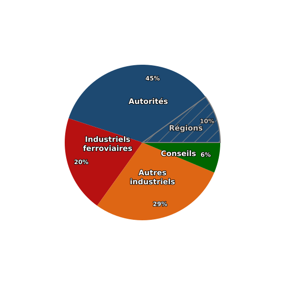
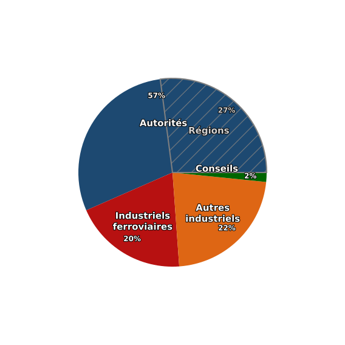
<div class="pie-caption" style="left:1%;">Résultat de l’indicateur de poids total regroupé par famille d’acteurs</div>
<div class="pie-caption" style="left:51%;">Résultat de l’indicateur de centralité d’intermédiarité regroupé par famille d’acteurs</div>
</div>

## Choix de la méthode de clustering {.editorial data-part="2" data-subpart="3" refs="riva-2023,li-2023"}

<div class="slide-title">Choix de la méthode de clustering</div>

```{=html}
<div class="ppt-canvas">
<div class="clustering-methods">
<div class="clustering-option"><h3>Objectif</h3><p>Regrouper les acteurs liés pour analyser le réseau et préserver leurs interactions lors de la réorganisation.</p></div>
<div class="clustering-option"><h3>Newman-Girvan <span data-cite="riva-2023"></span></h3><p>Supprime itérativement les arêtes de plus forte centralité d’intermédiarité pour séparer les communautés du réseau.</p></div>
<div class="clustering-option"><h3>Leiden <span data-cite="li-2023"></span></h3><p>Déplace les nœuds entre les communautés pour optimiser la modularité.</p></div>
</div>
</div>
```


## Résultat du clustering du réseau d’acteurs {.editorial data-part="2" data-subpart="3"}

<div class="slide-title">Résultat du clustering du réseau d’acteurs</div>

<div class="ppt-canvas cluster-results">
<span class="fragment cluster-main-step" data-fragment-index="0" aria-hidden="true"></span>
<span class="fragment cluster-sub-step" data-fragment-index="1" aria-hidden="true"></span><div class="dsm-table-frame" style="left:1%;top:10%;width:60%;height:78%;">
<table class="dsm-table" aria-label="DSM des acteurs avec les clusters C1 et C2" data-sheet="Feuil1"><tbody>
<tr><th data-cell="A1" style="background-color:transparent;color:#000000;font-weight:400" scope="col"></th><th data-cell="B1" style="background-color:transparent;color:#000000;font-weight:700" scope="col">A7</th><th data-cell="C1" style="background-color:transparent;color:#000000;font-weight:700" scope="col">A9</th><th data-cell="D1" style="background-color:transparent;color:#000000;font-weight:700" scope="col">A10</th><th data-cell="E1" style="background-color:transparent;color:#000000;font-weight:700" scope="col">A14</th><th data-cell="F1" style="background-color:transparent;color:#000000;font-weight:700" scope="col">A15</th><th data-cell="G1" style="background-color:transparent;color:#000000;font-weight:700" scope="col">A11</th><th data-cell="H1" style="background-color:transparent;color:#000000;font-weight:700" scope="col">A12</th><th data-cell="I1" style="background-color:transparent;color:#000000;font-weight:700" scope="col">A5</th><th data-cell="J1" style="background-color:transparent;color:#000000;font-weight:700" scope="col">A13</th><th data-cell="K1" style="background-color:transparent;color:#000000;font-weight:700" scope="col">A2</th><th data-cell="L1" style="background-color:transparent;color:#000000;font-weight:700" scope="col">A1</th><th data-cell="M1" style="background-color:transparent;color:#000000;font-weight:700" scope="col">A3</th><th data-cell="N1" style="background-color:transparent;color:#000000;font-weight:700" scope="col">A4</th><th data-cell="O1" style="background-color:transparent;color:#000000;font-weight:700" scope="col">A18</th><th data-cell="P1" style="background-color:transparent;color:#000000;font-weight:700" scope="col">A6</th><th data-cell="Q1" style="background-color:transparent;color:#000000;font-weight:700" scope="col">A16</th><th data-cell="R1" style="background-color:transparent;color:#000000;font-weight:700" scope="col">A17</th><th data-cell="S1" style="background-color:transparent;color:#000000;font-weight:700" scope="col">A8</th></tr>
<tr><th data-cell="A2" style="background-color:transparent;color:#000000;font-weight:700" scope="row">A7</th><td data-cell="B2" style="background-color:transparent;color:#000000;font-weight:400;border-left:2px solid var(--cluster-main-color,transparent);border-top:2px solid var(--cluster-main-color,transparent)"></td><td data-cell="C2" style="background-color:transparent;color:#000000;font-weight:400;border-top:2px solid var(--cluster-main-color,transparent)"></td><td data-cell="D2" style="background-color:transparent;color:#000000;font-weight:400;border-top:2px solid var(--cluster-main-color,transparent)"></td><td data-cell="E2" style="background-color:#FCFCFF;color:#000000;font-weight:400;border-top:2px solid var(--cluster-main-color,transparent)">3</td><td data-cell="F2" style="background-color:#FBD7DA;color:#000000;font-weight:400;border-top:2px solid var(--cluster-main-color,transparent)">2</td><td data-cell="G2" style="background-color:#FAB2B5;color:#000000;font-weight:400;border-top:2px solid var(--cluster-main-color,transparent)">1</td><td data-cell="H2" style="background-color:#FAB2B5;color:#000000;font-weight:400;border-top:2px solid var(--cluster-main-color,transparent)">1</td><td data-cell="I2" style="background-color:#FCFCFF;color:#000000;font-weight:400;border-top:2px solid var(--cluster-main-color,transparent)">3</td><td data-cell="J2" style="background-color:#FCFCFF;color:#000000;font-weight:400;border-top:2px solid var(--cluster-main-color,transparent)">3</td><td data-cell="K2" style="background-color:#FCFCFF;color:#000000;font-weight:400;border-top:2px solid var(--cluster-main-color,transparent)">3</td><td data-cell="L2" style="background-color:#FCFCFF;color:#000000;font-weight:400;border-right:2px solid var(--cluster-main-color,transparent);border-top:2px solid var(--cluster-main-color,transparent)">3</td><td data-cell="M2" style="background-color:#FCFCFF;color:#000000;font-weight:400">3</td><td data-cell="N2" style="background-color:#FCFCFF;color:#000000;font-weight:400">3</td><td data-cell="O2" style="background-color:#F8696B;color:#000000;font-weight:400">-1</td><td data-cell="P2" style="background-color:transparent;color:#000000;font-weight:400"></td><td data-cell="Q2" style="background-color:transparent;color:#000000;font-weight:400"></td><td data-cell="R2" style="background-color:transparent;color:#000000;font-weight:400"></td><td data-cell="S2" style="background-color:transparent;color:#000000;font-weight:400"></td></tr>
<tr><th data-cell="A3" style="background-color:transparent;color:#000000;font-weight:700" scope="row">A9</th><td data-cell="B3" style="background-color:#FAB2B5;color:#000000;font-weight:400;border-left:2px solid var(--cluster-main-color,transparent)">1</td><td data-cell="C3" style="background-color:transparent;color:#000000;font-weight:400"></td><td data-cell="D3" style="background-color:#FAB2B5;color:#000000;font-weight:400">1</td><td data-cell="E3" style="background-color:#FBD7DA;color:#000000;font-weight:400">2</td><td data-cell="F3" style="background-color:#FBD7DA;color:#000000;font-weight:400">2</td><td data-cell="G3" style="background-color:#FAB2B5;color:#000000;font-weight:400">1</td><td data-cell="H3" style="background-color:transparent;color:#000000;font-weight:400"></td><td data-cell="I3" style="background-color:#FCFCFF;color:#000000;font-weight:400">3</td><td data-cell="J3" style="background-color:#FCFCFF;color:#000000;font-weight:400">3</td><td data-cell="K3" style="background-color:#FCFCFF;color:#000000;font-weight:400">3</td><td data-cell="L3" style="background-color:#FCFCFF;color:#000000;font-weight:400;border-right:2px solid var(--cluster-main-color,transparent)">3</td><td data-cell="M3" style="background-color:#FCFCFF;color:#000000;font-weight:400">3</td><td data-cell="N3" style="background-color:#FCFCFF;color:#000000;font-weight:400">3</td><td data-cell="O3" style="background-color:#F8696B;color:#000000;font-weight:400">-1</td><td data-cell="P3" style="background-color:#FAB2B5;color:#000000;font-weight:400">1</td><td data-cell="Q3" style="background-color:transparent;color:#000000;font-weight:400"></td><td data-cell="R3" style="background-color:transparent;color:#000000;font-weight:400"></td><td data-cell="S3" style="background-color:#FAB2B5;color:#000000;font-weight:400">1</td></tr>
<tr><th data-cell="A4" style="background-color:transparent;color:#000000;font-weight:700" scope="row">A10</th><td data-cell="B4" style="background-color:transparent;color:#000000;font-weight:400;border-left:2px solid var(--cluster-main-color,transparent)"></td><td data-cell="C4" style="background-color:transparent;color:#000000;font-weight:400"></td><td data-cell="D4" style="background-color:transparent;color:#000000;font-weight:400"></td><td data-cell="E4" style="background-color:#FCFCFF;color:#000000;font-weight:400">3</td><td data-cell="F4" style="background-color:#FBD7DA;color:#000000;font-weight:400">2</td><td data-cell="G4" style="background-color:#FAB2B5;color:#000000;font-weight:400">1</td><td data-cell="H4" style="background-color:#FAB2B5;color:#000000;font-weight:400">1</td><td data-cell="I4" style="background-color:#FCFCFF;color:#000000;font-weight:400">3</td><td data-cell="J4" style="background-color:#FCFCFF;color:#000000;font-weight:400">3</td><td data-cell="K4" style="background-color:#FCFCFF;color:#000000;font-weight:400">3</td><td data-cell="L4" style="background-color:#FCFCFF;color:#000000;font-weight:400;border-right:2px solid var(--cluster-main-color,transparent)">3</td><td data-cell="M4" style="background-color:#FCFCFF;color:#000000;font-weight:400">3</td><td data-cell="N4" style="background-color:#FCFCFF;color:#000000;font-weight:400">3</td><td data-cell="O4" style="background-color:#F8696B;color:#000000;font-weight:400">-1</td><td data-cell="P4" style="background-color:transparent;color:#000000;font-weight:400"></td><td data-cell="Q4" style="background-color:transparent;color:#000000;font-weight:400"></td><td data-cell="R4" style="background-color:transparent;color:#000000;font-weight:400"></td><td data-cell="S4" style="background-color:transparent;color:#000000;font-weight:400"></td></tr>
<tr><th data-cell="A5" style="background-color:transparent;color:#000000;font-weight:700" scope="row">A14</th><td data-cell="B5" style="background-color:#FBD7DA;color:#000000;font-weight:400;border-left:2px solid var(--cluster-main-color,transparent)">2</td><td data-cell="C5" style="background-color:#FBD7DA;color:#000000;font-weight:400">2</td><td data-cell="D5" style="background-color:#FBD7DA;color:#000000;font-weight:400">2</td><td data-cell="E5" style="background-color:transparent;color:#000000;font-weight:400"></td><td data-cell="F5" style="background-color:#FBD7DA;color:#000000;font-weight:400">2</td><td data-cell="G5" style="background-color:#FBD7DA;color:#000000;font-weight:400">2</td><td data-cell="H5" style="background-color:#FBD7DA;color:#000000;font-weight:400">2</td><td data-cell="I5" style="background-color:#FBD7DA;color:#000000;font-weight:400">2</td><td data-cell="J5" style="background-color:transparent;color:#000000;font-weight:400"></td><td data-cell="K5" style="background-color:#FBD7DA;color:#000000;font-weight:400">2</td><td data-cell="L5" style="background-color:#FBD7DA;color:#000000;font-weight:400;border-right:2px solid var(--cluster-main-color,transparent)">2</td><td data-cell="M5" style="background-color:transparent;color:#000000;font-weight:400"></td><td data-cell="N5" style="background-color:transparent;color:#000000;font-weight:400"></td><td data-cell="O5" style="background-color:transparent;color:#000000;font-weight:400"></td><td data-cell="P5" style="background-color:transparent;color:#000000;font-weight:400"></td><td data-cell="Q5" style="background-color:transparent;color:#000000;font-weight:400"></td><td data-cell="R5" style="background-color:transparent;color:#000000;font-weight:400"></td><td data-cell="S5" style="background-color:#FBD7DA;color:#000000;font-weight:400">2</td></tr>
<tr><th data-cell="A6" style="background-color:transparent;color:#000000;font-weight:700" scope="row">A15</th><td data-cell="B6" style="background-color:transparent;color:#000000;font-weight:400;border-left:2px solid var(--cluster-main-color,transparent)"></td><td data-cell="C6" style="background-color:transparent;color:#000000;font-weight:400"></td><td data-cell="D6" style="background-color:transparent;color:#000000;font-weight:400"></td><td data-cell="E6" style="background-color:transparent;color:#000000;font-weight:400"></td><td data-cell="F6" style="background-color:transparent;color:#000000;font-weight:400"></td><td data-cell="G6" style="background-color:transparent;color:#000000;font-weight:400;border-bottom:3px solid var(--cluster-sub-color,transparent)"></td><td data-cell="H6" style="background-color:transparent;color:#000000;font-weight:400;border-bottom:3px solid var(--cluster-sub-color,transparent)"></td><td data-cell="I6" style="background-color:transparent;color:#000000;font-weight:400"></td><td data-cell="J6" style="background-color:transparent;color:#000000;font-weight:400"></td><td data-cell="K6" style="background-color:transparent;color:#000000;font-weight:400"></td><td data-cell="L6" style="background-color:#FBD7DA;color:#000000;font-weight:400;border-right:2px solid var(--cluster-main-color,transparent)">2</td><td data-cell="M6" style="background-color:transparent;color:#000000;font-weight:400"></td><td data-cell="N6" style="background-color:transparent;color:#000000;font-weight:400"></td><td data-cell="O6" style="background-color:transparent;color:#000000;font-weight:400"></td><td data-cell="P6" style="background-color:transparent;color:#000000;font-weight:400"></td><td data-cell="Q6" style="background-color:transparent;color:#000000;font-weight:400"></td><td data-cell="R6" style="background-color:transparent;color:#000000;font-weight:400"></td><td data-cell="S6" style="background-color:transparent;color:#000000;font-weight:400"></td></tr>
<tr><th data-cell="A7" style="background-color:transparent;color:#000000;font-weight:700" scope="row">A11</th><td data-cell="B7" style="background-color:#FCFCFF;color:#000000;font-weight:400;border-left:2px solid var(--cluster-main-color,transparent)">3</td><td data-cell="C7" style="background-color:#FCFCFF;color:#000000;font-weight:400">3</td><td data-cell="D7" style="background-color:#FCFCFF;color:#000000;font-weight:400">3</td><td data-cell="E7" style="background-color:#FBD7DA;color:#000000;font-weight:400">2</td><td data-cell="F7" style="background-color:#FBD7DA;color:#000000;font-weight:400">2</td><td data-cell="G7" style="background-color:transparent;color:#000000;font-weight:400;border-left:3px solid var(--cluster-sub-color,transparent)"></td><td data-cell="H7" style="background-color:#FBD7DA;color:#000000;font-weight:400">2</td><td data-cell="I7" style="background-color:#FCFCFF;color:#000000;font-weight:400;border-top:3px solid var(--cluster-sub-color,transparent)">3</td><td data-cell="J7" style="background-color:transparent;color:#000000;font-weight:400;border-top:3px solid var(--cluster-sub-color,transparent)"></td><td data-cell="K7" style="background-color:#FCFCFF;color:#000000;font-weight:400;border-top:3px solid var(--cluster-sub-color,transparent)">3</td><td data-cell="L7" style="background-color:#FCFCFF;color:#000000;font-weight:400;border-right:2px solid var(--cluster-main-color,transparent);border-top:3px solid var(--cluster-sub-color,transparent)">3</td><td data-cell="M7" style="background-color:#FCFCFF;color:#000000;font-weight:400">3</td><td data-cell="N7" style="background-color:#FCFCFF;color:#000000;font-weight:400">3</td><td data-cell="O7" style="background-color:#FBD7DA;color:#000000;font-weight:400">2</td><td data-cell="P7" style="background-color:#FCFCFF;color:#000000;font-weight:400">3</td><td data-cell="Q7" style="background-color:transparent;color:#000000;font-weight:400"></td><td data-cell="R7" style="background-color:transparent;color:#000000;font-weight:400"></td><td data-cell="S7" style="background-color:#FCFCFF;color:#000000;font-weight:400">3</td></tr>
<tr><th data-cell="A8" style="background-color:transparent;color:#000000;font-weight:700" scope="row">A12</th><td data-cell="B8" style="background-color:#FCFCFF;color:#000000;font-weight:400;border-left:2px solid var(--cluster-main-color,transparent)">3</td><td data-cell="C8" style="background-color:#FCFCFF;color:#000000;font-weight:400">3</td><td data-cell="D8" style="background-color:#FCFCFF;color:#000000;font-weight:400">3</td><td data-cell="E8" style="background-color:#FBD7DA;color:#000000;font-weight:400">2</td><td data-cell="F8" style="background-color:#FBD7DA;color:#000000;font-weight:400">2</td><td data-cell="G8" style="background-color:#FCFCFF;color:#000000;font-weight:400;border-left:3px solid var(--cluster-sub-color,transparent)">3</td><td data-cell="H8" style="background-color:transparent;color:#000000;font-weight:400"></td><td data-cell="I8" style="background-color:#FCFCFF;color:#000000;font-weight:400">3</td><td data-cell="J8" style="background-color:#FCFCFF;color:#000000;font-weight:400">3</td><td data-cell="K8" style="background-color:transparent;color:#000000;font-weight:400"></td><td data-cell="L8" style="background-color:#FCFCFF;color:#000000;font-weight:400;border-right:2px solid var(--cluster-main-color,transparent)">3</td><td data-cell="M8" style="background-color:transparent;color:#000000;font-weight:400"></td><td data-cell="N8" style="background-color:transparent;color:#000000;font-weight:400"></td><td data-cell="O8" style="background-color:transparent;color:#000000;font-weight:400"></td><td data-cell="P8" style="background-color:#FCFCFF;color:#000000;font-weight:400">3</td><td data-cell="Q8" style="background-color:#FCFCFF;color:#000000;font-weight:400">3</td><td data-cell="R8" style="background-color:transparent;color:#000000;font-weight:400"></td><td data-cell="S8" style="background-color:#FCFCFF;color:#000000;font-weight:400">3</td></tr>
<tr><th data-cell="A9" style="background-color:transparent;color:#000000;font-weight:700" scope="row">A5</th><td data-cell="B9" style="background-color:#FCFCFF;color:#000000;font-weight:400;border-left:2px solid var(--cluster-main-color,transparent)">3</td><td data-cell="C9" style="background-color:#FCFCFF;color:#000000;font-weight:400">3</td><td data-cell="D9" style="background-color:#FCFCFF;color:#000000;font-weight:400">3</td><td data-cell="E9" style="background-color:#FBD7DA;color:#000000;font-weight:400">2</td><td data-cell="F9" style="background-color:#FBD7DA;color:#000000;font-weight:400">2</td><td data-cell="G9" style="background-color:#FCFCFF;color:#000000;font-weight:400;border-left:3px solid var(--cluster-sub-color,transparent)">3</td><td data-cell="H9" style="background-color:#FCFCFF;color:#000000;font-weight:400">3</td><td data-cell="I9" style="background-color:transparent;color:#000000;font-weight:400"></td><td data-cell="J9" style="background-color:#FCFCFF;color:#000000;font-weight:400">3</td><td data-cell="K9" style="background-color:#FCFCFF;color:#000000;font-weight:400">3</td><td data-cell="L9" style="background-color:#FCFCFF;color:#000000;font-weight:400;border-right:2px solid var(--cluster-main-color,transparent)">3</td><td data-cell="M9" style="background-color:#FCFCFF;color:#000000;font-weight:400">3</td><td data-cell="N9" style="background-color:#FCFCFF;color:#000000;font-weight:400">3</td><td data-cell="O9" style="background-color:#F8696B;color:#000000;font-weight:400">-1</td><td data-cell="P9" style="background-color:#FCFCFF;color:#000000;font-weight:400">3</td><td data-cell="Q9" style="background-color:#FCFCFF;color:#000000;font-weight:400">3</td><td data-cell="R9" style="background-color:transparent;color:#000000;font-weight:400"></td><td data-cell="S9" style="background-color:#FCFCFF;color:#000000;font-weight:400">3</td></tr>
<tr><th data-cell="A10" style="background-color:transparent;color:#000000;font-weight:700" scope="row">A13</th><td data-cell="B10" style="background-color:#FCFCFF;color:#000000;font-weight:400;border-left:2px solid var(--cluster-main-color,transparent)">3</td><td data-cell="C10" style="background-color:#FCFCFF;color:#000000;font-weight:400">3</td><td data-cell="D10" style="background-color:#FCFCFF;color:#000000;font-weight:400">3</td><td data-cell="E10" style="background-color:transparent;color:#000000;font-weight:700;font-size:1.565em;border-right:3px solid var(--cluster-sub-color,transparent)" rowspan="2" colspan="2"><span class="cluster-main-label">C1</span></td><td data-cell="G10" style="background-color:#CAE8D4;color:#000000;font-weight:400;border-left:3px solid var(--cluster-sub-color,transparent)">4</td><td data-cell="H10" style="background-color:#CAE8D4;color:#000000;font-weight:400">4</td><td data-cell="I10" style="background-color:#FAB2B5;color:#000000;font-weight:400">1</td><td data-cell="J10" style="background-color:transparent;color:#000000;font-weight:400"></td><td data-cell="K10" style="background-color:#FAB2B5;color:#000000;font-weight:400">1</td><td data-cell="L10" style="background-color:#F8696B;color:#000000;font-weight:400;border-right:2px solid var(--cluster-main-color,transparent)">-1</td><td data-cell="M10" style="background-color:#FAB2B5;color:#000000;font-weight:400">1</td><td data-cell="N10" style="background-color:#FAB2B5;color:#000000;font-weight:400">1</td><td data-cell="O10" style="background-color:transparent;color:#000000;font-weight:400"></td><td data-cell="P10" style="background-color:#FCFCFF;color:#000000;font-weight:400">3</td><td data-cell="Q10" style="background-color:transparent;color:#000000;font-weight:400"></td><td data-cell="R10" style="background-color:transparent;color:#000000;font-weight:400"></td><td data-cell="S10" style="background-color:#FCFCFF;color:#000000;font-weight:400">3</td></tr>
<tr><th data-cell="A11" style="background-color:transparent;color:#000000;font-weight:700" scope="row">A2</th><td data-cell="B11" style="background-color:#FCFCFF;color:#000000;font-weight:400;border-left:2px solid var(--cluster-main-color,transparent)">3</td><td data-cell="C11" style="background-color:#FCFCFF;color:#000000;font-weight:400">3</td><td data-cell="D11" style="background-color:#FCFCFF;color:#000000;font-weight:400">3</td><td data-cell="G11" style="background-color:#CAE8D4;color:#000000;font-weight:400;border-left:3px solid var(--cluster-sub-color,transparent)">4</td><td data-cell="H11" style="background-color:#97D3A8;color:#000000;font-weight:400">5</td><td data-cell="I11" style="background-color:#FAB2B5;color:#000000;font-weight:400">1</td><td data-cell="J11" style="background-color:transparent;color:#000000;font-weight:400"></td><td data-cell="K11" style="background-color:transparent;color:#000000;font-weight:400;border-left:3px solid var(--cluster-sub-color,transparent);border-top:3px solid var(--cluster-sub-color,transparent)"></td><td data-cell="L11" style="background-color:#CAE8D4;color:#000000;font-weight:400;border-top:3px solid var(--cluster-sub-color,transparent)">4</td><td data-cell="M11" style="background-color:#FCFCFF;color:#000000;font-weight:400;border-top:3px solid var(--cluster-sub-color,transparent)">3</td><td data-cell="N11" style="background-color:#FCFCFF;color:#000000;font-weight:400;border-right:3px solid var(--cluster-sub-color,transparent);border-top:3px solid var(--cluster-sub-color,transparent)">3</td><td data-cell="O11" style="background-color:#FAB2B5;color:#000000;font-weight:400">1</td><td data-cell="P11" style="background-color:#FCFCFF;color:#000000;font-weight:400">3</td><td data-cell="Q11" style="background-color:#FAB2B5;color:#000000;font-weight:400">1</td><td data-cell="R11" style="background-color:#FCFCFF;color:#000000;font-weight:400">3</td><td data-cell="S11" style="background-color:#FCFCFF;color:#000000;font-weight:400">3</td></tr>
<tr><th data-cell="A12" style="background-color:transparent;color:#000000;font-weight:700" scope="row">A1</th><td data-cell="B12" style="background-color:#FCFCFF;color:#000000;font-weight:400;border-left:2px solid var(--cluster-main-color,transparent);border-bottom:2px solid var(--cluster-main-color,transparent)">3</td><td data-cell="C12" style="background-color:#FCFCFF;color:#000000;font-weight:400;border-bottom:2px solid var(--cluster-main-color,transparent)">3</td><td data-cell="D12" style="background-color:#FCFCFF;color:#000000;font-weight:400;border-bottom:2px solid var(--cluster-main-color,transparent)">3</td><td data-cell="E12" style="background-color:#FBD7DA;color:#000000;font-weight:400;border-bottom:2px solid var(--cluster-main-color,transparent)">2</td><td data-cell="F12" style="background-color:#FBD7DA;color:#000000;font-weight:400;border-bottom:2px solid var(--cluster-main-color,transparent)">2</td><td data-cell="G12" style="background-color:#CAE8D4;color:#000000;font-weight:400;border-left:3px solid var(--cluster-sub-color,transparent);border-bottom:2px solid var(--cluster-main-color,transparent)">4</td><td data-cell="H12" style="background-color:#CAE8D4;color:#000000;font-weight:400;border-bottom:2px solid var(--cluster-main-color,transparent)">4</td><td data-cell="I12" style="background-color:#63BE7B;color:#000000;font-weight:400;border-bottom:2px solid var(--cluster-main-color,transparent)">6</td><td data-cell="J12" style="background-color:#FCFCFF;color:#000000;font-weight:400;border-bottom:2px solid var(--cluster-main-color,transparent)">3</td><td data-cell="K12" style="background-color:#CAE8D4;color:#000000;font-weight:400;border-left:3px solid var(--cluster-sub-color,transparent)">4</td><td data-cell="L12" style="background-color:transparent;color:#000000;font-weight:400"></td><td data-cell="M12" style="background-color:#CAE8D4;color:#000000;font-weight:400">4</td><td data-cell="N12" style="background-color:#FCFCFF;color:#000000;font-weight:400">3</td><td data-cell="O12" style="background-color:#FCFCFF;color:#000000;font-weight:400;border-left:3px solid var(--cluster-sub-color,transparent);border-top:2px solid var(--cluster-main-color,transparent)">3</td><td data-cell="P12" style="background-color:#FCFCFF;color:#000000;font-weight:400;border-top:2px solid var(--cluster-main-color,transparent)">3</td><td data-cell="Q12" style="background-color:#FCFCFF;color:#000000;font-weight:400;border-top:2px solid var(--cluster-main-color,transparent)">3</td><td data-cell="R12" style="background-color:#FCFCFF;color:#000000;font-weight:400;border-top:2px solid var(--cluster-main-color,transparent)">3</td><td data-cell="S12" style="background-color:#FCFCFF;color:#000000;font-weight:400;border-right:2px solid var(--cluster-main-color,transparent);border-top:2px solid var(--cluster-main-color,transparent)">3</td></tr>
<tr><th data-cell="A13" style="background-color:transparent;color:#000000;font-weight:700" scope="row">A3</th><td data-cell="B13" style="background-color:#FCFCFF;color:#000000;font-weight:400">3</td><td data-cell="C13" style="background-color:#FCFCFF;color:#000000;font-weight:400">3</td><td data-cell="D13" style="background-color:#FCFCFF;color:#000000;font-weight:400">3</td><td data-cell="E13" style="background-color:transparent;color:#000000;font-weight:400"></td><td data-cell="F13" style="background-color:transparent;color:#000000;font-weight:400"></td><td data-cell="G13" style="background-color:#FAB2B5;color:#000000;font-weight:400">1</td><td data-cell="H13" style="background-color:#FAB2B5;color:#000000;font-weight:400">1</td><td data-cell="I13" style="background-color:#FAB2B5;color:#000000;font-weight:400">1</td><td data-cell="J13" style="background-color:transparent;color:#000000;font-weight:400"></td><td data-cell="K13" style="background-color:#FAB2B5;color:#000000;font-weight:400;border-left:3px solid var(--cluster-sub-color,transparent)">1</td><td data-cell="L13" style="background-color:#CAE8D4;color:#000000;font-weight:400">4</td><td data-cell="M13" style="background-color:transparent;color:#000000;font-weight:400"></td><td data-cell="N13" style="background-color:#FCFCFF;color:#000000;font-weight:400">3</td><td data-cell="O13" style="background-color:#FAB2B5;color:#000000;font-weight:400;border-left:3px solid var(--cluster-sub-color,transparent)">1</td><td data-cell="P13" style="background-color:#FCFCFF;color:#000000;font-weight:400">3</td><td data-cell="Q13" style="background-color:#FAB2B5;color:#000000;font-weight:400">1</td><td data-cell="R13" style="background-color:#FCFCFF;color:#000000;font-weight:400">3</td><td data-cell="S13" style="background-color:#FCFCFF;color:#000000;font-weight:400;border-right:2px solid var(--cluster-main-color,transparent)">3</td></tr>
<tr><th data-cell="A14" style="background-color:transparent;color:#000000;font-weight:700" scope="row">A4</th><td data-cell="B14" style="background-color:#FCFCFF;color:#000000;font-weight:400">3</td><td data-cell="C14" style="background-color:#FCFCFF;color:#000000;font-weight:400">3</td><td data-cell="D14" style="background-color:#FCFCFF;color:#000000;font-weight:400">3</td><td data-cell="E14" style="background-color:transparent;color:#000000;font-weight:400"></td><td data-cell="F14" style="background-color:transparent;color:#000000;font-weight:400"></td><td data-cell="G14" style="background-color:#FAB2B5;color:#000000;font-weight:400">1</td><td data-cell="H14" style="background-color:#FAB2B5;color:#000000;font-weight:400">1</td><td data-cell="I14" style="background-color:#FAB2B5;color:#000000;font-weight:400">1</td><td data-cell="J14" style="background-color:transparent;color:#000000;font-weight:400"></td><td data-cell="K14" style="background-color:#FAB2B5;color:#000000;font-weight:400;border-left:3px solid var(--cluster-sub-color,transparent);border-bottom:3px solid var(--cluster-sub-color,transparent)">1</td><td data-cell="L14" style="background-color:#CAE8D4;color:#000000;font-weight:400;border-bottom:3px solid var(--cluster-sub-color,transparent)">4</td><td data-cell="M14" style="background-color:#FAB2B5;color:#000000;font-weight:400;border-bottom:3px solid var(--cluster-sub-color,transparent)">1</td><td data-cell="N14" style="background-color:transparent;color:#000000;font-weight:400;border-right:3px solid var(--cluster-sub-color,transparent);border-bottom:3px solid var(--cluster-sub-color,transparent)"></td><td data-cell="O14" style="background-color:#FAB2B5;color:#000000;font-weight:400">1</td><td data-cell="P14" style="background-color:#FCFCFF;color:#000000;font-weight:400">3</td><td data-cell="Q14" style="background-color:#FAB2B5;color:#000000;font-weight:400">1</td><td data-cell="R14" style="background-color:#FCFCFF;color:#000000;font-weight:400">3</td><td data-cell="S14" style="background-color:#FCFCFF;color:#000000;font-weight:400;border-right:2px solid var(--cluster-main-color,transparent)">3</td></tr>
<tr><th data-cell="A15" style="background-color:transparent;color:#000000;font-weight:700" scope="row">A18</th><td data-cell="B15" style="background-color:#FCFCFF;color:#000000;font-weight:400">3</td><td data-cell="C15" style="background-color:#FCFCFF;color:#000000;font-weight:400">3</td><td data-cell="D15" style="background-color:#FCFCFF;color:#000000;font-weight:400">3</td><td data-cell="E15" style="background-color:transparent;color:#000000;font-weight:400"></td><td data-cell="F15" style="background-color:transparent;color:#000000;font-weight:400"></td><td data-cell="G15" style="background-color:transparent;color:#000000;font-weight:400"></td><td data-cell="H15" style="background-color:transparent;color:#000000;font-weight:400"></td><td data-cell="I15" style="background-color:transparent;color:#000000;font-weight:400"></td><td data-cell="J15" style="background-color:#FAB2B5;color:#000000;font-weight:400">1</td><td data-cell="K15" style="background-color:#FCFCFF;color:#000000;font-weight:400">3</td><td data-cell="L15" style="background-color:#FCFCFF;color:#000000;font-weight:400;border-left:2px solid var(--cluster-main-color,transparent)">3</td><td data-cell="M15" style="background-color:#FCFCFF;color:#000000;font-weight:400">3</td><td data-cell="N15" style="background-color:#FAB2B5;color:#000000;font-weight:400">1</td><td data-cell="O15" style="background-color:transparent;color:#000000;font-weight:400"></td><td data-cell="P15" style="background-color:#FCFCFF;color:#000000;font-weight:400">3</td><td data-cell="Q15" style="background-color:transparent;color:#000000;font-weight:400"></td><td data-cell="R15" style="background-color:#FCFCFF;color:#000000;font-weight:400">3</td><td data-cell="S15" style="background-color:#FCFCFF;color:#000000;font-weight:400;border-right:2px solid var(--cluster-main-color,transparent)">3</td></tr>
<tr><th data-cell="A16" style="background-color:transparent;color:#000000;font-weight:700" scope="row">A6</th><td data-cell="B16" style="background-color:#FCFCFF;color:#000000;font-weight:400">3</td><td data-cell="C16" style="background-color:transparent;color:#000000;font-weight:400"></td><td data-cell="D16" style="background-color:transparent;color:#000000;font-weight:400"></td><td data-cell="E16" style="background-color:#FCFCFF;color:#000000;font-weight:400">3</td><td data-cell="F16" style="background-color:#FBD7DA;color:#000000;font-weight:400">2</td><td data-cell="G16" style="background-color:#FAB2B5;color:#000000;font-weight:400">1</td><td data-cell="H16" style="background-color:#FAB2B5;color:#000000;font-weight:400">1</td><td data-cell="I16" style="background-color:#FCFCFF;color:#000000;font-weight:400">3</td><td data-cell="J16" style="background-color:#FCFCFF;color:#000000;font-weight:400">3</td><td data-cell="K16" style="background-color:#FCFCFF;color:#000000;font-weight:400">3</td><td data-cell="L16" style="background-color:#FCFCFF;color:#000000;font-weight:400;border-left:2px solid var(--cluster-main-color,transparent)">3</td><td data-cell="M16" style="background-color:#FCFCFF;color:#000000;font-weight:400">3</td><td data-cell="N16" style="background-color:#FCFCFF;color:#000000;font-weight:400">3</td><td data-cell="O16" style="background-color:#FCFCFF;color:#000000;font-weight:400">3</td><td data-cell="P16" style="background-color:transparent;color:#000000;font-weight:700;font-size:1.565em" rowspan="2" colspan="2"><span class="cluster-main-label">C2</span></td><td data-cell="R16" style="background-color:transparent;color:#000000;font-weight:400"></td><td data-cell="S16" style="background-color:transparent;color:#000000;font-weight:400;border-right:2px solid var(--cluster-main-color,transparent)"></td></tr>
<tr><th data-cell="A17" style="background-color:transparent;color:#000000;font-weight:700" scope="row">A16</th><td data-cell="B17" style="background-color:transparent;color:#000000;font-weight:400"></td><td data-cell="C17" style="background-color:#FCFCFF;color:#000000;font-weight:400">3</td><td data-cell="D17" style="background-color:transparent;color:#000000;font-weight:400"></td><td data-cell="E17" style="background-color:transparent;color:#000000;font-weight:400"></td><td data-cell="F17" style="background-color:transparent;color:#000000;font-weight:400"></td><td data-cell="G17" style="background-color:#FBD7DA;color:#000000;font-weight:400">2</td><td data-cell="H17" style="background-color:transparent;color:#000000;font-weight:400"></td><td data-cell="I17" style="background-color:#FCFCFF;color:#000000;font-weight:400">3</td><td data-cell="J17" style="background-color:transparent;color:#000000;font-weight:400"></td><td data-cell="K17" style="background-color:#FCFCFF;color:#000000;font-weight:400">3</td><td data-cell="L17" style="background-color:#FCFCFF;color:#000000;font-weight:400;border-left:2px solid var(--cluster-main-color,transparent)">3</td><td data-cell="M17" style="background-color:#FCFCFF;color:#000000;font-weight:400">3</td><td data-cell="N17" style="background-color:#FCFCFF;color:#000000;font-weight:400">3</td><td data-cell="O17" style="background-color:transparent;color:#000000;font-weight:400"></td><td data-cell="R17" style="background-color:transparent;color:#000000;font-weight:400"></td><td data-cell="S17" style="background-color:#FCFCFF;color:#000000;font-weight:400;border-right:2px solid var(--cluster-main-color,transparent)">3</td></tr>
<tr><th data-cell="A18" style="background-color:transparent;color:#000000;font-weight:700" scope="row">A17</th><td data-cell="B18" style="background-color:transparent;color:#000000;font-weight:400"></td><td data-cell="C18" style="background-color:transparent;color:#000000;font-weight:400"></td><td data-cell="D18" style="background-color:transparent;color:#000000;font-weight:400"></td><td data-cell="E18" style="background-color:transparent;color:#000000;font-weight:400"></td><td data-cell="F18" style="background-color:transparent;color:#000000;font-weight:400"></td><td data-cell="G18" style="background-color:transparent;color:#000000;font-weight:400"></td><td data-cell="H18" style="background-color:#FCFCFF;color:#000000;font-weight:400">3</td><td data-cell="I18" style="background-color:transparent;color:#000000;font-weight:400"></td><td data-cell="J18" style="background-color:transparent;color:#000000;font-weight:400"></td><td data-cell="K18" style="background-color:transparent;color:#000000;font-weight:400"></td><td data-cell="L18" style="background-color:transparent;color:#000000;font-weight:400;border-left:2px solid var(--cluster-main-color,transparent)"></td><td data-cell="M18" style="background-color:transparent;color:#000000;font-weight:400"></td><td data-cell="N18" style="background-color:transparent;color:#000000;font-weight:400"></td><td data-cell="O18" style="background-color:transparent;color:#000000;font-weight:400"></td><td data-cell="P18" style="background-color:#FCFCFF;color:#000000;font-weight:400">3</td><td data-cell="Q18" style="background-color:#FCFCFF;color:#000000;font-weight:400">3</td><td data-cell="R18" style="background-color:transparent;color:#000000;font-weight:400"></td><td data-cell="S18" style="background-color:transparent;color:#000000;font-weight:400;border-right:2px solid var(--cluster-main-color,transparent)"></td></tr>
<tr><th data-cell="A19" style="background-color:transparent;color:#000000;font-weight:700" scope="row">A8</th><td data-cell="B19" style="background-color:transparent;color:#000000;font-weight:400"></td><td data-cell="C19" style="background-color:transparent;color:#000000;font-weight:400"></td><td data-cell="D19" style="background-color:transparent;color:#000000;font-weight:400"></td><td data-cell="E19" style="background-color:#FCFCFF;color:#000000;font-weight:400">3</td><td data-cell="F19" style="background-color:#FBD7DA;color:#000000;font-weight:400">2</td><td data-cell="G19" style="background-color:#FAB2B5;color:#000000;font-weight:400">1</td><td data-cell="H19" style="background-color:transparent;color:#000000;font-weight:400"></td><td data-cell="I19" style="background-color:transparent;color:#000000;font-weight:400"></td><td data-cell="J19" style="background-color:#FCFCFF;color:#000000;font-weight:400">3</td><td data-cell="K19" style="background-color:#FCFCFF;color:#000000;font-weight:400">3</td><td data-cell="L19" style="background-color:#FCFCFF;color:#000000;font-weight:400;border-left:2px solid var(--cluster-main-color,transparent);border-bottom:2px solid var(--cluster-main-color,transparent)">3</td><td data-cell="M19" style="background-color:#FCFCFF;color:#000000;font-weight:400;border-bottom:2px solid var(--cluster-main-color,transparent)">3</td><td data-cell="N19" style="background-color:#FCFCFF;color:#000000;font-weight:400;border-bottom:2px solid var(--cluster-main-color,transparent)">3</td><td data-cell="O19" style="background-color:#F8696B;color:#000000;font-weight:400;border-bottom:2px solid var(--cluster-main-color,transparent)">-1</td><td data-cell="P19" style="background-color:#FCFCFF;color:#000000;font-weight:400;border-bottom:2px solid var(--cluster-main-color,transparent)">3</td><td data-cell="Q19" style="background-color:transparent;color:#000000;font-weight:400;border-bottom:2px solid var(--cluster-main-color,transparent)"></td><td data-cell="R19" style="background-color:transparent;color:#000000;font-weight:400;border-bottom:2px solid var(--cluster-main-color,transparent)"></td><td data-cell="S19" style="background-color:transparent;color:#000000;font-weight:400;border-right:2px solid var(--cluster-main-color,transparent);border-bottom:2px solid var(--cluster-main-color,transparent)"></td></tr>
</tbody></table></div>
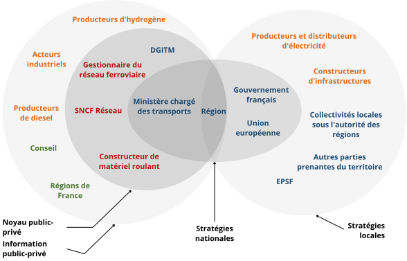
</div>

## Réorganisation du processus de décision {.editorial data-part="2" data-subpart="3"}

<div class="slide-title">Réorganisation du processus de décision</div>

<div class="ppt-canvas decision-reorganization">



</div>

## perspectives DSM {.editorial .perspectives-slide .publications-slide .unnumbered-subpart data-part="2"}

<div class="slide-title">Conclusion et perspectives</div>

```{=html}
<div class="ppt-canvas">
<div class="publication-contribution"><span class="method-outlook-label">Apport de la méthode</span><p>Réduire les riques des interactions public-privé en modélisant les réseaux de décision public-privé pour analyser la place des parties prenantes et réorganiser leur intervention.</p></div>
<div class="publication-perspectives">
<div class="method-outlook-label"><br>Perspectives</div>
<div><h3>Temporalité de la décision</h3><p>Modéliser chaque étape de décision pour une temporalité plus précise.</p></div>
<div><h3>Modélisation à base d’agents</h3><p>Modéliser plus précisément les acteurs, leurs intérêts et leurs ressources.</p></div>
<div><h3>Sensibilité à la pondération</h3><p>Faire varier les poids attribués aux classes d’interactions et proposer d’autres modèles de classification des interactions.</p></div>
</div>
<div class="publication-grid">
<article class="publication-card">
<a class="publication-preview" href="figures/conf.pdf" target="_blank" rel="noopener">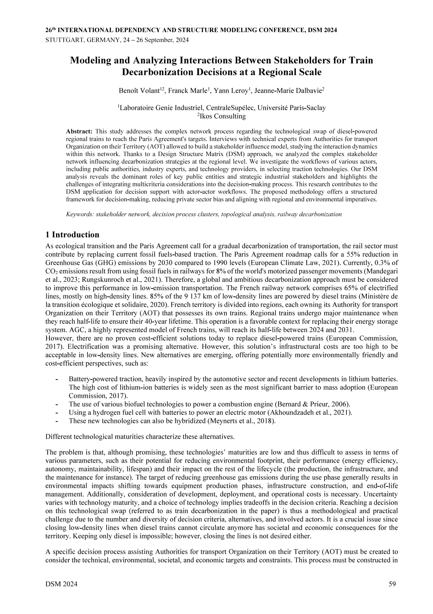</a>
<div class="publication-details">
<div class="publication-label">Conférence 2024</div>
<h3>Modeling and Analyzing Interactions Between Stakeholders for Train Decarbonization Decisions at a Regional Scale</h3>
<p>Volant, B., Marle, F., Leroy, Y., &amp; Dalbavie, J.-M. (2024).</p>
<p class="publication-venue"><em>DS 134: Proceedings of the 26th International DSM Conference (DSM 2024), Stuttgart, Germany</em>, 059–068.</p>
<a class="publication-doi" href="https://doi.org/10.35199/DSM2024.07" target="_blank" rel="noopener">doi:10.35199/DSM2024.07</a>
</div>
</article>
<article class="publication-card">
<a class="publication-preview" href="figures/article.pdf" target="_blank" rel="noopener">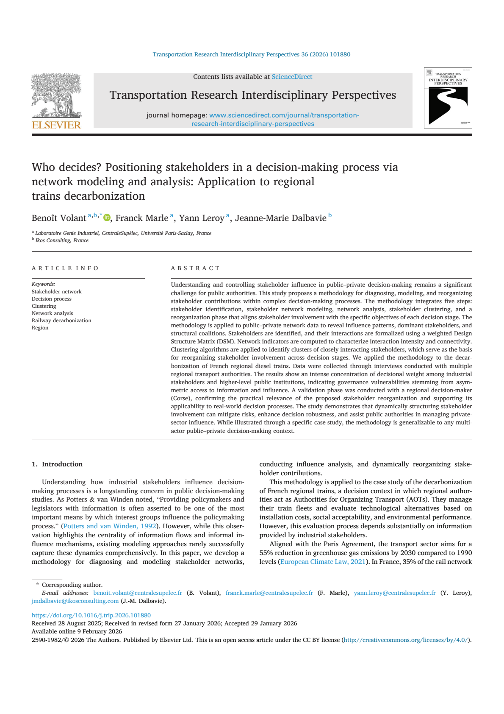</a>
<div class="publication-details">
<div class="publication-label">Article de journal 2026</div>
<h3>Who decides? Positioning stakeholders in a decision-making process via network modeling and analysis: Application to regional trains decarbonization</h3>
<p>Volant, B., Marle, F., Leroy, Y., &amp; Dalbavie, J.-M. (2026).</p>
<p class="publication-venue"><em>Transportation Research Interdisciplinary Perspectives</em>, <em>36</em>, 101880.</p>
<a class="publication-doi" href="https://doi.org/10.1016/j.trip.2026.101880" target="_blank" rel="noopener">doi:10.1016/j.trip.2026.101880</a>
</div>
</article>
</div>
</div>
```

## {.editorial .part-divider .decision-divider data-part="3" data-subpart="1" refs="iso-14040"}

<div class="divider-number">PARTIE 03</div>
<div class="divider-title">ACV &amp; ADMC</div>
<div class="divider-subtitle">Méthodologie pour l’évaluation environnementale paramétrique et prospective pour la comparaison de scénarios de réduction d’impact par l’analyse du cycle de vie (ACV) et l’aide à la décision multicritère (ADMC)</div>

<div class="divider-decision-needs">
<p>Le <strong>manque de ressources</strong> a été identifié comme leur principale contrainte.</p>
<p>Besoin de <strong>transparence</strong> et de <strong>facilité d’interprétation.</strong></p>
<p>Besoin d’une <strong>approche multicritère</strong> pour éviter les <strong>transferts d’impacts</strong> <span data-cite="iso-14040"></span>.</p>
</div>

<figure class="divider-decision-steps">

</figure>


## Objectif et champ de l’étude — unité fonctionnelle {.editorial .functional-unit-slide data-part="3" data-subpart="1"}

<div class="slide-title">Unité fonctionnelle et périmètre de l'étude</div>
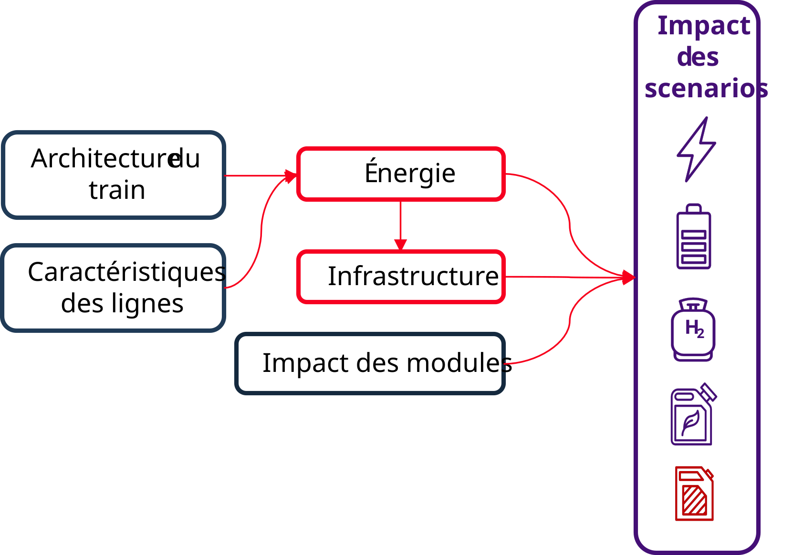
```{=html}
<div class="ppt-canvas functional-unit-canvas">
  <div class="fu-definition">
    <div class="fu-label">UNITÉ FONCTIONNELLE</div>
    <div class="fu-statement">Fournir l’énergie nécessaire à l’exploitation d’un train régional<br>sur sa durée de vie restante.</div>
    <div class="fu-database">Base de données utilisée : <strong>ecoinvent 3.9.1</strong>.</div>
    <div class="fu-lifetime"><strong>16 à 24 ans</strong><span>Horizon fixé par les décideurs</span></div>
  </div>

</div>
```

<div class="fu-assembly-caption">Assemblage des scénarios par modules et paramètres</div>

## Division en modules des scénarios {.editorial .module-focus-slide data-part="3" data-subpart="1"}

<div class="slide-title">
Champ de l’étude: Division des scénarios en modules</div>

```{=html}
<span class="fragment module-focus-step" data-fragment-index="0" aria-hidden="true"></span>
<div class="module-matrix" lang="fr">

<div class="matrix-head" style="grid-column:1; grid-row:1;">Scénarios</div>

<div class="matrix-head matrix-family-alim" style="grid-column:2 / span 5; grid-row:1;">Système énergétique embarqué</div>

<div class="matrix-head matrix-family-energie" style="grid-column:7 / span 3; grid-row:1;">Produc&shy;tion d’énergie</div>

<div class="matrix-head matrix-family-infra" style="grid-column:10 / span 2; grid-row:1;">Infrastructure d’alimentation</div>

<div class="matrix-label" style="grid-column:1; grid-row:2;">Électrification</div>

<div class="matrix-label" style="grid-column:1; grid-row:3;">Batteries</div>

<div class="matrix-label" style="grid-column:1; grid-row:4;">Hydro&shy;gène</div>

<div class="matrix-label" style="grid-column:1; grid-row:5;">Hybride</div>

<div class="matrix-label" style="grid-column:1; grid-row:6;">Biocarburant/<wbr>diesel</div>

<!-- MODULES : grille fixe, sans placement JavaScript.
     Meme forme pour tous ; couleur par famille (alim, energie, infra).
     --track = piste horizontale :
       2 a 6 : systeme embarque (5 emplacements cote a cote) ;
       7 a 9 : production (3 emplacements) ; 10 et 11 : infrastructure.
     --row = premiere ligne ; --end = ligne APRES la derniere couverte.
       2 Electrification, 3 Batteries, 4 Hydrogene, 5 Hybride,
       6 Biocarburant/<wbr>diesel ; 7 est la limite inferieure du tableau.
     Exemple : --row:3; --end:6 couvre Batteries, Hydrogene et Hybride.
     Pour ajouter un module, dupliquer un bloc et choisir une piste libre
     sur les lignes souhaitees. Ne pas repeter une propriete dans style.
     Couleurs : classes matrix-family-alim, matrix-family-energie, matrix-family-infra.
     Palettes dans custom.css ; police et arrondi communs via .matrix-module.
-->

<div class="matrix-module matrix-focus-target matrix-family-energie" style="--track:7; --row:2; --end:6;">
    Produc&shy;tion d'électri&shy;cité
  </div>

<div class="matrix-module matrix-focus-target matrix-family-infra" style="--track:11; --row:2; --end:7;">
    Caténaires
  </div>

<div class="matrix-module matrix-focus-target matrix-family-alim" style="--track:2; --row:3; --end:6;">
    Batterie NMC
  </div>

<div class="matrix-module matrix-focus-target matrix-family-alim" style="--track:3; --row:3; --end:6;">
    Batterie LFP
  </div>

<div class="matrix-module matrix-focus-target matrix-family-alim" style="--track:4; --row:3; --end:6;">
    Batterie LTO
  </div>

<div class="matrix-module matrix-family-alim" style="--track:5; --row:4; --end:5;">
    Pile à com&shy;bustible
  </div>

<div class="matrix-module matrix-family-alim" style="--track:6; --row:4; --end:5;">
    Réser&shy;voirs d'hydro&shy;gène
  </div>

<div class="matrix-module matrix-family-energie" style="--track:8; --row:4; --end:5;">
    Hydro&shy;gène électro&shy;lytique
  </div>

<div class="matrix-module matrix-family-energie" style="--track:9; --row:4; --end:5;">
    Hydro&shy;gène fossile
  </div>

<div class="matrix-module matrix-family-infra" style="--track:10; --row:4; --end:5;">
    Station d’hydro&shy;gène
  </div>

<div class="matrix-module matrix-family-energie" style="--track:8; --row:5; --end:7;">
    Diesel
  </div>

<div class="matrix-module matrix-family-energie" style="--track:9; --row:5; --end:7;">
    B100/HVO
  </div>

<div class="matrix-module matrix-family-alim" style="--track:5; --row:5; --end:7;">
    Géné&shy;rateur ther&shy;mique
  </div>

</div>

```


## Choix de l’ACV : types et définitions {.editorial .acv-definitions-slide data-auto-animate="true" data-auto-animate-id="acv-types" data-auto-animate-duration="0.5" data-auto-animate-easing="ease-in-out" data-part="3" data-subpart="1" refs="riondet-2023,spreafico-2021"}

<div class="slide-title" data-id="acv-title">Types d'ACV</div>

```{=html}
<div class="ppt-canvas acv-choice">
<div class="ppt-table-wrap acv-types-table">
<table class="ppt-table" aria-label="Types d'ACV, définitions et références">
<thead><tr><th scope="col" data-id="acv-type-heading">Type d’ACV</th><th scope="col">Définition</th><th scope="col">Référence</th></tr></thead>
<tbody>
<tr><td><span class="acv-morph-label" data-id="acv-type-0">Attributionnelle</span></td><td>Impacts d’un système donné, sans effets de marché.</td><td class="acv-type-reference" rowspan="5"><span data-cite="riondet-2023"></span></td></tr>
<tr><td><span class="acv-morph-label" data-id="acv-type-1">Prospective</span></td><td>Systèmes futurs intégrant les progrès technologiques et le passage à l’échelle industrielle.</td></tr>
<tr><td><span class="acv-morph-label" data-id="acv-type-2">Paramétrique</span></td><td>Paramètres variables pour explorer les configurations, scénarios et sensibilités.</td></tr>
<tr><td><span class="acv-morph-label" data-id="acv-type-3">Rétrospective</span></td><td>Systèmes existants représentés par des données historiques ou actuelles.</td></tr>
<tr><td><span class="acv-morph-label" data-id="acv-type-4">Régionalisée</span></td><td>Données géographiques spécifiques aux conditions régionales.</td></tr>
<tr><td><span class="acv-morph-label" data-id="acv-type-5">Bibliographique</span></td><td>Modèle fondé sur les données de la littérature plutôt que sur des mesures primaires.</td><td class="acv-type-reference"><span data-cite="spreafico-2021"></span></td></tr>
</tbody></table>
</div>
</div>
```

## Inventaire lié aux types d'ACV {.editorial .inventory-types-slide data-auto-animate="true" data-auto-animate-id="acv-types" data-auto-animate-duration="0.5" data-auto-animate-easing="ease-in-out" data-part="3" data-subpart="1" refs="rte-2022"}

<div class="slide-title" data-id="acv-title">Types d'ACV par module</div>

```{=html}
<div class="ppt-canvas inventory-types">
<span class="fragment inventory-step-rte" data-fragment-index="0" aria-hidden="true"></span>
<span class="fragment inventory-step-batteries" data-fragment-index="1" aria-hidden="true"></span>
<span class="fragment inventory-step-catenaries" data-fragment-index="2" aria-hidden="true"></span>
<div class="module-matrix inventory-module-matrix" lang="fr" aria-label="Cinq modules étudiés par scénario">
<div class="matrix-head" style="grid-column:1; grid-row:1;">Scénarios</div>
<div class="matrix-head matrix-family-alim" style="grid-column:2 / span 3; grid-row:1;">Système énergétique embarqué</div>
<div class="matrix-head matrix-family-energie" style="grid-column:5; grid-row:1;">Production d’énergie</div>
<div class="matrix-head matrix-family-infra" style="grid-column:6; grid-row:1;">Infrastructure d’alimentation</div>
<div class="matrix-label" style="grid-column:1; grid-row:2;">Électrification</div>
<div class="matrix-label" style="grid-column:1; grid-row:3;">Batteries</div>
<div class="matrix-label" style="grid-column:1; grid-row:4;">Hydrogène</div>
<div class="matrix-label" style="grid-column:1; grid-row:5;">Hybride</div>
<div class="matrix-label" style="grid-column:1; grid-row:6;">Biocarburant/<br>diesel</div>
<div class="matrix-module matrix-family-energie" style="--track:5; --row:2; --end:6;">
    Production d'électricité
  </div>
<div class="matrix-module matrix-family-infra" style="--track:6; --row:2; --end:7;">
    Caténaires
  </div>
<div class="matrix-module matrix-family-alim" style="--track:2; --row:3; --end:6;">
    Batterie NMC
  </div>
<div class="matrix-module matrix-family-alim" style="--track:3; --row:3; --end:6;">
    Batterie LFP
  </div>
<div class="matrix-module matrix-family-alim" style="--track:4; --row:3; --end:6;">
    Batterie LTO
  </div>
</div>
<div class="ppt-table-wrap inventory-types-table">
<table class="ppt-table" aria-label="Types d'ACV retenus pour l’étude">
<thead><tr><th scope="col" data-id="acv-type-heading">Type d'ACV</th></tr></thead>
<tbody>
<tr class="inventory-common"><td><span class="acv-morph-label" data-id="acv-type-0">Attributionnelle</span></td></tr>
<tr class="inventory-prospective"><td><span class="acv-morph-label" data-id="acv-type-1">Prospective</span></td></tr>
<tr class="inventory-common"><td><span class="acv-morph-label" data-id="acv-type-2">Paramétrique</span></td></tr>
<tr class="inventory-retrospective"><td><span class="acv-morph-label" data-id="acv-type-3">Rétrospective</span></td></tr>
<tr class="inventory-common"><td><span class="acv-morph-label" data-id="acv-type-4">Régionalisée</span></td></tr>
<tr class="inventory-bibliographic"><td><span class="acv-morph-label" data-id="acv-type-5">Bibliographique</span></td></tr>
</tbody>
</table>
</div>
<figure class="inventory-panel inventory-rte">
<figcaption>Capacité des modes de production par scénario 2050 <span data-cite="rte-2022"></span></figcaption>

</figure>
<figure class="inventory-panel inventory-batteries">
<figcaption>Construction de l’inventaire de cycle de vie des batteries : assemblage des données bibliographiques décrivant les sous-systèmes.</figcaption>
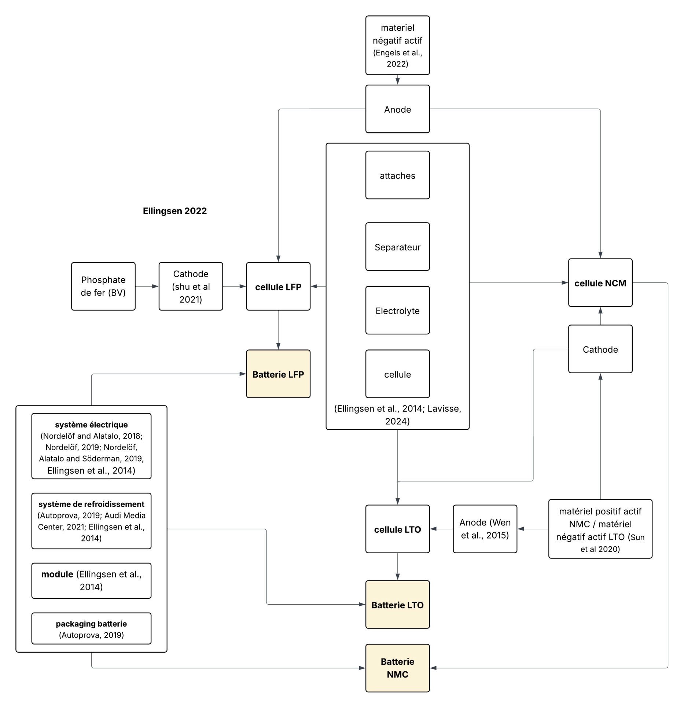
</figure>
<figure class="inventory-panel inventory-catenaries">
<figcaption>Modélisation des caténaires : interview d'experts</figcaption>
<div class="inventory-catenary-pair">
<figure><figcaption>Illustration d’une caténaire 1 500 V</figcaption></figure>
<figure><figcaption>Illustration d’une caténaire 25 kV</figcaption></figure>
</div>
</figure>
</div>
```

## Propagation des incertitudes {.editorial .uncertainty-slide data-part="3" data-subpart="1" refs="ciroth-2016,muller-2015"}

<div class="slide-title">Propagation des incertitudes</div>

```{=html}
<div class="ppt-canvas uncertainty-canvas">
<div class="uncertainty-figure">
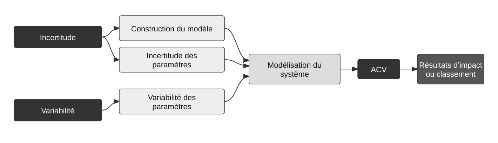
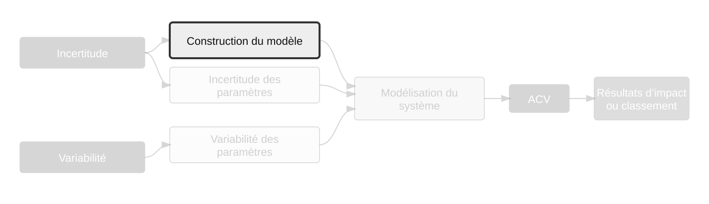
</div>
<div class="ppt-table-wrap pedigree-table fragment fade-in" data-fragment-index="0">
<table class="ppt-table"><caption>Matrice de pedigree <span class="pedigree-citations"><span data-cite="ciroth-2016,muller-2015"></span></span></caption><thead><tr><th scope="col">Score de l’indicateur</th><th scope="col">1</th><th scope="col">2</th><th scope="col">3</th><th scope="col">4</th><th scope="col">5 (par défaut)</th></tr></thead><tbody><tr><th scope="row">Fiabilité</th><td>1,00</td><td>1,00</td><td>1,00</td><td>1,00</td><td>1,00</td></tr><tr><th scope="row">Complétude</th><td>1,54</td><td>1,03</td><td>1,03</td><td>1,04</td><td>1,18</td></tr><tr><th scope="row">Corrélation temporelle</th><td>1,61</td><td>1,04</td><td>1,10</td><td>1,08</td><td>1,65</td></tr><tr><th scope="row">Corrélation géographique</th><td>1,69</td><td>1,08</td><td>1,19</td><td>1,11</td><td>2,08</td></tr><tr><th scope="row">Corrélation technologique supplémentaire</th><td>4,52<sup>a</sup></td><td>3,09<sup>a</sup></td><td>1,29</td><td>9,49<sup>a</sup></td><td>2,80</td></tr></tbody></table>
</div>
</div>
```

## Application du pedigree aux données {.editorial data-part="3" data-subpart="1"}

<div class="slide-title">Application du pedigree aux données</div>

```{=html}
<div class="ppt-canvas pedigree-application">
<span class="fragment pedigree-step-electricity" data-fragment-index="0" aria-hidden="true"></span>
<span class="fragment pedigree-step-catenaries" data-fragment-index="1" aria-hidden="true"></span>
<span class="fragment pedigree-step-batteries" data-fragment-index="2" aria-hidden="true"></span>
<div class="ppt-table-wrap pedigree-application-wrap">
<table class="ppt-table pedigree-application-table" aria-label="Scores de pedigree et écarts-types, style du classeur Excel"><thead><tr><th style="background-color:#ffffff00;color:#000000;font-family:&#x27;Avenir Next LT Pro&#x27;,Arial,sans-serif;font-weight:700;border-left:2px solid #ffffff00;border-right:2px solid #ffffff0000;border-top:2px solid #ffffff00;border-bottom:2px solid #ffffff00">Famille</th><th style="background-color:#ffffff00;color:#000000;font-family:&#x27;Avenir Next LT Pro&#x27;,Arial,sans-serif;font-weight:700;border-left:2px solid #ffffff00;border-right:2px solid #ffffff00;border-top:2px solid #ffffff00;border-bottom:2px solid #ffffff00">Technologie</th><th style="background-color:#ffffff00;color:#000000;font-family:&#x27;Avenir Next LT Pro&#x27;,Arial,sans-serif;font-weight:700;border-left:2px solid #ffffff00;border-right:0;border-top:2px solid #ffffff00;border-bottom:2px solid #ffffff00">Système</th><th style="background-color:#ffffff00;color:#000000;font-family:&#x27;Avenir Next LT Pro&#x27;,Arial,sans-serif;font-weight:700;border-left:2px solid #000000;border-right:2px solid #ffffff00;border-top:2px solid #ffffff00;border-bottom:2px solid #ffffff00">Fiabilité</th><th style="background-color:#ffffff00;color:#000000;font-family:&#x27;Avenir Next LT Pro&#x27;,Arial,sans-serif;font-weight:700;border-left:2px solid #ffffff00;border-right:2px solid #ffffff00;border-top:2px solid #ffffff00;border-bottom:2px solid #ffffff00">Complétude</th><th style="background-color:#ffffff00;color:#000000;font-family:&#x27;Avenir Next LT Pro&#x27;,Arial,sans-serif;font-weight:700;border-left:2px solid #ffffff00;border-right:2px solid #ffffff00;border-top:2px solid #ffffff00;border-bottom:2px solid #ffffff00">Corrélation temporelle</th><th style="background-color:#ffffff00;color:#000000;font-family:&#x27;Avenir Next LT Pro&#x27;,Arial,sans-serif;font-weight:700;border-left:2px solid #ffffff00;border-right:2px solid #ffffff00;border-top:2px solid #ffffff00;border-bottom:2px solid #ffffff00">Corrélation géographique</th><th style="background-color:#ffffff00;color:#000000;font-family:&#x27;Avenir Next LT Pro&#x27;,Arial,sans-serif;font-weight:700;border-left:2px solid #ffffff00;border-right:2px solid #000000;border-top:2px solid #ffffff00;border-bottom:2px solid #ffffff00">Corrélation technologique supplémentaire</th><th style="background-color:#ffffff00;color:#000000;font-family:&#x27;Avenir Next LT Pro&#x27;,Arial,sans-serif;font-weight:700;border-left:2px solid #000000;border-right:2px solid #ffffff00;border-top:2px solid #ffffff00;border-bottom:2px solid #ffffff00">Écart-type résultant</th></tr></thead><tbody>
<tr style="height:46.8px"><th data-cell="A2" rowspan="5" scope="rowgroup" style="background-color:#ffffff00;color:#000000;font-family:&#x27;Raleway&#x27;,Arial,sans-serif;font-weight:400;border-left:2px solid #ffffff00;border-right:2px solid #ffffff00;border-top:0;border-bottom:0">Système embarqué</th><th data-cell="B2" rowspan="2" scope="rowgroup" style="background-color:#ffffff00;color:#000000;font-family:&#x27;Raleway&#x27;,Arial,sans-serif;font-weight:400;border-left:2px solid #ffffff00;border-right:2px solid #ffffff00;border-top:2px solid #ffffff00;border-bottom:0">Hydrogène</th><th data-cell="C2" scope="row" style="background-color:#ffffff00;color:#000000;font-family:&#x27;Avenir Next LT Pro&#x27;,Arial,sans-serif;font-weight:700;border-left:2px solid #ffffff00;border-right:2px solid #000000;border-top:0;border-bottom:2px solid #ffffff00">Pile à combustible PEM</th><td data-cell="D2" title="2" style="background-color:#FBD7DA;color:#000000;font-family:&#x27;Avenir Next LT Pro&#x27;,Arial,sans-serif;font-weight:400;border-left:2px solid #ffffff00;border-right:2px solid #ffffff00;border-top:0;border-bottom:2px solid #ffffff00">2</td><td data-cell="E2" title="1" style="background-color:#FCFCFF;color:#000000;font-family:&#x27;Avenir Next LT Pro&#x27;,Arial,sans-serif;font-weight:400;border-left:2px solid #ffffff00;border-right:2px solid #ffffff00;border-top:0;border-bottom:2px solid #ffffff00">1</td><td data-cell="F2" title="3" style="background-color:#FAB2B5;color:#000000;font-family:&#x27;Avenir Next LT Pro&#x27;,Arial,sans-serif;font-weight:400;border-left:2px solid #ffffff00;border-right:2px solid #ffffff00;border-top:0;border-bottom:2px solid #ffffff00">3</td><td data-cell="G2" title="3" style="background-color:#FAB2B5;color:#000000;font-family:&#x27;Avenir Next LT Pro&#x27;,Arial,sans-serif;font-weight:400;border-left:2px solid #ffffff00;border-right:2px solid #ffffff00;border-top:0;border-bottom:2px solid #ffffff00">3</td><td data-cell="H2" title="1" style="background-color:#FCFCFF;color:#000000;font-family:&#x27;Avenir Next LT Pro&#x27;,Arial,sans-serif;font-weight:400;border-left:2px solid #ffffff00;border-right:2px solid #000000;border-top:0;border-bottom:2px solid #ffffff00">1</td><td data-cell="S2" title="1,251586639655866" style="background-color:#F9888A;color:#000000;font-family:&#x27;Avenir Next LT Pro&#x27;,Arial,sans-serif;font-weight:400;border-left:2px solid #000000;border-right:2px solid #ffffff00;border-top:0;border-bottom:2px solid #ffffff00">1,252</td></tr>
<tr style="height:46.8px"><th data-cell="C3" scope="row" style="background-color:#ffffff00;color:#000000;font-family:&#x27;Avenir Next LT Pro&#x27;,Arial,sans-serif;font-weight:700;border-left:2px solid #ffffff00;border-right:2px solid #000000;border-top:2px solid #ffffff00;border-bottom:2px solid #ffffff00">Réservoirs H₂</th><td data-cell="D3" title="2" style="background-color:#FBD7DA;color:#000000;font-family:&#x27;Avenir Next LT Pro&#x27;,Arial,sans-serif;font-weight:400;border-left:2px solid #ffffff00;border-right:2px solid #ffffff00;border-top:0;border-bottom:2px solid #ffffff00">2</td><td data-cell="E3" title="2" style="background-color:#FBD7DA;color:#000000;font-family:&#x27;Avenir Next LT Pro&#x27;,Arial,sans-serif;font-weight:400;border-left:2px solid #ffffff00;border-right:2px solid #ffffff00;border-top:0;border-bottom:2px solid #ffffff00">2</td><td data-cell="F3" title="3" style="background-color:#FAB2B5;color:#000000;font-family:&#x27;Avenir Next LT Pro&#x27;,Arial,sans-serif;font-weight:400;border-left:2px solid #ffffff00;border-right:2px solid #ffffff00;border-top:0;border-bottom:2px solid #ffffff00">3</td><td data-cell="G3" title="3" style="background-color:#FAB2B5;color:#000000;font-family:&#x27;Avenir Next LT Pro&#x27;,Arial,sans-serif;font-weight:400;border-left:2px solid #ffffff00;border-right:2px solid #ffffff00;border-top:0;border-bottom:2px solid #ffffff00">3</td><td data-cell="H3" title="2" style="background-color:#FBD7DA;color:#000000;font-family:&#x27;Avenir Next LT Pro&#x27;,Arial,sans-serif;font-weight:400;border-left:2px solid #ffffff00;border-right:2px solid #000000;border-top:0;border-bottom:2px solid #ffffff00">2</td><td data-cell="S3" title="1,2707932541368572" style="background-color:#F97F80;color:#000000;font-family:&#x27;Avenir Next LT Pro&#x27;,Arial,sans-serif;font-weight:400;border-left:2px solid #000000;border-right:2px solid #ffffff00;border-top:0;border-bottom:2px solid #ffffff00">1,271</td></tr>
<tr class="pedigree-row-batteries" style="height:27.900000000000002px"><th data-cell="B4" rowspan="3" scope="rowgroup" style="background-color:#ffffff00;color:#000000;font-family:&#x27;Raleway&#x27;,Arial,sans-serif;font-weight:400;border-left:2px solid #ffffff00;border-right:2px solid #ffffff00;border-top:0;border-bottom:0">Batteries</th><th data-cell="C4" scope="row" style="background-color:#ffffff00;color:#000000;font-family:&#x27;Avenir Next LT Pro&#x27;,Arial,sans-serif;font-weight:700;border-left:2px solid #ffffff00;border-right:2px solid #000000;border-top:2px solid #ffffff00;border-bottom:2px solid #ffffff00">LTO</th><td data-cell="D4" title="1" style="background-color:#FCFCFF;color:#000000;font-family:&#x27;Avenir Next LT Pro&#x27;,Arial,sans-serif;font-weight:400;border-left:2px solid #ffffff00;border-right:2px solid #ffffff00;border-top:0;border-bottom:2px solid #ffffff00">1</td><td data-cell="E4" title="1" style="background-color:#FCFCFF;color:#000000;font-family:&#x27;Avenir Next LT Pro&#x27;,Arial,sans-serif;font-weight:400;border-left:2px solid #ffffff00;border-right:2px solid #ffffff00;border-top:0;border-bottom:2px solid #ffffff00">1</td><td data-cell="F4" title="1" style="background-color:#FCFCFF;color:#000000;font-family:&#x27;Avenir Next LT Pro&#x27;,Arial,sans-serif;font-weight:400;border-left:2px solid #ffffff00;border-right:2px solid #ffffff00;border-top:0;border-bottom:2px solid #ffffff00">1</td><td data-cell="G4" title="3" style="background-color:#FAB2B5;color:#000000;font-family:&#x27;Avenir Next LT Pro&#x27;,Arial,sans-serif;font-weight:400;border-left:2px solid #ffffff00;border-right:2px solid #ffffff00;border-top:0;border-bottom:2px solid #ffffff00">3</td><td data-cell="H4" title="1" style="background-color:#FCFCFF;color:#000000;font-family:&#x27;Avenir Next LT Pro&#x27;,Arial,sans-serif;font-weight:400;border-left:2px solid #ffffff00;border-right:2px solid #000000;border-top:0;border-bottom:2px solid #ffffff00">1</td><td data-cell="S4" title="1,0392304845413265" style="background-color:#FEF3F3;color:#000000;font-family:&#x27;Avenir Next LT Pro&#x27;,Arial,sans-serif;font-weight:400;border-left:2px solid #000000;border-right:2px solid #ffffff00;border-top:0;border-bottom:2px solid #ffffff00">1,039</td></tr>
<tr class="pedigree-row-batteries" style="height:27.900000000000002px"><th data-cell="C5" scope="row" style="background-color:#ffffff00;color:#000000;font-family:&#x27;Avenir Next LT Pro&#x27;,Arial,sans-serif;font-weight:700;border-left:2px solid #ffffff00;border-right:2px solid #000000;border-top:2px solid #ffffff00;border-bottom:2px solid #ffffff00">LFP</th><td data-cell="D5" title="2" style="background-color:#FBD7DA;color:#000000;font-family:&#x27;Avenir Next LT Pro&#x27;,Arial,sans-serif;font-weight:400;border-left:2px solid #ffffff00;border-right:2px solid #ffffff00;border-top:0;border-bottom:2px solid #ffffff00">2</td><td data-cell="E5" title="1" style="background-color:#FCFCFF;color:#000000;font-family:&#x27;Avenir Next LT Pro&#x27;,Arial,sans-serif;font-weight:400;border-left:2px solid #ffffff00;border-right:2px solid #ffffff00;border-top:0;border-bottom:2px solid #ffffff00">1</td><td data-cell="F5" title="2" style="background-color:#FBD7DA;color:#000000;font-family:&#x27;Avenir Next LT Pro&#x27;,Arial,sans-serif;font-weight:400;border-left:2px solid #ffffff00;border-right:2px solid #ffffff00;border-top:0;border-bottom:2px solid #ffffff00">2</td><td data-cell="G5" title="3" style="background-color:#FAB2B5;color:#000000;font-family:&#x27;Avenir Next LT Pro&#x27;,Arial,sans-serif;font-weight:400;border-left:2px solid #ffffff00;border-right:2px solid #ffffff00;border-top:0;border-bottom:2px solid #ffffff00">3</td><td data-cell="H5" title="2" style="background-color:#FBD7DA;color:#000000;font-family:&#x27;Avenir Next LT Pro&#x27;,Arial,sans-serif;font-weight:400;border-left:2px solid #ffffff00;border-right:2px solid #000000;border-top:0;border-bottom:2px solid #ffffff00">2</td><td data-cell="S5" title="1,2647255890435916" style="background-color:#F98283;color:#000000;font-family:&#x27;Avenir Next LT Pro&#x27;,Arial,sans-serif;font-weight:400;border-left:2px solid #000000;border-right:2px solid #ffffff00;border-top:0;border-bottom:2px solid #ffffff00">1,265</td></tr>
<tr class="pedigree-row-batteries" style="height:27.900000000000002px"><th data-cell="C6" scope="row" style="background-color:#ffffff00;color:#000000;font-family:&#x27;Avenir Next LT Pro&#x27;,Arial,sans-serif;font-weight:700;border-left:2px solid #ffffff00;border-right:2px solid #000000;border-top:2px solid #ffffff00;border-bottom:2px solid #ffffff00">NMC</th><td data-cell="D6" title="2" style="background-color:#FBD7DA;color:#000000;font-family:&#x27;Avenir Next LT Pro&#x27;,Arial,sans-serif;font-weight:400;border-left:2px solid #000000;border-right:2px solid #ffffff00;border-top:2px solid #ffffff00;border-bottom:2px solid #000000">2</td><td data-cell="E6" title="1" style="background-color:#FCFCFF;color:#000000;font-family:&#x27;Avenir Next LT Pro&#x27;,Arial,sans-serif;font-weight:400;border-left:2px solid #ffffff00;border-right:2px solid #ffffff00;border-top:2px solid #ffffff00;border-bottom:2px solid #000000">1</td><td data-cell="F6" title="2" style="background-color:#FBD7DA;color:#000000;font-family:&#x27;Avenir Next LT Pro&#x27;,Arial,sans-serif;font-weight:400;border-left:2px solid #ffffff00;border-right:2px solid #ffffff00;border-top:2px solid #ffffff00;border-bottom:2px solid #000000">2</td><td data-cell="G6" title="2" style="background-color:#FBD7DA;color:#000000;font-family:&#x27;Avenir Next LT Pro&#x27;,Arial,sans-serif;font-weight:400;border-left:2px solid #ffffff00;border-right:2px solid #ffffff00;border-top:2px solid #ffffff00;border-bottom:2px solid #000000">2</td><td data-cell="H6" title="2" style="background-color:#FBD7DA;color:#000000;font-family:&#x27;Avenir Next LT Pro&#x27;,Arial,sans-serif;font-weight:400;border-left:2px solid #ffffff00;border-right:2px solid #000000;border-top:2px solid #ffffff00;border-bottom:2px solid #000000">2</td><td data-cell="S6" title="1,2617627052273268" style="background-color:#F98385;color:#000000;font-family:&#x27;Avenir Next LT Pro&#x27;,Arial,sans-serif;font-weight:400;border-left:2px solid #000000;border-right:2px solid #ffffff00;border-top:0;border-bottom:2px solid #000000">1,262</td></tr>
<tr style="height:22.5px"><th data-cell="A7" rowspan="5" scope="rowgroup" style="background-color:#ffffff00;color:#000000;font-family:&#x27;Raleway&#x27;,Arial,sans-serif;font-weight:400;border-left:2px solid #ffffff00;border-right:2px solid #ffffff00;border-top:2px solid #000000;border-bottom:2px solid #000000">Production</th><th data-cell="B7" rowspan="5" scope="rowgroup" style="background-color:#ffffff00;color:#000000;font-family:&#x27;Raleway&#x27;,Arial,sans-serif;font-weight:400;border-left:2px solid #ffffff00;border-right:2px solid #ffffff00;border-top:2px solid #000000;border-bottom:2px solid #000000"></th><th data-cell="C7" scope="row" style="background-color:#ffffff00;color:#000000;font-family:&#x27;Avenir Next LT Pro&#x27;,Arial,sans-serif;font-weight:700;border-left:2px solid #ffffff00;border-right:2px solid #000000;border-top:2px solid #000000;border-bottom:2px solid #ffffff00">H₂ gris</th><td data-cell="D7" title="1" style="background-color:#FCFCFF;color:#000000;font-family:&#x27;Avenir Next LT Pro&#x27;,Arial,sans-serif;font-weight:400;border-left:2px solid #000000;border-right:2px solid #ffffff00;border-top:0;border-bottom:2px solid #ffffff00">1</td><td data-cell="E7" title="1" style="background-color:#FCFCFF;color:#000000;font-family:&#x27;Avenir Next LT Pro&#x27;,Arial,sans-serif;font-weight:400;border-left:2px solid #ffffff00;border-right:2px solid #ffffff00;border-top:0;border-bottom:2px solid #ffffff00">1</td><td data-cell="F7" title="2" style="background-color:#FBD7DA;color:#000000;font-family:&#x27;Avenir Next LT Pro&#x27;,Arial,sans-serif;font-weight:400;border-left:2px solid #ffffff00;border-right:2px solid #ffffff00;border-top:0;border-bottom:2px solid #ffffff00">2</td><td data-cell="G7" title="1" style="background-color:#FCFCFF;color:#000000;font-family:&#x27;Avenir Next LT Pro&#x27;,Arial,sans-serif;font-weight:400;border-left:2px solid #ffffff00;border-right:2px solid #ffffff00;border-top:0;border-bottom:2px solid #ffffff00">1</td><td data-cell="H7" title="1" style="background-color:#FCFCFF;color:#000000;font-family:&#x27;Avenir Next LT Pro&#x27;,Arial,sans-serif;font-weight:400;border-left:2px solid #ffffff00;border-right:2px solid #000000;border-top:0;border-bottom:2px solid #ffffff00">1</td><td data-cell="S7" title="1,014889156509222" style="background-color:#ffffff00;color:#000000;font-family:&#x27;Avenir Next LT Pro&#x27;,Arial,sans-serif;font-weight:400;border-left:2px solid #000000;border-right:2px solid #ffffff00;border-top:0;border-bottom:2px solid #ffffff00">1,015</td></tr>
<tr style="height:22.5px"><th data-cell="C8" scope="row" style="background-color:#ffffff00;color:#000000;font-family:&#x27;Avenir Next LT Pro&#x27;,Arial,sans-serif;font-weight:700;border-left:2px solid #ffffff00;border-right:2px solid #000000;border-top:2px solid #ffffff00;border-bottom:2px solid #ffffff00">H₂ vert</th><td data-cell="D8" title="3" style="background-color:#FAB2B5;color:#000000;font-family:&#x27;Avenir Next LT Pro&#x27;,Arial,sans-serif;font-weight:400;border-left:2px solid #000000;border-right:2px solid #ffffff00;border-top:0;border-bottom:2px solid #ffffff00">3</td><td data-cell="E8" title="1" style="background-color:#FCFCFF;color:#000000;font-family:&#x27;Avenir Next LT Pro&#x27;,Arial,sans-serif;font-weight:400;border-left:2px solid #ffffff00;border-right:2px solid #ffffff00;border-top:0;border-bottom:2px solid #ffffff00">1</td><td data-cell="F8" title="1" style="background-color:#FCFCFF;color:#000000;font-family:&#x27;Avenir Next LT Pro&#x27;,Arial,sans-serif;font-weight:400;border-left:2px solid #ffffff00;border-right:2px solid #ffffff00;border-top:0;border-bottom:2px solid #ffffff00">1</td><td data-cell="G8" title="3" style="background-color:#FAB2B5;color:#000000;font-family:&#x27;Avenir Next LT Pro&#x27;,Arial,sans-serif;font-weight:400;border-left:2px solid #ffffff00;border-right:2px solid #ffffff00;border-top:0;border-bottom:2px solid #ffffff00">3</td><td data-cell="H8" title="2" style="background-color:#FBD7DA;color:#000000;font-family:&#x27;Avenir Next LT Pro&#x27;,Arial,sans-serif;font-weight:400;border-left:2px solid #ffffff00;border-right:2px solid #000000;border-top:0;border-bottom:2px solid #ffffff00">2</td><td data-cell="S8" title="1,2904723900497306" style="background-color:#F97577;color:#000000;font-family:&#x27;Avenir Next LT Pro&#x27;,Arial,sans-serif;font-weight:400;border-left:2px solid #000000;border-right:2px solid #ffffff00;border-top:0;border-bottom:2px solid #ffffff00">1,290</td></tr>
<tr class="pedigree-row-electricity" style="height:22.5px"><th data-cell="C9" scope="row" style="background-color:#ffffff00;color:#000000;font-family:&#x27;Avenir Next LT Pro&#x27;,Arial,sans-serif;font-weight:700;border-left:2px solid #ffffff00;border-right:2px solid #000000;border-top:2px solid #ffffff00;border-bottom:2px solid #ffffff00">Électricité</th><td data-cell="D9" title="1" style="background-color:#FCFCFF;color:#000000;font-family:&#x27;Avenir Next LT Pro&#x27;,Arial,sans-serif;font-weight:400;border-left:2px solid #000000;border-right:2px solid #ffffff00;border-top:0;border-bottom:2px solid #ffffff00">1</td><td data-cell="E9" title="1" style="background-color:#FCFCFF;color:#000000;font-family:&#x27;Avenir Next LT Pro&#x27;,Arial,sans-serif;font-weight:400;border-left:2px solid #ffffff00;border-right:2px solid #ffffff00;border-top:0;border-bottom:2px solid #ffffff00">1</td><td data-cell="F9" title="5" style="background-color:#F8696B;color:#000000;font-family:&#x27;Avenir Next LT Pro&#x27;,Arial,sans-serif;font-weight:400;border-left:2px solid #ffffff00;border-right:2px solid #ffffff00;border-top:0;border-bottom:2px solid #ffffff00">5</td><td data-cell="G9" title="1" style="background-color:#FCFCFF;color:#000000;font-family:&#x27;Avenir Next LT Pro&#x27;,Arial,sans-serif;font-weight:400;border-left:2px solid #ffffff00;border-right:2px solid #ffffff00;border-top:0;border-bottom:2px solid #ffffff00">1</td><td data-cell="H9" title="1" style="background-color:#FCFCFF;color:#000000;font-family:&#x27;Avenir Next LT Pro&#x27;,Arial,sans-serif;font-weight:400;border-left:2px solid #ffffff00;border-right:2px solid #000000;border-top:0;border-bottom:2px solid #ffffff00">1</td><td data-cell="S9" title="1,1357816691600546" style="background-color:#FCC2C3;color:#000000;font-family:&#x27;Avenir Next LT Pro&#x27;,Arial,sans-serif;font-weight:400;border-left:2px solid #000000;border-right:2px solid #ffffff00;border-top:0;border-bottom:2px solid #ffffff00">1,136</td></tr>
<tr style="height:22.5px"><th data-cell="C10" scope="row" style="background-color:#ffffff00;color:#000000;font-family:&#x27;Avenir Next LT Pro&#x27;,Arial,sans-serif;font-weight:700;border-left:2px solid #ffffff00;border-right:2px solid #000000;border-top:2px solid #ffffff00;border-bottom:2px solid #ffffff00">Biocarburant</th><td data-cell="D10" title="3" style="background-color:#FAB2B5;color:#000000;font-family:&#x27;Avenir Next LT Pro&#x27;,Arial,sans-serif;font-weight:400;border-left:2px solid #000000;border-right:2px solid #ffffff00;border-top:0;border-bottom:2px solid #ffffff00">3</td><td data-cell="E10" title="2" style="background-color:#FBD7DA;color:#000000;font-family:&#x27;Avenir Next LT Pro&#x27;,Arial,sans-serif;font-weight:400;border-left:2px solid #ffffff00;border-right:2px solid #ffffff00;border-top:0;border-bottom:2px solid #ffffff00">2</td><td data-cell="F10" title="5" style="background-color:#F8696B;color:#000000;font-family:&#x27;Avenir Next LT Pro&#x27;,Arial,sans-serif;font-weight:400;border-left:2px solid #ffffff00;border-right:2px solid #ffffff00;border-top:0;border-bottom:2px solid #ffffff00">5</td><td data-cell="G10" title="3" style="background-color:#FAB2B5;color:#000000;font-family:&#x27;Avenir Next LT Pro&#x27;,Arial,sans-serif;font-weight:400;border-left:2px solid #ffffff00;border-right:2px solid #ffffff00;border-top:0;border-bottom:2px solid #ffffff00">3</td><td data-cell="H10" title="1" style="background-color:#FCFCFF;color:#000000;font-family:&#x27;Avenir Next LT Pro&#x27;,Arial,sans-serif;font-weight:400;border-left:2px solid #ffffff00;border-right:2px solid #000000;border-top:0;border-bottom:2px solid #ffffff00">1</td><td data-cell="S10" title="1,3140941497537875" style="background-color:#F8696B;color:#000000;font-family:&#x27;Avenir Next LT Pro&#x27;,Arial,sans-serif;font-weight:400;border-left:2px solid #000000;border-right:2px solid #ffffff00;border-top:0;border-bottom:2px solid #ffffff00">1,314</td></tr>
<tr style="height:22.5px"><th data-cell="C11" scope="row" style="background-color:#ffffff00;color:#000000;font-family:&#x27;Avenir Next LT Pro&#x27;,Arial,sans-serif;font-weight:700;border-left:2px solid #ffffff00;border-right:2px solid #000000;border-top:2px solid #ffffff00;border-bottom:2px solid #000000">Diesel</th><td data-cell="D11" title="1" style="background-color:#FCFCFF;color:#000000;font-family:&#x27;Avenir Next LT Pro&#x27;,Arial,sans-serif;font-weight:400;border-left:2px solid #000000;border-right:2px solid #ffffff00;border-top:0;border-bottom:2px solid #000000">1</td><td data-cell="E11" title="1" style="background-color:#FCFCFF;color:#000000;font-family:&#x27;Avenir Next LT Pro&#x27;,Arial,sans-serif;font-weight:400;border-left:2px solid #ffffff00;border-right:2px solid #ffffff00;border-top:0;border-bottom:2px solid #000000">1</td><td data-cell="F11" title="5" style="background-color:#F8696B;color:#000000;font-family:&#x27;Avenir Next LT Pro&#x27;,Arial,sans-serif;font-weight:400;border-left:2px solid #ffffff00;border-right:2px solid #ffffff00;border-top:0;border-bottom:2px solid #000000">5</td><td data-cell="G11" title="1" style="background-color:#FCFCFF;color:#000000;font-family:&#x27;Avenir Next LT Pro&#x27;,Arial,sans-serif;font-weight:400;border-left:2px solid #ffffff00;border-right:2px solid #ffffff00;border-top:0;border-bottom:2px solid #000000">1</td><td data-cell="H11" title="1" style="background-color:#FCFCFF;color:#000000;font-family:&#x27;Avenir Next LT Pro&#x27;,Arial,sans-serif;font-weight:400;border-left:2px solid #ffffff00;border-right:2px solid #000000;border-top:0;border-bottom:2px solid #000000">1</td><td data-cell="S11" title="1,1357816691600546" style="background-color:#FCC2C3;color:#000000;font-family:&#x27;Avenir Next LT Pro&#x27;,Arial,sans-serif;font-weight:400;border-left:2px solid #000000;border-right:2px solid #ffffff00;border-top:0;border-bottom:2px solid #000000">1,136</td></tr>
<tr class="pedigree-row-catenaries" style="height:49.5px"><th data-cell="A12" rowspan="2" scope="rowgroup" style="background-color:#ffffff00;color:#000000;font-family:&#x27;Raleway&#x27;,Arial,sans-serif;font-weight:400;border-left:2px solid #ffffff00;border-right:2px solid #ffffff00;border-top:0;border-bottom:0">Distribution</th><th data-cell="B12" rowspan="2" scope="rowgroup" style="background-color:#ffffff00;color:#000000;font-family:&#x27;Raleway&#x27;,Arial,sans-serif;font-weight:400;border-left:2px solid #ffffff00;border-right:2px solid #ffffff00;border-top:0;border-bottom:0"></th><th data-cell="C12" scope="row" style="background-color:#ffffff00;color:#000000;font-family:&#x27;Avenir Next LT Pro&#x27;,Arial,sans-serif;font-weight:700;border-left:2px solid #ffffff00;border-right:2px solid #000000;border-top:0;border-bottom:2px solid #ffffff00">Caténaires</th><td data-cell="D12" title="1" style="background-color:#FCFCFF;color:#000000;font-family:&#x27;Avenir Next LT Pro&#x27;,Arial,sans-serif;font-weight:400;border-left:2px solid #000000;border-right:2px solid #ffffff00;border-top:0;border-bottom:2px solid #ffffff00">1</td><td data-cell="E12" title="2" style="background-color:#FBD7DA;color:#000000;font-family:&#x27;Avenir Next LT Pro&#x27;,Arial,sans-serif;font-weight:400;border-left:2px solid #ffffff00;border-right:2px solid #ffffff00;border-top:0;border-bottom:2px solid #ffffff00">2</td><td data-cell="F12" title="5" style="background-color:#F8696B;color:#000000;font-family:&#x27;Avenir Next LT Pro&#x27;,Arial,sans-serif;font-weight:400;border-left:2px solid #ffffff00;border-right:2px solid #ffffff00;border-top:0;border-bottom:2px solid #ffffff00">5</td><td data-cell="G12" title="1" style="background-color:#FCFCFF;color:#000000;font-family:&#x27;Avenir Next LT Pro&#x27;,Arial,sans-serif;font-weight:400;border-left:2px solid #ffffff00;border-right:2px solid #ffffff00;border-top:0;border-bottom:2px solid #ffffff00">1</td><td data-cell="H12" title="1" style="background-color:#FCFCFF;color:#000000;font-family:&#x27;Avenir Next LT Pro&#x27;,Arial,sans-serif;font-weight:400;border-left:2px solid #ffffff00;border-right:2px solid #000000;border-top:0;border-bottom:2px solid #ffffff00">1</td><td data-cell="S12" title="1,1367530916142823" style="background-color:#FCC2C3;color:#000000;font-family:&#x27;Avenir Next LT Pro&#x27;,Arial,sans-serif;font-weight:400;border-left:2px solid #000000;border-right:2px solid #ffffff00;border-top:0;border-bottom:2px solid #ffffff00">1,137</td></tr>
<tr style="height:49.5px"><th data-cell="C13" scope="row" style="background-color:#ffffff00;color:#000000;font-family:&#x27;Avenir Next LT Pro&#x27;,Arial,sans-serif;font-weight:700;border-left:2px solid #ffffff00;border-right:2px solid #000000;border-top:2px solid #ffffff00;border-bottom:2px solid #ffffff00">Station H₂</th><td data-cell="D13" title="2" style="background-color:#FBD7DA;color:#000000;font-family:&#x27;Avenir Next LT Pro&#x27;,Arial,sans-serif;font-weight:400;border-left:2px solid #ffffff00;border-right:2px solid #ffffff00;border-top:0;border-bottom:2px solid #ffffff00">2</td><td data-cell="E13" title="2" style="background-color:#FBD7DA;color:#000000;font-family:&#x27;Avenir Next LT Pro&#x27;,Arial,sans-serif;font-weight:400;border-left:2px solid #ffffff00;border-right:2px solid #ffffff00;border-top:0;border-bottom:2px solid #ffffff00">2</td><td data-cell="F13" title="1" style="background-color:#FCFCFF;color:#000000;font-family:&#x27;Avenir Next LT Pro&#x27;,Arial,sans-serif;font-weight:400;border-left:2px solid #ffffff00;border-right:2px solid #ffffff00;border-top:0;border-bottom:2px solid #ffffff00">1</td><td data-cell="G13" title="3" style="background-color:#FAB2B5;color:#000000;font-family:&#x27;Avenir Next LT Pro&#x27;,Arial,sans-serif;font-weight:400;border-left:2px solid #ffffff00;border-right:2px solid #ffffff00;border-top:0;border-bottom:2px solid #ffffff00">3</td><td data-cell="H13" title="2" style="background-color:#FBD7DA;color:#000000;font-family:&#x27;Avenir Next LT Pro&#x27;,Arial,sans-serif;font-weight:400;border-left:2px solid #ffffff00;border-right:2px solid #000000;border-top:0;border-bottom:2px solid #ffffff00">2</td><td data-cell="S13" title="1,2647255890435916" style="background-color:#F98283;color:#000000;font-family:&#x27;Avenir Next LT Pro&#x27;,Arial,sans-serif;font-weight:400;border-left:2px solid #000000;border-right:2px solid #ffffff00;border-top:0;border-bottom:2px solid #ffffff00">1,265</td></tr>
</tbody></table>
</div>
</div>
```

## méthodes de calcul d'impact {.editorial data-part="3" data-subpart="2"}

<div class="slide-title">Méthodes de calcul d'impact d'ACV</div>

```{=html}
<div class="ppt-canvas lcia-choice lcia-pathways">
<div class="ppt-table-wrap lcia-methods-table">
<table class="ppt-table">
<thead><tr><th>Méthode</th><th>Indicateurs</th><th>Interprétation</th></tr></thead>
<tbody>
<tr><td>ReCiPe 2016</td><td>18 catégories</td><td>3 indicateurs de dommages</td></tr>
<tr class="lcia-selected-method"><td>Environmental Footprint<br>(EF 3.0)</td><td>28 sous-catégories</td><td>Score unique</td></tr>
<tr><td>IMPACT World+</td><td>18 catégories</td><td></td></tr>
</tbody>
</table>
</div>
<span class="fragment lcia-selection" data-fragment-index="0" aria-hidden="true"></span>
<div class="lcia-mcdm"><strong class="lcia-method-name">EF 3.0</strong><p>apporte une méthode de <strong>normalisation et de pondération</strong><br>valorisable pour l’<strong>ADMC</strong>.</p></div>
<figure class="lcia-pathway-figure">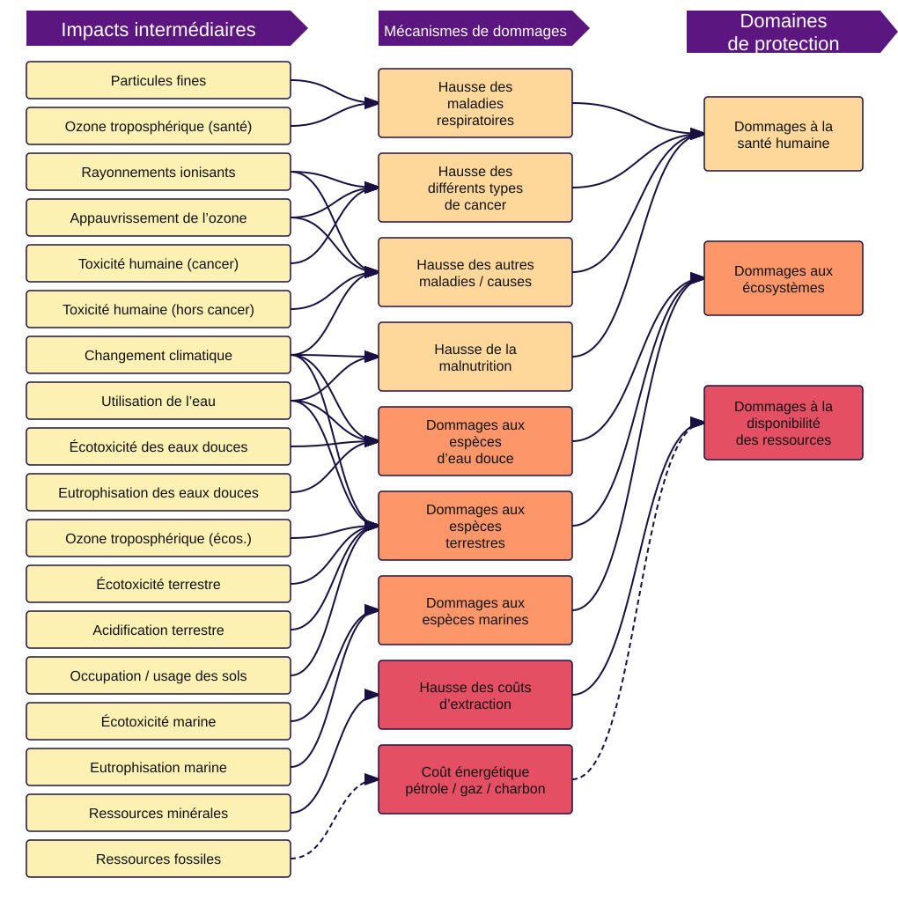</figure>

</div>
```

## Introduction à l’aide à la décision multicritère {.editorial .mcdm-intro-slide data-part="3" data-subpart="2" refs="sala-2017-normalisation,sala-cerutti-2018-weighting"}

<div class="slide-title">ADMC pour la recommendation de scénario à partir des résultats d’ACV</div>

```{=html}
<div class="ppt-canvas mcdm-intro">
<p class="mcdm-purpose">Choix de PROMETHEE</p>
<div class="mcdm-flow">
<div class="mcdm-stage"><span class="mcdm-stage-number">01</span><h3>Résultats d’ACV</h3><p>Impacts environnementaux<br>de chaque scénario</p></div>
<span class="mcdm-arrow" aria-hidden="true">→</span>
<div class="mcdm-stage"><span class="mcdm-stage-number">02</span><h3>Normalisation  et pondération </h3><p>Poids des critères <span data-cite="sala-2017-normalisation"></span><br>Seuils de normalisation <span data-cite="sala-cerutti-2018-weighting"></span></p></div>
<span class="mcdm-arrow" aria-hidden="true">→</span>
<div class="mcdm-stage"><span class="mcdm-stage-number">03</span><h3>Comparaison</h3><p>Évaluation des scénarios<br>deux à deux avec PROMETHEE</p></div>
<span class="mcdm-arrow" aria-hidden="true">→</span>
<div class="mcdm-stage"><span class="mcdm-stage-number">04</span><h3>Recommendation de scénarios</h3><p>Classement et incomparabilité</p></div>
</div>
<div class="mcdm-compensation">
<span class="fragment mcdm-compensation-step" data-fragment-index="0" aria-hidden="true"></span>
<h3>Méthodes d’ADMC et compensabilité</h3>
<table class="mcdm-compensation-table" lang="fr" aria-label="Comparaison des approches compensatoires des méthodes d’ADMC">
<thead><tr><th scope="row">Méthode</th><th scope="col">PROMETHEE</th><th scope="col">TOPSIS</th><th scope="col">AHP / Fuzzy AHP</th><th scope="col">SAW / WSA</th><th scope="col">ELECTRE<br>(I à IV, TRI)</th><th scope="col">TACTIC</th><th scope="col">MAPPAC</th><th scope="col">PACMAN</th><th scope="col">PRAGMA</th><th scope="col">ORESTE</th></tr></thead>
<tbody><tr><th scope="row">Approche compensatoire</th><td class="partial-noncompensatory">Partiellement non-compensatoire</td><td>Compensatoire</td><td>Compensatoire</td><td>Compensatoire</td><td class="partial-noncompensatory">Partiellement non-compensatoire</td><td class="partial-noncompensatory">Strictement / partiellement non-compensatoire</td><td>Strictement non-compensatoire</td><td>Hybride / modulable</td><td class="partial-noncompensatory">Partiellement non-compensatoire</td><td class="partial-noncompensatory">Partiellement non-compensatoire</td></tr><tr><th scope="row">Approche</th><td>Fonctions de préférence</td><td>—</td><td>—</td><td>—</td><td>Indices de concordance et de discordance</td><td>Veto et conditions d’acceptabilité strictes</td><td>—</td><td>—</td><td>Agglomération</td><td>Ordre des rangs</td></tr></tbody>
</table>
<div class="mcdm-acv-labels"><span class="fragment fade-in" data-fragment-index="1">Utilisée en ACV</span><span class="fragment fade-in" data-fragment-index="1">Utilisée en ACV</span></div>
</div>

</div>
```

## ADMC : PROMETHEE {.editorial data-part="3" data-subpart="2" refs="greco-2016,taherdoost-2023,wulf-2021"}

<div class="slide-title">ADMC : PROMETHEE <span data-cite="taherdoost-2023"></span></div>

```{=html}
<div class="ppt-canvas preference-choice">
<div class="ppt-table-wrap preference-functions"><table class="ppt-table"><caption>Fonctions de préférence <span data-cite="greco-2016"></span></caption><thead><tr><th>Fonction</th><th>Représentation</th><th>Définition de P(d)</th><th>Paramètres</th></tr></thead><tbody><tr><td>Usuelle</td><td></td><td>0 si d ≤ 0 ; 1 si d &gt; 0</td><td>-</td></tr><tr><td>En U</td><td></td><td>0 si d ≤ q ; 1 si d &gt; q</td><td>q</td></tr><tr><td>À niveaux</td><td></td><td>0 si d ≤ q ; ½ si q &lt; d ≤ p ;<br>1 si d &gt; p</td><td>p, q</td></tr><tr><td>Gaussienne</td><td></td><td>0 si d ≤ 0 ;<br>1 − exp(−d² / (2s²)) si d &gt; 0</td><td>s</td></tr><tr class="preference-vshape"><td>En V</td><td></td><td>0 si d ≤ q ;<br>(d − q) / (p − q) si q &lt; d ≤ p ;<br>1 si d &gt; p</td><td>p, q</td></tr></tbody></table></div>
<span class="fragment preference-selection" data-fragment-index="0" aria-hidden="true"></span>
<div class="preference-weak-stage">
<div class="preference-v-detail">
</div>

<div class="ppt-table-wrap weak-preference-table"><table class="ppt-table"><caption>Zones de préférence faible <span data-cite="wulf-2021"></span></caption><tr><td>Catégorie d’impact</td><td>Classe d’incertitude</td><td>Zone de préférence faible (q-p)</td></tr><tr><td>Changement climatique</td><td>1</td><td>10-20%</td></tr><tr><td>Appauvrissement de l’ozone</td><td>1</td><td>10-20%</td></tr><tr><td>Demande cumulée d’énergie</td><td>1</td><td>10-20%</td></tr><tr><td>Épuisement des ressources en eau</td><td>2</td><td>30-40%</td></tr><tr><td>Épuisement des ressources minérales</td><td>2</td><td>30-40%</td></tr><tr><td>Particules / effets respiratoires inorganiques</td><td>2</td><td>30-40%</td></tr><tr><td>Rayonnements ionisants - santé humaine</td><td>2</td><td>30-40%</td></tr><tr><td>Formation photochimique d’ozone</td><td>2</td><td>30-40%</td></tr><tr><td>Acidification</td><td>2</td><td>30-40%</td></tr><tr><td>Eutrophisation terrestre</td><td>2</td><td>30-40%</td></tr><tr><td>Eutrophisation aquatique</td><td>2</td><td>30-40%</td></tr><tr><td>Eutrophisation marine</td><td>2</td><td>30-40%</td></tr><tr><td>Écotoxicité en eau douce</td><td>3</td><td>70-80%</td></tr><tr><td>Toxicité humaine cancérogène</td><td>3</td><td>70-80%</td></tr><tr><td>Toxicité humaine non cancérogène</td><td>3</td><td>70-80%</td></tr></table></div>
</div>
</div>
```

## Application {.editorial .validation-overview-slide data-part="3" data-subpart="3" refs="sune-2025"}

<div class="slide-title">Application de la méthodologie</div>

```{=html}
<div class="ppt-canvas validation-overview">
<article class="validation-example">
<h3>Comparaison avec un rapport de l'ADEME <span data-cite="sune-2025"></span></h3>
<div class="ademe-validation-content">
<div class="ademe-validation-intro"><div class="ademe-validation-label" data-id="ademe-validation-label">ADEME</div><h3>ACV attributionnelle d’un trajet en train</h3><p><strong>100 km</strong> de ligne non électrifiée</p></div>
<figure class="ademe-parameters"><figcaption data-id="ademe-parameters-title">Paramètres de la ligne</figcaption>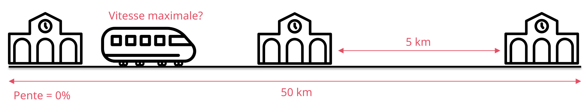</figure>
</div>
</article>
<article class="validation-example">
<h3>Application à un cas réel: la Corse</h3>

</article>
<article class="validation-example">
<h3>Analyse de sensibilité</h3>
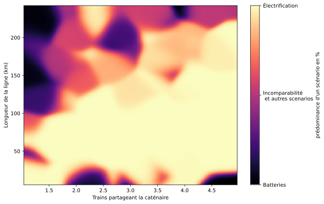
</article>
</div>
```

## Validation : comparaison avec l’ADEME {.editorial data-part="3" data-subpart="3" refs="sune-2025"}

<div class="slide-title">Validation : cas d'étude de l’ADEME <span data-cite="sune-2025"></span></div>

```{=html}
<div class="ppt-canvas ademe-validation">
<figure class="ademe-report">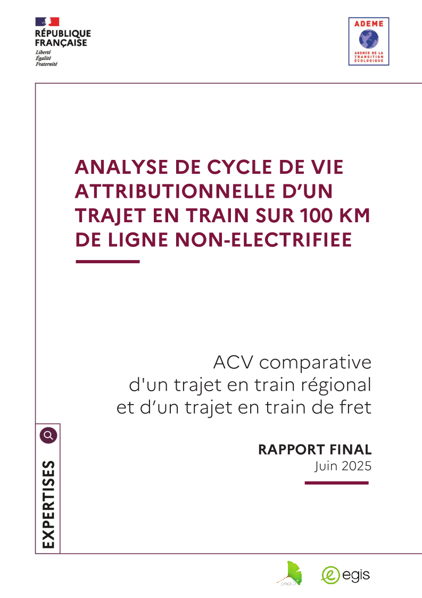<figcaption></figcaption></figure>
<div class="ademe-validation-content">
<div class="ademe-validation-intro"><div class="ademe-validation-label" data-id="ademe-validation-label">ADEME</div><h3>ACV attributionnelle d’un trajet en train</h3><p><strong>100 km</strong> de ligne non électrifiée</p><p class="ademe-report-scope"><strong>Unité fonctionnelle : 1 passager-kilomètre (p.km)</strong><br>Transporter un passager sur un kilomètre.</p></div>
<figure class="ademe-parameters"><figcaption data-id="ademe-parameters-title">Paramètres de la ligne</figcaption></figure>
</div>
</div>
```


## Analyse des résultats : impacts normalisés {.editorial .normalized-results-slide data-part="3" data-subpart="3" refs="sune-2025"}

<div class="slide-title">Comparaison des résultats des méthodologies</div>

<div class="ppt-canvas"><div class="ppt-text results-cautions" style="left:1%;top:62%;width:47%;height:19%;font-size:var(--content-size);"><div class="ppt-p" style="text-align:center"><span style="font-size:var(--content-size);font-weight:700">« Les résultats obtenus ne peuvent être généralisés à l’ensemble des configurations d’exploitation ferroviaire. » </span></div><div class="ppt-p" style="text-align:center"><span style="font-size:var(--content-size);font-weight:700">« Cette étude ne remplace pas la réalisation d’une ACV spécifique au système étudié. » </span></div></div>
<div class="ppt-table-wrap speed-ranking-table">
<table class="ppt-table" aria-label="Classement des scénarios selon la vitesse maximale">
<thead>
<tr><th rowspan="2" scope="col">Scénarios</th><th colspan="3" scope="colgroup">Vitesse maximale (km/h)</th></tr>
<tr><th scope="col">54 - 72</th><th scope="col">72 - 94</th><th scope="col">94 - 130</th></tr>
</thead>
<tbody>
<tr><th scope="row">Électrification</th><td>1</td><td rowspan="2" class="speed-ranking-uncertainty">Incertitude</td><td>2</td></tr>
<tr><th scope="row">Batteries</th><td>2</td><td>1</td></tr>
<tr><th scope="row">Diesel</th><td>3</td><td>3</td><td>3</td></tr>
</tbody>
</table>
</div>
<div class="ppt-text speed-ranking-heading" style="left:50%;top:13%;width:47%;height:5%;font-size:var(--content-size);"><div class="ppt-p" style="text-align:center"><span style="font-size:var(--content-size);font-weight:700">Classement PROMETHEE selon la vitesse maximale</span></div></div>

<div class="ppt-table-wrap impact-ranking-table" style="left:2%;top:23%;width:45%;height:31%;"><table class="ppt-table"><tr><td style="font-size:var(--content-size);font-weight:700">Catégorie d’impact</td><td style="font-size:var(--content-size);font-weight:700">Scénario le plus impactant</td></tr><tr><td style="font-size:var(--content-size)">Changement climatique</td><td style="font-size:var(--content-size)">Diesel</td></tr><tr><td style="font-size:var(--content-size)">Utilisation des ressources fossiles</td><td style="font-size:var(--content-size)">Hydrogène produit par électrolyse avec le mix électrique français</td></tr><tr><td style="font-size:var(--content-size)">Micro-particules</td><td style="font-size:var(--content-size)">Biocarburant B100</td></tr><tr><td style="font-size:var(--content-size)">Utilisation des ressources minérales et métalliques</td><td style="font-size:var(--content-size)">Hydrogène, batteries et caténaires</td></tr></table></div>
<div class="ppt-text" style="left:31%;top:8%;width:5%;height:5%;"><span data-cite="sune-2025"></span></div></div>

## Cas d’étude : Corse {.editorial .corsica-case-slide data-part="3" data-subpart="3"}

<div class="slide-title">Cas d’étude : Corse</div>

<div class="ppt-canvas">
<div class="corse-map-caption">Carte topographique du tracé des lignes et des gares ferroviaires corses</div>
</div>

<div class="ppt-table-wrap fragment fade-in" data-fragment-index="1" style="left:50%;top:14%;width:33%;height:24%;"><table class="ppt-table"><tr><td style="font-size:var(--content-size)">04/06/26</td><td style="font-size:var(--content-size);font-weight:700">gCO₂eq/kWh</td><td style="font-size:var(--content-size);font-weight:700">Production impactante</td></tr><tr><td style="font-size:var(--content-size);font-weight:700">Corse</td><td style="font-size:var(--content-size)">452</td><td style="font-size:var(--content-size)">40% fioul</td></tr><tr><td style="font-size:var(--content-size);font-weight:700">Italie</td><td style="font-size:var(--content-size)">147</td><td style="font-size:var(--content-size)">4% gaz</td></tr><tr><td style="font-size:var(--content-size);font-weight:700">France</td><td style="font-size:var(--content-size)">16</td><td style="font-size:var(--content-size)">60% nucléaire</td></tr></table></div>

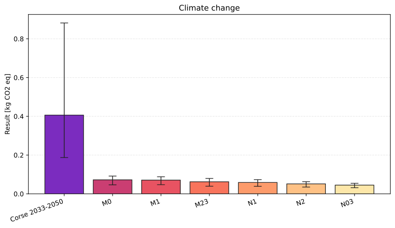
<div class="corse-impact-caption fragment fade-in" data-fragment-index="0">Impact sur le changement climatique du mix électrique corse 2033–2050 et des scénarios RTE 2050</div>

<div class="ppt-table-wrap fragment fade-in" data-fragment-index="2" style="left:50%;top:71%;width:35%;height:19%;"><table class="ppt-table"><tr><td style="font-size:var(--content-size);font-weight:700">Ligne</td><td style="font-size:var(--content-size);font-weight:700">Energie sans regeneration (kWh)</td><td style="font-size:var(--content-size);font-weight:700">Energie avec regeneration (kWh)</td></tr><tr><td style="font-size:var(--content-size);font-weight:700">Balagne</td><td style="font-size:var(--content-size)">1,159</td><td style="font-size:var(--content-size)">787</td></tr><tr><td style="font-size:var(--content-size);font-weight:700">Centrale</td><td style="font-size:var(--content-size)">2,029</td><td style="font-size:var(--content-size)">1,268</td></tr></table></div>

## Réduction de l’impact du mix électrique corse {.editorial data-part="3" data-subpart="3"}

<div class="slide-title">Évolution du classement avec la réduction de l’impact du mix électrique corse</div>

<div class="ppt-canvas">
<div class="corse-reduction-axis">% de réduction de l’impact du mix électrique</div>
<div class="module-matrix corse-scenario-matrix" lang="fr" role="group" aria-label="Scénarios selon la réduction de l’impact du mix électrique">
<div class="matrix-head" style="grid-column:1;grid-row:1;">Scénarios</div>
<div class="matrix-head corse-threshold fragment fade-in" data-fragment-index="2" style="--corse-rank:3;"><strong>−96 %</strong><span>France métropole</span></div>
<div class="matrix-head corse-threshold fragment fade-in" data-fragment-index="1" style="--corse-rank:2;"><strong>−51 %</strong><span>Italie</span></div>
<div class="matrix-head corse-threshold fragment fade-in" data-fragment-index="0" style="--corse-rank:1;"><strong>−47 %</strong></div>
<div class="matrix-head corse-threshold" style="--corse-rank:0;"><strong>0 %</strong><span>Mix actuel</span></div>
<div class="matrix-label" style="grid-column:1;grid-row:2;">Batteries</div>
<div class="matrix-label" style="grid-column:1;grid-row:3;">Hydrogène</div>
<div class="matrix-label" style="grid-column:1;grid-row:4;">Diesel</div>
<div class="matrix-module matrix-family-alim" style="" aria-label="Batteries : présentes dans les quatre colonnes"></div>
<div class="matrix-module matrix-family-energie" style="" aria-label="Hydrogène : de la colonne moins 51 pour cent jusqu’à zéro"></div>
<div class="matrix-module matrix-family-infra" style="" aria-label="Diesel : au-delà de moins 47 pour cent jusqu’à zéro"></div>
</div>
<div class="corse-mix-perspective fragment fade-in" data-fragment-index="3"><strong>Perspectives</strong> : Stratégies de décarbonation du mix électrique corse</div>
</div>

## Stratégies de décarbonation du mix électrique corse {.editorial .corsica-strategies-slide data-part="3" data-subpart="3" refs="edf-2024"}

<div class="slide-title">Stratégies de décarbonation du mix électrique corse</div>

<div class="ppt-canvas">
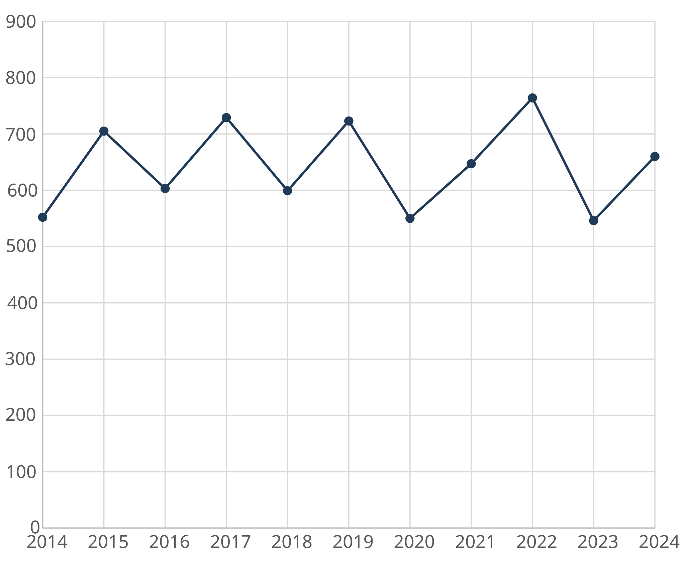
<h3 class="corsica-chart-title corsica-chart-title-left">Evolution de l’impact en tonnes de CO2eq de la production d’électricité en Corse <span data-cite="edf-2024"></span></h3>
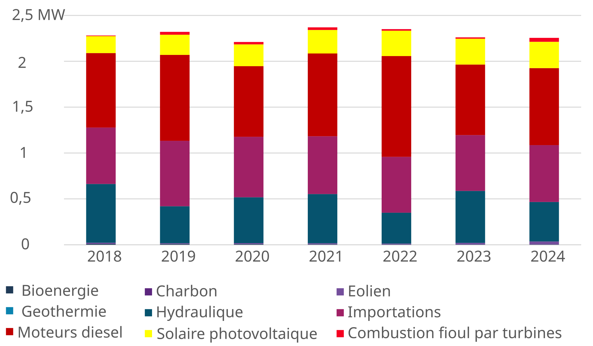
<h3 class="corsica-chart-title corsica-chart-title-right">Modes de production d’électricité en Corse (MW) <span data-cite="edf-2024"></span></h3>
<div class="ppt-text corsica-sacoi-note" style="left:3%;top:96%;width:94%;height:4%;font-size:var(--content-size);text-align:center;"><strong>SACOI3 : 100 MW</strong> d’alimentation de l’Italie vers la Corse</div></div>

## Analyse de sensibilité globale {.editorial data-part="3" data-subpart="3"}

<div class="slide-title">Analyse de sensibilité globale</div>

<div class="ppt-canvas sampling-designs">
<figure class="sampling-panel">
<figcaption><strong>Variabilité</strong><span>Tirage de Sobol</span></figcaption>
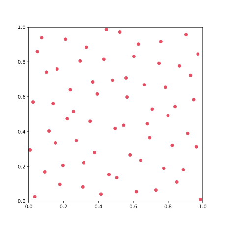
</figure>
<figure class="sampling-panel">
<figcaption><strong>Incertitude</strong><span>Tirage Monte-Carlo</span></figcaption>
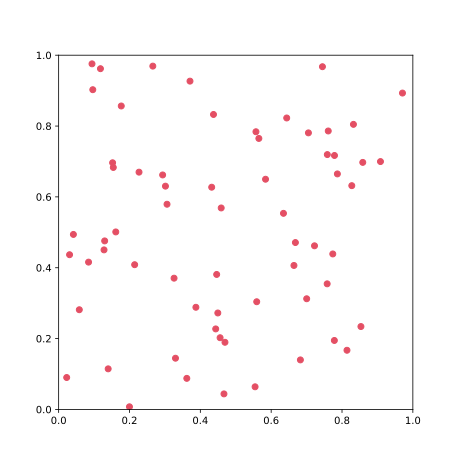
</figure>
</div>

## Sobol total : ensemble des paramètres {.editorial .sobol-readable-slide data-part="3" data-subpart="3"}

<div class="slide-title">Sobol total : ensemble des paramètres</div>

```{=html}
<div class="ppt-canvas sobol-readable-content">
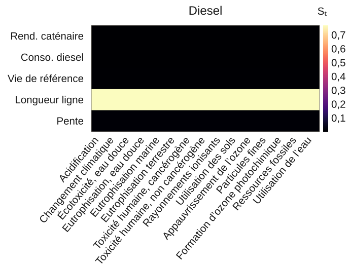
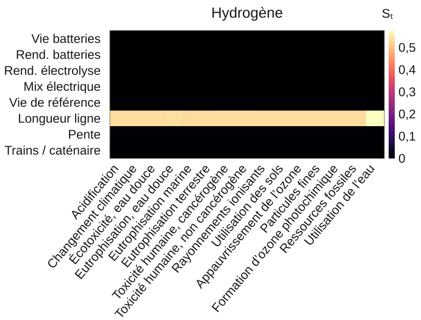
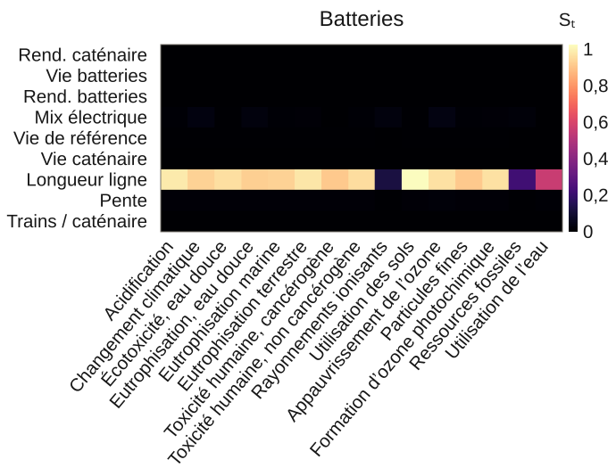
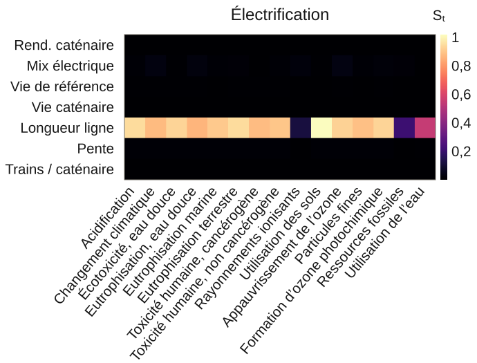
</div>
```

## Sobol total : paramètres technologiques {.editorial .sobol-readable-slide data-part="3" data-subpart="3"}

<div class="slide-title">Sobol total : paramètres technologiques</div>

```{=html}
<div class="ppt-canvas sobol-readable-content">
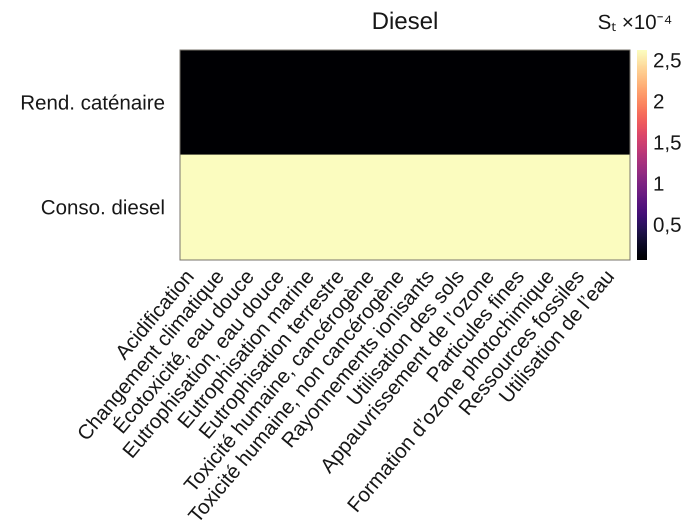
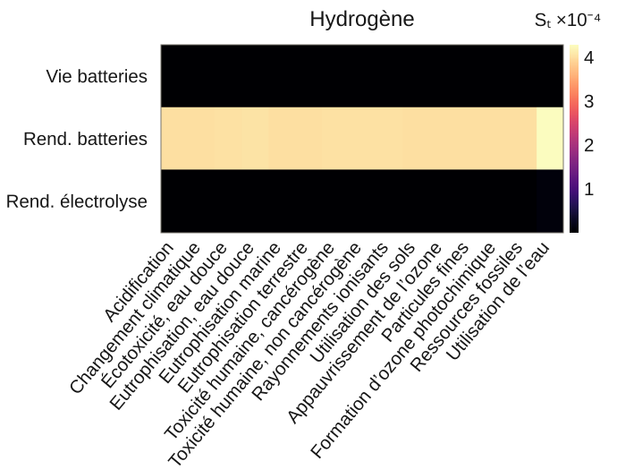
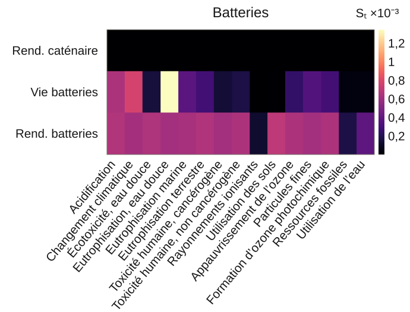
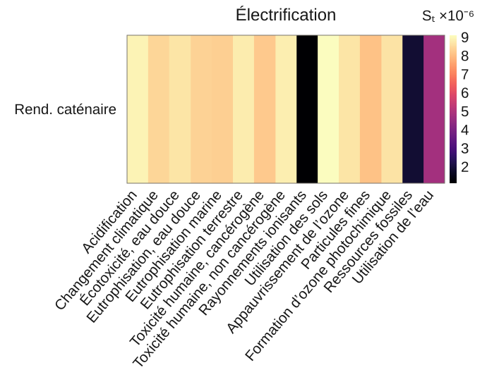
</div>
```

## Zones d’incomparabilité {.editorial .incomparability-slide data-part="3" data-subpart="3"}

<div class="slide-title">Zones d’incomparabilité</div>


```{=html}
<div class="ppt-canvas incomparability-content">
<div class="incomparability-maps">
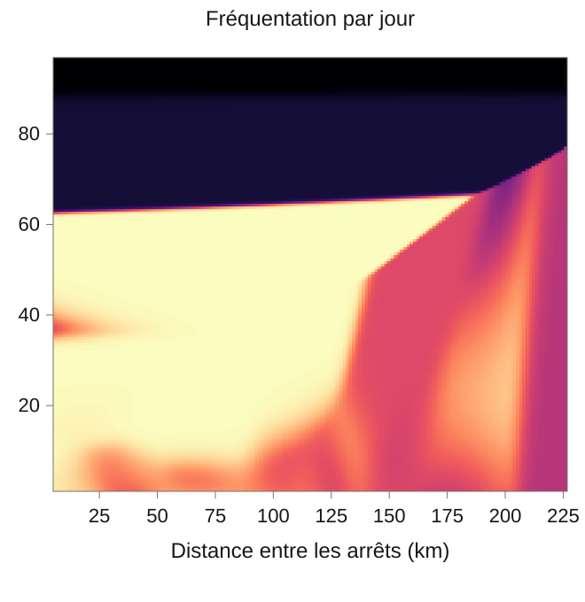
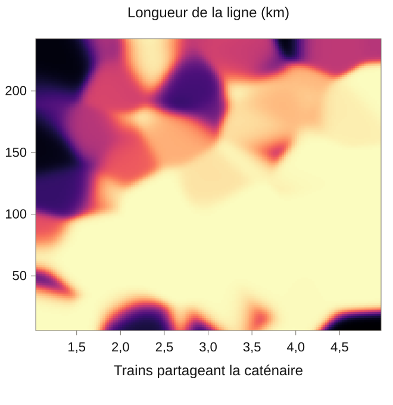
</div>
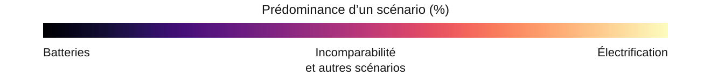
</div>
```

## {.editorial .part-divider data-part="4" data-subpart="1"}

<div class="divider-number">PARTIE 04</div>
<div class="divider-title">Conclusions et Perspectives</div>
<div class="divider-subtitle">Synthèse des contributions et perspectives scientifiques et opérationnels.</div>

## Conclusion {.editorial .conclusion-summary-slide data-part="4" data-subpart="1" refs="literature-1,literature-2,literature-3,literature-4,literature-5,tsvetkova-2019"}

<div class="slide-title">Conclusion</div>
<div class="perspective-grid">
<div class="perspective-column fragment fade-in" data-fragment-index="0"><div class="perspective-kicker">ORGANISATION DE LA DÉCISION</div><div class="perspective-title">Réorganisation des décisions publiques avec interactions public-privé</div><div class="perspective-list">Réduction des risques<br>Permet l'analyse et l'organisation des acteurs dans un processus de décision public-privé</div></div>
<div class="perspective-column fragment fade-in" data-fragment-index="1"><div class="perspective-kicker">RECOMMANDATION TECHNOLOGIQUE</div><div class="perspective-title">Méthodologie de recommandation environnementale</div><div class="perspective-list">ACV adaptable à différents contextes<br>Facile à interpréter pour des non-experts<br>Transparence des données et incertitudes</div></div>
</div>

<div class="conclusion-visuals">
<div class="module-matrix literature-module-matrix fragment fade-in" data-fragment-index="0" lang="fr" role="group" aria-label="Répartition des références selon les acteurs et les domaines">
<div class="matrix-head" style="grid-column:1;grid-row:1;">Acteurs</div>
<div class="matrix-head" style="grid-column:2 / 5;grid-row:1;">Analyse des parties prenantes</div>
<div class="matrix-head" style="grid-column:5 / 8;grid-row:1;">Organisation des relations entre parties prenantes</div>
<div class="matrix-head" style="grid-column:8 / 11;grid-row:1;">Organisation du processus de décision</div>
<div class="matrix-label" style="grid-column:1;grid-row:2 / 5;">Acteurs publics</div>
<div class="matrix-label" style="grid-column:1;grid-row:5 / 8;">Acteurs industriels</div>
<div class="literature-row-band" style="grid-column:2 / 11;grid-row:5 / 8;" aria-hidden="true"></div>
<div class="matrix-module literature-reference" data-literature="literature-1" style="grid-column:6 / 11;grid-row:3 / 5;" title="Approche participative et gouvernance locale"><span data-cite="literature-1"></span></div>
<div class="matrix-module literature-reference" data-literature="literature-2" style="grid-column:2 / 11;grid-row:2;" title="Modélisation graphique et cartographie des parties prenantes"><span data-cite="literature-2"></span></div>
<div class="matrix-module literature-reference" data-literature="literature-3" style="grid-column:2;grid-row:3 / 8;" title="Évaluation des impacts organisationnels du changement"><span data-cite="literature-3"></span></div>
<div class="matrix-module literature-reference" data-literature="literature-4" style="grid-column:5;grid-row:3 / 8;" title="Stratégies d’évaluation et de gestion des parties prenantes"><span data-cite="literature-4"></span></div>
<div class="matrix-module literature-reference" data-literature="literature-5" style="grid-column:3;grid-row:3 / 8;" title="Influence des groupes d’intérêt et asymétrie d’information"><span data-cite="literature-5"></span></div>
<div class="matrix-module literature-reference" data-literature="literature-6" style="grid-column:4;grid-row:5 / 8;" title="Modélisation des parties prenantes de l’entreprise"><span data-cite="tsvetkova-2019"></span></div>
</div>

</div>

## Perspectives {.editorial .scientific-perspectives data-part="4" data-subpart="1"}

<div class="slide-title">Perspectives scientifiques et opérationnelles</div>
<div class="perspective-grid">
<div class="perspective-column fragment fade-in" data-fragment-index="0">
<h3 class="perspective-kicker">Réorganisation des parties prenantes</h3>
<div class="perspective-list">
<p><strong>Temporalité de la décision</strong><br>Modéliser une DSM par étape pour mieux représenter la temporalité des interventions.</p>
<p><strong>Représentation des acteurs</strong><br>Développer une modélisation à base d’agents (ABM) pour mieux représenter les acteurs et leurs interactions.</p>
</div>
</div>
<div class="perspective-column fragment fade-in" data-fragment-index="1">
<h3 class="perspective-kicker">ACV et aide à la décision multicritère</h3>
<div class="perspective-list">
<p><strong>Évaluation de la durabilité</strong><br>Ajouter l'analyse <strong>sociale</strong> et des <strong>coûts</strong> du cycle de vie pour une évaluation de la soutenabilité du cycle de vie.</p>
<p><strong>Sensibilité aux méthodes</strong><br>Tester d’autres méthodes d’ADMC, de pondération et de normalisation pour évaluer la sensibilité du classement aux choix méthodologiques et comparer les résultats à une approche par score unique.</p>
</div>
</div>
</div>
<div class="perspective-applications fragment fade-in" data-fragment-index="2">
<h3 class="perspective-kicker">Perspectives d’application</h3>
<ul>
<li>Étendre l’approche à d’autres régions à l’international confrontées à des enjeux similaires.</li>
<li>Étendre l’approche à d’autres formes de mobilité lourde.</li>
<li>Étendre l’approche à d’autres réseaux d’acteurs, pour des décisions publiques faisant intervenir des acteurs privés.</li>
<li>Étendre l’approche à d’autres contextes associant énergie et infrastructures, comme l’aménagement du territoire ou la construction de bâtiments.</li>
</ul>
</div>

## {.end-slide .thanks-slide data-part="4" data-subpart="1"}

<div class="end-title">Merci.</div>
<div class="end-subtitle">Questions</div>
```{=html}
<div class="publication-grid">
<article class="publication-card">
<a class="publication-preview" href="figures/conf.pdf" target="_blank" rel="noopener"></a>
<div class="publication-details">
<div class="publication-label">Conférence 2024</div>
<h3>Modeling and Analyzing Interactions Between Stakeholders for Train Decarbonization Decisions at a Regional Scale</h3>
<p>Volant, B., Marle, F., Leroy, Y., &amp; Dalbavie, J.-M. (2024).</p>
<p class="publication-venue"><em>DS 134: Proceedings of the 26th International DSM Conference (DSM 2024), Stuttgart, Germany</em>, 059–068.</p>
<a class="publication-doi" href="https://doi.org/10.35199/DSM2024.07" target="_blank" rel="noopener">doi:10.35199/DSM2024.07</a>
</div>
</article>
<article class="publication-card">
<a class="publication-preview" href="figures/article.pdf" target="_blank" rel="noopener"></a>
<div class="publication-details">
<div class="publication-label">Article de journal 2026</div>
<h3>Who decides? Positioning stakeholders in a decision-making process via network modeling and analysis: Application to regional trains decarbonization</h3>
<p>Volant, B., Marle, F., Leroy, Y., &amp; Dalbavie, J.-M. (2026).</p>
<p class="publication-venue"><em>Transportation Research Interdisciplinary Perspectives</em>, <em>36</em>, 101880.</p>
<a class="publication-doi" href="https://doi.org/10.1016/j.trip.2026.101880" target="_blank" rel="noopener">doi:10.1016/j.trip.2026.101880</a>
</div>
</article>
</div>
<div class="cover-partners">
<div class="cover-partner cover-ikos"><div class="cover-supervisors"><figure><figcaption>Jeanne-Marie Dalbavie</figcaption></figure></div></div>
<div class="cover-author"><strong>Benoît Volant</strong><span></span></div>
<div class="cover-partner cover-lgi"><div class="cover-academic-logos"><div class="cover-centrale-frame"></div></div><div class="cover-supervisors"><figure><figcaption>Franck Marle</figcaption></figure><figure><figcaption>Yann Leroy</figcaption></figure></div></div>
</div>
```

## Limites planétaires {.appendix-slide}

<div class="appendix-title">Limites planétaires</div>
<div class="appendix-body"><div class="ppt-canvas" style="top:0;left:0;right:0;bottom:0;">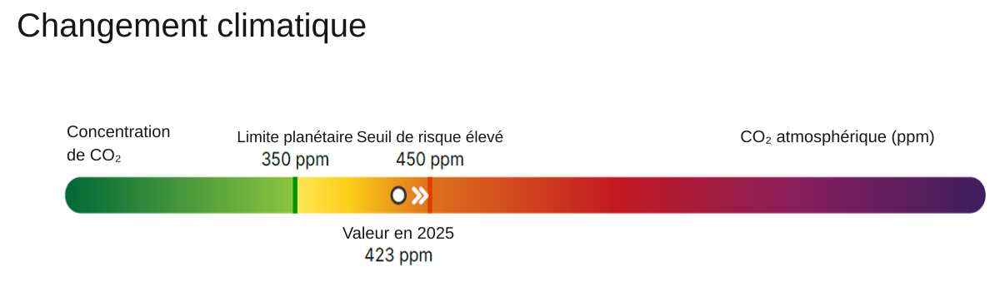
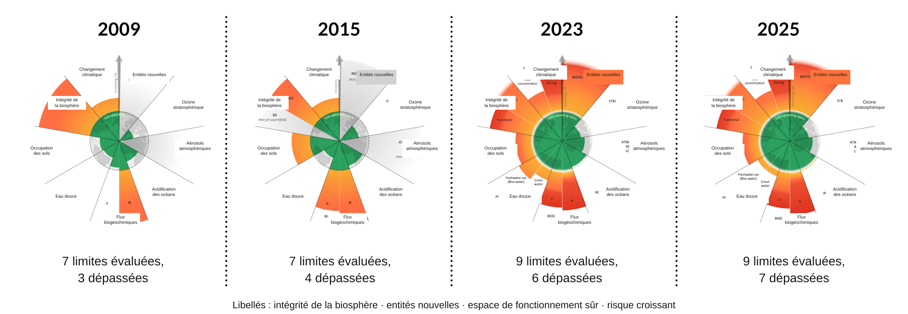</div></div>

## Critères d’impact environnementaux {.appendix-slide .appendix-impact-criteria}

<div class="appendix-title">Critères d’impact environnementaux</div>
<div class="appendix-body"><div class="ppt-canvas" style="top:0;left:0;right:0;bottom:0;">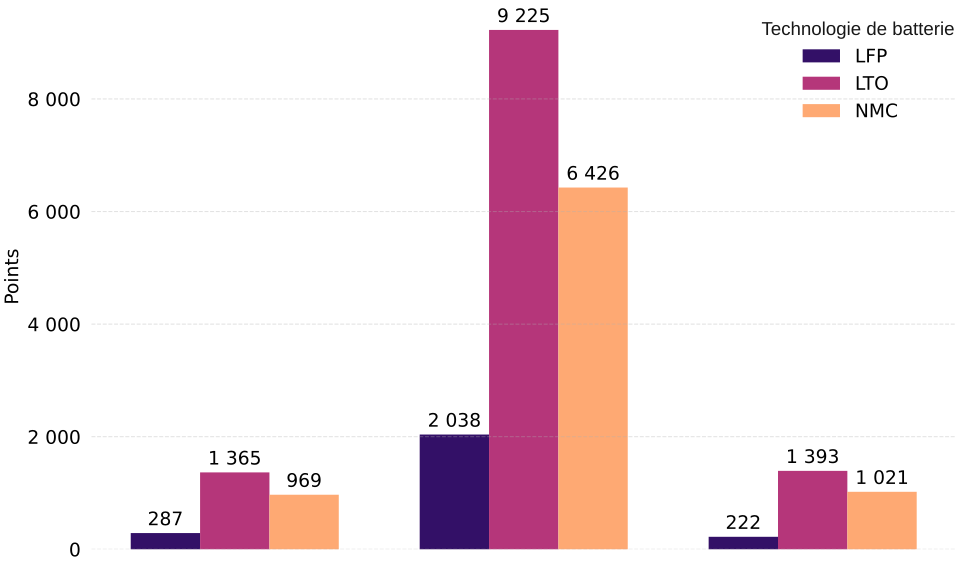

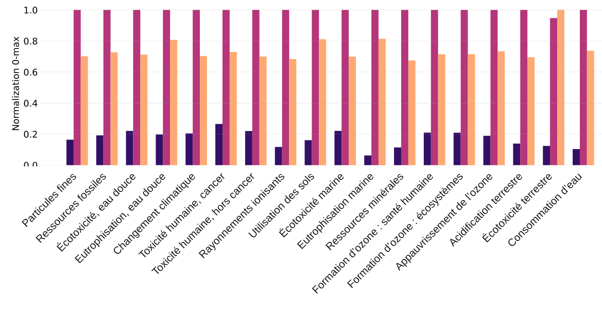
<div class="ppt-text" style="left:58%;top:2%;width:25%;height:5%;font-size:var(--content-size);"><div class="ppt-p" style="text-align:center"><span style="font-size:var(--content-size);font-weight:700">Impacts intermédiaires</span></div></div>
<div class="ppt-text" style="left:76%;top:86%;width:22%;height:5%;font-size:var(--content-size);"><div class="ppt-p" style="text-align:center"><span style="font-size:var(--content-size);font-weight:700">Score</span></div></div>
<div class="ppt-text" style="left:47%;top:88%;width:16%;height:5%;font-size:var(--content-size);"><div class="ppt-p" style="text-align:center"><span style="font-size:var(--content-size);font-weight:700">Dégâts </span></div></div>
</div></div>

## Formalisation de la méthodologie d’ACV {.editorial .appendix-slide .has-slide-references}

<div class="slide-title">Formalisation de la méthodologie d’ACV <span class="slide-subtitle">ISO 14040 · ISO 14044</span></div>

<div class="ppt-canvas acv-methodology">
<div class="methodology-steps" role="img" aria-label="Quatre phases de l’ACV : objectifs et champ de l’étude, inventaire, évaluation des impacts, interprétation. Des itérations relient les phases.">
<div class="methodology-step"><span>Objectifs et champ<br>de l’étude</span></div>
<div class="methodology-step"><span>Inventaire du<br>cycle de vie</span></div>
<div class="methodology-step"><span>Évaluation des impacts<br>du cycle de vie</span></div>
<div class="methodology-step"><span>Interprétation</span></div>
</div>
<div class="acv-phase-details">
<div><h3>Cadrer la comparaison</h3><p>Objectif, unité fonctionnelle<br>et frontières du système</p><p>Scénarios technologiques<br>et hypothèses communes</p><div class="acv-deliverable">Périmètre de l’étude</div></div>
<div><h3>Quantifier les flux</h3><p>Collecte des données :<br>matières, énergie, émissions</p><p>Fabrication, exploitation,<br>maintenance et fin de vie</p><div class="acv-deliverable">Inventaire des flux</div></div>
<div><h3>Caractériser les impacts</h3><p>Choix des catégories<br>et indicateurs d’impact</p><p>Classification des flux<br>et caractérisation</p><div class="acv-deliverable">Profil environnemental</div></div>
<div><h3>Éclairer la décision</h3><p>Contributions majeures,<br>sensibilité et cohérence</p><p>Limites, conclusions<br>et recommandations</p><div class="acv-deliverable">Résultats interprétés</div></div>
</div>
</div>
<div class="slide-references" role="note"><span class="slide-reference-entry">ISO (2006). ISO 14040 - Management environnemental - Analyse du cycle de vie - Principes et cadre.</span><span class="slide-reference-entry">ISO (2006). ISO 14044 - Management environnemental - Analyse du cycle de vie - Exigences et lignes directrices.</span></div>

## caténaires {.editorial .appendix-slide}

<div class="slide-title">Impact des modèles de caténaires</div>

<div class="ppt-canvas">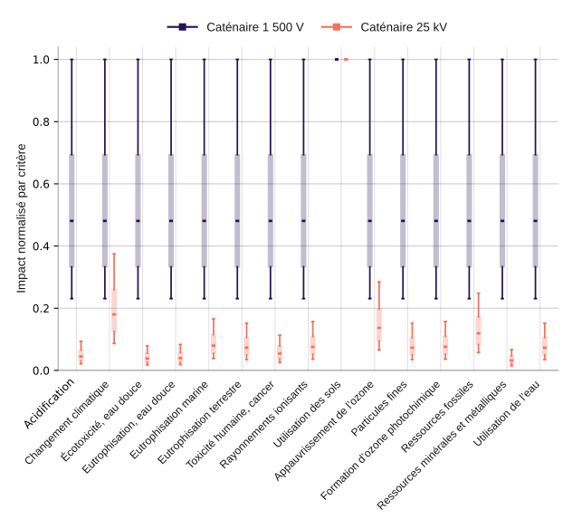
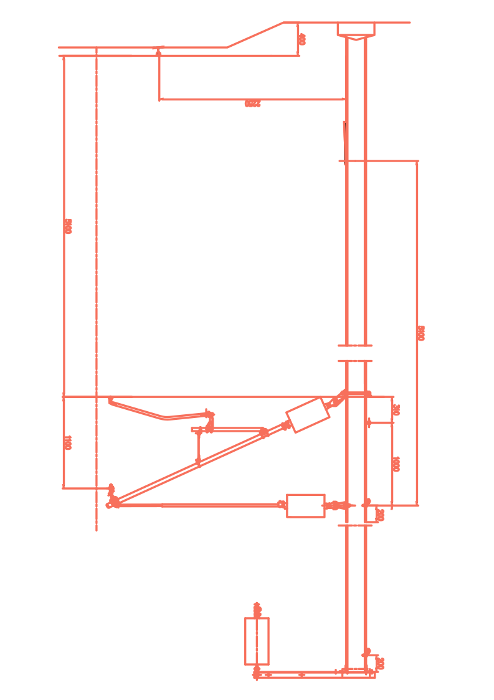
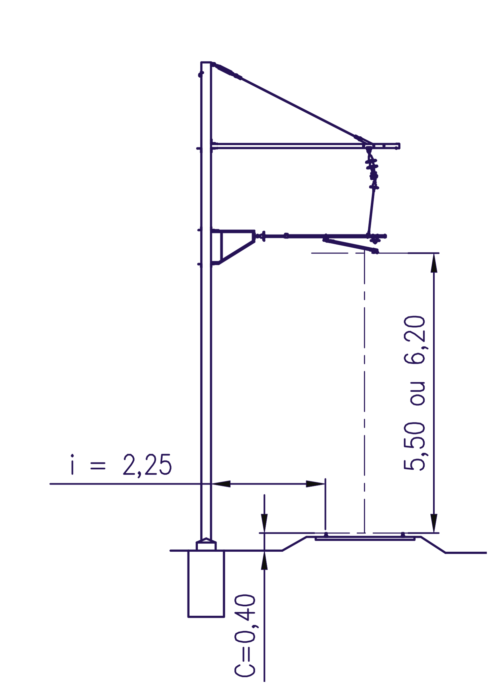</div>

## mix électrique {.editorial .appendix-slide}

<div class="slide-title">Impact des modèles de mix électrique</div>

<div class="ppt-canvas">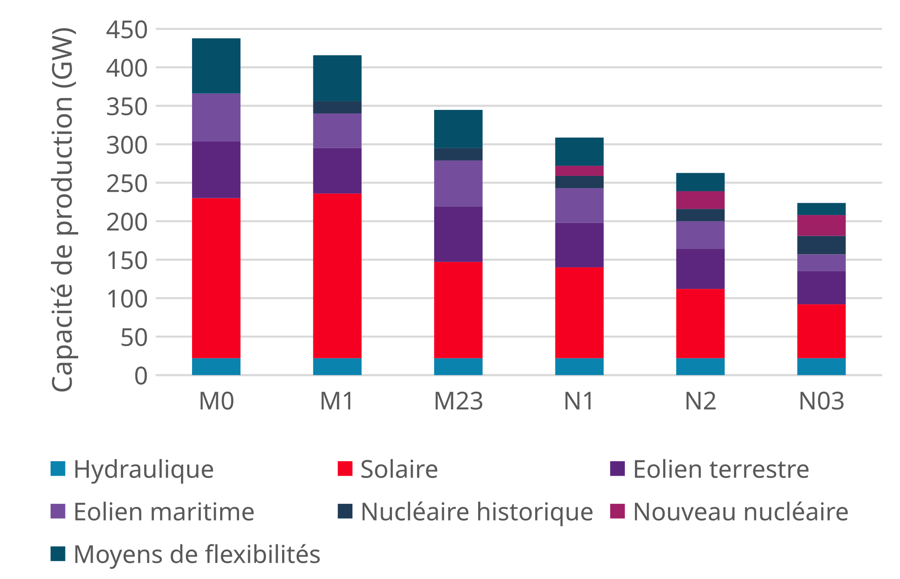
<div class="ppt-text" style="left:4%;top:20%;width:34%;height:6%;font-size:var(--content-size);"><div class="ppt-p" style="text-align:left"><span style="font-size:var(--content-size)">Prospectives: scenarios de projection (RTE) </span></div></div>
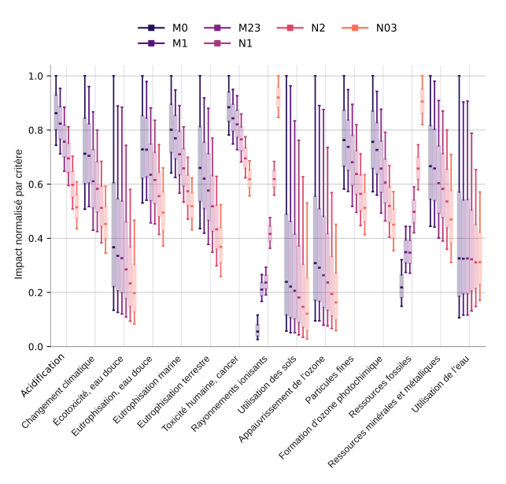</div>

## Batteries : echelle {.editorial .appendix-slide .annex-battery-review}

<div class="slide-title">Verification de l'échelle de production des batteries</div>

<div class="ppt-canvas">

<div class="ppt-table-wrap" style="left:52%;top:62%;width:37%;height:24%;"><table class="ppt-table"><tr><td style=""></td><td style="color:#440F76;font-size:var(--content-size)">LTO</td><td style="color:#B73779;font-size:var(--content-size)">NMC</td><td style="color:#FD9668;font-size:var(--content-size)">LFP</td></tr><tr><td style="font-size:var(--content-size)">Masse</td><td style="font-size:var(--content-size)">1400 kg</td><td style="font-size:var(--content-size)">-</td><td style="font-size:var(--content-size)">-</td></tr><tr><td style="font-size:var(--content-size)">Energie kWh</td><td style="font-size:var(--content-size)">75</td><td style="font-size:var(--content-size)">220</td><td style="font-size:var(--content-size)">191</td></tr><tr><td style="font-size:var(--content-size)">Puissance kW</td><td style="font-size:var(--content-size)">300 à 600</td><td style="font-size:var(--content-size)">220 à 440</td><td style="font-size:var(--content-size)">191 à 383</td></tr></table></div></div>

## Batteries  {.editorial .appendix-slide .annex-battery-sizing}

<div class="slide-title">Impact des modèles de batteries</div>

<div class="ppt-canvas">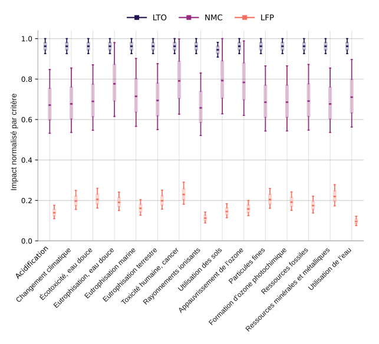
<div class="ppt-table-wrap" style="left:56%;top:17%;width:37%;height:24%;"><table class="ppt-table"><tr><td style=""></td><td style="color:#440F76;font-size:var(--content-size)">LTO</td><td style="color:#B73779;font-size:var(--content-size)">NMC</td><td style="color:#FD9668;font-size:var(--content-size)">LFP</td></tr><tr><td style="font-size:var(--content-size)">Masse</td><td style="font-size:var(--content-size)">1400 kg</td><td style="font-size:var(--content-size)">1400 kg</td><td style="font-size:var(--content-size)">1400 kg</td></tr><tr><td style="font-size:var(--content-size)">Energie kWh</td><td style="font-size:var(--content-size)">75</td><td style="font-size:var(--content-size)">220</td><td style="font-size:var(--content-size)">191</td></tr><tr><td style="font-size:var(--content-size)">Puissance kW</td><td style="font-size:var(--content-size)">300 à 600</td><td style="font-size:var(--content-size)">220 à 440</td><td style="font-size:var(--content-size)">191 à 383</td></tr></table></div>
</div>

## modélisation des vitesses {.editorial .appendix-slide .annex-speed-model}

<div class="slide-title">Modélisation des vitesses</div>

<div class="ppt-canvas">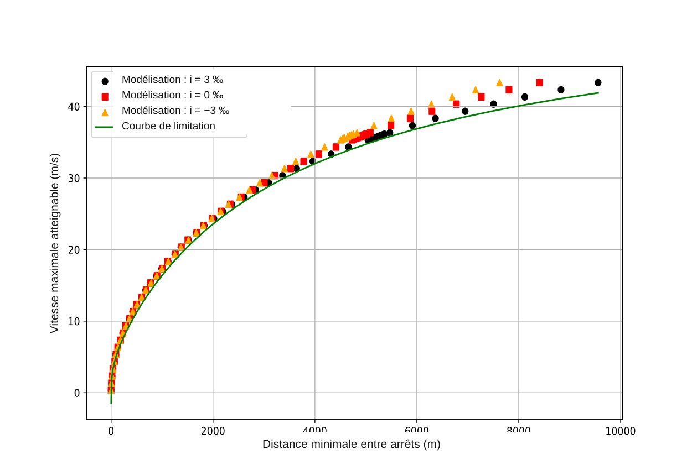</div>

## paramètres  {.editorial .appendix-slide .annex-technology-line}

<div class="slide-title">Schema de la paramétrisation du modèle</div>

<div class="ppt-canvas">
</div>

## Illustration d’un classement multicritère {.editorial .appendix-slide .annex-ranking}

<div class="slide-title">Illustration d’un classement multicritère</div>

<div class="ppt-canvas"><div class="ppt-table-wrap" style="left:27%;top:5%;width:50%;height:31%;"><table class="ppt-table"><tr><td style=""></td><td style="background:#FFF2CC;color:#000000;font-size:var(--content-size)">Poids</td><td style="background:#FFF2CC;color:#000000;font-size:var(--content-size)">0,24</td><td style="background:#FFF2CC;color:#000000;font-size:var(--content-size)">0,27</td><td style="background:#FFF2CC;color:#000000;font-size:var(--content-size)">0,18</td><td style="background:#FFF2CC;color:#000000;font-size:var(--content-size)">0,09</td><td style="background:#FFF2CC;color:#000000;font-size:var(--content-size)">0,21</td></tr><tr><td style=""></td><td style="background:#DDEBF7;color:#000000;font-size:var(--content-size)">Critères</td><td style="background:#DDEBF7;color:#000000;font-size:var(--content-size)">Coût</td><td style="background:#DDEBF7;color:#000000;font-size:var(--content-size)">Diversité des écosystèmes</td><td style="background:#DDEBF7;color:#000000;font-size:var(--content-size)">Rareté des ressources</td><td style="background:#DDEBF7;color:#000000;font-size:var(--content-size)">Santé humaine</td><td style="background:#DDEBF7;color:#000000;font-size:var(--content-size)">Impact social</td></tr><tr><td style="background:#FCE4D6;color:#000000;font-size:var(--content-size)">Solutions</td><td style="background:#FCE4D6;color:#000000;font-size:var(--content-size)">Diesel</td><td style="font-size:var(--content-size)">6</td><td style="font-size:var(--content-size)">10</td><td style="font-size:var(--content-size)">4</td><td style="font-size:var(--content-size)">7</td><td style="font-size:var(--content-size)">4</td></tr><tr><td style=""></td><td style="background:#FCE4D6;color:#000000;font-size:var(--content-size)">Biocarburant</td><td style="font-size:var(--content-size)">10</td><td style="font-size:var(--content-size)">9</td><td style="font-size:var(--content-size)">5</td><td style="font-size:var(--content-size)">1</td><td style="font-size:var(--content-size)">9</td></tr><tr><td style=""></td><td style="background:#FCE4D6;color:#000000;font-size:var(--content-size)">Hybride</td><td style="font-size:var(--content-size)">6</td><td style="font-size:var(--content-size)">7</td><td style="font-size:var(--content-size)">3</td><td style="font-size:var(--content-size)">2</td><td style="font-size:var(--content-size)">5</td></tr><tr><td style=""></td><td style="background:#FCE4D6;color:#000000;font-size:var(--content-size)">Batteries</td><td style="font-size:var(--content-size)">6</td><td style="font-size:var(--content-size)">3</td><td style="font-size:var(--content-size)">5</td><td style="font-size:var(--content-size)">4</td><td style="font-size:var(--content-size)">9</td></tr><tr><td style=""></td><td style="background:#FCE4D6;color:#000000;font-size:var(--content-size)">Hydrogène</td><td style="font-size:var(--content-size)">10</td><td style="font-size:var(--content-size)">2</td><td style="font-size:var(--content-size)">2</td><td style="font-size:var(--content-size)">8</td><td style="font-size:var(--content-size)">3</td></tr><tr><td style=""></td><td style="background:#FCE4D6;color:#000000;font-size:var(--content-size)">Électrification</td><td style="font-size:var(--content-size)">5</td><td style="font-size:var(--content-size)">3</td><td style="font-size:var(--content-size)">10</td><td style="font-size:var(--content-size)">6</td><td style="font-size:var(--content-size)">7</td></tr></table></div>

<div class="ppt-table-wrap" style="left:76%;top:49%;width:15%;height:24%;"><table class="ppt-table"><tr><td style="font-size:var(--content-size);font-weight:700">Scénario</td><td style="font-size:var(--content-size);font-weight:700">Rang</td></tr><tr><td style="font-size:var(--content-size)">Diesel</td><td style="font-size:var(--content-size)">5</td></tr><tr><td style="font-size:var(--content-size)">Biocarburant</td><td style="font-size:var(--content-size)">4</td></tr><tr><td style="font-size:var(--content-size)">Hybride</td><td style="font-size:var(--content-size)">1</td></tr><tr><td style="font-size:var(--content-size)">Batteries</td><td style="font-size:var(--content-size)">3</td></tr><tr><td style="font-size:var(--content-size)">Hydrogène</td><td style="font-size:var(--content-size)">2</td></tr><tr><td style="font-size:var(--content-size)">Électrification</td><td style="font-size:var(--content-size)">6</td></tr></table></div></div>

## ADEME : impact {.editorial .appendix-slide .annex-ademe-results}

<div class="slide-title">Impact avec les paramètres de l'ADEME</div>

<div class="ppt-canvas">

</div>
## Architecture modulaire des modèles {.editorial .appendix-slide .annex-module-architecture}

<div class="slide-title">Architecture modulaire des modèles</div>

<div class="ppt-canvas">
</div>

## Indicateurs de réseau choisis {.editorial .appendix-slide .has-slide-references #indicateurs-complets-14}

<div class="slide-title">Indicateurs de réseau choisis</div>

:::: {.ppt-canvas}

::: {.network-indicators}

| Indicateur | Interprétation | Formule |
|:--|:--|:--|
| **Nombre d’entrées et de sorties** | Nombre de liens entrants et sortants du nœud | $\Omega_i^{-}\;;\quad\Omega_i^{+}$ |
| **Nombre d’entrées et de sorties pondérées** | Somme des poids des liens entrants et sortants | $\displaystyle\varphi_i^{-}=\sum\nolimits_{j=1}^{n}g_{ji}\;;\quad\varphi_i^{+}=\sum\nolimits_{j=1}^{n}g_{ij}$ |
| **Centralité normalisée** | Nombre de connexions du nœud, rapporté aux maxima du réseau | $\displaystyle\Omega_i=\frac{\Omega_i^{+}}{\max_k\Omega_k^{+}}+\frac{\Omega_i^{-}}{\max_k\Omega_k^{-}}$ |
| **Poids total du nœud normalisé** | Part du nœud dans la somme des poids entrants et sortants | $\displaystyle\varphi_i=\frac{\varphi_i^{+}+\varphi_i^{-}}{\sum_{k=1}^{n}\varphi_k^{+}+\sum_{k=1}^{n}\varphi_k^{-}}$ |
| **Centralité d’intermédiarité** | Importance du nœud dans les plus courts chemins reliant les autres nœuds | $\displaystyle c_i^{\mathrm{bet}}=\frac{2}{(n-1)(n-2)}\sum_{\substack{(j,k)\,:\,j\ne i,\,k\ne i}}\frac{\nu_g(i:j,k)}{\nu_g(j,k)}$ |
| **Centralité de proximité normalisée** | Inverse de la distance moyenne du nœud aux autres nœuds | $\displaystyle C_c(i)=\frac{n-1}{\sum\nolimits_{j\ne i}^{n}\rho(i,j)}$ |
| **Centralité harmonique** | Moyenne des inverses des distances aux autres nœuds | $\displaystyle C_h(i)=\frac{1}{n-1}\sum\nolimits_{j\ne i}^{n}\frac{1}{\rho(i,j)}$ |

<div class="network-indicators-key">$n$ : nombre de nœuds · $g_{ij}$ : poids du lien de $i$ vers $j$ · $\rho(i,j)$ : distance géodésique.<br>$\nu_g(i:j,k)/\nu_g(j,k)$ : fraction des plus courts chemins entre $j$ et $k$ passant par $i$.</div>

:::
::::

<div class="slide-references" role="note" aria-label="Référence">Bloch, F., Jackson, M. O., &amp; Tebaldi, P. (2023). Centrality measures in networks. Social Choice and Welfare, 61(2), 413–453.<br>Freeman, L. C. (1978). <em>Centrality in social networks conceptual clarification</em>. Social Networks, 1(3), 215–239.</div>

## Indicateurs de réseau : résultats {.editorial .appendix-slide .has-slide-references #indicateurs-complets-15}

<div class="slide-title">Indicateurs de réseau : résultats</div>

```{=html}
<div class="ppt-canvas">
<div class="indicator-focus-label" aria-live="polite">Tous les acteurs</div>
<span class="fragment indicator-focus-step" data-fragment-index="0" data-actor-focus="region" aria-hidden="true"></span>
<span class="fragment indicator-focus-step" data-fragment-index="1" data-actor-focus="top" aria-hidden="true"></span>
<span class="fragment indicator-focus-step" data-fragment-index="2" data-actor-focus="dgitm" aria-hidden="true"></span>
<span class="fragment indicator-focus-step" data-fragment-index="3" data-actor-focus="all" aria-hidden="true"></span>
<div class="indicator-results-frame"><table class="indicator-results-table" aria-label="Indicateurs par acteur">
<colgroup><col style="width:5%"><col style="width:25%"><col style="width:7.7778%"><col style="width:7.7778%"><col style="width:7.7778%"><col style="width:7.7778%"><col style="width:7.7778%"><col style="width:7.7778%"><col style="width:7.7778%"><col style="width:7.7778%"><col style="width:7.7778%"></colgroup><thead>
<tr><th data-cell="A1" style="background-color:transparent;color:#000000;font-weight:700;border-left:2px solid #000000;border-right:2px solid #000000;border-top:2px solid #000000;border-bottom:2px solid #000000" rowspan="2" colspan="1" scope="col">ID acteur</th><th data-cell="B1" style="background-color:transparent;color:#000000;font-weight:700;border-left:2px solid #000000;border-right:2px solid #000000;border-top:2px solid #000000;border-bottom:2px solid #000000" rowspan="2" colspan="1" scope="col">Nom de l’acteur</th><th data-cell="C1" style="background-color:transparent;color:#000000;font-weight:700;border-left:2px solid #000000;border-right:2px solid #000000;border-top:2px solid #000000;border-bottom:2px solid #000000" rowspan="2" colspan="1" scope="col">Nombre d’entrées Ω+</th><th data-cell="D1" style="background-color:transparent;color:#000000;font-weight:700;border-left:2px solid #000000;border-right:2px solid #000000;border-top:2px solid #000000;border-bottom:2px solid #000000" rowspan="2" colspan="1" scope="col">Nombre de sorties Ω-</th><th data-cell="E1" style="background-color:transparent;color:#000000;font-weight:700;border-left:2px solid #000000;border-right:2px solid #000000;border-top:2px solid #000000;border-bottom:2px solid #000000" rowspan="2" colspan="1" scope="col">Sorties pondérées φ+</th><th data-cell="F1" style="background-color:transparent;color:#000000;font-weight:700;border-left:2px solid #000000;border-right:2px solid #000000;border-top:2px solid #000000;border-bottom:2px solid #000000" rowspan="2" colspan="1" scope="col">Entrées pondérées φ-</th><th data-cell="G1" style="background-color:transparent;color:#000000;font-weight:700;border-left:2px solid #000000;border-right:2px solid #000000;border-top:2px solid #000000;border-bottom:2px solid #000000" rowspan="2" colspan="1" scope="col">Poids normalisé Φ</th><th data-cell="H1" style="background-color:transparent;color:#000000;font-weight:700;border-left:2px solid #000000;border-right:2px solid #000000;border-top:2px solid #000000;border-bottom:2px solid #000000" rowspan="2" colspan="1" scope="col">Centralité normalisée Ω</th><th data-cell="I1" style="background-color:transparent;color:#000000;font-weight:700;border-left:2px solid #000000;border-right:2px solid #000000;border-top:2px solid #000000;border-bottom:2px solid #000000" rowspan="2" colspan="1" scope="col">Centralité d&#x27;intermédiarité Cbet </th><th data-cell="J1" style="background-color:transparent;color:#000000;font-weight:700;border-left:2px solid #000000;border-right:2px solid #000000;border-top:2px solid #000000;border-bottom:2px solid #000000" rowspan="2" colspan="1" scope="col">Centralité de proximité normalisée Cc</th><th data-cell="K1" style="background-color:transparent;color:#000000;font-weight:700;border-left:2px solid #000000;border-right:2px solid #000000;border-top:2px solid #000000" scope="col">Centralité harmonique </th></tr>
<tr><th data-cell="K2" style="background-color:transparent;color:#000000;font-weight:700;border-left:2px solid #000000;border-right:2px solid #000000;border-bottom:2px solid #000000" scope="col">Ch</th></tr>
</thead><tbody>
<tr><td data-cell="A3" style="background-color:transparent;color:#000000;font-weight:700;border-left:2px solid #000000;border-right:2px solid #000000;border-top:2px solid #000000;border-bottom:2px solid #000000">A1</td><td data-cell="B3" style="background-color:transparent;color:#1D4971;font-weight:700;border-left:2px solid #000000;border-right:2px solid #000000;border-top:2px solid #000000;border-bottom:2px solid #000000">Région</td><td data-cell="C3" style="background-color:#F8696B;color:#000000;font-weight:400;border-left:2px solid #000000;border-top:2px solid #000000">16</td><td data-cell="D3" style="background-color:#F8696B;color:#000000;font-weight:400;border-top:2px solid #000000">17</td><td data-cell="E3" style="background-color:#F8696B;color:#000000;font-weight:400;border-top:2px solid #000000">45</td><td data-cell="F3" style="background-color:#F8696B;color:#000000;font-weight:400;border-top:2px solid #000000">56</td><td data-cell="G3" style="background-color:#F8696B;color:#000000;font-weight:700;border-top:2px solid #000000">0,1</td><td data-cell="H3" style="background-color:#F8696B;color:#000000;font-weight:400;border-top:2px solid #000000">1,94</td><td data-cell="I3" style="background-color:#F8696B;color:#000000;font-weight:400;border-top:2px solid #000000">0,101</td><td data-cell="J3" style="background-color:#F8696B;color:#000000;font-weight:400;border-top:2px solid #000000">0,944</td><td data-cell="K3" style="background-color:#F8696B;color:#000000;font-weight:400;border-top:2px solid #000000">16,5</td></tr>
<tr><td data-cell="A4" style="background-color:transparent;color:#000000;font-weight:700;border-left:2px solid #000000;border-right:2px solid #000000;border-top:2px solid #000000;border-bottom:2px solid #000000">A2</td><td data-cell="B4" style="background-color:transparent;color:#1D4971;font-weight:700;border-left:2px solid #000000;border-right:2px solid #000000;border-top:2px solid #000000;border-bottom:2px solid #000000">Ministère chargé des transports</td><td data-cell="C4" style="background-color:#FCAA78;color:#000000;font-weight:400;border-left:2px solid #000000">14</td><td data-cell="D4" style="background-color:#FDB87B;color:#000000;font-weight:400">14</td><td data-cell="E4" style="background-color:#FDBD7C;color:#000000;font-weight:400">36</td><td data-cell="F4" style="background-color:#FCB27A;color:#000000;font-weight:400">40</td><td data-cell="G4" style="background-color:#FDB47A;color:#000000;font-weight:700">0,075</td><td data-cell="H4" style="background-color:#FCAE79;color:#000000;font-weight:400">1,65</td><td data-cell="I4" style="background-color:#FED881;color:#000000;font-weight:400">0,028</td><td data-cell="J4" style="background-color:#FCB179;color:#000000;font-weight:400">0,85</td><td data-cell="K4" style="background-color:#FCAA78;color:#000000;font-weight:400">15,5</td></tr>
<tr><td data-cell="A5" style="background-color:transparent;color:#000000;font-weight:700;border-left:2px solid #000000;border-right:2px solid #000000;border-top:2px solid #000000;border-bottom:2px solid #000000">A5</td><td data-cell="B5" style="background-color:transparent;color:#B71111;font-weight:700;border-left:2px solid #000000;border-right:2px solid #000000;border-top:2px solid #000000;border-bottom:2px solid #000000">Constructeur de matériel roulant</td><td data-cell="C5" style="background-color:#FECB7E;color:#000000;font-weight:400;border-left:2px solid #000000">13</td><td data-cell="D5" style="background-color:#FA8370;color:#000000;font-weight:400">16</td><td data-cell="E5" style="background-color:#FFD981;color:#000000;font-weight:400">33</td><td data-cell="F5" style="background-color:#FCA978;color:#000000;font-weight:400">42</td><td data-cell="G5" style="background-color:#FDB77A;color:#000000;font-weight:700">0,074</td><td data-cell="H5" style="background-color:#FBA076;color:#000000;font-weight:400">1,71</td><td data-cell="I5" style="background-color:#FFDF82;color:#000000;font-weight:400">0,023</td><td data-cell="J5" style="background-color:#FED07F;color:#000000;font-weight:400">0,81</td><td data-cell="K5" style="background-color:#FECB7E;color:#000000;font-weight:400">15</td></tr>
<tr><td data-cell="A6" style="background-color:transparent;color:#000000;font-weight:700;border-left:2px solid #000000;border-right:2px solid #000000;border-top:2px solid #000000;border-bottom:2px solid #000000">A11</td><td data-cell="B6" style="background-color:transparent;color:#B71111;font-weight:700;border-left:2px solid #000000;border-right:2px solid #000000;border-top:2px solid #000000;border-bottom:2px solid #000000">SNCF Réseau</td><td data-cell="C6" style="background-color:#FCAA78;color:#000000;font-weight:400;border-left:2px solid #000000">14</td><td data-cell="D6" style="background-color:#FDB87B;color:#000000;font-weight:400">14</td><td data-cell="E6" style="background-color:#F2E783;color:#000000;font-weight:400">29</td><td data-cell="F6" style="background-color:#FDBC7B;color:#000000;font-weight:400">38</td><td data-cell="G6" style="background-color:#FECF7F;color:#000000;font-weight:700">0,066</td><td data-cell="H6" style="background-color:#FCAE79;color:#000000;font-weight:400">1,65</td><td data-cell="I6" style="background-color:#FFE784;color:#000000;font-weight:400">0,018</td><td data-cell="J6" style="background-color:#FCB179;color:#000000;font-weight:400">0,85</td><td data-cell="K6" style="background-color:#FCAA78;color:#000000;font-weight:400">15,5</td></tr>
<tr><td data-cell="A7" style="background-color:transparent;color:#000000;font-weight:700;border-left:2px solid #000000;border-right:2px solid #000000;border-top:2px solid #000000;border-bottom:2px solid #000000">A3</td><td data-cell="B7" style="background-color:transparent;color:#1D4971;font-weight:700;border-left:2px solid #000000;border-right:2px solid #000000;border-top:2px solid #000000;border-bottom:2px solid #000000">Gouvernement français</td><td data-cell="C7" style="background-color:#FECB7E;color:#000000;font-weight:400;border-left:2px solid #000000">13</td><td data-cell="D7" style="background-color:#FDB87B;color:#000000;font-weight:400">14</td><td data-cell="E7" style="background-color:#FDBD7C;color:#000000;font-weight:400">36</td><td data-cell="F7" style="background-color:#FFDC81;color:#000000;font-weight:400">31</td><td data-cell="G7" style="background-color:#FECF7F;color:#000000;font-weight:700">0,066</td><td data-cell="H7" style="background-color:#FDBC7B;color:#000000;font-weight:400">1,59</td><td data-cell="I7" style="background-color:#FFDF82;color:#000000;font-weight:400">0,023</td><td data-cell="J7" style="background-color:#FED07F;color:#000000;font-weight:400">0,81</td><td data-cell="K7" style="background-color:#FECB7E;color:#000000;font-weight:400">15</td></tr>
<tr><td data-cell="A8" style="background-color:transparent;color:#000000;font-weight:700;border-left:2px solid #000000;border-right:2px solid #000000;border-top:2px solid #000000;border-bottom:2px solid #000000">A6</td><td data-cell="B8" style="background-color:transparent;color:#DE6614;font-weight:700;border-left:2px solid #000000;border-right:2px solid #000000;border-top:2px solid #000000;border-bottom:2px solid #000000">Producteurs et distributeurs d’électricité</td><td data-cell="C8" style="background-color:#FFEB84;color:#000000;font-weight:400;border-left:2px solid #000000">12</td><td data-cell="D8" style="background-color:#FFEB84;color:#000000;font-weight:400">12</td><td data-cell="E8" style="background-color:#FED07F;color:#000000;font-weight:400">34</td><td data-cell="F8" style="background-color:#FFDC81;color:#000000;font-weight:400">31</td><td data-cell="G8" style="background-color:#FED580;color:#000000;font-weight:700">0,064</td><td data-cell="H8" style="background-color:#FFE583;color:#000000;font-weight:400">1,41</td><td data-cell="I8" style="background-color:#FED380;color:#000000;font-weight:400">0,031</td><td data-cell="J8" style="background-color:#FFEB84;color:#000000;font-weight:400">0,773</td><td data-cell="K8" style="background-color:#FFEB84;color:#000000;font-weight:400">14,5</td></tr>
<tr><td data-cell="A9" style="background-color:transparent;color:#000000;font-weight:700;border-left:2px solid #000000;border-right:2px solid #000000;border-top:2px solid #000000;border-bottom:2px solid #000000">A4</td><td data-cell="B9" style="background-color:transparent;color:#1D4971;font-weight:700;border-left:2px solid #000000;border-right:2px solid #000000;border-top:2px solid #000000;border-bottom:2px solid #000000">Union européenne</td><td data-cell="C9" style="background-color:#FECB7E;color:#000000;font-weight:400;border-left:2px solid #000000">13</td><td data-cell="D9" style="background-color:#FDB87B;color:#000000;font-weight:400">14</td><td data-cell="E9" style="background-color:#FEC67D;color:#000000;font-weight:400">35</td><td data-cell="F9" style="background-color:#FFE583;color:#000000;font-weight:400">29</td><td data-cell="G9" style="background-color:#FED881;color:#000000;font-weight:700">0,063</td><td data-cell="H9" style="background-color:#FDBC7B;color:#000000;font-weight:400">1,59</td><td data-cell="I9" style="background-color:#FFDF82;color:#000000;font-weight:400">0,023</td><td data-cell="J9" style="background-color:#FED07F;color:#000000;font-weight:400">0,81</td><td data-cell="K9" style="background-color:#FECB7E;color:#000000;font-weight:400">15</td></tr>
<tr><td data-cell="A10" style="background-color:transparent;color:#000000;font-weight:700;border-left:2px solid #000000;border-right:2px solid #000000;border-top:2px solid #000000;border-bottom:2px solid #000000">A12</td><td data-cell="B10" style="background-color:transparent;color:#B71111;font-weight:700;border-left:2px solid #000000;border-right:2px solid #000000;border-top:2px solid #000000;border-bottom:2px solid #000000">Exploitant du réseau ferroviaire</td><td data-cell="C10" style="background-color:#FFEB84;color:#000000;font-weight:400;border-left:2px solid #000000">12</td><td data-cell="D10" style="background-color:#FFEB84;color:#000000;font-weight:400">12</td><td data-cell="E10" style="background-color:#ECE582;color:#000000;font-weight:400">28</td><td data-cell="F10" style="background-color:#FECE7F;color:#000000;font-weight:400">34</td><td data-cell="G10" style="background-color:#FFDE82;color:#000000;font-weight:700">0,061</td><td data-cell="H10" style="background-color:#FFE583;color:#000000;font-weight:400">1,41</td><td data-cell="I10" style="background-color:#FED17F;color:#000000;font-weight:400">0,032</td><td data-cell="J10" style="background-color:#FFEB84;color:#000000;font-weight:400">0,773</td><td data-cell="K10" style="background-color:#FFEB84;color:#000000;font-weight:400">14,5</td></tr>
<tr><td data-cell="A11" style="background-color:transparent;color:#000000;font-weight:700;border-left:2px solid #000000;border-right:2px solid #000000;border-top:2px solid #000000;border-bottom:2px solid #000000">A9</td><td data-cell="B11" style="background-color:transparent;color:#DE6614;font-weight:700;border-left:2px solid #000000;border-right:2px solid #000000;border-top:2px solid #000000;border-bottom:2px solid #000000">Acteurs industriels</td><td data-cell="C11" style="background-color:#E8E482;color:#000000;font-weight:400;border-left:2px solid #000000">11</td><td data-cell="D11" style="background-color:#FDB87B;color:#000000;font-weight:400">14</td><td data-cell="E11" style="background-color:#FFE283;color:#000000;font-weight:400">32</td><td data-cell="F11" style="background-color:#F5E883;color:#000000;font-weight:400">26</td><td data-cell="G11" style="background-color:#FFEA84;color:#000000;font-weight:700">0,057</td><td data-cell="H11" style="background-color:#FED781;color:#000000;font-weight:400">1,47</td><td data-cell="I11" style="background-color:#FFEA84;color:#000000;font-weight:400">0,016</td><td data-cell="J11" style="background-color:#E2E282;color:#000000;font-weight:400">0,739</td><td data-cell="K11" style="background-color:#E8E482;color:#000000;font-weight:400">14</td></tr>
<tr><td data-cell="A12" style="background-color:transparent;color:#000000;font-weight:700;border-left:2px solid #000000;border-right:2px solid #000000;border-top:2px solid #000000;border-bottom:2px solid #000000">A7</td><td data-cell="B12" style="background-color:transparent;color:#DE6614;font-weight:700;border-left:2px solid #000000;border-right:2px solid #000000;border-top:2px solid #000000;border-bottom:2px solid #000000">Producteurs d’hydrogène</td><td data-cell="C12" style="background-color:#FFEB84;color:#000000;font-weight:400;border-left:2px solid #000000">12</td><td data-cell="D12" style="background-color:#F0E683;color:#000000;font-weight:400">11</td><td data-cell="E12" style="background-color:#FFD981;color:#000000;font-weight:400">33</td><td data-cell="F12" style="background-color:#E9E482;color:#000000;font-weight:400">24</td><td data-cell="G12" style="background-color:#FCEA83;color:#000000;font-weight:700">0,056</td><td data-cell="H12" style="background-color:#F9E983;color:#000000;font-weight:400">1,35</td><td data-cell="I12" style="background-color:#DBE081;color:#000000;font-weight:400">0,011</td><td data-cell="J12" style="background-color:#FFEB84;color:#000000;font-weight:400">0,773</td><td data-cell="K12" style="background-color:#FFEB84;color:#000000;font-weight:400">14,5</td></tr>
<tr><td data-cell="A13" style="background-color:transparent;color:#000000;font-weight:700;border-left:2px solid #000000;border-right:2px solid #000000;border-top:2px solid #000000;border-bottom:2px solid #000000">A8</td><td data-cell="B13" style="background-color:transparent;color:#DE6614;font-weight:700;border-left:2px solid #000000;border-right:2px solid #000000;border-top:2px solid #000000;border-bottom:2px solid #000000">Constructeurs d’infrastructures</td><td data-cell="C13" style="background-color:#FFEB84;color:#000000;font-weight:400;border-left:2px solid #000000">12</td><td data-cell="D13" style="background-color:#E2E282;color:#000000;font-weight:400">10</td><td data-cell="E13" style="background-color:#FFD981;color:#000000;font-weight:400">33</td><td data-cell="F13" style="background-color:#E3E382;color:#000000;font-weight:400">23</td><td data-cell="G13" style="background-color:#F8E983;color:#000000;font-weight:700">0,055</td><td data-cell="H13" style="background-color:#EFE683;color:#000000;font-weight:400">1,29</td><td data-cell="I13" style="background-color:#F7E883;color:#000000;font-weight:400">0,014</td><td data-cell="J13" style="background-color:#FFEB84;color:#000000;font-weight:400">0,773</td><td data-cell="K13" style="background-color:#FFEB84;color:#000000;font-weight:400">14,5</td></tr>
<tr><td data-cell="A14" style="background-color:transparent;color:#000000;font-weight:700;border-left:2px solid #000000;border-right:2px solid #000000;border-top:2px solid #000000;border-bottom:2px solid #000000">A10</td><td data-cell="B14" style="background-color:transparent;color:#DE6614;font-weight:700;border-left:2px solid #000000;border-right:2px solid #000000;border-top:2px solid #000000;border-bottom:2px solid #000000">Producteurs de diesel</td><td data-cell="C14" style="background-color:#E8E482;color:#000000;font-weight:400;border-left:2px solid #000000">11</td><td data-cell="D14" style="background-color:#F0E683;color:#000000;font-weight:400">11</td><td data-cell="E14" style="background-color:#F8E983;color:#000000;font-weight:400">30</td><td data-cell="F14" style="background-color:#E9E482;color:#000000;font-weight:400">24</td><td data-cell="G14" style="background-color:#EFE683;color:#000000;font-weight:700">0,053</td><td data-cell="H14" style="background-color:#EFE683;color:#000000;font-weight:400">1,29</td><td data-cell="I14" style="background-color:#DBE081;color:#000000;font-weight:400">0,011</td><td data-cell="J14" style="background-color:#E2E282;color:#000000;font-weight:400">0,739</td><td data-cell="K14" style="background-color:#E8E482;color:#000000;font-weight:400">14</td></tr>
<tr><td data-cell="A15" style="background-color:transparent;color:#000000;font-weight:700;border-left:2px solid #000000;border-right:2px solid #000000;border-top:2px solid #000000;border-bottom:2px solid #000000">A13</td><td data-cell="B15" style="background-color:transparent;color:#1D4971;font-weight:700;border-left:2px solid #000000;border-right:2px solid #000000;border-top:2px solid #000000;border-bottom:2px solid #000000">DGITM</td><td data-cell="C15" style="background-color:#BCD780;color:#000000;font-weight:400;border-left:2px solid #000000">9</td><td data-cell="D15" style="background-color:#FFEB84;color:#000000;font-weight:400">12</td><td data-cell="E15" style="background-color:#D9E081;color:#000000;font-weight:400">25</td><td data-cell="F15" style="background-color:#F5E883;color:#000000;font-weight:400">26</td><td data-cell="G15" style="background-color:#E2E282;color:#000000;font-weight:700">0,05</td><td data-cell="H15" style="background-color:#E5E382;color:#000000;font-weight:400">1,24</td><td data-cell="I15" style="background-color:#C1D980;color:#000000;font-weight:400">0,009</td><td data-cell="J15" style="background-color:#B1D47F;color:#000000;font-weight:400">0,68</td><td data-cell="K15" style="background-color:#BCD780;color:#000000;font-weight:400">13</td></tr>
<tr><td data-cell="A16" style="background-color:transparent;color:#000000;font-weight:700;border-left:2px solid #000000;border-right:2px solid #000000;border-top:2px solid #000000;border-bottom:2px solid #000000">A14</td><td data-cell="B16" style="background-color:transparent;color:#4D7731;font-weight:700;border-left:2px solid #000000;border-right:2px solid #000000;border-top:2px solid #000000;border-bottom:2px solid #000000">Bureau d’études en ingénierie</td><td data-cell="C16" style="background-color:#BCD780;color:#000000;font-weight:400;border-left:2px solid #000000">9</td><td data-cell="D16" style="background-color:#E2E282;color:#000000;font-weight:400">10</td><td data-cell="E16" style="background-color:#C6DA80;color:#000000;font-weight:400">22</td><td data-cell="F16" style="background-color:#D1DD81;color:#000000;font-weight:400">20</td><td data-cell="G16" style="background-color:#BAD780;color:#000000;font-weight:700">0,041</td><td data-cell="H16" style="background-color:#D1DD81;color:#000000;font-weight:400">1,12</td><td data-cell="I16" style="background-color:#A4D07E;color:#000000;font-weight:400">0,006</td><td data-cell="J16" style="background-color:#B1D47F;color:#000000;font-weight:400">0,68</td><td data-cell="K16" style="background-color:#BCD780;color:#000000;font-weight:400">13</td></tr>
<tr><td data-cell="A17" style="background-color:transparent;color:#000000;font-weight:700;border-left:2px solid #000000;border-right:2px solid #000000;border-top:2px solid #000000;border-bottom:2px solid #000000">A16</td><td data-cell="B17" style="background-color:transparent;color:#1D4971;font-weight:700;border-left:2px solid #000000;border-right:2px solid #000000;border-top:2px solid #000000;border-bottom:2px solid #000000">EPSF</td><td data-cell="C17" style="background-color:#8FCA7D;color:#000000;font-weight:400;border-left:2px solid #000000">7</td><td data-cell="D17" style="background-color:#C6DA80;color:#000000;font-weight:400">8</td><td data-cell="E17" style="background-color:#9BCE7E;color:#000000;font-weight:400">15</td><td data-cell="F17" style="background-color:#E3E382;color:#000000;font-weight:400">23</td><td data-cell="G17" style="background-color:#A9D27F;color:#000000;font-weight:700">0,037</td><td data-cell="H17" style="background-color:#A9D27F;color:#000000;font-weight:400">0,88</td><td data-cell="I17" style="background-color:#F5E883;color:#000000;font-weight:400">0,014</td><td data-cell="J17" style="background-color:#87C87D;color:#000000;font-weight:400">0,63</td><td data-cell="K17" style="background-color:#8FCA7D;color:#000000;font-weight:400">12</td></tr>
<tr><td data-cell="A18" style="background-color:transparent;color:#000000;font-weight:700;border-left:2px solid #000000;border-right:2px solid #000000;border-top:2px solid #000000;border-bottom:2px solid #000000" rowspan="2" colspan="1">A18</td><td data-cell="B18" style="background-color:transparent;color:#1D4971;font-weight:700;border-left:2px solid #000000;border-right:2px solid #000000;border-top:2px solid #000000">Collectivités territoriales infrarégionales</td><td data-cell="C18" style="background-color:#E8E482;color:#000000;font-weight:400;border-left:2px solid #000000" rowspan="2" colspan="1">11</td><td data-cell="D18" style="background-color:#F0E683;color:#000000;font-weight:400" rowspan="2" colspan="1">11</td><td data-cell="E18" style="background-color:#63BE7B;color:#000000;font-weight:400" rowspan="2" colspan="1">6</td><td data-cell="F18" style="background-color:#FFE583;color:#000000;font-weight:400" rowspan="2" colspan="1">29</td><td data-cell="G18" style="background-color:#9CCE7E;color:#000000;font-weight:700" rowspan="2" colspan="1">0,035</td><td data-cell="H18" style="background-color:#EFE683;color:#000000;font-weight:400" rowspan="2" colspan="1">1,29</td><td data-cell="I18" style="background-color:#E3E382;color:#000000;font-weight:400" rowspan="2" colspan="1">0,012</td><td data-cell="J18" style="background-color:#E2E282;color:#000000;font-weight:400" rowspan="2" colspan="1">0,739</td><td data-cell="K18" style="background-color:#E8E482;color:#000000;font-weight:400" rowspan="2" colspan="1">14</td></tr>
<tr><td data-cell="B19" style="background-color:transparent;color:#1D4971;font-weight:700;border-left:2px solid #000000;border-right:2px solid #000000;border-bottom:2px solid #000000">(départements, EPCI, communes…)</td></tr>
<tr><td data-cell="A20" style="background-color:transparent;color:#000000;font-weight:700;border-left:2px solid #000000;border-right:2px solid #000000;border-top:2px solid #000000;border-bottom:2px solid #000000" rowspan="2" colspan="1">A17</td><td data-cell="B20" style="background-color:transparent;color:#1D4971;font-weight:700;border-left:2px solid #000000;border-right:2px solid #000000;border-top:2px solid #000000">Autres parties prenantes du territoire</td><td data-cell="C20" style="background-color:#63BE7B;color:#000000;font-weight:400;border-left:2px solid #000000" rowspan="2" colspan="1">5</td><td data-cell="D20" style="background-color:#7FC67C;color:#000000;font-weight:400" rowspan="2" colspan="1">3</td><td data-cell="E20" style="background-color:#9BCE7E;color:#000000;font-weight:400" rowspan="2" colspan="1">15</td><td data-cell="F20" style="background-color:#8DCA7D;color:#000000;font-weight:400" rowspan="2" colspan="1">9</td><td data-cell="G20" style="background-color:#6BC07B;color:#000000;font-weight:700" rowspan="2" colspan="1">0,024</td><td data-cell="H20" style="background-color:#63BE7B;color:#000000;font-weight:400" rowspan="2" colspan="1">0,47</td><td data-cell="I20" style="background-color:#6FC17B;color:#000000;font-weight:400" rowspan="2" colspan="1">0,001</td><td data-cell="J20" style="background-color:#63BE7B;color:#000000;font-weight:400" rowspan="2" colspan="1">0,586</td><td data-cell="K20" style="background-color:#63BE7B;color:#000000;font-weight:400" rowspan="2" colspan="1">11</td></tr>
<tr><td data-cell="B21" style="background-color:transparent;color:#1D4971;font-weight:700;border-left:2px solid #000000;border-right:2px solid #000000;border-bottom:2px solid #000000">Associations (usagers, environnement…)</td></tr>
<tr><td data-cell="A22" style="background-color:transparent;color:#000000;font-weight:700;border-left:2px solid #000000;border-right:2px solid #000000;border-top:2px solid #000000;border-bottom:2px solid #000000">A15</td><td data-cell="B22" style="background-color:transparent;color:#4D7731;font-weight:700;border-left:2px solid #000000;border-right:2px solid #000000;border-top:2px solid #000000;border-bottom:2px solid #000000">Régions de France</td><td data-cell="C22" style="background-color:#D2DE81;color:#000000;font-weight:400;border-left:2px solid #000000">10</td><td data-cell="D22" style="background-color:#63BE7B;color:#000000;font-weight:400">1</td><td data-cell="E22" style="background-color:#BAD780;color:#000000;font-weight:400">20</td><td data-cell="F22" style="background-color:#63BE7B;color:#000000;font-weight:400">2</td><td data-cell="G22" style="background-color:#63BE7B;color:#000000;font-weight:700">0,022</td><td data-cell="H22" style="background-color:#81C67C;color:#000000;font-weight:400">0,65</td><td data-cell="I22" style="background-color:#63BE7B;color:#000000;font-weight:400">0</td><td data-cell="J22" style="background-color:#C9DB80;color:#000000;font-weight:400">0,708</td><td data-cell="K22" style="background-color:#D2DE81;color:#000000;font-weight:400">13,5</td></tr>
</tbody></table></div>
</div>
```

<div class="slide-references" role="note" aria-label="Référence">Bloch, F., Jackson, M. O., &amp; Tebaldi, P. (2023). Centrality measures in networks. Social Choice and Welfare, 61(2), 413–453.<br>Freeman, L. C. (1978). <em>Centrality in social networks conceptual clarification</em>. Social Networks, 1(3), 215–239.</div>

## Modélisation des roulements : équations {.editorial .appendix-slide .rolling-detail-slide}

<div class="slide-title">Modélisation des roulements : équations</div>

:::: {.ppt-canvas .rolling-equations}


::: {.rolling-equations-table}

| Modèle / phase | Paramètres et contraintes | Équation |
|:--|:--|:--|
| **Résistance Davis** | Coefficients $A$ ; $B$ ; $C$ propres au train ; $v$ la vitesse | $R=A+Bv+Cv^2$ |
| **Seconde loi newton** |  $a=\mathrm{d}v/\mathrm{d}t$ ; $m$ masse ; $i$ pente ; $P$ Puissance du train | $P=\bigl(ma+R+mgi\bigr)v$ |
| **Accélération** | $v_{\max}$ fonction de la distance entre arrêts ; $a<0{,}3\ \mathrm{m/s^2}$ ; $P<P_{\max}$ |  |
| **Croisière** | $a=0$ ; distance avant freinage |
| **Décélération** |  $-0{,}3\mathrm{m/s^2}<a\ $ ; $P>P_{\min}$ (si régénération au freinage) |  |

:::
::::

## Biocarburant {.editorial .appendix-slide .biofuel-comparison-slide .has-slide-references}

<div class="slide-title">Biocarburant</div>

```{=html}
<div class="ppt-canvas biofuel-comparison">
<table class="biofuel-comparison-table">
<colgroup><col style="width:22%"><col style="width:20%"><col style="width:58%"></colgroup>
<thead><tr><th>Filière énergétique</th><th>Émissions de GES sur le cycle de vie (WtW)</th><th>Facteurs clés et remarques</th></tr></thead>
<tbody>
<tr><th>Carburants fossiles</th><td>Référence : élevées</td><td>Principale source des émissions anthropiques de CO₂.</td></tr>
<tr><th>Biocarburants de 1ʳᵉ génération<span class="biofuel-detail">(ex. : maïs)</span></th><td>Réduction modeste ; potentiellement élevées avec changement d’usage des sols</td><td>L’éthanol de maïs offre des réductions modestes en raison des intrants fossiles. Risque important d’émissions liées à l’ILUC. Le potentiel global de réduction des GES reste débattu.</td></tr>
<tr><th>1ʳᵉ génération à faible LUC<span class="biofuel-detail">(ex. : canne à sucre)</span></th><td>Réduction partielle</td><td>Les bénéfices dépendent fortement de l’absence de changement direct ou indirect d’usage des sols (LUC / ILUC).</td></tr>
<tr><th>Biocarburants de 2ᵉ génération<span class="biofuel-detail">(ex. : cellulosiques)</span></th><td>Potentiel de réduction plus élevé</td><td>Matières premières non alimentaires : moindre concurrence directe avec l’alimentation. Réduction potentiellement supérieure à la 1ʳᵉ génération, surtout sans ILUC. Prélèvement durable des résidus nécessaire pour éviter la dégradation des sols.</td></tr>
<tr><th>Biocarburants de 3ᵉ génération<span class="biofuel-detail">(algues)</span></th><td>Variables</td><td>Culture et récolte énergivores : les bénéfices peuvent être annulés si l’énergie est fossile. Les apports de nutriments (engrais) génèrent aussi des GES.</td></tr>
<tr><th>Carburants issus de déchets<span class="biofuel-detail">(plastiques / pneus)</span></th><td>Variables</td><td>Émissions potentiellement inférieures à l’incinération ; forte dépendance à l’efficacité du procédé et aux apports énergétiques.</td></tr>
<tr><th>E-carburants<span class="biofuel-detail">(source 100 % renouvelable)</span></th><td>Très faibles / quasi nulles</td><td>Réduction potentielle de 70 à 100 % par rapport aux carburants fossiles. Électricité 100 % renouvelable et CO₂ durable nécessaires. Inclure les émissions amont des infrastructures : photovoltaïque 20–80 ; éolien 10–30 gCO₂-éq/kWh.</td></tr>
<tr><th>E-carburants<span class="biofuel-detail">(mix du réseau / source fossile)</span></th><td>Variables ; potentiellement élevées</td><td>Forte dépendance à l’intensité carbone de l’électricité ; émissions élevées possibles avec une électricité fossile. Environ 60 % de l’électricité mondiale est d’origine fossile.</td></tr>
<tr><th>Véhicule électrique<span class="biofuel-detail">(réseau 100 % renouvelable)</span></th><td>Très faibles en phase d’utilisation</td><td>Émissions plus élevées lors de la fabrication des batteries ; réseau réellement bas carbone nécessaire. Plusieurs pays de l’UE dépassent 50 % d’électricité renouvelable.</td></tr>
<tr><th>Véhicule électrique<span class="biofuel-detail">(mix du réseau)</span></th><td>Variables ; potentiellement élevées</td><td>Peut être plus émetteur qu’un véhicule thermique avec un réseau très carboné (ex. : charbon). Inclure les émissions amont de la production électrique.</td></tr>
</tbody></table>
<p class="biofuel-definitions">GES : gaz à effet de serre · WtW : du puits à la roue · LUC : changement d’usage des sols · ILUC : changement indirect d’usage des sols.</p>
</div>
```

<div class="slide-references" role="note">Yılbaşı, Z. (2025). Biofuels, E-Fuels, and Waste-Derived Fuels: Advances, Challenges, and Future Directions. <em>Sustainability</em>, 17, 6145, tableau 8. <a href="https://doi.org/10.3390/su17136145">https://doi.org/10.3390/su17136145</a></div>


## Serment {.end-slide .oath-slide}

<div class="end-title">Serment</div>
<div class="oath-text">
<p>En présence de mes pairs.</p>
<p>Parvenu à l’issue de mon doctorat en Génie industriel, et ayant ainsi pratiqué, dans ma quête du savoir, l’exercice d’une recherche scientifique exigeante, en cultivant la rigueur intellectuelle, la réflexivité éthique et dans le respect des principes de l’intégrité scientifique, je m’engage, pour ce qui dépendra de moi, dans la suite de ma carrière professionnelle quel qu’en soit le secteur ou le domaine d’activité, à maintenir une conduite intègre dans mon rapport au savoir, mes méthodes et mes résultats.</p>
</div>
<div class="end-footer"><span>Benoît Volant · CentraleSupélec · LGI · IKOS</span><span>bvolant@ikosconsulting.com</span></div>
