---
metadata-files:
  - references.yml
filters:
  - part-references.lua
format:
  revealjs:
    css: custom.css
    include-after-body: navigation.html
    slide-number: false
    progress: false
    controls: true
    transition: fade
    transition-speed: fast
    auto-animate: true
    auto-animate-duration: 0.3
    background-transition: fade
    center: false
    width: 1600
    height: 900
    margin: 0
---

## {.cover}

<div class="cover-kicker">SOUTENANCE DE THÈSE · 2026</div>
<div class="cover-title">Organisation des Parties Prenantes et Recommandation De Substitution Technologique Respectueuse de l’Environnement : Application à la Décarbonation Ferroviaire Régionale</div>
<div class="cover-subtitle"><br>Méthodologie de diagnostic, modélisation et réorganisation des contributions des parties prenantes au sein des processus décisionnels complexes<br><br>Méthodologie pour l’évaluation environnementale paramétrique et prospective pour la comparaison de scénarios de réduction d’impact par l’analyse du cycle de vie (ACV) et l’aide à la décision multicritère (ADMC)</div>
<div class="cover-footer"><div><strong>Benoît Volant</strong><br>CentraleSupélec · LGI · IKOS</div><div>Franck Marle · Yann Leroy · Jeanne-Marie Dalbavie</div></div>

## {.editorial .part-divider data-part="1" data-subpart="1"}

<div class="divider-number">PARTIE 01</div>
<div class="divider-title">Introduction</div>
<div class="divider-subtitle">Pourquoi la décarbonation ferroviaire régionale appelle un support à la décision transparent et interprétable.</div>

## Décision publique de décarbonation : cadres climatiques {.editorial data-part="1" data-subpart="1"}

<div class="slide-title">Décision publique de décarbonation : cadres climatiques</div>

<!-- Même ordre que sur la diapo suivante : Paris, Pacte vert européen, SNBC.
     Cadres de même taille, entièrement dans le canevas ; object-fit:contain conserve les couvertures. -->
<div class="ppt-canvas">

</div>

## Décarbonation ferroviaire : changement technologique {.editorial data-part="1" data-subpart="1"}

<div class="slide-title">Décarbonation ferroviaire : changement technologique</div>

<div class="ppt-canvas">


</div>

## Décideurs et niveaux institutionnels {.editorial data-part="1" data-subpart="1"}

<div class="slide-title">Décideurs et niveaux institutionnels</div>

<div class="ppt-canvas">
</div>

## Contraintes des services techniques régionaux {.editorial data-part="1" data-subpart="1"}

<div class="slide-title">Contraintes des services techniques régionaux</div>

<div class="ppt-canvas"><div class="ppt-text" style="left:5%;top:67%;width:90%;height:27%;font-size:var(--content-size);"><div class="ppt-p" style="text-align:left"><span style="font-size:var(--content-size)">Le </span><span style="font-size:var(--content-size);font-weight:700">manque de ressources </span><span style="font-size:var(--content-size)">a été identifié comme leur principale contrainte.</span></div><div class="ppt-p" style="text-align:left"><span style="font-size:var(--content-size)">Besoin de </span><span style="font-size:var(--content-size);font-weight:700">transparence </span><span style="font-size:var(--content-size)">et de </span><span style="font-size:var(--content-size);font-weight:700">facilité d’interprétation</span></div></div>

<div class="ppt-text" style="left:9%;top:9%;width:82%;height:5%;font-size:var(--content-size);"><div class="ppt-p" style="text-align:left"><span style="font-size:var(--content-size)">Les services techniques de décarbonation des trains régionaux ont été interrogés à l&#x27;aide d&#x27;entretiens </span><span style="font-size:var(--content-size);font-weight:700">semi-structurés</span><span style="font-size:var(--content-size)">. </span></div></div></div>

## Risques des interactions publiques–privées {.editorial data-part="1" data-subpart="1"}

<div class="slide-title">Risques des interactions publiques–privées</div>

:::: {.ppt-canvas}
::: {.ppt-text .risk-list style="left:5%;top:15%;width:90%;height:73%;"}

1. **Asymétrie d’information et dépendance technique**  
   Dépendance aux données industrielles  
   Biais d’évaluation  
   Alliances imposées

2. **Lobbying et captation des décisions**  
   Avantage du premier entrant  
   Négociations opaques  
   Déséquilibre d’influence

3. **Inadéquation temporelle des interventions**  
   Participation trop précoce ou trop tardive  
   Sous-représentation aux moments clés

4. **Paralysie décisionnelle et fatigue participative**  
   Surcharge bureaucratique  
   Désengagement des acteurs

5. **Incohérences stratégiques et inefficacité financière**  
   Cloisonnement des connaissances  
   Contradictions internes  
   Gaspillage de ressources publiques

:::
::::

## Lacunes de la littérature sur l’organisation de la décision {.editorial data-part="1" data-subpart="1" refs="literature-1,literature-2,literature-3,literature-4,literature-5,literature-6"}

<div class="slide-title">Lacunes de la littérature sur l’organisation de la décision</div>


:::: {.ppt-canvas}

::: {.ppt-table-wrap .references-table style="left:3%;top:20%;width:45%;"}

| **N°** | **Approche** | **Référence** |
| :--- | :--- | :--- |
| **1** | Approche participative et gouvernance locale | <span data-cite="literature-1"></span> |
| **2** | Modélisation graphique et cartographie des parties prenantes | <span data-cite="literature-2"></span> |
| **3** | Évaluation des impacts organisationnels du changement | <span data-cite="literature-3"></span> |
| **4** | Stratégies d’évaluation et de gestion des parties prenantes de l’organisation | <span data-cite="literature-4"></span> |
| **5** | Influence des groupes d’intérêt et asymétrie d’information | <span data-cite="literature-5"></span> |
| **6** | Modélisation des parties prenantes de l’entreprise | <span data-cite="literature-6"></span> |

:::

::: {.ppt-table-wrap .references-table style="left:55%;top:20%;width:45%;"}

|  | **Analyse des parties prenantes** | **Organisation des relations entre parties prenantes** | **Organisation du processus de décision** |
| :--- | :--- | :--- | :--- |
| **Acteurs publics** | 2-3-5 | 1-2-4 | 1-2 |
| **Acteurs industriels** | 3-5-6 | 4 |  |

:::


::::

## {.editorial .part-divider data-part="2" data-subpart="1"}

<div class="divider-number">PARTIE 02</div>
<div class="divider-title">Organisation & parties prenantes</div>
<div class="divider-subtitle">Méthodologie de diagnostic, modélisation et réorganisation des contributions des parties prenantes au sein des processus décisionnels complexes</div>


## Formalisation de la méthodologie d’organisation de la décision {.editorial data-part="2" data-subpart="1"}

<div class="slide-title">Méthodologie d’organisation de la décision</div>

:::: {.ppt-canvas .methodology-content}

<!-- DIAPO 10 — Guide de modification
Textes : modifier le contenu entre les balises span.
Images : modifier src pour remplacer le fichier.
Position : left = distance depuis la gauche ; top = distance depuis le haut.
Dimensions : width = largeur ; height = hauteur, en % du canevas.
-->

<!-- Bandeau : les quatre étapes de la méthodologie -->
<div class="methodology-steps" role="img" aria-label="Data collection, Modélisation, Analyse, Réorganisation : progression de gauche à droite.">
<div class="methodology-step"><span>Collecte de données</span></div>
<div class="methodology-step"><span>Modélisation du réseau</span></div>
<div class="methodology-step"><span>Analyse des acteurs</span></div>
<div class="methodology-step"><span>Clustering et<br>réorganisation</span></div>
</div>

<!-- Tableau de pondération : libellés, couleurs et poids -->
::: {.ppt-table-wrap style="left:22%;top:39%;width:9%;height:13%;"}

| <span style="font-weight:700">Type de relation</span> | <span style="font-weight:700">Poids</span> |
| :--- | :--- |
| <span style="color:#FFC000">Interdépendance</span> | <span style="font-weight:700">1</span> |
| <span style="color:#4472C4">Dépendance séquentielle</span> | <span style="font-weight:700">2</span> |
| <span style="color:#C00000">Réciprocité conflictuelle</span> | <span style="font-weight:700">3</span> |
| <span style="color:#70AD47">Réciprocité compatible</span> | <span style="font-weight:700">-1</span> |

:::

<!-- Matrice DSM : image centrale -->


<!-- Schéma des indicateurs -->


<!-- Schéma des clusters -->


<!-- Matrice de relation : image à gauche -->


<!-- Illustration de la réorganisation : image à droite -->
<div class="ppt-text" style="left:75%;top:59%;width:24%;height:5%;font-size:var(--content-size);">
<div class="ppt-p" style="text-align:center"><span style="font-size:var(--content-size)">Allocation temporelle</span></div>
</div>


<!-- Temporalité de la décision : schéma et libellé -->

<div class="ppt-text" style="left:3%;top:69%;width:30%;height:5%;font-size:var(--content-size);">

<!-- Libellés : matrice, pondération, DSM, regroupement et indicateurs -->
<div class="ppt-p" style="text-align:center"><span style="font-size:var(--content-size)">Temporalité de la décision</span></div>
</div>
<div class="ppt-text" style="left:1%;top:37%;width:19%;height:5%;font-size:var(--content-size);">
<div class="ppt-p" style="text-align:center"><span style="font-size:var(--content-size)">Matrice de relation</span></div>
</div>
<div class="ppt-text" style="left:19%;top:34%;width:14%;height:5%;font-size:var(--content-size);">
<div class="ppt-p" style="text-align:center"><span style="font-size:var(--content-size)">Pondération</span></div>
</div>
<div class="ppt-text" style="left:33%;top:36%;width:21%;height:5%;font-size:var(--content-size);">
<div class="ppt-p" style="text-align:center"><span style="font-size:var(--content-size)">Design Structure Matrix (DSM)</span></div>
</div>
<div class="ppt-text" style="left:75%;top:23%;width:24%;height:5%;font-size:var(--content-size);">
<div class="ppt-p" style="text-align:center"><span style="font-size:var(--content-size)">Regroupement</span></div>
</div>
<div class="ppt-text" style="left:49%;top:36%;width:27%;height:5%;font-size:var(--content-size);">
<div class="ppt-p" style="text-align:center"><span style="font-size:var(--content-size)">Indicateurs</span></div>
</div>


::::

## Étapes de décision {.editorial data-part="2" data-subpart="1"}

<div class="slide-title">Étapes de décision</div>

<div class="ppt-canvas"></div>

## Modélisation du réseau d’acteurs {.editorial data-part="2" data-subpart="1" refs="tsvetkova-ouarda-2019"}

<div class="slide-title">Modélisation du réseau d’acteurs</div>

<!-- Grand tableau : une cellule par ligne ; bloc HTML brut pour conserver l'indentation. -->
```{=html}
<div class="ppt-canvas">
<div class="ppt-table-wrap actor-matrix-small" style="left:4%;top:6%;width:90%;height:66%;">
<table class="ppt-table">
  <tr>
    <td style=""></td>
    <td style="background:#D9D9D9;color:#000000;font-size:var(--content-size)">Region</td>
    <td style="background:#D9D9D9;color:#000000;font-size:var(--content-size)">Ministry in charge of transportation</td>
    <td style="background:#D9D9D9;color:#000000;font-size:var(--content-size)">French government</td>
    <td style="background:#D9D9D9;color:#000000;font-size:var(--content-size)">European union</td>
    <td style="background:#D9D9D9;color:#000000;font-size:var(--content-size)">Local authorities under regions <br>(departments, EPCI, cities…)</td>
    <td style="background:#D9D9D9;color:#000000;font-size:var(--content-size)">DGTIM</td>
    <td style="background:#D9D9D9;color:#000000;font-size:var(--content-size)">EPSF</td>
    <td style="background:#D9D9D9;color:#000000;font-size:var(--content-size)">SNCF Réseau</td>
    <td style="background:#D9D9D9;color:#000000;font-size:var(--content-size)">railway network operator</td>
    <td style="background:#D9D9D9;color:#000000;font-size:var(--content-size)">Rolling stock manufacturer</td>
    <td style="background:#D9D9D9;color:#000000;font-size:var(--content-size)">Industry actors</td>
    <td style="background:#D9D9D9;color:#000000;font-size:var(--content-size)">Infrastructures constructors</td>
    <td style="background:#D9D9D9;color:#000000;font-size:var(--content-size)">Electricity producers and distributors</td>
    <td style="background:#D9D9D9;color:#000000;font-size:var(--content-size)">Diesel producers</td>
    <td style="background:#D9D9D9;color:#000000;font-size:var(--content-size)">Hydrogen producers</td>
    <td style="background:#D9D9D9;color:#000000;font-size:var(--content-size)">Engineering consultancy</td>
    <td style="background:#D9D9D9;color:#000000;font-size:var(--content-size)">Régions de France</td>
    <td style="background:#D9D9D9;color:#000000;font-size:var(--content-size)">Other territory stakeholders<br>Associations (users, environnemental…)</td>

  </tr>
  <tr>
    <td style="background:#D9D9D9;color:#000000;font-size:var(--content-size)">Région</td>
    <td style="background:#BFBFBF;color:#000000;font-size:var(--content-size)"> </td>
    <td style="color:#FFC000;font-size:var(--content-size)">Regions align with national development plans<br> The concerned voters are different leading to conflicts of objectives</td>
    <td style=""></td>
    <td style="color:#C00000;font-size:var(--content-size)">The concerned voters are different leading to conflicts of objectives </td>
    <td style="color:#C00000;font-size:var(--content-size)">The concerned voters are different leading to conflicts of objectives </td>
    <td style="color:#C00000;font-size:var(--content-size)">DGITM development objectives for national trains can come into conflict with the regional objectives. These objectives can also synergize</td>
    <td style="color:#C00000;font-size:var(--content-size)">Region’s financial objectives are opposed to EPSF security objectives. Their objectives can also synergize</td>
    <td style="color:#FFC000;font-size:var(--content-size)">SNCF réseau exploit energy supply infrastructures according to the region&#x27;s choices<br>SNCF réseau advise Authorities on renewal and construction needs. Their budget evolves with these infrastructures.</td>
    <td style="color:#FFC000;font-size:var(--content-size)">The operator operate region&#x27;s trains<br>The operator advises the region on train decarbonation and associated infrastructures. The budget allocated by regions for operators evolves with the amount of trains affected. This induces a objective conflict.</td>
    <td style="color:#C00000;font-size:var(--content-size)">Sell trains to AOT<br>Advise AOT on rolling stock fleet renewal</td>
    <td style="color:#C00000;font-size:var(--content-size)">Influence territory stakeholders as a industrial and economic actor</td>
    <td style=""></td>
    <td style=""></td>
    <td style=""></td>
    <td style=""></td>
    <td style="color:#4472C4;font-size:var(--content-size)">Provide analysis data for technologies comparison</td>
    <td style="color:#4472C4;font-size:var(--content-size)"><br>Sharing ressources during the decision process</td>
    <td style="color:#C00000;font-size:var(--content-size)">Territory actors provide complaints and opinions to influence elected officials&#x27; decisions<br>Deciders are elected by local users, they are interested by their opinions</td>

  </tr>
  <tr>
    <td style="background:#D9D9D9;color:#000000;font-size:var(--content-size)">Ministry in charge of transportation</td>
    <td style="color:#C00000;font-size:var(--content-size)">Regions influence the government on coming strategic choices, they can block local investments.<br>Regions opinion is taken into account for national plans development<br>These authorities distribute fundings according to financing plans</td>
    <td style="background:#BFBFBF;color:#000000;font-size:var(--content-size)"> </td>
    <td style="color:#C00000;font-size:var(--content-size)">The ministry participates to financing plans and strategic lines developments </td>
    <td style=""></td>
    <td style="color:#FFC000;font-size:var(--content-size)">The ministry distributes fundings according to financing plans</td>
    <td style="color:#000000;font-size:var(--content-size)"> </td>
    <td style="color:#FFC000;font-size:var(--content-size)">EPSF participate to security rules elaboration on European and national levels</td>
    <td style="color:#FFC000;font-size:var(--content-size)">SNCF réseau follows railway devlopment laws and directives.<br>SNCF réseau exploite energy infrastructures for railway.<br>SNCF réseau advise Authorities on renewal and construction needs. Their budget evolves with these infrastructures.</td>
    <td style="color:#FFC000;font-size:var(--content-size)">The operator follows railway devlopment laws and directives.<br>The operator advise authorities on rolling stock fleet renewal, operating schedules and lines devlopment. Their budget evolves proportionnaly.</td>
    <td style="color:#C00000;font-size:var(--content-size)">Industrialized technologies influence action plans</td>
    <td style=""></td>
    <td style=""></td>
    <td style=""></td>
    <td style=""></td>
    <td style=""></td>
    <td style="color:#4472C4;font-size:var(--content-size)"> </td>
    <td style="color:#70AD47;font-size:var(--content-size)"> </td>
    <td style=""></td>

  </tr>
  <tr>
    <td style="background:#D9D9D9;color:#000000;font-size:var(--content-size)">French government</td>
    <td style=""></td>
    <td style="color:#FFC000;font-size:var(--content-size)">Transportation Minister follow its government directives</td>
    <td style="background:#BFBFBF;color:#000000;font-size:var(--content-size)"> </td>
    <td style="color:#C00000;font-size:var(--content-size)">The government influence European union evolution objectives according to their objectives</td>
    <td style="color:#FFC000;font-size:var(--content-size)">The government distributes fundings according to financing plans</td>
    <td style="color:#000000;font-size:var(--content-size)"> </td>
    <td style=""></td>
    <td style="color:#FFC000;font-size:var(--content-size)">SNCF réseau follows railway devlopment laws and directives.</td>
    <td style="color:#FFC000;font-size:var(--content-size)">The operator follows railway devlopment laws and directives.</td>
    <td style=""></td>
    <td style=""></td>
    <td style=""></td>
    <td style=""></td>
    <td style=""></td>
    <td style=""></td>
    <td style="color:#000000;font-size:var(--content-size)"> </td>
    <td style="color:#000000;font-size:var(--content-size)"> </td>
    <td style=""></td>

  </tr>
  <tr>
    <td style="background:#D9D9D9;color:#000000;font-size:var(--content-size)">European union</td>
    <td style="color:#C00000;font-size:var(--content-size)">The concerned voters are different leading to conflicts of objectives <br>The European union finances regional development projects</td>
    <td style="color:#FFC000;font-size:var(--content-size)">European union gives the strategic lines to follow</td>
    <td style=""></td>
    <td style="background:#BFBFBF;color:#000000;font-size:var(--content-size)"> </td>
    <td style="color:#FFC000;font-size:var(--content-size)">The European union distributes fundings according to financing plans</td>
    <td style="color:#000000;font-size:var(--content-size)"> </td>
    <td style=""></td>
    <td style=""></td>
    <td style=""></td>
    <td style=""></td>
    <td style=""></td>
    <td style=""></td>
    <td style=""></td>
    <td style=""></td>
    <td style=""></td>
    <td style="color:#000000;font-size:var(--content-size)"> </td>
    <td style="color:#000000;font-size:var(--content-size)"> </td>
    <td style=""></td>

  </tr>
  <tr>
    <td style="background:#D9D9D9;color:#000000;font-size:var(--content-size)">Local authorities under regions <br>(departments, EPCI, cities…)</td>
    <td style="color:#C00000;font-size:var(--content-size)">The region considers collectivities will for strategic plans creations and evolutions even though these entities have different electors and objectives</td>
    <td style="color:#FFC000;font-size:var(--content-size)">Local authorities follow directives and earn fundings<br>They can block projects on their territory if their will is ignored</td>
    <td style=""></td>
    <td style="color:#FFC000;font-size:var(--content-size)">Local authorities follow directives and earn fundings<br>Local authorities inform the European union on their evolution will</td>
    <td style="background:#BFBFBF;color:#000000;font-size:var(--content-size)"> </td>
    <td style="color:#FFC000;font-size:var(--content-size)">DGITM conveys transportation evolution plans to local authorities</td>
    <td style="color:#000000;font-size:var(--content-size)"> </td>
    <td style=""></td>
    <td style="color:#000000;font-size:var(--content-size)"> </td>
    <td style=""></td>
    <td style=""></td>
    <td style=""></td>
    <td style=""></td>
    <td style=""></td>
    <td style=""></td>
    <td style="color:#000000;font-size:var(--content-size)"> </td>
    <td style="color:#000000;font-size:var(--content-size)"> </td>
    <td style=""></td>

  </tr>
  <tr>
    <td style="background:#D9D9D9;color:#000000;font-size:var(--content-size)">DGTIM</td>
    <td style="color:#70AD47;font-size:var(--content-size)">Acquisition synergies exist between regions and DGITM</td>
    <td style="color:#FFC000;font-size:var(--content-size)">DGITM adds European unions’ evolution plans to norms and national objectives to develop local evolution plans </td>
    <td style=""></td>
    <td style=""></td>
    <td style="color:#000000;font-size:var(--content-size)"> </td>
    <td style="background:#BFBFBF;color:#000000;font-size:var(--content-size)"> </td>
    <td style="color:#000000;font-size:var(--content-size)"> </td>
    <td style="color:#FFC000;font-size:var(--content-size)">SNCF réseau exploite energy infrastructures for railway.<br>The operator advise authorities on rolling stock fleet renewal, operating schedules and lines devlopment. Their budget evolves proportionnaly.</td>
    <td style="color:#FFC000;font-size:var(--content-size)">The operator operate DGTIM&#x27;s trains<br>The operator advise authorities on rolling stock fleet renewal, operating schedules and lines devlopment. Their budget evolves proportionnaly.</td>
    <td style=""></td>
    <td style=""></td>
    <td style=""></td>
    <td style=""></td>
    <td style=""></td>
    <td style=""></td>
    <td style="color:#000000;font-size:var(--content-size)"> </td>
    <td style="color:#000000;font-size:var(--content-size)"> </td>
    <td style="color:#000000;font-size:var(--content-size)"> </td>

  </tr>
  <tr>
    <td style="background:#D9D9D9;color:#000000;font-size:var(--content-size)">EPSF</td>
    <td style="color:#C00000;font-size:var(--content-size)">EPSF certificates have a direct influence on rolling stock prices, development schedule and disponible technologies</td>
    <td style="color:#C00000;font-size:var(--content-size)">EPSF delivers authorizations defined in collaboration with the European agency for railway and the government<br>They security objectives can constrain authorities’ choices</td>
    <td style=""></td>
    <td style=""></td>
    <td style="color:#000000;font-size:var(--content-size)"> </td>
    <td style="color:#000000;font-size:var(--content-size)"> </td>
    <td style="background:#BFBFBF;color:#000000;font-size:var(--content-size)"> </td>
    <td style="color:#4472C4;font-size:var(--content-size)">EPSF:<br>– delivers security certificates<br>– controles autorisations compliances<br>– Follows security evolution needs</td>
    <td style=""></td>
    <td style="color:#C00000;font-size:var(--content-size)">EPSF controles railway security equipment</td>
    <td style=""></td>
    <td style=""></td>
    <td style="color:#000000;font-size:var(--content-size)"> </td>
    <td style="color:#000000;font-size:var(--content-size)"> </td>
    <td style="color:#000000;font-size:var(--content-size)"> </td>
    <td style="color:#000000;font-size:var(--content-size)"> </td>
    <td style="color:#000000;font-size:var(--content-size)"> </td>
    <td style="color:#000000;font-size:var(--content-size)"> </td>

  </tr>
  <tr>
    <td style="background:#D9D9D9;color:#000000;font-size:var(--content-size)">SNCF Réseau</td>
    <td style="color:#C00000;font-size:var(--content-size)">SNCF réseau builds railway infrastructures</td>
    <td style=""></td>
    <td style=""></td>
    <td style=""></td>
    <td style="color:#4472C4;font-size:var(--content-size)">Local infrastructure construction is under the supervision of local authorities</td>
    <td style="color:#000000;font-size:var(--content-size)"> </td>
    <td style="color:#000000;font-size:var(--content-size)"> </td>
    <td style="background:#BFBFBF;color:#000000;font-size:var(--content-size)"> </td>
    <td style="color:#4472C4;font-size:var(--content-size)">The operator pay a toll to SNCF réseau</td>
    <td style="color:#C00000;font-size:var(--content-size)">SNCF réseau informations and advises are linked to technologies development</td>
    <td style=""></td>
    <td style=""></td>
    <td style="color:#C00000;font-size:var(--content-size)">SNCF réseau informations and advises are linked to energies technologies development</td>
    <td style=""></td>
    <td style=""></td>
    <td style="color:#4472C4;font-size:var(--content-size)">Provide analysis data for technologies comparison</td>
    <td style="color:#4472C4;font-size:var(--content-size)">Provide analysis data for technologies comparison</td>
    <td style="color:#000000;font-size:var(--content-size)"> </td>

  </tr>
  <tr>
    <td style="background:#D9D9D9;color:#000000;font-size:var(--content-size)">railway network operator</td>
    <td style="color:#C00000;font-size:var(--content-size)">The operator handles rolling stocks exploitation following AOTs&#x27; rules. Their financial objectives can be opposed.</td>
    <td style="color:#000000;font-size:var(--content-size)"> </td>
    <td style="color:#000000;font-size:var(--content-size)"> </td>
    <td style="color:#000000;font-size:var(--content-size)"> </td>
    <td style="color:#000000;font-size:var(--content-size)"> </td>
    <td style="color:#C00000;font-size:var(--content-size)">The operator handles rolling stocks exploitation following AOTs&#x27; rules. Their financial objectives can be opposed.</td>
    <td style="color:#C00000;font-size:var(--content-size)">The operator comply with EPSF rules</td>
    <td style="color:#C00000;font-size:var(--content-size)">Infrastructures installed by SNCF réseau must correspond to trains energy technology but these actors financial objectives can be opposed</td>
    <td style="background:#BFBFBF;color:#000000;font-size:var(--content-size)"> </td>
    <td style="color:#C00000;font-size:var(--content-size)">Operator&#x27;s informations and advises are linked to energies &amp; technologies development</td>
    <td style=""></td>
    <td style=""></td>
    <td style=""></td>
    <td style=""></td>
    <td style=""></td>
    <td style="color:#4472C4;font-size:var(--content-size)">Provide analysis data for technologies comparison</td>
    <td style="color:#4472C4;font-size:var(--content-size)">Provide analysis data for technologies comparison</td>
    <td style="color:#000000;font-size:var(--content-size)"> </td>

  </tr>
  <tr>
    <td style="background:#D9D9D9;color:#000000;font-size:var(--content-size)">Rolling stock manufacturer</td>
    <td style="color:#C00000;font-size:var(--content-size)">The region buys rolling stocks. Their financial objectives can be opposed.</td>
    <td style="color:#C00000;font-size:var(--content-size)">TET rolling stock are bought by the ministry in accordance with transport evolution plans</td>
    <td style="color:#C00000;font-size:var(--content-size)">Evolution strategic plans &amp; norms influence these industries</td>
    <td style=""></td>
    <td style="color:#C00000;font-size:var(--content-size)">These industries development can be influenced by local authorities according to their objectives which can be opposed to industrials objectives</td>
    <td style="color:#C00000;font-size:var(--content-size)">DGTIM establishes transports evolution plans</td>
    <td style="color:#C00000;font-size:var(--content-size)">New rolling stock as to be certificated by EPSF</td>
    <td style=""></td>
    <td style="color:#C00000;font-size:var(--content-size)">The operator exploits trains build by Rolling stock manufacturers with opposed financial objectives</td>
    <td style="background:#BFBFBF;color:#C00000;font-size:var(--content-size)"> </td>
    <td style="color:#C00000;font-size:var(--content-size)">Manufacturer&#x27;s solutions are linked to the industry technological development</td>
    <td style=""></td>
    <td style=""></td>
    <td style=""></td>
    <td style=""></td>
    <td style="color:#4472C4;font-size:var(--content-size)">Provide analysis data for technologies comparison</td>
    <td style="color:#4472C4;font-size:var(--content-size)">Provide analysis data for technologies comparison</td>
    <td style="color:#000000;font-size:var(--content-size)"> </td>

  </tr>
  <tr>
    <td style="background:#D9D9D9;color:#000000;font-size:var(--content-size)">Industry actors</td>
    <td style="color:#C00000;font-size:var(--content-size)">Their financial objectives can be opposed.</td>
    <td style="color:#C00000;font-size:var(--content-size)">Evolution strategic plans &amp; norms influence these industries</td>
    <td style=""></td>
    <td style=""></td>
    <td style=""></td>
    <td style=""></td>
    <td style="color:#C00000;font-size:var(--content-size)"> </td>
    <td style="color:#FFC000;font-size:var(--content-size)">SNCF Réseau works with these industrials</td>
    <td style="color:#C00000;font-size:var(--content-size)"> </td>
    <td style="color:#C00000;font-size:var(--content-size)">Rolling stock manufacturers works with industry actors with opposed strategic development plans</td>
    <td style="background:#BFBFBF;color:#000000;font-size:var(--content-size)"> </td>
    <td style="color:#FFC000;font-size:var(--content-size)">provider</td>
    <td style="color:#FFC000;font-size:var(--content-size)">provider</td>
    <td style="color:#FFC000;font-size:var(--content-size)">provider</td>
    <td style="color:#FFC000;font-size:var(--content-size)">provider</td>
    <td style="color:#4472C4;font-size:var(--content-size)">Provide analysis data for technologies comparison</td>
    <td style="color:#4472C4;font-size:var(--content-size)">Provide analysis data for technologies comparison</td>
    <td style="color:#000000;font-size:var(--content-size)"> </td>

  </tr>
  <tr>
    <td style="background:#D9D9D9;color:#000000;font-size:var(--content-size)">Infrastructures constructors</td>
    <td style="color:#C00000;font-size:var(--content-size)">Their financial objectives can be opposed.</td>
    <td style=""></td>
    <td style=""></td>
    <td style=""></td>
    <td style=""></td>
    <td style=""></td>
    <td style="color:#C00000;font-size:var(--content-size)"> </td>
    <td style=""></td>
    <td style="color:#C00000;font-size:var(--content-size)"> </td>
    <td style="color:#C00000;font-size:var(--content-size)"> </td>
    <td style="color:#000000;font-size:var(--content-size)"> </td>
    <td style="background:#BFBFBF;color:#000000;font-size:var(--content-size)"> </td>
    <td style="color:#C00000;font-size:var(--content-size)">Electricity industrials need infrastructures</td>
    <td style="color:#000000;font-size:var(--content-size)"> </td>
    <td style=""></td>
    <td style="color:#4472C4;font-size:var(--content-size)">Cet industriel peut-être intéressé par l&#x27;impact environnemental des technologies de trains à énergie embarquée donc par l&#x27;outil d&#x27;AD<br>Provide analysis data for technologies comparison</td>
    <td style="color:#4472C4;font-size:var(--content-size)">Provide analysis data for technologies comparison</td>
    <td style="color:#000000;font-size:var(--content-size)"> </td>

  </tr>
  <tr>
    <td style="background:#D9D9D9;color:#000000;font-size:var(--content-size)">Electricity producers and distributors</td>
    <td style="color:#C00000;font-size:var(--content-size)">The region finances Electrical infrastructure construction . Their financial objectives can be opposed.</td>
    <td style=""></td>
    <td style=""></td>
    <td style=""></td>
    <td style="color:#C00000;font-size:var(--content-size)">Electrical infrastructures construction are financed by local authorities</td>
    <td style=""></td>
    <td style="color:#C00000;font-size:var(--content-size)"> </td>
    <td style=""></td>
    <td style="color:#FFC000;font-size:var(--content-size)">The operator works with these industrials</td>
    <td style="color:#C00000;font-size:var(--content-size)">Trains powered directly or indirectly by electricity democratization depends on the establishment of suitable production infrastructure </td>
    <td style="color:#000000;font-size:var(--content-size)"> </td>
    <td style="color:#000000;font-size:var(--content-size)"> </td>
    <td style="background:#BFBFBF;color:#000000;font-size:var(--content-size)"> </td>
    <td style="color:#000000;font-size:var(--content-size)"> </td>
    <td style="color:#C00000;font-size:var(--content-size)">Hydrogen production and environmental impact depend on electricity cost and availability</td>
    <td style="color:#4472C4;font-size:var(--content-size)">EDF est interessé par l&#x27;impact environnemental des technologies favorisant l&#x27;électricité pour connaître l&#x27;évolution de leurs infrastructure &amp; énergie demandée<br>Provide analysis data for technologies comparison</td>
    <td style="color:#4472C4;font-size:var(--content-size)">Provide analysis data for technologies comparison</td>
    <td style="color:#000000;font-size:var(--content-size)"> </td>

  </tr>
  <tr>
    <td style="background:#D9D9D9;color:#000000;font-size:var(--content-size)">Diesel producers</td>
    <td style="color:#C00000;font-size:var(--content-size)">Their financial objectives can be opposed.</td>
    <td style=""></td>
    <td style=""></td>
    <td style=""></td>
    <td style="color:#C00000;font-size:var(--content-size)">These industries development can be influenced by local authorities according to their objectives which can be opposed to industrials objectives</td>
    <td style=""></td>
    <td style="color:#C00000;font-size:var(--content-size)"> </td>
    <td style=""></td>
    <td style=""></td>
    <td style="color:#C00000;font-size:var(--content-size)">Diesel cost and environmental impact influence other technologies deployment</td>
    <td style="color:#000000;font-size:var(--content-size)"> </td>
    <td style="color:#000000;font-size:var(--content-size)"> </td>
    <td style="color:#000000;font-size:var(--content-size)"> </td>
    <td style="background:#BFBFBF;color:#000000;font-size:var(--content-size)"> </td>
    <td style="color:#C00000;font-size:var(--content-size)"> </td>
    <td style="color:#4472C4;font-size:var(--content-size)">Cet industriel est intéressé par l&#x27;impact environnemental des technologies de trains à énergie embarquée &amp; les infrastructures associées <br>Provide analysis data for technologies comparison</td>
    <td style="color:#4472C4;font-size:var(--content-size)">Provide analysis data for technologies comparison</td>
    <td style="color:#000000;font-size:var(--content-size)"> </td>

  </tr>
  <tr>
    <td style="background:#D9D9D9;color:#000000;font-size:var(--content-size)">Hydrogen producers</td>
    <td style="color:#C00000;font-size:var(--content-size)">Their financial objectives can be opposed.</td>
    <td style=""></td>
    <td style=""></td>
    <td style=""></td>
    <td style=""></td>
    <td style=""></td>
    <td style="color:#C00000;font-size:var(--content-size)"> </td>
    <td style=""></td>
    <td style=""></td>
    <td style="color:#C00000;font-size:var(--content-size)">Hydrogen trains success depends on hydrogen production cost, environmental impact and availability</td>
    <td style="color:#000000;font-size:var(--content-size)"> </td>
    <td style="color:#000000;font-size:var(--content-size)"> </td>
    <td style="color:#000000;font-size:var(--content-size)"> </td>
    <td style="color:#000000;font-size:var(--content-size)"> </td>
    <td style="background:#BFBFBF;color:#C00000;font-size:var(--content-size)"> </td>
    <td style=""></td>
    <td style="color:#4472C4;font-size:var(--content-size)">Provide analysis data for technologies comparison</td>
    <td style="color:#000000;font-size:var(--content-size)"> </td>

  </tr>
  <tr>
    <td style="background:#D9D9D9;color:#000000;font-size:var(--content-size)">Engineering consultancy</td>
    <td style="color:#4472C4;font-size:var(--content-size)">Regions refers to Engineering firms for advices on train decarbonation and associated infrastructures</td>
    <td style="color:#4472C4;font-size:var(--content-size)">The ministry refers to Engineering firms for advices on train decarbonation and associated infrastructures</td>
    <td style="color:#000000;font-size:var(--content-size)"> </td>
    <td style="color:#000000;font-size:var(--content-size)"> </td>
    <td style="color:#000000;font-size:var(--content-size)"> </td>
    <td style="color:#C00000;font-size:var(--content-size)"> </td>
    <td style="color:#C00000;font-size:var(--content-size)"> </td>
    <td style="color:#4472C4;font-size:var(--content-size)">Provide analysis data for technologies comparison</td>
    <td style="color:#4472C4;font-size:var(--content-size)">Provide analysis data for technologies comparison</td>
    <td style="color:#4472C4;font-size:var(--content-size)">Provide analysis data for technologies comparison</td>
    <td style="color:#4472C4;font-size:var(--content-size)">Provide analysis data for technologies comparison</td>
    <td style="color:#4472C4;font-size:var(--content-size)">Provide analysis data for technologies comparison</td>
    <td style="color:#000000;font-size:var(--content-size)"> </td>
    <td style="color:#4472C4;font-size:var(--content-size)">Provide analysis data for technologies comparison</td>
    <td style="color:#4472C4;font-size:var(--content-size)">Provide analysis data for technologies comparison</td>
    <td style="background:#BFBFBF;color:#000000;font-size:var(--content-size)"> </td>
    <td style="color:#4472C4;font-size:var(--content-size)">Provide analysis data for technologies comparison</td>
    <td style="color:#000000;font-size:var(--content-size)"> </td>

  </tr>
  <tr>
    <td style="background:#D9D9D9;color:#000000;font-size:var(--content-size)">Régions de France</td>
    <td style="color:#4472C4;font-size:var(--content-size)">Regions refers to Régions de France for advices on train decarbonation and associated infrastructures</td>
    <td style="color:#000000;font-size:var(--content-size)"> </td>
    <td style="color:#000000;font-size:var(--content-size)"> </td>
    <td style="color:#000000;font-size:var(--content-size)"> </td>
    <td style="color:#000000;font-size:var(--content-size)"> </td>
    <td style="color:#C00000;font-size:var(--content-size)"> </td>
    <td style="color:#C00000;font-size:var(--content-size)"> </td>
    <td style="color:#4472C4;font-size:var(--content-size)"> </td>
    <td style="color:#4472C4;font-size:var(--content-size)"> </td>
    <td style="color:#4472C4;font-size:var(--content-size)"> </td>
    <td style="color:#4472C4;font-size:var(--content-size)"> </td>
    <td style="color:#4472C4;font-size:var(--content-size)"> </td>
    <td style="color:#000000;font-size:var(--content-size)"> </td>
    <td style="color:#4472C4;font-size:var(--content-size)"> </td>
    <td style="color:#4472C4;font-size:var(--content-size)"> </td>
    <td style="color:#000000;font-size:var(--content-size)"> </td>
    <td style="background:#BFBFBF;color:#000000;font-size:var(--content-size)"> </td>
    <td style="color:#000000;font-size:var(--content-size)"> </td>

  </tr>
  <tr>
    <td style="background:#D9D9D9;color:#000000;font-size:var(--content-size)">Other territory stakeholders<br>Associations (users, environnemental…)</td>
    <td style="color:#000000;font-size:var(--content-size)"> </td>
    <td style="color:#000000;font-size:var(--content-size)"> </td>
    <td style="color:#000000;font-size:var(--content-size)"> </td>
    <td style="color:#000000;font-size:var(--content-size)"> </td>
    <td style="color:#000000;font-size:var(--content-size)"> </td>
    <td style="color:#C00000;font-size:var(--content-size)"> </td>
    <td style="color:#C00000;font-size:var(--content-size)">Un accident dû à un manquement de l&#x27;EPSF se répercutera sur les usager</td>
    <td style="color:#C00000;font-size:var(--content-size)"> </td>
    <td style="color:#C00000;font-size:var(--content-size)">L&#x27;exploitant gère la relation avec les passagers, paiement des tickets et information sur les retards</td>
    <td style="color:#C00000;font-size:var(--content-size)"> </td>
    <td style="color:#000000;font-size:var(--content-size)"> </td>
    <td style="color:#000000;font-size:var(--content-size)"> </td>
    <td style="color:#C00000;font-size:var(--content-size)">Electricity needs for territory stakeholders must be fulfilled</td>
    <td style="color:#000000;font-size:var(--content-size)"> </td>
    <td style="color:#000000;font-size:var(--content-size)"> </td>
    <td style="color:#000000;font-size:var(--content-size)"> </td>
    <td style="color:#000000;font-size:var(--content-size)"> </td>
    <td style="background:#BFBFBF;color:#000000;font-size:var(--content-size)"> </td>

  </tr>
</table>
</div>

<div class="ppt-table-wrap" style="left:12%;top:77%;width:74%;height:15%;">
<table class="ppt-table">
  <tr>
    <td style="font-size:var(--content-size);font-weight:700">Relation interdépendante</td>
    <td style="color:#FFC000;font-size:var(--content-size);font-weight:700">commune</td>
    <td style="color:#4472C4;font-size:var(--content-size);font-weight:700">séquentielle</td>
    <td style="color:#70AD47;font-size:var(--content-size);font-weight:700">compatible-réciproque</td>
    <td style="color:#C00000;font-size:var(--content-size);font-weight:700">contentieux-réciproque</td>

  </tr>
  <tr>
    <td style="font-size:var(--content-size);font-weight:700">Poids</td>
    <td style="font-size:var(--content-size);font-weight:700">1</td>
    <td style="font-size:var(--content-size);font-weight:700">2</td>
    <td style="font-size:var(--content-size);font-weight:700">-1</td>
    <td style="font-size:var(--content-size);font-weight:700">3</td>

  </tr>
</table>
</div></div>
```


## DSM du poids des relations entre acteurs {.editorial data-part="2" data-subpart="1"}

<div class="slide-title">DSM du poids des relations entre acteurs</div>

```{=html}
<div class="ppt-canvas">
<!-- Copie des colonnes ID / acteur de la diapo des résultats ; mêmes couleurs et ordre. -->
<div class="actor-key-frame"><table class="actor-key-table" aria-label="Correspondance des identifiants et des acteurs">
<colgroup><col style="width:14%"><col style="width:86%"></colgroup><thead>
<tr><th data-cell="A1" style="background-color:transparent;color:#000000;font-weight:700;border-left:2px solid #000000;border-right:2px solid #000000;border-top:2px solid #000000;border-bottom:2px solid #000000" rowspan="2" colspan="1" scope="col">ID acteur</th><th data-cell="B1" style="background-color:transparent;color:#000000;font-weight:700;border-left:2px solid #000000;border-right:2px solid #000000;border-top:2px solid #000000;border-bottom:2px solid #000000" rowspan="2" colspan="1" scope="col">Nom de l’acteur</th></tr>
<tr></tr>
</thead><tbody>
<tr><td data-cell="A3" style="background-color:transparent;color:#000000;font-weight:700;border-left:2px solid #000000;border-right:2px solid #000000;border-top:2px solid #000000;border-bottom:2px solid #000000">A1</td><td data-cell="B3" style="background-color:transparent;color:#1D4971;font-weight:700;border-left:2px solid #000000;border-right:2px solid #000000;border-top:2px solid #000000;border-bottom:2px solid #000000">Région</td></tr>
<tr><td data-cell="A4" style="background-color:transparent;color:#000000;font-weight:700;border-left:2px solid #000000;border-right:2px solid #000000;border-top:2px solid #000000;border-bottom:2px solid #000000">A2</td><td data-cell="B4" style="background-color:transparent;color:#1D4971;font-weight:700;border-left:2px solid #000000;border-right:2px solid #000000;border-top:2px solid #000000;border-bottom:2px solid #000000">Ministère chargé des transports</td></tr>
<tr><td data-cell="A5" style="background-color:transparent;color:#000000;font-weight:700;border-left:2px solid #000000;border-right:2px solid #000000;border-top:2px solid #000000;border-bottom:2px solid #000000">A5</td><td data-cell="B5" style="background-color:transparent;color:#B71111;font-weight:700;border-left:2px solid #000000;border-right:2px solid #000000;border-top:2px solid #000000;border-bottom:2px solid #000000">Constructeur de matériel roulant</td></tr>
<tr><td data-cell="A6" style="background-color:transparent;color:#000000;font-weight:700;border-left:2px solid #000000;border-right:2px solid #000000;border-top:2px solid #000000;border-bottom:2px solid #000000">A11</td><td data-cell="B6" style="background-color:transparent;color:#B71111;font-weight:700;border-left:2px solid #000000;border-right:2px solid #000000;border-top:2px solid #000000;border-bottom:2px solid #000000">SNCF Réseau</td></tr>
<tr><td data-cell="A7" style="background-color:transparent;color:#000000;font-weight:700;border-left:2px solid #000000;border-right:2px solid #000000;border-top:2px solid #000000;border-bottom:2px solid #000000">A3</td><td data-cell="B7" style="background-color:transparent;color:#1D4971;font-weight:700;border-left:2px solid #000000;border-right:2px solid #000000;border-top:2px solid #000000;border-bottom:2px solid #000000">Gouvernement français</td></tr>
<tr><td data-cell="A8" style="background-color:transparent;color:#000000;font-weight:700;border-left:2px solid #000000;border-right:2px solid #000000;border-top:2px solid #000000;border-bottom:2px solid #000000">A6</td><td data-cell="B8" style="background-color:transparent;color:#DE6614;font-weight:700;border-left:2px solid #000000;border-right:2px solid #000000;border-top:2px solid #000000;border-bottom:2px solid #000000">Producteurs et distributeurs d’électricité</td></tr>
<tr><td data-cell="A9" style="background-color:transparent;color:#000000;font-weight:700;border-left:2px solid #000000;border-right:2px solid #000000;border-top:2px solid #000000;border-bottom:2px solid #000000">A4</td><td data-cell="B9" style="background-color:transparent;color:#1D4971;font-weight:700;border-left:2px solid #000000;border-right:2px solid #000000;border-top:2px solid #000000;border-bottom:2px solid #000000">Union européenne</td></tr>
<tr><td data-cell="A10" style="background-color:transparent;color:#000000;font-weight:700;border-left:2px solid #000000;border-right:2px solid #000000;border-top:2px solid #000000;border-bottom:2px solid #000000">A12</td><td data-cell="B10" style="background-color:transparent;color:#B71111;font-weight:700;border-left:2px solid #000000;border-right:2px solid #000000;border-top:2px solid #000000;border-bottom:2px solid #000000">Exploitant du réseau ferroviaire</td></tr>
<tr><td data-cell="A11" style="background-color:transparent;color:#000000;font-weight:700;border-left:2px solid #000000;border-right:2px solid #000000;border-top:2px solid #000000;border-bottom:2px solid #000000">A9</td><td data-cell="B11" style="background-color:transparent;color:#DE6614;font-weight:700;border-left:2px solid #000000;border-right:2px solid #000000;border-top:2px solid #000000;border-bottom:2px solid #000000">Acteurs industriels</td></tr>
<tr><td data-cell="A12" style="background-color:transparent;color:#000000;font-weight:700;border-left:2px solid #000000;border-right:2px solid #000000;border-top:2px solid #000000;border-bottom:2px solid #000000">A7</td><td data-cell="B12" style="background-color:transparent;color:#DE6614;font-weight:700;border-left:2px solid #000000;border-right:2px solid #000000;border-top:2px solid #000000;border-bottom:2px solid #000000">Producteurs d’hydrogène</td></tr>
<tr><td data-cell="A13" style="background-color:transparent;color:#000000;font-weight:700;border-left:2px solid #000000;border-right:2px solid #000000;border-top:2px solid #000000;border-bottom:2px solid #000000">A8</td><td data-cell="B13" style="background-color:transparent;color:#DE6614;font-weight:700;border-left:2px solid #000000;border-right:2px solid #000000;border-top:2px solid #000000;border-bottom:2px solid #000000">Constructeurs d’infrastructures</td></tr>
<tr><td data-cell="A14" style="background-color:transparent;color:#000000;font-weight:700;border-left:2px solid #000000;border-right:2px solid #000000;border-top:2px solid #000000;border-bottom:2px solid #000000">A10</td><td data-cell="B14" style="background-color:transparent;color:#DE6614;font-weight:700;border-left:2px solid #000000;border-right:2px solid #000000;border-top:2px solid #000000;border-bottom:2px solid #000000">Producteurs de diesel</td></tr>
<tr><td data-cell="A15" style="background-color:transparent;color:#000000;font-weight:700;border-left:2px solid #000000;border-right:2px solid #000000;border-top:2px solid #000000;border-bottom:2px solid #000000">A13</td><td data-cell="B15" style="background-color:transparent;color:#1D4971;font-weight:700;border-left:2px solid #000000;border-right:2px solid #000000;border-top:2px solid #000000;border-bottom:2px solid #000000">DGITM</td></tr>
<tr><td data-cell="A16" style="background-color:transparent;color:#000000;font-weight:700;border-left:2px solid #000000;border-right:2px solid #000000;border-top:2px solid #000000;border-bottom:2px solid #000000">A14</td><td data-cell="B16" style="background-color:transparent;color:#4D7731;font-weight:700;border-left:2px solid #000000;border-right:2px solid #000000;border-top:2px solid #000000;border-bottom:2px solid #000000">Bureau d’études en ingénierie</td></tr>
<tr><td data-cell="A17" style="background-color:transparent;color:#000000;font-weight:700;border-left:2px solid #000000;border-right:2px solid #000000;border-top:2px solid #000000;border-bottom:2px solid #000000">A16</td><td data-cell="B17" style="background-color:transparent;color:#1D4971;font-weight:700;border-left:2px solid #000000;border-right:2px solid #000000;border-top:2px solid #000000;border-bottom:2px solid #000000">EPSF</td></tr>
<tr><td data-cell="A18" style="background-color:transparent;color:#000000;font-weight:700;border-left:2px solid #000000;border-right:2px solid #000000;border-top:2px solid #000000;border-bottom:2px solid #000000" rowspan="2" colspan="1">A18</td><td data-cell="B18" style="background-color:transparent;color:#1D4971;font-weight:700;border-left:2px solid #000000;border-right:2px solid #000000;border-top:2px solid #000000">Collectivités territoriales infrarégionales</td></tr>
<tr><td data-cell="B19" style="background-color:transparent;color:#1D4971;font-weight:700;border-left:2px solid #000000;border-right:2px solid #000000;border-bottom:2px solid #000000">(départements, EPCI, communes…)</td></tr>
<tr><td data-cell="A20" style="background-color:transparent;color:#000000;font-weight:700;border-left:2px solid #000000;border-right:2px solid #000000;border-top:2px solid #000000;border-bottom:2px solid #000000" rowspan="2" colspan="1">A17</td><td data-cell="B20" style="background-color:transparent;color:#1D4971;font-weight:700;border-left:2px solid #000000;border-right:2px solid #000000;border-top:2px solid #000000">Autres parties prenantes du territoire</td></tr>
<tr><td data-cell="B21" style="background-color:transparent;color:#1D4971;font-weight:700;border-left:2px solid #000000;border-right:2px solid #000000;border-bottom:2px solid #000000">Associations (usagers, environnement…)</td></tr>
<tr><td data-cell="A22" style="background-color:transparent;color:#000000;font-weight:700;border-left:2px solid #000000;border-right:2px solid #000000;border-top:2px solid #000000;border-bottom:2px solid #000000">A15</td><td data-cell="B22" style="background-color:transparent;color:#4D7731;font-weight:700;border-left:2px solid #000000;border-right:2px solid #000000;border-top:2px solid #000000;border-bottom:2px solid #000000">Régions de France</td></tr>
</tbody></table></div>
<div class="dsm-table-frame" style="left:37%;top:13%;width:62%;height:71%;">
<table class="dsm-table" aria-label="DSM du poids des relations entre acteurs" data-sheet="Feuil1 (2)"><tbody>
<tr><th data-cell="A1" style="background-color:transparent;color:#000000;font-weight:400" scope="col"></th><th data-cell="B1" style="background-color:transparent;color:#000000;font-weight:700" scope="col">A7</th><th data-cell="C1" style="background-color:transparent;color:#000000;font-weight:700" scope="col">A9</th><th data-cell="D1" style="background-color:transparent;color:#000000;font-weight:700" scope="col">A10</th><th data-cell="E1" style="background-color:transparent;color:#000000;font-weight:700" scope="col">A14</th><th data-cell="F1" style="background-color:transparent;color:#000000;font-weight:700" scope="col">A15</th><th data-cell="G1" style="background-color:transparent;color:#000000;font-weight:700" scope="col">A11</th><th data-cell="H1" style="background-color:transparent;color:#000000;font-weight:700" scope="col">A12</th><th data-cell="I1" style="background-color:transparent;color:#000000;font-weight:700" scope="col">A5</th><th data-cell="J1" style="background-color:transparent;color:#000000;font-weight:700" scope="col">A13</th><th data-cell="K1" style="background-color:transparent;color:#000000;font-weight:700" scope="col">A2</th><th data-cell="L1" style="background-color:transparent;color:#000000;font-weight:700" scope="col">A1</th><th data-cell="M1" style="background-color:transparent;color:#000000;font-weight:700" scope="col">A3</th><th data-cell="N1" style="background-color:transparent;color:#000000;font-weight:700" scope="col">A4</th><th data-cell="O1" style="background-color:transparent;color:#000000;font-weight:700" scope="col">A18</th><th data-cell="P1" style="background-color:transparent;color:#000000;font-weight:700" scope="col">A6</th><th data-cell="Q1" style="background-color:transparent;color:#000000;font-weight:700" scope="col">A16</th><th data-cell="R1" style="background-color:transparent;color:#000000;font-weight:700" scope="col">A17</th><th data-cell="S1" style="background-color:transparent;color:#000000;font-weight:700" scope="col">A8</th></tr>
<tr><th data-cell="A2" style="background-color:transparent;color:#000000;font-weight:700" scope="row">A7</th><td data-cell="B2" style="background-color:transparent;color:#000000;font-weight:400"></td><td data-cell="C2" style="background-color:transparent;color:#000000;font-weight:400"></td><td data-cell="D2" style="background-color:transparent;color:#000000;font-weight:400"></td><td data-cell="E2" style="background-color:#FCFCFF;color:#000000;font-weight:400">3</td><td data-cell="F2" style="background-color:#FBD7DA;color:#000000;font-weight:400">2</td><td data-cell="G2" style="background-color:#FAB2B5;color:#000000;font-weight:400">1</td><td data-cell="H2" style="background-color:#FAB2B5;color:#000000;font-weight:400">1</td><td data-cell="I2" style="background-color:#FCFCFF;color:#000000;font-weight:400">3</td><td data-cell="J2" style="background-color:#FCFCFF;color:#000000;font-weight:400">3</td><td data-cell="K2" style="background-color:#FCFCFF;color:#000000;font-weight:400">3</td><td data-cell="L2" style="background-color:#FCFCFF;color:#000000;font-weight:400">3</td><td data-cell="M2" style="background-color:#FCFCFF;color:#000000;font-weight:400">3</td><td data-cell="N2" style="background-color:#FCFCFF;color:#000000;font-weight:400">3</td><td data-cell="O2" style="background-color:#F8696B;color:#000000;font-weight:400">-1</td><td data-cell="P2" style="background-color:transparent;color:#000000;font-weight:400"></td><td data-cell="Q2" style="background-color:transparent;color:#000000;font-weight:400"></td><td data-cell="R2" style="background-color:transparent;color:#000000;font-weight:400"></td><td data-cell="S2" style="background-color:transparent;color:#000000;font-weight:400"></td></tr>
<tr><th data-cell="A3" style="background-color:transparent;color:#000000;font-weight:700" scope="row">A9</th><td data-cell="B3" style="background-color:#FAB2B5;color:#000000;font-weight:400">1</td><td data-cell="C3" style="background-color:transparent;color:#000000;font-weight:400"></td><td data-cell="D3" style="background-color:#FAB2B5;color:#000000;font-weight:400">1</td><td data-cell="E3" style="background-color:#FBD7DA;color:#000000;font-weight:400">2</td><td data-cell="F3" style="background-color:#FBD7DA;color:#000000;font-weight:400">2</td><td data-cell="G3" style="background-color:#FAB2B5;color:#000000;font-weight:400">1</td><td data-cell="H3" style="background-color:transparent;color:#000000;font-weight:400"></td><td data-cell="I3" style="background-color:#FCFCFF;color:#000000;font-weight:400">3</td><td data-cell="J3" style="background-color:#FCFCFF;color:#000000;font-weight:400">3</td><td data-cell="K3" style="background-color:#FCFCFF;color:#000000;font-weight:400">3</td><td data-cell="L3" style="background-color:#FCFCFF;color:#000000;font-weight:400">3</td><td data-cell="M3" style="background-color:#FCFCFF;color:#000000;font-weight:400">3</td><td data-cell="N3" style="background-color:#FCFCFF;color:#000000;font-weight:400">3</td><td data-cell="O3" style="background-color:#F8696B;color:#000000;font-weight:400">-1</td><td data-cell="P3" style="background-color:#FAB2B5;color:#000000;font-weight:400">1</td><td data-cell="Q3" style="background-color:transparent;color:#000000;font-weight:400"></td><td data-cell="R3" style="background-color:transparent;color:#000000;font-weight:400"></td><td data-cell="S3" style="background-color:#FAB2B5;color:#000000;font-weight:400">1</td></tr>
<tr><th data-cell="A4" style="background-color:transparent;color:#000000;font-weight:700" scope="row">A10</th><td data-cell="B4" style="background-color:transparent;color:#000000;font-weight:400"></td><td data-cell="C4" style="background-color:transparent;color:#000000;font-weight:400"></td><td data-cell="D4" style="background-color:transparent;color:#000000;font-weight:400"></td><td data-cell="E4" style="background-color:#FCFCFF;color:#000000;font-weight:400">3</td><td data-cell="F4" style="background-color:#FBD7DA;color:#000000;font-weight:400">2</td><td data-cell="G4" style="background-color:#FAB2B5;color:#000000;font-weight:400">1</td><td data-cell="H4" style="background-color:#FAB2B5;color:#000000;font-weight:400">1</td><td data-cell="I4" style="background-color:#FCFCFF;color:#000000;font-weight:400">3</td><td data-cell="J4" style="background-color:#FCFCFF;color:#000000;font-weight:400">3</td><td data-cell="K4" style="background-color:#FCFCFF;color:#000000;font-weight:400">3</td><td data-cell="L4" style="background-color:#FCFCFF;color:#000000;font-weight:400">3</td><td data-cell="M4" style="background-color:#FCFCFF;color:#000000;font-weight:400">3</td><td data-cell="N4" style="background-color:#FCFCFF;color:#000000;font-weight:400">3</td><td data-cell="O4" style="background-color:#F8696B;color:#000000;font-weight:400">-1</td><td data-cell="P4" style="background-color:transparent;color:#000000;font-weight:400"></td><td data-cell="Q4" style="background-color:transparent;color:#000000;font-weight:400"></td><td data-cell="R4" style="background-color:transparent;color:#000000;font-weight:400"></td><td data-cell="S4" style="background-color:transparent;color:#000000;font-weight:400"></td></tr>
<tr><th data-cell="A5" style="background-color:transparent;color:#000000;font-weight:700" scope="row">A14</th><td data-cell="B5" style="background-color:#FBD7DA;color:#000000;font-weight:400">2</td><td data-cell="C5" style="background-color:#FBD7DA;color:#000000;font-weight:400">2</td><td data-cell="D5" style="background-color:#FBD7DA;color:#000000;font-weight:400">2</td><td data-cell="E5" style="background-color:transparent;color:#000000;font-weight:400"></td><td data-cell="F5" style="background-color:#FBD7DA;color:#000000;font-weight:400">2</td><td data-cell="G5" style="background-color:#FBD7DA;color:#000000;font-weight:400">2</td><td data-cell="H5" style="background-color:#FBD7DA;color:#000000;font-weight:400">2</td><td data-cell="I5" style="background-color:#FBD7DA;color:#000000;font-weight:400">2</td><td data-cell="J5" style="background-color:transparent;color:#000000;font-weight:400"></td><td data-cell="K5" style="background-color:#FBD7DA;color:#000000;font-weight:400">2</td><td data-cell="L5" style="background-color:#FBD7DA;color:#000000;font-weight:400">2</td><td data-cell="M5" style="background-color:transparent;color:#000000;font-weight:400"></td><td data-cell="N5" style="background-color:transparent;color:#000000;font-weight:400"></td><td data-cell="O5" style="background-color:transparent;color:#000000;font-weight:400"></td><td data-cell="P5" style="background-color:transparent;color:#000000;font-weight:400"></td><td data-cell="Q5" style="background-color:transparent;color:#000000;font-weight:400"></td><td data-cell="R5" style="background-color:transparent;color:#000000;font-weight:400"></td><td data-cell="S5" style="background-color:#FBD7DA;color:#000000;font-weight:400">2</td></tr>
<tr><th data-cell="A6" style="background-color:transparent;color:#000000;font-weight:700" scope="row">A15</th><td data-cell="B6" style="background-color:transparent;color:#000000;font-weight:400"></td><td data-cell="C6" style="background-color:transparent;color:#000000;font-weight:400"></td><td data-cell="D6" style="background-color:transparent;color:#000000;font-weight:400"></td><td data-cell="E6" style="background-color:transparent;color:#000000;font-weight:400"></td><td data-cell="F6" style="background-color:transparent;color:#000000;font-weight:400"></td><td data-cell="G6" style="background-color:transparent;color:#000000;font-weight:400"></td><td data-cell="H6" style="background-color:transparent;color:#000000;font-weight:400"></td><td data-cell="I6" style="background-color:transparent;color:#000000;font-weight:400"></td><td data-cell="J6" style="background-color:transparent;color:#000000;font-weight:400"></td><td data-cell="K6" style="background-color:transparent;color:#000000;font-weight:400"></td><td data-cell="L6" style="background-color:#FBD7DA;color:#000000;font-weight:400">2</td><td data-cell="M6" style="background-color:transparent;color:#000000;font-weight:400"></td><td data-cell="N6" style="background-color:transparent;color:#000000;font-weight:400"></td><td data-cell="O6" style="background-color:transparent;color:#000000;font-weight:400"></td><td data-cell="P6" style="background-color:transparent;color:#000000;font-weight:400"></td><td data-cell="Q6" style="background-color:transparent;color:#000000;font-weight:400"></td><td data-cell="R6" style="background-color:transparent;color:#000000;font-weight:400"></td><td data-cell="S6" style="background-color:transparent;color:#000000;font-weight:400"></td></tr>
<tr><th data-cell="A7" style="background-color:transparent;color:#000000;font-weight:700" scope="row">A11</th><td data-cell="B7" style="background-color:#FCFCFF;color:#000000;font-weight:400">3</td><td data-cell="C7" style="background-color:#FCFCFF;color:#000000;font-weight:400">3</td><td data-cell="D7" style="background-color:#FCFCFF;color:#000000;font-weight:400">3</td><td data-cell="E7" style="background-color:#FBD7DA;color:#000000;font-weight:400">2</td><td data-cell="F7" style="background-color:#FBD7DA;color:#000000;font-weight:400">2</td><td data-cell="G7" style="background-color:transparent;color:#000000;font-weight:400"></td><td data-cell="H7" style="background-color:#FBD7DA;color:#000000;font-weight:400">2</td><td data-cell="I7" style="background-color:#FCFCFF;color:#000000;font-weight:400">3</td><td data-cell="J7" style="background-color:transparent;color:#000000;font-weight:400"></td><td data-cell="K7" style="background-color:#FCFCFF;color:#000000;font-weight:400">3</td><td data-cell="L7" style="background-color:#FCFCFF;color:#000000;font-weight:400">3</td><td data-cell="M7" style="background-color:#FCFCFF;color:#000000;font-weight:400">3</td><td data-cell="N7" style="background-color:#FCFCFF;color:#000000;font-weight:400">3</td><td data-cell="O7" style="background-color:#FBD7DA;color:#000000;font-weight:400">2</td><td data-cell="P7" style="background-color:#FCFCFF;color:#000000;font-weight:400">3</td><td data-cell="Q7" style="background-color:transparent;color:#000000;font-weight:400"></td><td data-cell="R7" style="background-color:transparent;color:#000000;font-weight:400"></td><td data-cell="S7" style="background-color:#FCFCFF;color:#000000;font-weight:400">3</td></tr>
<tr><th data-cell="A8" style="background-color:transparent;color:#000000;font-weight:700" scope="row">A12</th><td data-cell="B8" style="background-color:#FCFCFF;color:#000000;font-weight:400">3</td><td data-cell="C8" style="background-color:#FCFCFF;color:#000000;font-weight:400">3</td><td data-cell="D8" style="background-color:#FCFCFF;color:#000000;font-weight:400">3</td><td data-cell="E8" style="background-color:#FBD7DA;color:#000000;font-weight:400">2</td><td data-cell="F8" style="background-color:#FBD7DA;color:#000000;font-weight:400">2</td><td data-cell="G8" style="background-color:#FCFCFF;color:#000000;font-weight:400">3</td><td data-cell="H8" style="background-color:transparent;color:#000000;font-weight:400"></td><td data-cell="I8" style="background-color:#FCFCFF;color:#000000;font-weight:400">3</td><td data-cell="J8" style="background-color:#FCFCFF;color:#000000;font-weight:400">3</td><td data-cell="K8" style="background-color:transparent;color:#000000;font-weight:400"></td><td data-cell="L8" style="background-color:#FCFCFF;color:#000000;font-weight:400">3</td><td data-cell="M8" style="background-color:transparent;color:#000000;font-weight:400"></td><td data-cell="N8" style="background-color:transparent;color:#000000;font-weight:400"></td><td data-cell="O8" style="background-color:transparent;color:#000000;font-weight:400"></td><td data-cell="P8" style="background-color:#FCFCFF;color:#000000;font-weight:400">3</td><td data-cell="Q8" style="background-color:#FCFCFF;color:#000000;font-weight:400">3</td><td data-cell="R8" style="background-color:transparent;color:#000000;font-weight:400"></td><td data-cell="S8" style="background-color:#FCFCFF;color:#000000;font-weight:400">3</td></tr>
<tr><th data-cell="A9" style="background-color:transparent;color:#000000;font-weight:700" scope="row">A5</th><td data-cell="B9" style="background-color:#FCFCFF;color:#000000;font-weight:400">3</td><td data-cell="C9" style="background-color:#FCFCFF;color:#000000;font-weight:400">3</td><td data-cell="D9" style="background-color:#FCFCFF;color:#000000;font-weight:400">3</td><td data-cell="E9" style="background-color:#FBD7DA;color:#000000;font-weight:400">2</td><td data-cell="F9" style="background-color:#FBD7DA;color:#000000;font-weight:400">2</td><td data-cell="G9" style="background-color:#FCFCFF;color:#000000;font-weight:400">3</td><td data-cell="H9" style="background-color:#FCFCFF;color:#000000;font-weight:400">3</td><td data-cell="I9" style="background-color:transparent;color:#000000;font-weight:400"></td><td data-cell="J9" style="background-color:#FCFCFF;color:#000000;font-weight:400">3</td><td data-cell="K9" style="background-color:#FCFCFF;color:#000000;font-weight:400">3</td><td data-cell="L9" style="background-color:#FCFCFF;color:#000000;font-weight:400">3</td><td data-cell="M9" style="background-color:#FCFCFF;color:#000000;font-weight:400">3</td><td data-cell="N9" style="background-color:#FCFCFF;color:#000000;font-weight:400">3</td><td data-cell="O9" style="background-color:#F8696B;color:#000000;font-weight:400">-1</td><td data-cell="P9" style="background-color:#FCFCFF;color:#000000;font-weight:400">3</td><td data-cell="Q9" style="background-color:#FCFCFF;color:#000000;font-weight:400">3</td><td data-cell="R9" style="background-color:transparent;color:#000000;font-weight:400"></td><td data-cell="S9" style="background-color:#FCFCFF;color:#000000;font-weight:400">3</td></tr>
<tr><th data-cell="A10" style="background-color:transparent;color:#000000;font-weight:700" scope="row">A13</th><td data-cell="B10" style="background-color:#FCFCFF;color:#000000;font-weight:400">3</td><td data-cell="C10" style="background-color:#FCFCFF;color:#000000;font-weight:400">3</td><td data-cell="D10" style="background-color:#FCFCFF;color:#000000;font-weight:400">3</td><td data-cell="E10" style="background-color:transparent;color:#000000;font-weight:700;font-size:1.565em"></td><td data-cell="F10" style="background-color:transparent;color:#000000;font-weight:700;font-size:1.565em"></td><td data-cell="G10" style="background-color:#CAE8D4;color:#000000;font-weight:400">4</td><td data-cell="H10" style="background-color:#CAE8D4;color:#000000;font-weight:400">4</td><td data-cell="I10" style="background-color:#FAB2B5;color:#000000;font-weight:400">1</td><td data-cell="J10" style="background-color:transparent;color:#000000;font-weight:400"></td><td data-cell="K10" style="background-color:#FAB2B5;color:#000000;font-weight:400">1</td><td data-cell="L10" style="background-color:#F8696B;color:#000000;font-weight:400">-1</td><td data-cell="M10" style="background-color:#FAB2B5;color:#000000;font-weight:400">1</td><td data-cell="N10" style="background-color:#FAB2B5;color:#000000;font-weight:400">1</td><td data-cell="O10" style="background-color:transparent;color:#000000;font-weight:400"></td><td data-cell="P10" style="background-color:#FCFCFF;color:#000000;font-weight:400">3</td><td data-cell="Q10" style="background-color:transparent;color:#000000;font-weight:400"></td><td data-cell="R10" style="background-color:transparent;color:#000000;font-weight:400"></td><td data-cell="S10" style="background-color:#FCFCFF;color:#000000;font-weight:400">3</td></tr>
<tr><th data-cell="A11" style="background-color:transparent;color:#000000;font-weight:700" scope="row">A2</th><td data-cell="B11" style="background-color:#FCFCFF;color:#000000;font-weight:400">3</td><td data-cell="C11" style="background-color:#FCFCFF;color:#000000;font-weight:400">3</td><td data-cell="D11" style="background-color:#FCFCFF;color:#000000;font-weight:400">3</td><td data-cell="E11" style="background-color:transparent;color:#000000;font-weight:700;font-size:1.565em"></td><td data-cell="F11" style="background-color:transparent;color:#000000;font-weight:700;font-size:1.565em"></td><td data-cell="G11" style="background-color:#CAE8D4;color:#000000;font-weight:400">4</td><td data-cell="H11" style="background-color:#97D3A8;color:#000000;font-weight:400">5</td><td data-cell="I11" style="background-color:#FAB2B5;color:#000000;font-weight:400">1</td><td data-cell="J11" style="background-color:transparent;color:#000000;font-weight:400"></td><td data-cell="K11" style="background-color:transparent;color:#000000;font-weight:400"></td><td data-cell="L11" style="background-color:#CAE8D4;color:#000000;font-weight:400">4</td><td data-cell="M11" style="background-color:#FCFCFF;color:#000000;font-weight:400">3</td><td data-cell="N11" style="background-color:#FCFCFF;color:#000000;font-weight:400">3</td><td data-cell="O11" style="background-color:#FAB2B5;color:#000000;font-weight:400">1</td><td data-cell="P11" style="background-color:#FCFCFF;color:#000000;font-weight:400">3</td><td data-cell="Q11" style="background-color:#FAB2B5;color:#000000;font-weight:400">1</td><td data-cell="R11" style="background-color:#FCFCFF;color:#000000;font-weight:400">3</td><td data-cell="S11" style="background-color:#FCFCFF;color:#000000;font-weight:400">3</td></tr>
<tr><th data-cell="A12" style="background-color:transparent;color:#000000;font-weight:700" scope="row">A1</th><td data-cell="B12" style="background-color:#FCFCFF;color:#000000;font-weight:400">3</td><td data-cell="C12" style="background-color:#FCFCFF;color:#000000;font-weight:400">3</td><td data-cell="D12" style="background-color:#FCFCFF;color:#000000;font-weight:400">3</td><td data-cell="E12" style="background-color:#FBD7DA;color:#000000;font-weight:400">2</td><td data-cell="F12" style="background-color:#FBD7DA;color:#000000;font-weight:400">2</td><td data-cell="G12" style="background-color:#CAE8D4;color:#000000;font-weight:400">4</td><td data-cell="H12" style="background-color:#CAE8D4;color:#000000;font-weight:400">4</td><td data-cell="I12" style="background-color:#63BE7B;color:#000000;font-weight:400">6</td><td data-cell="J12" style="background-color:#FCFCFF;color:#000000;font-weight:400">3</td><td data-cell="K12" style="background-color:#CAE8D4;color:#000000;font-weight:400">4</td><td data-cell="L12" style="background-color:transparent;color:#000000;font-weight:400"></td><td data-cell="M12" style="background-color:#CAE8D4;color:#000000;font-weight:400">4</td><td data-cell="N12" style="background-color:#FCFCFF;color:#000000;font-weight:400">3</td><td data-cell="O12" style="background-color:#FCFCFF;color:#000000;font-weight:400">3</td><td data-cell="P12" style="background-color:#FCFCFF;color:#000000;font-weight:400">3</td><td data-cell="Q12" style="background-color:#FCFCFF;color:#000000;font-weight:400">3</td><td data-cell="R12" style="background-color:#FCFCFF;color:#000000;font-weight:400">3</td><td data-cell="S12" style="background-color:#FCFCFF;color:#000000;font-weight:400">3</td></tr>
<tr><th data-cell="A13" style="background-color:transparent;color:#000000;font-weight:700" scope="row">A3</th><td data-cell="B13" style="background-color:#FCFCFF;color:#000000;font-weight:400">3</td><td data-cell="C13" style="background-color:#FCFCFF;color:#000000;font-weight:400">3</td><td data-cell="D13" style="background-color:#FCFCFF;color:#000000;font-weight:400">3</td><td data-cell="E13" style="background-color:transparent;color:#000000;font-weight:400"></td><td data-cell="F13" style="background-color:transparent;color:#000000;font-weight:400"></td><td data-cell="G13" style="background-color:#FAB2B5;color:#000000;font-weight:400">1</td><td data-cell="H13" style="background-color:#FAB2B5;color:#000000;font-weight:400">1</td><td data-cell="I13" style="background-color:#FAB2B5;color:#000000;font-weight:400">1</td><td data-cell="J13" style="background-color:transparent;color:#000000;font-weight:400"></td><td data-cell="K13" style="background-color:#FAB2B5;color:#000000;font-weight:400">1</td><td data-cell="L13" style="background-color:#CAE8D4;color:#000000;font-weight:400">4</td><td data-cell="M13" style="background-color:transparent;color:#000000;font-weight:400"></td><td data-cell="N13" style="background-color:#FCFCFF;color:#000000;font-weight:400">3</td><td data-cell="O13" style="background-color:#FAB2B5;color:#000000;font-weight:400">1</td><td data-cell="P13" style="background-color:#FCFCFF;color:#000000;font-weight:400">3</td><td data-cell="Q13" style="background-color:#FAB2B5;color:#000000;font-weight:400">1</td><td data-cell="R13" style="background-color:#FCFCFF;color:#000000;font-weight:400">3</td><td data-cell="S13" style="background-color:#FCFCFF;color:#000000;font-weight:400">3</td></tr>
<tr><th data-cell="A14" style="background-color:transparent;color:#000000;font-weight:700" scope="row">A4</th><td data-cell="B14" style="background-color:#FCFCFF;color:#000000;font-weight:400">3</td><td data-cell="C14" style="background-color:#FCFCFF;color:#000000;font-weight:400">3</td><td data-cell="D14" style="background-color:#FCFCFF;color:#000000;font-weight:400">3</td><td data-cell="E14" style="background-color:transparent;color:#000000;font-weight:400"></td><td data-cell="F14" style="background-color:transparent;color:#000000;font-weight:400"></td><td data-cell="G14" style="background-color:#FAB2B5;color:#000000;font-weight:400">1</td><td data-cell="H14" style="background-color:#FAB2B5;color:#000000;font-weight:400">1</td><td data-cell="I14" style="background-color:#FAB2B5;color:#000000;font-weight:400">1</td><td data-cell="J14" style="background-color:transparent;color:#000000;font-weight:400"></td><td data-cell="K14" style="background-color:#FAB2B5;color:#000000;font-weight:400">1</td><td data-cell="L14" style="background-color:#CAE8D4;color:#000000;font-weight:400">4</td><td data-cell="M14" style="background-color:#FAB2B5;color:#000000;font-weight:400">1</td><td data-cell="N14" style="background-color:transparent;color:#000000;font-weight:400"></td><td data-cell="O14" style="background-color:#FAB2B5;color:#000000;font-weight:400">1</td><td data-cell="P14" style="background-color:#FCFCFF;color:#000000;font-weight:400">3</td><td data-cell="Q14" style="background-color:#FAB2B5;color:#000000;font-weight:400">1</td><td data-cell="R14" style="background-color:#FCFCFF;color:#000000;font-weight:400">3</td><td data-cell="S14" style="background-color:#FCFCFF;color:#000000;font-weight:400">3</td></tr>
<tr><th data-cell="A15" style="background-color:transparent;color:#000000;font-weight:700" scope="row">A18</th><td data-cell="B15" style="background-color:#FCFCFF;color:#000000;font-weight:400">3</td><td data-cell="C15" style="background-color:#FCFCFF;color:#000000;font-weight:400">3</td><td data-cell="D15" style="background-color:#FCFCFF;color:#000000;font-weight:400">3</td><td data-cell="E15" style="background-color:transparent;color:#000000;font-weight:400"></td><td data-cell="F15" style="background-color:transparent;color:#000000;font-weight:400"></td><td data-cell="G15" style="background-color:transparent;color:#000000;font-weight:400"></td><td data-cell="H15" style="background-color:transparent;color:#000000;font-weight:400"></td><td data-cell="I15" style="background-color:transparent;color:#000000;font-weight:400"></td><td data-cell="J15" style="background-color:#FAB2B5;color:#000000;font-weight:400">1</td><td data-cell="K15" style="background-color:#FCFCFF;color:#000000;font-weight:400">3</td><td data-cell="L15" style="background-color:#FCFCFF;color:#000000;font-weight:400">3</td><td data-cell="M15" style="background-color:#FCFCFF;color:#000000;font-weight:400">3</td><td data-cell="N15" style="background-color:#FAB2B5;color:#000000;font-weight:400">1</td><td data-cell="O15" style="background-color:transparent;color:#000000;font-weight:400"></td><td data-cell="P15" style="background-color:#FCFCFF;color:#000000;font-weight:400">3</td><td data-cell="Q15" style="background-color:transparent;color:#000000;font-weight:400"></td><td data-cell="R15" style="background-color:#FCFCFF;color:#000000;font-weight:400">3</td><td data-cell="S15" style="background-color:#FCFCFF;color:#000000;font-weight:400">3</td></tr>
<tr><th data-cell="A16" style="background-color:transparent;color:#000000;font-weight:700" scope="row">A6</th><td data-cell="B16" style="background-color:#FCFCFF;color:#000000;font-weight:400">3</td><td data-cell="C16" style="background-color:transparent;color:#000000;font-weight:400"></td><td data-cell="D16" style="background-color:transparent;color:#000000;font-weight:400"></td><td data-cell="E16" style="background-color:#FCFCFF;color:#000000;font-weight:400">3</td><td data-cell="F16" style="background-color:#FBD7DA;color:#000000;font-weight:400">2</td><td data-cell="G16" style="background-color:#FAB2B5;color:#000000;font-weight:400">1</td><td data-cell="H16" style="background-color:#FAB2B5;color:#000000;font-weight:400">1</td><td data-cell="I16" style="background-color:#FCFCFF;color:#000000;font-weight:400">3</td><td data-cell="J16" style="background-color:#FCFCFF;color:#000000;font-weight:400">3</td><td data-cell="K16" style="background-color:#FCFCFF;color:#000000;font-weight:400">3</td><td data-cell="L16" style="background-color:#FCFCFF;color:#000000;font-weight:400">3</td><td data-cell="M16" style="background-color:#FCFCFF;color:#000000;font-weight:400">3</td><td data-cell="N16" style="background-color:#FCFCFF;color:#000000;font-weight:400">3</td><td data-cell="O16" style="background-color:#FCFCFF;color:#000000;font-weight:400">3</td><td data-cell="P16" style="background-color:transparent;color:#000000;font-weight:700;font-size:1.565em"></td><td data-cell="Q16" style="background-color:transparent;color:#000000;font-weight:700;font-size:1.565em"></td><td data-cell="R16" style="background-color:transparent;color:#000000;font-weight:400"></td><td data-cell="S16" style="background-color:transparent;color:#000000;font-weight:400"></td></tr>
<tr><th data-cell="A17" style="background-color:transparent;color:#000000;font-weight:700" scope="row">A16</th><td data-cell="B17" style="background-color:transparent;color:#000000;font-weight:400"></td><td data-cell="C17" style="background-color:#FCFCFF;color:#000000;font-weight:400">3</td><td data-cell="D17" style="background-color:transparent;color:#000000;font-weight:400"></td><td data-cell="E17" style="background-color:transparent;color:#000000;font-weight:400"></td><td data-cell="F17" style="background-color:transparent;color:#000000;font-weight:400"></td><td data-cell="G17" style="background-color:#FBD7DA;color:#000000;font-weight:400">2</td><td data-cell="H17" style="background-color:transparent;color:#000000;font-weight:400"></td><td data-cell="I17" style="background-color:#FCFCFF;color:#000000;font-weight:400">3</td><td data-cell="J17" style="background-color:transparent;color:#000000;font-weight:400"></td><td data-cell="K17" style="background-color:#FCFCFF;color:#000000;font-weight:400">3</td><td data-cell="L17" style="background-color:#FCFCFF;color:#000000;font-weight:400">3</td><td data-cell="M17" style="background-color:#FCFCFF;color:#000000;font-weight:400">3</td><td data-cell="N17" style="background-color:#FCFCFF;color:#000000;font-weight:400">3</td><td data-cell="O17" style="background-color:transparent;color:#000000;font-weight:400"></td><td data-cell="P17" style="background-color:transparent;color:#000000;font-weight:700;font-size:1.565em"></td><td data-cell="Q17" style="background-color:transparent;color:#000000;font-weight:700;font-size:1.565em"></td><td data-cell="R17" style="background-color:transparent;color:#000000;font-weight:400"></td><td data-cell="S17" style="background-color:#FCFCFF;color:#000000;font-weight:400">3</td></tr>
<tr><th data-cell="A18" style="background-color:transparent;color:#000000;font-weight:700" scope="row">A17</th><td data-cell="B18" style="background-color:transparent;color:#000000;font-weight:400"></td><td data-cell="C18" style="background-color:transparent;color:#000000;font-weight:400"></td><td data-cell="D18" style="background-color:transparent;color:#000000;font-weight:400"></td><td data-cell="E18" style="background-color:transparent;color:#000000;font-weight:400"></td><td data-cell="F18" style="background-color:transparent;color:#000000;font-weight:400"></td><td data-cell="G18" style="background-color:transparent;color:#000000;font-weight:400"></td><td data-cell="H18" style="background-color:#FCFCFF;color:#000000;font-weight:400">3</td><td data-cell="I18" style="background-color:transparent;color:#000000;font-weight:400"></td><td data-cell="J18" style="background-color:transparent;color:#000000;font-weight:400"></td><td data-cell="K18" style="background-color:transparent;color:#000000;font-weight:400"></td><td data-cell="L18" style="background-color:transparent;color:#000000;font-weight:400"></td><td data-cell="M18" style="background-color:transparent;color:#000000;font-weight:400"></td><td data-cell="N18" style="background-color:transparent;color:#000000;font-weight:400"></td><td data-cell="O18" style="background-color:transparent;color:#000000;font-weight:400"></td><td data-cell="P18" style="background-color:#FCFCFF;color:#000000;font-weight:400">3</td><td data-cell="Q18" style="background-color:#FCFCFF;color:#000000;font-weight:400">3</td><td data-cell="R18" style="background-color:transparent;color:#000000;font-weight:400"></td><td data-cell="S18" style="background-color:transparent;color:#000000;font-weight:400"></td></tr>
<tr><th data-cell="A19" style="background-color:transparent;color:#000000;font-weight:700" scope="row">A8</th><td data-cell="B19" style="background-color:transparent;color:#000000;font-weight:400"></td><td data-cell="C19" style="background-color:transparent;color:#000000;font-weight:400"></td><td data-cell="D19" style="background-color:transparent;color:#000000;font-weight:400"></td><td data-cell="E19" style="background-color:#FCFCFF;color:#000000;font-weight:400">3</td><td data-cell="F19" style="background-color:#FBD7DA;color:#000000;font-weight:400">2</td><td data-cell="G19" style="background-color:#FAB2B5;color:#000000;font-weight:400">1</td><td data-cell="H19" style="background-color:transparent;color:#000000;font-weight:400"></td><td data-cell="I19" style="background-color:transparent;color:#000000;font-weight:400"></td><td data-cell="J19" style="background-color:#FCFCFF;color:#000000;font-weight:400">3</td><td data-cell="K19" style="background-color:#FCFCFF;color:#000000;font-weight:400">3</td><td data-cell="L19" style="background-color:#FCFCFF;color:#000000;font-weight:400">3</td><td data-cell="M19" style="background-color:#FCFCFF;color:#000000;font-weight:400">3</td><td data-cell="N19" style="background-color:#FCFCFF;color:#000000;font-weight:400">3</td><td data-cell="O19" style="background-color:#F8696B;color:#000000;font-weight:400">-1</td><td data-cell="P19" style="background-color:#FCFCFF;color:#000000;font-weight:400">3</td><td data-cell="Q19" style="background-color:transparent;color:#000000;font-weight:400"></td><td data-cell="R19" style="background-color:transparent;color:#000000;font-weight:400"></td><td data-cell="S19" style="background-color:transparent;color:#000000;font-weight:400"></td></tr>
</tbody></table></div></div>
```

## Indicateurs de réseau choisis {.editorial .network-indicators-selected data-part="2" data-subpart="2" refs="bloch-2023"}

<div class="slide-title">Indicateurs de réseau choisis</div>

:::: {.ppt-canvas}

::: {.network-indicators}

| Indicateur | Interprétation | Formule |
|:--|:--|:--|
| **Nombre d’entrées et de sorties pondérées** | Somme des poids des liens entrants et sortants | $\displaystyle\varphi_i^{-}=\sum\nolimits_{j=1}^{n}g_{ji}\;;\quad\varphi_i^{+}=\sum\nolimits_{j=1}^{n}g_{ij}$ |
| **Poids total du nœud normalisé** | Part du nœud dans la somme des poids entrants et sortants | $\displaystyle\varphi_i=\frac{\varphi_i^{+}+\varphi_i^{-}}{\sum_{k=1}^{n}\varphi_k^{+}+\sum_{k=1}^{n}\varphi_k^{-}}$ |
| **Centralité d’intermédiarité** | Importance du nœud dans les plus courts chemins reliant les autres nœuds | $\displaystyle c_i^{\mathrm{bet}}=\frac{2}{(n-1)(n-2)}\sum_{\substack{(j,k)\,:\,j\ne i,\,k\ne i}}\frac{\nu_g(i:j,k)}{\nu_g(j,k)}$ |

<div class="network-indicators-key">$n$ : nombre de nœuds · $g_{ij}$ : poids du lien de $i$ vers $j$.<br>$\nu_g(i:j,k)/\nu_g(j,k)$ : fraction des plus courts chemins entre $j$ et $k$ passant par $i$.</div>

:::
::::

## Indicateurs de réseau : résultats {.editorial .indicator-results-selected data-part="2" data-subpart="2" refs="bloch-2023"}

<div class="slide-title">Indicateurs de réseau : résultats</div>

```{=html}
<div class="ppt-canvas">
<div class="indicator-focus-label" aria-live="polite">Tous les acteurs</div>
<span class="fragment indicator-focus-step" data-fragment-index="0" data-actor-focus="region" aria-hidden="true"></span>
<span class="fragment indicator-focus-step" data-fragment-index="1" data-actor-focus="top" aria-hidden="true"></span>
<span class="fragment indicator-focus-step" data-fragment-index="2" data-actor-focus="dgitm" aria-hidden="true"></span>
<span class="fragment indicator-focus-step" data-fragment-index="3" data-actor-focus="all" aria-hidden="true"></span>
<div class="indicator-results-frame"><table class="indicator-results-table" aria-label="Indicateurs par acteur">
<colgroup><col style="width:6%"><col style="width:32%"><col style="width:15%"><col style="width:15%"><col style="width:16%"><col style="width:16%"></colgroup><thead>
<tr><th data-cell="A1" style="background-color:transparent;color:#000000;font-weight:700;border-left:2px solid #000000;border-right:2px solid #000000;border-top:2px solid #000000;border-bottom:2px solid #000000" colspan="1" scope="col">ID acteur</th><th data-cell="B1" style="background-color:transparent;color:#000000;font-weight:700;border-left:2px solid #000000;border-right:2px solid #000000;border-top:2px solid #000000;border-bottom:2px solid #000000" colspan="1" scope="col">Nom de l’acteur</th><th data-cell="E1" style="background-color:transparent;color:#000000;font-weight:700;border-left:2px solid #000000;border-right:2px solid #000000;border-top:2px solid #000000;border-bottom:2px solid #000000" colspan="1" scope="col">Sorties pondérées φ+</th><th data-cell="F1" style="background-color:transparent;color:#000000;font-weight:700;border-left:2px solid #000000;border-right:2px solid #000000;border-top:2px solid #000000;border-bottom:2px solid #000000" colspan="1" scope="col">Entrées pondérées φ-</th><th data-cell="G1" style="background-color:transparent;color:#000000;font-weight:700;border-left:2px solid #000000;border-right:2px solid #000000;border-top:2px solid #000000;border-bottom:2px solid #000000" colspan="1" scope="col">Poids normalisé Φ</th><th data-cell="I1" style="background-color:transparent;color:#000000;font-weight:700;border-left:2px solid #000000;border-right:2px solid #000000;border-top:2px solid #000000;border-bottom:2px solid #000000" colspan="1" scope="col">Centralité d&#x27;intermédiarité Cbet </th></tr>

</thead><tbody>
<tr><td data-cell="A3" style="background-color:transparent;color:#000000;font-weight:700;border-left:2px solid #000000;border-right:2px solid #000000;border-top:2px solid #000000;border-bottom:2px solid #000000">A1</td><td data-cell="B3" style="background-color:transparent;color:#1D4971;font-weight:700;border-left:2px solid #000000;border-right:2px solid #000000;border-top:2px solid #000000;border-bottom:2px solid #000000">Région</td><td data-cell="E3" style="background-color:#F8696B;color:#000000;font-weight:400;border-top:2px solid #000000">45</td><td data-cell="F3" style="background-color:#F8696B;color:#000000;font-weight:400;border-top:2px solid #000000">56</td><td data-cell="G3" style="background-color:#F8696B;color:#000000;font-weight:700;border-top:2px solid #000000">0,1</td><td data-cell="I3" style="background-color:#F8696B;color:#000000;font-weight:400;border-top:2px solid #000000">0,101</td></tr>
<tr><td data-cell="A4" style="background-color:transparent;color:#000000;font-weight:700;border-left:2px solid #000000;border-right:2px solid #000000;border-top:2px solid #000000;border-bottom:2px solid #000000">A2</td><td data-cell="B4" style="background-color:transparent;color:#1D4971;font-weight:700;border-left:2px solid #000000;border-right:2px solid #000000;border-top:2px solid #000000;border-bottom:2px solid #000000">Ministère chargé des transports</td><td data-cell="E4" style="background-color:#FDBD7C;color:#000000;font-weight:400">36</td><td data-cell="F4" style="background-color:#FCB27A;color:#000000;font-weight:400">40</td><td data-cell="G4" style="background-color:#FDB47A;color:#000000;font-weight:700">0,075</td><td data-cell="I4" style="background-color:#FED881;color:#000000;font-weight:400">0,028</td></tr>
<tr><td data-cell="A5" style="background-color:transparent;color:#000000;font-weight:700;border-left:2px solid #000000;border-right:2px solid #000000;border-top:2px solid #000000;border-bottom:2px solid #000000">A5</td><td data-cell="B5" style="background-color:transparent;color:#B71111;font-weight:700;border-left:2px solid #000000;border-right:2px solid #000000;border-top:2px solid #000000;border-bottom:2px solid #000000">Constructeur de matériel roulant</td><td data-cell="E5" style="background-color:#FFD981;color:#000000;font-weight:400">33</td><td data-cell="F5" style="background-color:#FCA978;color:#000000;font-weight:400">42</td><td data-cell="G5" style="background-color:#FDB77A;color:#000000;font-weight:700">0,074</td><td data-cell="I5" style="background-color:#FFDF82;color:#000000;font-weight:400">0,023</td></tr>
<tr><td data-cell="A6" style="background-color:transparent;color:#000000;font-weight:700;border-left:2px solid #000000;border-right:2px solid #000000;border-top:2px solid #000000;border-bottom:2px solid #000000">A11</td><td data-cell="B6" style="background-color:transparent;color:#B71111;font-weight:700;border-left:2px solid #000000;border-right:2px solid #000000;border-top:2px solid #000000;border-bottom:2px solid #000000">SNCF Réseau</td><td data-cell="E6" style="background-color:#F2E783;color:#000000;font-weight:400">29</td><td data-cell="F6" style="background-color:#FDBC7B;color:#000000;font-weight:400">38</td><td data-cell="G6" style="background-color:#FECF7F;color:#000000;font-weight:700">0,066</td><td data-cell="I6" style="background-color:#FFE784;color:#000000;font-weight:400">0,018</td></tr>
<tr><td data-cell="A7" style="background-color:transparent;color:#000000;font-weight:700;border-left:2px solid #000000;border-right:2px solid #000000;border-top:2px solid #000000;border-bottom:2px solid #000000">A3</td><td data-cell="B7" style="background-color:transparent;color:#1D4971;font-weight:700;border-left:2px solid #000000;border-right:2px solid #000000;border-top:2px solid #000000;border-bottom:2px solid #000000">Gouvernement français</td><td data-cell="E7" style="background-color:#FDBD7C;color:#000000;font-weight:400">36</td><td data-cell="F7" style="background-color:#FFDC81;color:#000000;font-weight:400">31</td><td data-cell="G7" style="background-color:#FECF7F;color:#000000;font-weight:700">0,066</td><td data-cell="I7" style="background-color:#FFDF82;color:#000000;font-weight:400">0,023</td></tr>
<tr><td data-cell="A8" style="background-color:transparent;color:#000000;font-weight:700;border-left:2px solid #000000;border-right:2px solid #000000;border-top:2px solid #000000;border-bottom:2px solid #000000">A6</td><td data-cell="B8" style="background-color:transparent;color:#DE6614;font-weight:700;border-left:2px solid #000000;border-right:2px solid #000000;border-top:2px solid #000000;border-bottom:2px solid #000000">Producteurs et distributeurs d’électricité</td><td data-cell="E8" style="background-color:#FED07F;color:#000000;font-weight:400">34</td><td data-cell="F8" style="background-color:#FFDC81;color:#000000;font-weight:400">31</td><td data-cell="G8" style="background-color:#FED580;color:#000000;font-weight:700">0,064</td><td data-cell="I8" style="background-color:#FED380;color:#000000;font-weight:400">0,031</td></tr>
<tr><td data-cell="A9" style="background-color:transparent;color:#000000;font-weight:700;border-left:2px solid #000000;border-right:2px solid #000000;border-top:2px solid #000000;border-bottom:2px solid #000000">A4</td><td data-cell="B9" style="background-color:transparent;color:#1D4971;font-weight:700;border-left:2px solid #000000;border-right:2px solid #000000;border-top:2px solid #000000;border-bottom:2px solid #000000">Union européenne</td><td data-cell="E9" style="background-color:#FEC67D;color:#000000;font-weight:400">35</td><td data-cell="F9" style="background-color:#FFE583;color:#000000;font-weight:400">29</td><td data-cell="G9" style="background-color:#FED881;color:#000000;font-weight:700">0,063</td><td data-cell="I9" style="background-color:#FFDF82;color:#000000;font-weight:400">0,023</td></tr>
<tr><td data-cell="A10" style="background-color:transparent;color:#000000;font-weight:700;border-left:2px solid #000000;border-right:2px solid #000000;border-top:2px solid #000000;border-bottom:2px solid #000000">A12</td><td data-cell="B10" style="background-color:transparent;color:#B71111;font-weight:700;border-left:2px solid #000000;border-right:2px solid #000000;border-top:2px solid #000000;border-bottom:2px solid #000000">Exploitant du réseau ferroviaire</td><td data-cell="E10" style="background-color:#ECE582;color:#000000;font-weight:400">28</td><td data-cell="F10" style="background-color:#FECE7F;color:#000000;font-weight:400">34</td><td data-cell="G10" style="background-color:#FFDE82;color:#000000;font-weight:700">0,061</td><td data-cell="I10" style="background-color:#FED17F;color:#000000;font-weight:400">0,032</td></tr>
<tr><td data-cell="A11" style="background-color:transparent;color:#000000;font-weight:700;border-left:2px solid #000000;border-right:2px solid #000000;border-top:2px solid #000000;border-bottom:2px solid #000000">A9</td><td data-cell="B11" style="background-color:transparent;color:#DE6614;font-weight:700;border-left:2px solid #000000;border-right:2px solid #000000;border-top:2px solid #000000;border-bottom:2px solid #000000">Acteurs industriels</td><td data-cell="E11" style="background-color:#FFE283;color:#000000;font-weight:400">32</td><td data-cell="F11" style="background-color:#F5E883;color:#000000;font-weight:400">26</td><td data-cell="G11" style="background-color:#FFEA84;color:#000000;font-weight:700">0,057</td><td data-cell="I11" style="background-color:#FFEA84;color:#000000;font-weight:400">0,016</td></tr>
<tr><td data-cell="A12" style="background-color:transparent;color:#000000;font-weight:700;border-left:2px solid #000000;border-right:2px solid #000000;border-top:2px solid #000000;border-bottom:2px solid #000000">A7</td><td data-cell="B12" style="background-color:transparent;color:#DE6614;font-weight:700;border-left:2px solid #000000;border-right:2px solid #000000;border-top:2px solid #000000;border-bottom:2px solid #000000">Producteurs d’hydrogène</td><td data-cell="E12" style="background-color:#FFD981;color:#000000;font-weight:400">33</td><td data-cell="F12" style="background-color:#E9E482;color:#000000;font-weight:400">24</td><td data-cell="G12" style="background-color:#FCEA83;color:#000000;font-weight:700">0,056</td><td data-cell="I12" style="background-color:#DBE081;color:#000000;font-weight:400">0,011</td></tr>
<tr><td data-cell="A13" style="background-color:transparent;color:#000000;font-weight:700;border-left:2px solid #000000;border-right:2px solid #000000;border-top:2px solid #000000;border-bottom:2px solid #000000">A8</td><td data-cell="B13" style="background-color:transparent;color:#DE6614;font-weight:700;border-left:2px solid #000000;border-right:2px solid #000000;border-top:2px solid #000000;border-bottom:2px solid #000000">Constructeurs d’infrastructures</td><td data-cell="E13" style="background-color:#FFD981;color:#000000;font-weight:400">33</td><td data-cell="F13" style="background-color:#E3E382;color:#000000;font-weight:400">23</td><td data-cell="G13" style="background-color:#F8E983;color:#000000;font-weight:700">0,055</td><td data-cell="I13" style="background-color:#F7E883;color:#000000;font-weight:400">0,014</td></tr>
<tr><td data-cell="A14" style="background-color:transparent;color:#000000;font-weight:700;border-left:2px solid #000000;border-right:2px solid #000000;border-top:2px solid #000000;border-bottom:2px solid #000000">A10</td><td data-cell="B14" style="background-color:transparent;color:#DE6614;font-weight:700;border-left:2px solid #000000;border-right:2px solid #000000;border-top:2px solid #000000;border-bottom:2px solid #000000">Producteurs de diesel</td><td data-cell="E14" style="background-color:#F8E983;color:#000000;font-weight:400">30</td><td data-cell="F14" style="background-color:#E9E482;color:#000000;font-weight:400">24</td><td data-cell="G14" style="background-color:#EFE683;color:#000000;font-weight:700">0,053</td><td data-cell="I14" style="background-color:#DBE081;color:#000000;font-weight:400">0,011</td></tr>
<tr><td data-cell="A15" style="background-color:transparent;color:#000000;font-weight:700;border-left:2px solid #000000;border-right:2px solid #000000;border-top:2px solid #000000;border-bottom:2px solid #000000">A13</td><td data-cell="B15" style="background-color:transparent;color:#1D4971;font-weight:700;border-left:2px solid #000000;border-right:2px solid #000000;border-top:2px solid #000000;border-bottom:2px solid #000000">DGITM</td><td data-cell="E15" style="background-color:#D9E081;color:#000000;font-weight:400">25</td><td data-cell="F15" style="background-color:#F5E883;color:#000000;font-weight:400">26</td><td data-cell="G15" style="background-color:#E2E282;color:#000000;font-weight:700">0,05</td><td data-cell="I15" style="background-color:#C1D980;color:#000000;font-weight:400">0,009</td></tr>
<tr><td data-cell="A16" style="background-color:transparent;color:#000000;font-weight:700;border-left:2px solid #000000;border-right:2px solid #000000;border-top:2px solid #000000;border-bottom:2px solid #000000">A14</td><td data-cell="B16" style="background-color:transparent;color:#4D7731;font-weight:700;border-left:2px solid #000000;border-right:2px solid #000000;border-top:2px solid #000000;border-bottom:2px solid #000000">Bureau d’études en ingénierie</td><td data-cell="E16" style="background-color:#C6DA80;color:#000000;font-weight:400">22</td><td data-cell="F16" style="background-color:#D1DD81;color:#000000;font-weight:400">20</td><td data-cell="G16" style="background-color:#BAD780;color:#000000;font-weight:700">0,041</td><td data-cell="I16" style="background-color:#A4D07E;color:#000000;font-weight:400">0,006</td></tr>
<tr><td data-cell="A17" style="background-color:transparent;color:#000000;font-weight:700;border-left:2px solid #000000;border-right:2px solid #000000;border-top:2px solid #000000;border-bottom:2px solid #000000">A16</td><td data-cell="B17" style="background-color:transparent;color:#1D4971;font-weight:700;border-left:2px solid #000000;border-right:2px solid #000000;border-top:2px solid #000000;border-bottom:2px solid #000000">EPSF</td><td data-cell="E17" style="background-color:#9BCE7E;color:#000000;font-weight:400">15</td><td data-cell="F17" style="background-color:#E3E382;color:#000000;font-weight:400">23</td><td data-cell="G17" style="background-color:#A9D27F;color:#000000;font-weight:700">0,037</td><td data-cell="I17" style="background-color:#F5E883;color:#000000;font-weight:400">0,014</td></tr>
<tr><td data-cell="A18" style="background-color:transparent;color:#000000;font-weight:700;border-left:2px solid #000000;border-right:2px solid #000000;border-top:2px solid #000000;border-bottom:2px solid #000000" rowspan="2" colspan="1">A18</td><td data-cell="B18" style="background-color:transparent;color:#1D4971;font-weight:700;border-left:2px solid #000000;border-right:2px solid #000000;border-top:2px solid #000000">Collectivités territoriales infrarégionales</td><td data-cell="E18" style="background-color:#63BE7B;color:#000000;font-weight:400" rowspan="2" colspan="1">6</td><td data-cell="F18" style="background-color:#FFE583;color:#000000;font-weight:400" rowspan="2" colspan="1">29</td><td data-cell="G18" style="background-color:#9CCE7E;color:#000000;font-weight:700" rowspan="2" colspan="1">0,035</td><td data-cell="I18" style="background-color:#E3E382;color:#000000;font-weight:400" rowspan="2" colspan="1">0,012</td></tr>
<tr><td data-cell="B19" style="background-color:transparent;color:#1D4971;font-weight:700;border-left:2px solid #000000;border-right:2px solid #000000;border-bottom:2px solid #000000">(départements, EPCI, communes…)</td></tr>
<tr><td data-cell="A20" style="background-color:transparent;color:#000000;font-weight:700;border-left:2px solid #000000;border-right:2px solid #000000;border-top:2px solid #000000;border-bottom:2px solid #000000" rowspan="2" colspan="1">A17</td><td data-cell="B20" style="background-color:transparent;color:#1D4971;font-weight:700;border-left:2px solid #000000;border-right:2px solid #000000;border-top:2px solid #000000">Autres parties prenantes du territoire</td><td data-cell="E20" style="background-color:#9BCE7E;color:#000000;font-weight:400" rowspan="2" colspan="1">15</td><td data-cell="F20" style="background-color:#8DCA7D;color:#000000;font-weight:400" rowspan="2" colspan="1">9</td><td data-cell="G20" style="background-color:#6BC07B;color:#000000;font-weight:700" rowspan="2" colspan="1">0,024</td><td data-cell="I20" style="background-color:#6FC17B;color:#000000;font-weight:400" rowspan="2" colspan="1">0,001</td></tr>
<tr><td data-cell="B21" style="background-color:transparent;color:#1D4971;font-weight:700;border-left:2px solid #000000;border-right:2px solid #000000;border-bottom:2px solid #000000">Associations (usagers, environnement…)</td></tr>
<tr><td data-cell="A22" style="background-color:transparent;color:#000000;font-weight:700;border-left:2px solid #000000;border-right:2px solid #000000;border-top:2px solid #000000;border-bottom:2px solid #000000">A15</td><td data-cell="B22" style="background-color:transparent;color:#4D7731;font-weight:700;border-left:2px solid #000000;border-right:2px solid #000000;border-top:2px solid #000000;border-bottom:2px solid #000000">Régions de France</td><td data-cell="E22" style="background-color:#BAD780;color:#000000;font-weight:400">20</td><td data-cell="F22" style="background-color:#63BE7B;color:#000000;font-weight:400">2</td><td data-cell="G22" style="background-color:#63BE7B;color:#000000;font-weight:700">0,022</td><td data-cell="I22" style="background-color:#63BE7B;color:#000000;font-weight:400">0</td></tr>
</tbody></table></div>
</div>
```

## Poids et centralité d’intermédiarité des acteurs {.editorial data-part="2" data-subpart="2"}

<div class="slide-title">Poids et centralité d’intermédiarité des acteurs</div>

<div class="ppt-canvas">


<div class="pie-caption" style="left:1%;">Poids total des acteurs</div>
<div class="pie-caption" style="left:51%;">Centralité d’intermédiarité</div>
</div>

## Choix de la méthode de clustering {.editorial data-part="2" data-subpart="3" refs="giannikas-2022,riva-2023,li-2023"}

<div class="slide-title">Choix de la méthode de clustering</div>

```{=html}
<div class="ppt-canvas">
<div class="clustering-methods">
<p class="clustering-objective"><strong>Objectif :</strong> regrouper les acteurs liés pour analsyer le réseau et repérer conserver les interactions lors de la réorganisation.</p>
<p>Newman–Girvan et Leiden permettent d’identifier les structures communautaires autours d'un noeud commun <span class="clustering-citation"><span data-cite="giannikas-2022"></span></span>.</p>
<table class="clustering-comparison" aria-label="Algorithmes de clustering et références associées">
<colgroup><col style="width:22%"><col style="width:61%"><col style="width:17%"></colgroup>
<thead><tr><th>Algorithme</th><th>Principe</th><th>Référence associée</th></tr></thead>
<tbody>
<tr><td><strong>Newman–Girvan</strong></td><td>Supprime itérativement les arêtes de plus forte centralité d’intermédiarité pour séparer les communautés du réseau.</td><td class="clustering-citation"><span data-cite="riva-2023"></span></td></tr>
<tr><td><strong>Leiden</strong></td><td>Déplace les nœuds entre les communautés pour optimiser la modularité.</td><td class="clustering-citation"><span data-cite="li-2023"></span></td></tr>
</tbody>
</table>
</div>
</div>
```


## Clustering des acteurs {.editorial data-part="2" data-subpart="3"}

<div class="slide-title">Clustering des acteurs</div>

<div class="ppt-canvas"><div class="dsm-table-frame" style="left:1%;top:10%;width:48%;height:68%;">
<table class="dsm-table" aria-label="DSM des acteurs avec les clusters C1 et C2" data-sheet="Feuil1"><tbody>
<tr><th data-cell="A1" style="background-color:transparent;color:#000000;font-weight:400" scope="col"></th><th data-cell="B1" style="background-color:transparent;color:#000000;font-weight:700" scope="col">A7</th><th data-cell="C1" style="background-color:transparent;color:#000000;font-weight:700" scope="col">A9</th><th data-cell="D1" style="background-color:transparent;color:#000000;font-weight:700" scope="col">A10</th><th data-cell="E1" style="background-color:transparent;color:#000000;font-weight:700" scope="col">A14</th><th data-cell="F1" style="background-color:transparent;color:#000000;font-weight:700" scope="col">A15</th><th data-cell="G1" style="background-color:transparent;color:#000000;font-weight:700" scope="col">A11</th><th data-cell="H1" style="background-color:transparent;color:#000000;font-weight:700" scope="col">A12</th><th data-cell="I1" style="background-color:transparent;color:#000000;font-weight:700" scope="col">A5</th><th data-cell="J1" style="background-color:transparent;color:#000000;font-weight:700" scope="col">A13</th><th data-cell="K1" style="background-color:transparent;color:#000000;font-weight:700" scope="col">A2</th><th data-cell="L1" style="background-color:transparent;color:#000000;font-weight:700" scope="col">A1</th><th data-cell="M1" style="background-color:transparent;color:#000000;font-weight:700" scope="col">A3</th><th data-cell="N1" style="background-color:transparent;color:#000000;font-weight:700" scope="col">A4</th><th data-cell="O1" style="background-color:transparent;color:#000000;font-weight:700" scope="col">A18</th><th data-cell="P1" style="background-color:transparent;color:#000000;font-weight:700" scope="col">A6</th><th data-cell="Q1" style="background-color:transparent;color:#000000;font-weight:700" scope="col">A16</th><th data-cell="R1" style="background-color:transparent;color:#000000;font-weight:700" scope="col">A17</th><th data-cell="S1" style="background-color:transparent;color:#000000;font-weight:700" scope="col">A8</th></tr>
<tr><th data-cell="A2" style="background-color:transparent;color:#000000;font-weight:700" scope="row">A7</th><td data-cell="B2" style="background-color:transparent;color:#000000;font-weight:400;border-left:2px solid #000000;border-top:2px solid #000000"></td><td data-cell="C2" style="background-color:transparent;color:#000000;font-weight:400;border-top:2px solid #000000"></td><td data-cell="D2" style="background-color:transparent;color:#000000;font-weight:400;border-top:2px solid #000000"></td><td data-cell="E2" style="background-color:#FCFCFF;color:#000000;font-weight:400;border-top:2px solid #000000">3</td><td data-cell="F2" style="background-color:#FBD7DA;color:#000000;font-weight:400;border-top:2px solid #000000">2</td><td data-cell="G2" style="background-color:#FAB2B5;color:#000000;font-weight:400;border-top:2px solid #000000">1</td><td data-cell="H2" style="background-color:#FAB2B5;color:#000000;font-weight:400;border-top:2px solid #000000">1</td><td data-cell="I2" style="background-color:#FCFCFF;color:#000000;font-weight:400;border-top:2px solid #000000">3</td><td data-cell="J2" style="background-color:#FCFCFF;color:#000000;font-weight:400;border-top:2px solid #000000">3</td><td data-cell="K2" style="background-color:#FCFCFF;color:#000000;font-weight:400;border-top:2px solid #000000">3</td><td data-cell="L2" style="background-color:#FCFCFF;color:#000000;font-weight:400;border-right:2px solid #000000;border-top:2px solid #000000">3</td><td data-cell="M2" style="background-color:#FCFCFF;color:#000000;font-weight:400">3</td><td data-cell="N2" style="background-color:#FCFCFF;color:#000000;font-weight:400">3</td><td data-cell="O2" style="background-color:#F8696B;color:#000000;font-weight:400">-1</td><td data-cell="P2" style="background-color:transparent;color:#000000;font-weight:400"></td><td data-cell="Q2" style="background-color:transparent;color:#000000;font-weight:400"></td><td data-cell="R2" style="background-color:transparent;color:#000000;font-weight:400"></td><td data-cell="S2" style="background-color:transparent;color:#000000;font-weight:400"></td></tr>
<tr><th data-cell="A3" style="background-color:transparent;color:#000000;font-weight:700" scope="row">A9</th><td data-cell="B3" style="background-color:#FAB2B5;color:#000000;font-weight:400;border-left:2px solid #000000">1</td><td data-cell="C3" style="background-color:transparent;color:#000000;font-weight:400"></td><td data-cell="D3" style="background-color:#FAB2B5;color:#000000;font-weight:400">1</td><td data-cell="E3" style="background-color:#FBD7DA;color:#000000;font-weight:400">2</td><td data-cell="F3" style="background-color:#FBD7DA;color:#000000;font-weight:400">2</td><td data-cell="G3" style="background-color:#FAB2B5;color:#000000;font-weight:400">1</td><td data-cell="H3" style="background-color:transparent;color:#000000;font-weight:400"></td><td data-cell="I3" style="background-color:#FCFCFF;color:#000000;font-weight:400">3</td><td data-cell="J3" style="background-color:#FCFCFF;color:#000000;font-weight:400">3</td><td data-cell="K3" style="background-color:#FCFCFF;color:#000000;font-weight:400">3</td><td data-cell="L3" style="background-color:#FCFCFF;color:#000000;font-weight:400;border-right:2px solid #000000">3</td><td data-cell="M3" style="background-color:#FCFCFF;color:#000000;font-weight:400">3</td><td data-cell="N3" style="background-color:#FCFCFF;color:#000000;font-weight:400">3</td><td data-cell="O3" style="background-color:#F8696B;color:#000000;font-weight:400">-1</td><td data-cell="P3" style="background-color:#FAB2B5;color:#000000;font-weight:400">1</td><td data-cell="Q3" style="background-color:transparent;color:#000000;font-weight:400"></td><td data-cell="R3" style="background-color:transparent;color:#000000;font-weight:400"></td><td data-cell="S3" style="background-color:#FAB2B5;color:#000000;font-weight:400">1</td></tr>
<tr><th data-cell="A4" style="background-color:transparent;color:#000000;font-weight:700" scope="row">A10</th><td data-cell="B4" style="background-color:transparent;color:#000000;font-weight:400;border-left:2px solid #000000"></td><td data-cell="C4" style="background-color:transparent;color:#000000;font-weight:400"></td><td data-cell="D4" style="background-color:transparent;color:#000000;font-weight:400"></td><td data-cell="E4" style="background-color:#FCFCFF;color:#000000;font-weight:400">3</td><td data-cell="F4" style="background-color:#FBD7DA;color:#000000;font-weight:400">2</td><td data-cell="G4" style="background-color:#FAB2B5;color:#000000;font-weight:400">1</td><td data-cell="H4" style="background-color:#FAB2B5;color:#000000;font-weight:400">1</td><td data-cell="I4" style="background-color:#FCFCFF;color:#000000;font-weight:400">3</td><td data-cell="J4" style="background-color:#FCFCFF;color:#000000;font-weight:400">3</td><td data-cell="K4" style="background-color:#FCFCFF;color:#000000;font-weight:400">3</td><td data-cell="L4" style="background-color:#FCFCFF;color:#000000;font-weight:400;border-right:2px solid #000000">3</td><td data-cell="M4" style="background-color:#FCFCFF;color:#000000;font-weight:400">3</td><td data-cell="N4" style="background-color:#FCFCFF;color:#000000;font-weight:400">3</td><td data-cell="O4" style="background-color:#F8696B;color:#000000;font-weight:400">-1</td><td data-cell="P4" style="background-color:transparent;color:#000000;font-weight:400"></td><td data-cell="Q4" style="background-color:transparent;color:#000000;font-weight:400"></td><td data-cell="R4" style="background-color:transparent;color:#000000;font-weight:400"></td><td data-cell="S4" style="background-color:transparent;color:#000000;font-weight:400"></td></tr>
<tr><th data-cell="A5" style="background-color:transparent;color:#000000;font-weight:700" scope="row">A14</th><td data-cell="B5" style="background-color:#FBD7DA;color:#000000;font-weight:400;border-left:2px solid #000000">2</td><td data-cell="C5" style="background-color:#FBD7DA;color:#000000;font-weight:400">2</td><td data-cell="D5" style="background-color:#FBD7DA;color:#000000;font-weight:400">2</td><td data-cell="E5" style="background-color:transparent;color:#000000;font-weight:400"></td><td data-cell="F5" style="background-color:#FBD7DA;color:#000000;font-weight:400">2</td><td data-cell="G5" style="background-color:#FBD7DA;color:#000000;font-weight:400">2</td><td data-cell="H5" style="background-color:#FBD7DA;color:#000000;font-weight:400">2</td><td data-cell="I5" style="background-color:#FBD7DA;color:#000000;font-weight:400">2</td><td data-cell="J5" style="background-color:transparent;color:#000000;font-weight:400"></td><td data-cell="K5" style="background-color:#FBD7DA;color:#000000;font-weight:400">2</td><td data-cell="L5" style="background-color:#FBD7DA;color:#000000;font-weight:400;border-right:2px solid #000000">2</td><td data-cell="M5" style="background-color:transparent;color:#000000;font-weight:400"></td><td data-cell="N5" style="background-color:transparent;color:#000000;font-weight:400"></td><td data-cell="O5" style="background-color:transparent;color:#000000;font-weight:400"></td><td data-cell="P5" style="background-color:transparent;color:#000000;font-weight:400"></td><td data-cell="Q5" style="background-color:transparent;color:#000000;font-weight:400"></td><td data-cell="R5" style="background-color:transparent;color:#000000;font-weight:400"></td><td data-cell="S5" style="background-color:#FBD7DA;color:#000000;font-weight:400">2</td></tr>
<tr><th data-cell="A6" style="background-color:transparent;color:#000000;font-weight:700" scope="row">A15</th><td data-cell="B6" style="background-color:transparent;color:#000000;font-weight:400;border-left:2px solid #000000"></td><td data-cell="C6" style="background-color:transparent;color:#000000;font-weight:400"></td><td data-cell="D6" style="background-color:transparent;color:#000000;font-weight:400"></td><td data-cell="E6" style="background-color:transparent;color:#000000;font-weight:400"></td><td data-cell="F6" style="background-color:transparent;color:#000000;font-weight:400"></td><td data-cell="G6" style="background-color:transparent;color:#000000;font-weight:400;border-bottom:3px solid #C00000"></td><td data-cell="H6" style="background-color:transparent;color:#000000;font-weight:400;border-bottom:3px solid #C00000"></td><td data-cell="I6" style="background-color:transparent;color:#000000;font-weight:400"></td><td data-cell="J6" style="background-color:transparent;color:#000000;font-weight:400"></td><td data-cell="K6" style="background-color:transparent;color:#000000;font-weight:400"></td><td data-cell="L6" style="background-color:#FBD7DA;color:#000000;font-weight:400;border-right:2px solid #000000">2</td><td data-cell="M6" style="background-color:transparent;color:#000000;font-weight:400"></td><td data-cell="N6" style="background-color:transparent;color:#000000;font-weight:400"></td><td data-cell="O6" style="background-color:transparent;color:#000000;font-weight:400"></td><td data-cell="P6" style="background-color:transparent;color:#000000;font-weight:400"></td><td data-cell="Q6" style="background-color:transparent;color:#000000;font-weight:400"></td><td data-cell="R6" style="background-color:transparent;color:#000000;font-weight:400"></td><td data-cell="S6" style="background-color:transparent;color:#000000;font-weight:400"></td></tr>
<tr><th data-cell="A7" style="background-color:transparent;color:#000000;font-weight:700" scope="row">A11</th><td data-cell="B7" style="background-color:#FCFCFF;color:#000000;font-weight:400;border-left:2px solid #000000">3</td><td data-cell="C7" style="background-color:#FCFCFF;color:#000000;font-weight:400">3</td><td data-cell="D7" style="background-color:#FCFCFF;color:#000000;font-weight:400">3</td><td data-cell="E7" style="background-color:#FBD7DA;color:#000000;font-weight:400">2</td><td data-cell="F7" style="background-color:#FBD7DA;color:#000000;font-weight:400">2</td><td data-cell="G7" style="background-color:transparent;color:#000000;font-weight:400;border-left:3px solid #C00000"></td><td data-cell="H7" style="background-color:#FBD7DA;color:#000000;font-weight:400">2</td><td data-cell="I7" style="background-color:#FCFCFF;color:#000000;font-weight:400;border-top:3px solid #C00000">3</td><td data-cell="J7" style="background-color:transparent;color:#000000;font-weight:400;border-top:3px solid #C00000"></td><td data-cell="K7" style="background-color:#FCFCFF;color:#000000;font-weight:400;border-top:3px solid #C00000">3</td><td data-cell="L7" style="background-color:#FCFCFF;color:#000000;font-weight:400;border-right:2px solid #000000;border-top:3px solid #C00000">3</td><td data-cell="M7" style="background-color:#FCFCFF;color:#000000;font-weight:400">3</td><td data-cell="N7" style="background-color:#FCFCFF;color:#000000;font-weight:400">3</td><td data-cell="O7" style="background-color:#FBD7DA;color:#000000;font-weight:400">2</td><td data-cell="P7" style="background-color:#FCFCFF;color:#000000;font-weight:400">3</td><td data-cell="Q7" style="background-color:transparent;color:#000000;font-weight:400"></td><td data-cell="R7" style="background-color:transparent;color:#000000;font-weight:400"></td><td data-cell="S7" style="background-color:#FCFCFF;color:#000000;font-weight:400">3</td></tr>
<tr><th data-cell="A8" style="background-color:transparent;color:#000000;font-weight:700" scope="row">A12</th><td data-cell="B8" style="background-color:#FCFCFF;color:#000000;font-weight:400;border-left:2px solid #000000">3</td><td data-cell="C8" style="background-color:#FCFCFF;color:#000000;font-weight:400">3</td><td data-cell="D8" style="background-color:#FCFCFF;color:#000000;font-weight:400">3</td><td data-cell="E8" style="background-color:#FBD7DA;color:#000000;font-weight:400">2</td><td data-cell="F8" style="background-color:#FBD7DA;color:#000000;font-weight:400">2</td><td data-cell="G8" style="background-color:#FCFCFF;color:#000000;font-weight:400;border-left:3px solid #C00000">3</td><td data-cell="H8" style="background-color:transparent;color:#000000;font-weight:400"></td><td data-cell="I8" style="background-color:#FCFCFF;color:#000000;font-weight:400">3</td><td data-cell="J8" style="background-color:#FCFCFF;color:#000000;font-weight:400">3</td><td data-cell="K8" style="background-color:transparent;color:#000000;font-weight:400"></td><td data-cell="L8" style="background-color:#FCFCFF;color:#000000;font-weight:400;border-right:2px solid #000000">3</td><td data-cell="M8" style="background-color:transparent;color:#000000;font-weight:400"></td><td data-cell="N8" style="background-color:transparent;color:#000000;font-weight:400"></td><td data-cell="O8" style="background-color:transparent;color:#000000;font-weight:400"></td><td data-cell="P8" style="background-color:#FCFCFF;color:#000000;font-weight:400">3</td><td data-cell="Q8" style="background-color:#FCFCFF;color:#000000;font-weight:400">3</td><td data-cell="R8" style="background-color:transparent;color:#000000;font-weight:400"></td><td data-cell="S8" style="background-color:#FCFCFF;color:#000000;font-weight:400">3</td></tr>
<tr><th data-cell="A9" style="background-color:transparent;color:#000000;font-weight:700" scope="row">A5</th><td data-cell="B9" style="background-color:#FCFCFF;color:#000000;font-weight:400;border-left:2px solid #000000">3</td><td data-cell="C9" style="background-color:#FCFCFF;color:#000000;font-weight:400">3</td><td data-cell="D9" style="background-color:#FCFCFF;color:#000000;font-weight:400">3</td><td data-cell="E9" style="background-color:#FBD7DA;color:#000000;font-weight:400">2</td><td data-cell="F9" style="background-color:#FBD7DA;color:#000000;font-weight:400">2</td><td data-cell="G9" style="background-color:#FCFCFF;color:#000000;font-weight:400;border-left:3px solid #C00000">3</td><td data-cell="H9" style="background-color:#FCFCFF;color:#000000;font-weight:400">3</td><td data-cell="I9" style="background-color:transparent;color:#000000;font-weight:400"></td><td data-cell="J9" style="background-color:#FCFCFF;color:#000000;font-weight:400">3</td><td data-cell="K9" style="background-color:#FCFCFF;color:#000000;font-weight:400">3</td><td data-cell="L9" style="background-color:#FCFCFF;color:#000000;font-weight:400;border-right:2px solid #000000">3</td><td data-cell="M9" style="background-color:#FCFCFF;color:#000000;font-weight:400">3</td><td data-cell="N9" style="background-color:#FCFCFF;color:#000000;font-weight:400">3</td><td data-cell="O9" style="background-color:#F8696B;color:#000000;font-weight:400">-1</td><td data-cell="P9" style="background-color:#FCFCFF;color:#000000;font-weight:400">3</td><td data-cell="Q9" style="background-color:#FCFCFF;color:#000000;font-weight:400">3</td><td data-cell="R9" style="background-color:transparent;color:#000000;font-weight:400"></td><td data-cell="S9" style="background-color:#FCFCFF;color:#000000;font-weight:400">3</td></tr>
<tr><th data-cell="A10" style="background-color:transparent;color:#000000;font-weight:700" scope="row">A13</th><td data-cell="B10" style="background-color:#FCFCFF;color:#000000;font-weight:400;border-left:2px solid #000000">3</td><td data-cell="C10" style="background-color:#FCFCFF;color:#000000;font-weight:400">3</td><td data-cell="D10" style="background-color:#FCFCFF;color:#000000;font-weight:400">3</td><td data-cell="E10" style="background-color:transparent;color:#000000;font-weight:700;font-size:1.565em;border-right:3px solid #C00000" rowspan="2" colspan="2">C1</td><td data-cell="G10" style="background-color:#CAE8D4;color:#000000;font-weight:400;border-left:3px solid #C00000">4</td><td data-cell="H10" style="background-color:#CAE8D4;color:#000000;font-weight:400">4</td><td data-cell="I10" style="background-color:#FAB2B5;color:#000000;font-weight:400">1</td><td data-cell="J10" style="background-color:transparent;color:#000000;font-weight:400"></td><td data-cell="K10" style="background-color:#FAB2B5;color:#000000;font-weight:400">1</td><td data-cell="L10" style="background-color:#F8696B;color:#000000;font-weight:400;border-right:2px solid #000000">-1</td><td data-cell="M10" style="background-color:#FAB2B5;color:#000000;font-weight:400">1</td><td data-cell="N10" style="background-color:#FAB2B5;color:#000000;font-weight:400">1</td><td data-cell="O10" style="background-color:transparent;color:#000000;font-weight:400"></td><td data-cell="P10" style="background-color:#FCFCFF;color:#000000;font-weight:400">3</td><td data-cell="Q10" style="background-color:transparent;color:#000000;font-weight:400"></td><td data-cell="R10" style="background-color:transparent;color:#000000;font-weight:400"></td><td data-cell="S10" style="background-color:#FCFCFF;color:#000000;font-weight:400">3</td></tr>
<tr><th data-cell="A11" style="background-color:transparent;color:#000000;font-weight:700" scope="row">A2</th><td data-cell="B11" style="background-color:#FCFCFF;color:#000000;font-weight:400;border-left:2px solid #000000">3</td><td data-cell="C11" style="background-color:#FCFCFF;color:#000000;font-weight:400">3</td><td data-cell="D11" style="background-color:#FCFCFF;color:#000000;font-weight:400">3</td><td data-cell="G11" style="background-color:#CAE8D4;color:#000000;font-weight:400;border-left:3px solid #C00000">4</td><td data-cell="H11" style="background-color:#97D3A8;color:#000000;font-weight:400">5</td><td data-cell="I11" style="background-color:#FAB2B5;color:#000000;font-weight:400">1</td><td data-cell="J11" style="background-color:transparent;color:#000000;font-weight:400"></td><td data-cell="K11" style="background-color:transparent;color:#000000;font-weight:400;border-left:3px solid #C00000;border-top:3px solid #C00000"></td><td data-cell="L11" style="background-color:#CAE8D4;color:#000000;font-weight:400;border-top:3px solid #C00000">4</td><td data-cell="M11" style="background-color:#FCFCFF;color:#000000;font-weight:400;border-top:3px solid #C00000">3</td><td data-cell="N11" style="background-color:#FCFCFF;color:#000000;font-weight:400;border-right:3px solid #C00000;border-top:3px solid #C00000">3</td><td data-cell="O11" style="background-color:#FAB2B5;color:#000000;font-weight:400">1</td><td data-cell="P11" style="background-color:#FCFCFF;color:#000000;font-weight:400">3</td><td data-cell="Q11" style="background-color:#FAB2B5;color:#000000;font-weight:400">1</td><td data-cell="R11" style="background-color:#FCFCFF;color:#000000;font-weight:400">3</td><td data-cell="S11" style="background-color:#FCFCFF;color:#000000;font-weight:400">3</td></tr>
<tr><th data-cell="A12" style="background-color:transparent;color:#000000;font-weight:700" scope="row">A1</th><td data-cell="B12" style="background-color:#FCFCFF;color:#000000;font-weight:400;border-left:2px solid #000000;border-bottom:2px solid #000000">3</td><td data-cell="C12" style="background-color:#FCFCFF;color:#000000;font-weight:400;border-bottom:2px solid #000000">3</td><td data-cell="D12" style="background-color:#FCFCFF;color:#000000;font-weight:400;border-bottom:2px solid #000000">3</td><td data-cell="E12" style="background-color:#FBD7DA;color:#000000;font-weight:400;border-bottom:2px solid #000000">2</td><td data-cell="F12" style="background-color:#FBD7DA;color:#000000;font-weight:400;border-bottom:2px solid #000000">2</td><td data-cell="G12" style="background-color:#CAE8D4;color:#000000;font-weight:400;border-left:3px solid #C00000;border-bottom:2px solid #000000">4</td><td data-cell="H12" style="background-color:#CAE8D4;color:#000000;font-weight:400;border-bottom:2px solid #000000">4</td><td data-cell="I12" style="background-color:#63BE7B;color:#000000;font-weight:400;border-bottom:2px solid #000000">6</td><td data-cell="J12" style="background-color:#FCFCFF;color:#000000;font-weight:400;border-bottom:2px solid #000000">3</td><td data-cell="K12" style="background-color:#CAE8D4;color:#000000;font-weight:400;border-left:3px solid #C00000">4</td><td data-cell="L12" style="background-color:transparent;color:#000000;font-weight:400"></td><td data-cell="M12" style="background-color:#CAE8D4;color:#000000;font-weight:400">4</td><td data-cell="N12" style="background-color:#FCFCFF;color:#000000;font-weight:400">3</td><td data-cell="O12" style="background-color:#FCFCFF;color:#000000;font-weight:400;border-left:3px solid #C00000;border-top:2px solid #000000">3</td><td data-cell="P12" style="background-color:#FCFCFF;color:#000000;font-weight:400;border-top:2px solid #000000">3</td><td data-cell="Q12" style="background-color:#FCFCFF;color:#000000;font-weight:400;border-top:2px solid #000000">3</td><td data-cell="R12" style="background-color:#FCFCFF;color:#000000;font-weight:400;border-top:2px solid #000000">3</td><td data-cell="S12" style="background-color:#FCFCFF;color:#000000;font-weight:400;border-right:2px solid #000000;border-top:2px solid #000000">3</td></tr>
<tr><th data-cell="A13" style="background-color:transparent;color:#000000;font-weight:700" scope="row">A3</th><td data-cell="B13" style="background-color:#FCFCFF;color:#000000;font-weight:400">3</td><td data-cell="C13" style="background-color:#FCFCFF;color:#000000;font-weight:400">3</td><td data-cell="D13" style="background-color:#FCFCFF;color:#000000;font-weight:400">3</td><td data-cell="E13" style="background-color:transparent;color:#000000;font-weight:400"></td><td data-cell="F13" style="background-color:transparent;color:#000000;font-weight:400"></td><td data-cell="G13" style="background-color:#FAB2B5;color:#000000;font-weight:400">1</td><td data-cell="H13" style="background-color:#FAB2B5;color:#000000;font-weight:400">1</td><td data-cell="I13" style="background-color:#FAB2B5;color:#000000;font-weight:400">1</td><td data-cell="J13" style="background-color:transparent;color:#000000;font-weight:400"></td><td data-cell="K13" style="background-color:#FAB2B5;color:#000000;font-weight:400;border-left:3px solid #C00000">1</td><td data-cell="L13" style="background-color:#CAE8D4;color:#000000;font-weight:400">4</td><td data-cell="M13" style="background-color:transparent;color:#000000;font-weight:400"></td><td data-cell="N13" style="background-color:#FCFCFF;color:#000000;font-weight:400">3</td><td data-cell="O13" style="background-color:#FAB2B5;color:#000000;font-weight:400;border-left:3px solid #C00000">1</td><td data-cell="P13" style="background-color:#FCFCFF;color:#000000;font-weight:400">3</td><td data-cell="Q13" style="background-color:#FAB2B5;color:#000000;font-weight:400">1</td><td data-cell="R13" style="background-color:#FCFCFF;color:#000000;font-weight:400">3</td><td data-cell="S13" style="background-color:#FCFCFF;color:#000000;font-weight:400;border-right:2px solid #000000">3</td></tr>
<tr><th data-cell="A14" style="background-color:transparent;color:#000000;font-weight:700" scope="row">A4</th><td data-cell="B14" style="background-color:#FCFCFF;color:#000000;font-weight:400">3</td><td data-cell="C14" style="background-color:#FCFCFF;color:#000000;font-weight:400">3</td><td data-cell="D14" style="background-color:#FCFCFF;color:#000000;font-weight:400">3</td><td data-cell="E14" style="background-color:transparent;color:#000000;font-weight:400"></td><td data-cell="F14" style="background-color:transparent;color:#000000;font-weight:400"></td><td data-cell="G14" style="background-color:#FAB2B5;color:#000000;font-weight:400">1</td><td data-cell="H14" style="background-color:#FAB2B5;color:#000000;font-weight:400">1</td><td data-cell="I14" style="background-color:#FAB2B5;color:#000000;font-weight:400">1</td><td data-cell="J14" style="background-color:transparent;color:#000000;font-weight:400"></td><td data-cell="K14" style="background-color:#FAB2B5;color:#000000;font-weight:400;border-left:3px solid #C00000;border-bottom:3px solid #C00000">1</td><td data-cell="L14" style="background-color:#CAE8D4;color:#000000;font-weight:400;border-bottom:3px solid #C00000">4</td><td data-cell="M14" style="background-color:#FAB2B5;color:#000000;font-weight:400;border-bottom:3px solid #C00000">1</td><td data-cell="N14" style="background-color:transparent;color:#000000;font-weight:400;border-right:3px solid #C00000;border-bottom:3px solid #C00000"></td><td data-cell="O14" style="background-color:#FAB2B5;color:#000000;font-weight:400">1</td><td data-cell="P14" style="background-color:#FCFCFF;color:#000000;font-weight:400">3</td><td data-cell="Q14" style="background-color:#FAB2B5;color:#000000;font-weight:400">1</td><td data-cell="R14" style="background-color:#FCFCFF;color:#000000;font-weight:400">3</td><td data-cell="S14" style="background-color:#FCFCFF;color:#000000;font-weight:400;border-right:2px solid #000000">3</td></tr>
<tr><th data-cell="A15" style="background-color:transparent;color:#000000;font-weight:700" scope="row">A18</th><td data-cell="B15" style="background-color:#FCFCFF;color:#000000;font-weight:400">3</td><td data-cell="C15" style="background-color:#FCFCFF;color:#000000;font-weight:400">3</td><td data-cell="D15" style="background-color:#FCFCFF;color:#000000;font-weight:400">3</td><td data-cell="E15" style="background-color:transparent;color:#000000;font-weight:400"></td><td data-cell="F15" style="background-color:transparent;color:#000000;font-weight:400"></td><td data-cell="G15" style="background-color:transparent;color:#000000;font-weight:400"></td><td data-cell="H15" style="background-color:transparent;color:#000000;font-weight:400"></td><td data-cell="I15" style="background-color:transparent;color:#000000;font-weight:400"></td><td data-cell="J15" style="background-color:#FAB2B5;color:#000000;font-weight:400">1</td><td data-cell="K15" style="background-color:#FCFCFF;color:#000000;font-weight:400">3</td><td data-cell="L15" style="background-color:#FCFCFF;color:#000000;font-weight:400;border-left:2px solid #000000">3</td><td data-cell="M15" style="background-color:#FCFCFF;color:#000000;font-weight:400">3</td><td data-cell="N15" style="background-color:#FAB2B5;color:#000000;font-weight:400">1</td><td data-cell="O15" style="background-color:transparent;color:#000000;font-weight:400"></td><td data-cell="P15" style="background-color:#FCFCFF;color:#000000;font-weight:400">3</td><td data-cell="Q15" style="background-color:transparent;color:#000000;font-weight:400"></td><td data-cell="R15" style="background-color:#FCFCFF;color:#000000;font-weight:400">3</td><td data-cell="S15" style="background-color:#FCFCFF;color:#000000;font-weight:400;border-right:2px solid #000000">3</td></tr>
<tr><th data-cell="A16" style="background-color:transparent;color:#000000;font-weight:700" scope="row">A6</th><td data-cell="B16" style="background-color:#FCFCFF;color:#000000;font-weight:400">3</td><td data-cell="C16" style="background-color:transparent;color:#000000;font-weight:400"></td><td data-cell="D16" style="background-color:transparent;color:#000000;font-weight:400"></td><td data-cell="E16" style="background-color:#FCFCFF;color:#000000;font-weight:400">3</td><td data-cell="F16" style="background-color:#FBD7DA;color:#000000;font-weight:400">2</td><td data-cell="G16" style="background-color:#FAB2B5;color:#000000;font-weight:400">1</td><td data-cell="H16" style="background-color:#FAB2B5;color:#000000;font-weight:400">1</td><td data-cell="I16" style="background-color:#FCFCFF;color:#000000;font-weight:400">3</td><td data-cell="J16" style="background-color:#FCFCFF;color:#000000;font-weight:400">3</td><td data-cell="K16" style="background-color:#FCFCFF;color:#000000;font-weight:400">3</td><td data-cell="L16" style="background-color:#FCFCFF;color:#000000;font-weight:400;border-left:2px solid #000000">3</td><td data-cell="M16" style="background-color:#FCFCFF;color:#000000;font-weight:400">3</td><td data-cell="N16" style="background-color:#FCFCFF;color:#000000;font-weight:400">3</td><td data-cell="O16" style="background-color:#FCFCFF;color:#000000;font-weight:400">3</td><td data-cell="P16" style="background-color:transparent;color:#000000;font-weight:700;font-size:1.565em" rowspan="2" colspan="2">C2</td><td data-cell="R16" style="background-color:transparent;color:#000000;font-weight:400"></td><td data-cell="S16" style="background-color:transparent;color:#000000;font-weight:400;border-right:2px solid #000000"></td></tr>
<tr><th data-cell="A17" style="background-color:transparent;color:#000000;font-weight:700" scope="row">A16</th><td data-cell="B17" style="background-color:transparent;color:#000000;font-weight:400"></td><td data-cell="C17" style="background-color:#FCFCFF;color:#000000;font-weight:400">3</td><td data-cell="D17" style="background-color:transparent;color:#000000;font-weight:400"></td><td data-cell="E17" style="background-color:transparent;color:#000000;font-weight:400"></td><td data-cell="F17" style="background-color:transparent;color:#000000;font-weight:400"></td><td data-cell="G17" style="background-color:#FBD7DA;color:#000000;font-weight:400">2</td><td data-cell="H17" style="background-color:transparent;color:#000000;font-weight:400"></td><td data-cell="I17" style="background-color:#FCFCFF;color:#000000;font-weight:400">3</td><td data-cell="J17" style="background-color:transparent;color:#000000;font-weight:400"></td><td data-cell="K17" style="background-color:#FCFCFF;color:#000000;font-weight:400">3</td><td data-cell="L17" style="background-color:#FCFCFF;color:#000000;font-weight:400;border-left:2px solid #000000">3</td><td data-cell="M17" style="background-color:#FCFCFF;color:#000000;font-weight:400">3</td><td data-cell="N17" style="background-color:#FCFCFF;color:#000000;font-weight:400">3</td><td data-cell="O17" style="background-color:transparent;color:#000000;font-weight:400"></td><td data-cell="R17" style="background-color:transparent;color:#000000;font-weight:400"></td><td data-cell="S17" style="background-color:#FCFCFF;color:#000000;font-weight:400;border-right:2px solid #000000">3</td></tr>
<tr><th data-cell="A18" style="background-color:transparent;color:#000000;font-weight:700" scope="row">A17</th><td data-cell="B18" style="background-color:transparent;color:#000000;font-weight:400"></td><td data-cell="C18" style="background-color:transparent;color:#000000;font-weight:400"></td><td data-cell="D18" style="background-color:transparent;color:#000000;font-weight:400"></td><td data-cell="E18" style="background-color:transparent;color:#000000;font-weight:400"></td><td data-cell="F18" style="background-color:transparent;color:#000000;font-weight:400"></td><td data-cell="G18" style="background-color:transparent;color:#000000;font-weight:400"></td><td data-cell="H18" style="background-color:#FCFCFF;color:#000000;font-weight:400">3</td><td data-cell="I18" style="background-color:transparent;color:#000000;font-weight:400"></td><td data-cell="J18" style="background-color:transparent;color:#000000;font-weight:400"></td><td data-cell="K18" style="background-color:transparent;color:#000000;font-weight:400"></td><td data-cell="L18" style="background-color:transparent;color:#000000;font-weight:400;border-left:2px solid #000000"></td><td data-cell="M18" style="background-color:transparent;color:#000000;font-weight:400"></td><td data-cell="N18" style="background-color:transparent;color:#000000;font-weight:400"></td><td data-cell="O18" style="background-color:transparent;color:#000000;font-weight:400"></td><td data-cell="P18" style="background-color:#FCFCFF;color:#000000;font-weight:400">3</td><td data-cell="Q18" style="background-color:#FCFCFF;color:#000000;font-weight:400">3</td><td data-cell="R18" style="background-color:transparent;color:#000000;font-weight:400"></td><td data-cell="S18" style="background-color:transparent;color:#000000;font-weight:400;border-right:2px solid #000000"></td></tr>
<tr><th data-cell="A19" style="background-color:transparent;color:#000000;font-weight:700" scope="row">A8</th><td data-cell="B19" style="background-color:transparent;color:#000000;font-weight:400"></td><td data-cell="C19" style="background-color:transparent;color:#000000;font-weight:400"></td><td data-cell="D19" style="background-color:transparent;color:#000000;font-weight:400"></td><td data-cell="E19" style="background-color:#FCFCFF;color:#000000;font-weight:400">3</td><td data-cell="F19" style="background-color:#FBD7DA;color:#000000;font-weight:400">2</td><td data-cell="G19" style="background-color:#FAB2B5;color:#000000;font-weight:400">1</td><td data-cell="H19" style="background-color:transparent;color:#000000;font-weight:400"></td><td data-cell="I19" style="background-color:transparent;color:#000000;font-weight:400"></td><td data-cell="J19" style="background-color:#FCFCFF;color:#000000;font-weight:400">3</td><td data-cell="K19" style="background-color:#FCFCFF;color:#000000;font-weight:400">3</td><td data-cell="L19" style="background-color:#FCFCFF;color:#000000;font-weight:400;border-left:2px solid #000000;border-bottom:2px solid #000000">3</td><td data-cell="M19" style="background-color:#FCFCFF;color:#000000;font-weight:400;border-bottom:2px solid #000000">3</td><td data-cell="N19" style="background-color:#FCFCFF;color:#000000;font-weight:400;border-bottom:2px solid #000000">3</td><td data-cell="O19" style="background-color:#F8696B;color:#000000;font-weight:400;border-bottom:2px solid #000000">-1</td><td data-cell="P19" style="background-color:#FCFCFF;color:#000000;font-weight:400;border-bottom:2px solid #000000">3</td><td data-cell="Q19" style="background-color:transparent;color:#000000;font-weight:400;border-bottom:2px solid #000000"></td><td data-cell="R19" style="background-color:transparent;color:#000000;font-weight:400;border-bottom:2px solid #000000"></td><td data-cell="S19" style="background-color:transparent;color:#000000;font-weight:400;border-right:2px solid #000000;border-bottom:2px solid #000000"></td></tr>
</tbody></table></div>

</div>

## Réorganisation du processus de décision {.editorial data-part="2" data-subpart="3"}

<div class="slide-title">Réorganisation du processus de décision</div>

<div class="ppt-canvas decision-reorganization">



</div>

## Apports de la méthode et perspectives {.editorial .perspectives-slide .unnumbered-subpart data-part="2"}

<div class="slide-title">Apports de la méthode et perspectives</div>

```{=html}
<div class="ppt-canvas">
<div class="method-outlook">
  <div class="method-contribution">
    <div class="method-outlook-label">Apport de la méthode</div>
    <h3></h3>
    <p>Modéliser les réseaux de décision public–privé pour analyser la place des parties prenantes et réorganiser leur intervention.</p>
  </div>
  <div class="method-perspectives">
    <div class="method-outlook-label">Perspectives</div>
    <div class="method-perspective-item">
      <span class="method-perspective-number">01</span>
      <div><h3>Temporalité de la décision</h3><p>Modéliser chaque étape de décision pour une temporalité plus précise.</p></div>
    </div>
    <div class="method-perspective-item">
      <span class="method-perspective-number">02</span>
      <div><h3>Modélisation à base d’agents</h3><p>Modéliser plus précisément les acteurs, leurs intérêts et leurs ressources.</p></div>
    </div>
    <div class="method-perspective-item">
      <span class="method-perspective-number">03</span>
      <div><h3>Sensibilité à la pondération</h3><p>Faire varier les poids attribués aux classes d'interactions.<br>Proposer d'autres modèles de classification des interactions.</p></div>
    </div>
  </div>
</div>
</div>
```

## {.editorial .part-divider .decision-divider data-part="3" data-subpart="1"}

<div class="divider-number">PARTIE 03</div>
<div class="divider-title">ACV &amp; ADMC</div>
<div class="divider-subtitle">Méthodologie pour l’évaluation environnementale paramétrique et prospective pour la comparaison de scénarios de réduction d’impact par l’analyse du cycle de vie (ACV) et l’aide à la décision multicritère (ADMC)</div>

<div class="divider-decision-needs">
<p>Le <strong>manque de ressources</strong> a été identifié comme leur principale contrainte.</p>
<p>Besoin de <strong>transparence</strong> et de <strong>facilité d’interprétation.</strong></p>
</div>

<figure class="divider-decision-steps">

</figure>


## Objectif et champ de l’étude — unité fonctionnelle {.editorial .functional-unit-slide data-part="3" data-subpart="1"}

<div class="slide-title">Objectif et unité fonctionnelle</div>

```{=html}
<div class="ppt-canvas functional-unit-canvas">
  <div class="fu-definition">
    <div class="fu-label">UNITÉ FONCTIONNELLE</div>
    <div class="fu-statement">Fournir l’énergie nécessaire à l’exploitation d’un train régional<br>sur sa durée de vie restante.</div>
    <div class="fu-lifetime"><strong>16 à 24 ans</strong><span>Horizon fixé par les décideurs</span></div>
  </div>

```

## Division en modules des scénarios {.editorial .module-focus-slide data-part="3" data-subpart="1"}

<div class="slide-title">
Champ de l’étude: Division en modules des scénarios </div>

```{=html}
<span class="fragment module-focus-step" data-fragment-index="0" aria-hidden="true"></span>
<div class="module-matrix" lang="fr">

<div class="matrix-head" style="grid-column:1; grid-row:1;">Scénarios</div>

<div class="matrix-head matrix-family-alim" style="grid-column:2 / span 5; grid-row:1;">Système énergétique embarqué</div>

<div class="matrix-head matrix-family-energie" style="grid-column:7 / span 3; grid-row:1;">Production d’énergie</div>

<div class="matrix-head matrix-family-infra" style="grid-column:10 / span 2; grid-row:1;">Infrastructure d’alimentation</div>

<div class="matrix-label" style="grid-column:1; grid-row:2;">Électrification</div>

<div class="matrix-label" style="grid-column:1; grid-row:3;">Batteries</div>

<div class="matrix-label" style="grid-column:1; grid-row:4;">Hydrogène</div>

<div class="matrix-label" style="grid-column:1; grid-row:5;">Hybride</div>

<div class="matrix-label" style="grid-column:1; grid-row:6;">Biocarburant/diesel</div>

<!-- MODULES : grille fixe, sans placement JavaScript.
     Meme forme pour tous ; couleur par famille (alim, energie, infra).
     --track = piste horizontale :
       2 a 6 : systeme embarque (5 emplacements cote a cote) ;
       7 a 9 : production (3 emplacements) ; 10 et 11 : infrastructure.
     --row = premiere ligne ; --end = ligne APRES la derniere couverte.
       2 Electrification, 3 Batteries, 4 Hydrogene, 5 Hybride,
       6 Biocarburant/diesel ; 7 est la limite inferieure du tableau.
     Exemple : --row:3; --end:6 couvre Batteries, Hydrogene et Hybride.
     Pour ajouter un module, dupliquer un bloc et choisir une piste libre
     sur les lignes souhaitees. Ne pas repeter une propriete dans style.
     Couleurs : classes matrix-family-alim, matrix-family-energie, matrix-family-infra.
     Palettes dans custom.css ; police et arrondi communs via .matrix-module.
-->

<div class="matrix-module matrix-focus-target matrix-family-energie" style="--track:7; --row:2; --end:6;">
    Production d'électricité
  </div>

<div class="matrix-module matrix-focus-target matrix-family-infra" style="--track:11; --row:2; --end:7;">
    Caténaires
  </div>

<div class="matrix-module matrix-focus-target matrix-family-alim" style="--track:2; --row:3; --end:6;">
    Batterie NMC
  </div>

<div class="matrix-module matrix-focus-target matrix-family-alim" style="--track:3; --row:3; --end:6;">
    Batterie LFP
  </div>

<div class="matrix-module matrix-focus-target matrix-family-alim" style="--track:4; --row:3; --end:6;">
    Batterie LTO
  </div>

<div class="matrix-module matrix-family-alim" style="--track:5; --row:4; --end:5;">
    Pile à combustible
  </div>

<div class="matrix-module matrix-family-alim" style="--track:6; --row:4; --end:5;">
    Réservoirs d'hydrogène
  </div>

<div class="matrix-module matrix-family-energie" style="--track:8; --row:4; --end:5;">
    Hydrogène électrolytique
  </div>

<div class="matrix-module matrix-family-energie" style="--track:9; --row:4; --end:5;">
    Hydrogène fossile
  </div>

<div class="matrix-module matrix-family-infra" style="--track:10; --row:4; --end:5;">
    Station d’hydrogène
  </div>

<div class="matrix-module matrix-family-energie" style="--track:8; --row:5; --end:7;">
    Diesel
  </div>

<div class="matrix-module matrix-family-energie" style="--track:9; --row:5; --end:7;">
    B100/HVO
  </div>

<div class="matrix-module matrix-family-alim" style="--track:5; --row:5; --end:7;">
    Générateur thermique
  </div>

</div>

```


## Choix de l’ACV : types et définitions {.editorial .acv-definitions-slide data-part="3" data-subpart="1"}

<div class="slide-title">Choix de l’ACV : types et définitions</div>

```{=html}
<div class="ppt-canvas acv-choice">
<div class="ppt-table-wrap acv-types-table">
<table class="ppt-table" aria-label="Types d’ACV, définitions et références complètes">
<thead><tr><th scope="col">type d'ACV</th><th scope="col">Définition</th><th scope="col">Référence complète</th></tr></thead>
<tbody>
<tr class="acv-retained-type"><td>Attributionnelle</td><td>Impacts d’un système donné, sans effets de marché.</td><td class="acv-type-reference" rowspan="9">Riondet, L., Rio, M., Perrot-Bernardet, V., &amp; Zwolinski, P. (2023). Assessing energy technologies sustainability: upscaling photovoltaics using absolute LCA. Procedia CIRP, 116, 714–719. https://doi.org/10.1016/j.procir.2023.02.120</td></tr>
<tr><td>Conséquentielle</td><td>Conséquences d’un changement de demande, avec les réponses du marché.</td></tr>
<tr class="acv-retained-type"><td>Prospective</td><td>Systèmes futurs intégrant les progrès technologiques et le passage à l’échelle industrielle.</td></tr>
<tr class="acv-retained-type"><td>Paramétrique</td><td>Paramètres variables pour explorer les configurations, scénarios et sensibilités.</td></tr>
<tr class="acv-retained-type"><td>Rétrospective</td><td>Systèmes existants représentés par des données historiques ou actuelles.</td></tr>
<tr><td>Dynamique</td><td>Variations des émissions et des impacts dans le temps.</td></tr>
<tr><td>Statique</td><td>Émissions et paramètres constants sur la période étudiée.</td></tr>
<tr class="acv-retained-type"><td>Régionalisée</td><td>Données géographiques spécifiques aux conditions régionales.</td></tr>
<tr><td>Non régionalisée</td><td>Données génériques ou mondiales, sans différenciation spatiale.</td></tr>
<tr><td>Spatialement explicite</td><td>Localisation des flux élémentaires de l’inventaire pour affiner l’évaluation des impacts.</td><td class="acv-type-reference">Shi, S., &amp; Yan, X. (2024). A critical review on spatially explicit life cycle assessment methodologies and applications. Sustainable Production and Consumption, 52, 566–579. https://doi.org/10.1016/j.spc.2024.11.015</td></tr>
<tr><td>Territoriale</td><td>Évaluation d’un système délimité géographiquement ou administrativement.</td><td class="acv-type-reference">Loiseau, E., Aissani, L., Le Féon, S., Laurent, F., Cerceau, J., Sala, S., &amp; Roux, P. (2018). Territorial Life Cycle Assessment (LCA): What exactly is it about? A proposal towards using a common terminology and a research agenda. Journal of Cleaner Production, 176, 474–485. https://doi.org/10.1016/j.jclepro.2017.12.169</td></tr>
<tr class="acv-retained-type"><td>Bibliographique</td><td>Modèle fondé sur les données de la littérature plutôt que sur des mesures primaires.</td><td class="acv-type-reference">Spreafico, C. (2021). Can modified components make cars greener? A life cycle assessment. Journal of Cleaner Production, 307, 127190. https://doi.org/10.1016/j.jclepro.2021.127190</td></tr>
<tr><td>Méta-ACV</td><td>Analyse et comparaison d’ACV publiées portant sur le système étudié.</td><td class="acv-type-reference">Padey, P. (2013). Modèles simplifiés d’Analyse de Cycle de Vie : cadre méthodologique et applications aux filières de conversion d’énergie. Thèse de doctorat, École nationale supérieure des mines de Paris. https://theses.fr/2013ENMP0083</td></tr>
<tr><td>Transitionnelle</td><td>Impacts d’une transition sans suivi temporel complet des émissions.</td><td class="acv-type-reference">Ventura, A. (2022). Transition life cycle assessment: A new method to face ecological transition. Frontiers in Sustainability, 3, 801668. https://doi.org/10.3389/frsus.2022.801668</td></tr>
</tbody></table>
</div>
<span class="fragment acv-types-selection" data-fragment-index="0" aria-hidden="true"></span>
</div>
```

## Inventaire lié aux types d’ACV {.editorial data-part="3" data-subpart="1"}

<div class="slide-title">Types d’ACV par module</div>

```{=html}
<div class="ppt-canvas inventory-types">
<span class="fragment inventory-step-rte" data-fragment-index="0" aria-hidden="true"></span>
<span class="fragment inventory-step-batteries" data-fragment-index="1" aria-hidden="true"></span>
<span class="fragment inventory-step-catenaries" data-fragment-index="2" aria-hidden="true"></span>
<div class="module-matrix inventory-module-matrix" lang="fr" aria-label="Cinq modules étudiés par scénario">
<div class="matrix-head" style="grid-column:1; grid-row:1;">Scénarios</div>
<div class="matrix-head matrix-family-alim" style="grid-column:2 / span 3; grid-row:1;">Système énergétique embarqué</div>
<div class="matrix-head matrix-family-energie" style="grid-column:5; grid-row:1;">Production d’énergie</div>
<div class="matrix-head matrix-family-infra" style="grid-column:6; grid-row:1;">Infrastructure d’alimentation</div>
<div class="matrix-label" style="grid-column:1; grid-row:2;">Électrification</div>
<div class="matrix-label" style="grid-column:1; grid-row:3;">Batteries</div>
<div class="matrix-label" style="grid-column:1; grid-row:4;">Hydrogène</div>
<div class="matrix-label" style="grid-column:1; grid-row:5;">Hybride</div>
<div class="matrix-label" style="grid-column:1; grid-row:6;">Biocarburant/<br>diesel</div>
<div class="matrix-module matrix-family-energie" style="--track:5; --row:2; --end:6;">
    Production d'électricité
  </div>
<div class="matrix-module matrix-family-infra" style="--track:6; --row:2; --end:7;">
    Caténaires
  </div>
<div class="matrix-module matrix-family-alim" style="--track:2; --row:3; --end:6;">
    Batterie NMC
  </div>
<div class="matrix-module matrix-family-alim" style="--track:3; --row:3; --end:6;">
    Batterie LFP
  </div>
<div class="matrix-module matrix-family-alim" style="--track:4; --row:3; --end:6;">
    Batterie LTO
  </div>
</div>
<div class="ppt-table-wrap inventory-types-table">
<table class="ppt-table" aria-label="Types d’ACV retenus pour l’étude">
<thead><tr><th scope="col">type d'ACV</th></tr></thead>
<tbody>
<tr class="inventory-common"><td>Attributionnelle</td></tr>
<tr class="inventory-prospective"><td>Prospective</td></tr>
<tr class="inventory-common"><td>Paramétrique</td></tr>
<tr class="inventory-retrospective"><td>Rétrospective</td></tr>
<tr class="inventory-common"><td>Régionalisée</td></tr>
<tr class="inventory-bibliographic"><td>Bibliographique</td></tr>
</tbody>
</table>
</div>
<figure class="inventory-panel inventory-rte">
<figcaption>Mix électrique: scénarios prospectifs RTE</figcaption>
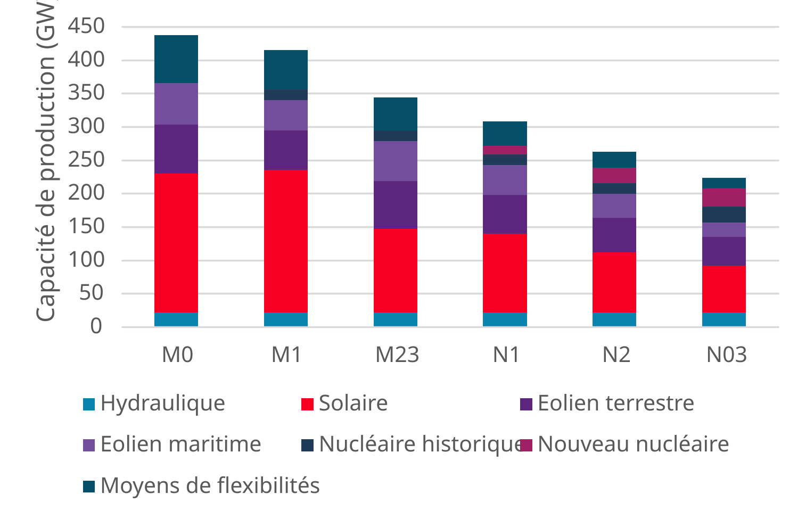
<p class="inventory-caption">Capacités de production par filière (GW) · Source : RTE</p>
</figure>
<figure class="inventory-panel inventory-batteries">
<figcaption>Batteries: revue de littérature</figcaption>

</figure>
<div class="inventory-panel inventory-catenaries">
<h3>Caténaires: interview d'experts</h3>
<div class="inventory-catenary-pair">
<figure><figcaption>1 500 V courant continu</figcaption></figure>
<figure><figcaption>25 kV courant alternatif</figcaption></figure>
</div>
</div>
</div>
```

## Modélisation des roulements : équations {.editorial data-part="3" data-subpart="1"}

<div class="slide-title">Modélisation des roulements : équations</div>

:::: {.ppt-canvas .rolling-equations}


::: {.rolling-equations-table}

| Modèle / phase | Paramètres et contraintes | Équation |
|:--|:--|:--|
| **Résistance Davis** | Coefficients $A$; $B$; $C$ propres au train; $v$ la vitesse | $R=A+Bv+Cv^2$ |
| **seconde loi newton** |  $a=\mathrm{d}v/\mathrm{d}t$; $F$ effort aux roues; $m$ masse; <br>$i$ pente; $P$ Puissance du train | $P=\bigl(ma+R+mgi\bigr)v$ |
| **Accélération** | $v_{\max}$ fonction de la distance entre arrêts ; $a<0{,}3\ \mathrm{m/s^2}$; $P<P_{\max}$ |  |
| **Croisière** | $a=0$; distance avant freinage |
| **Décélération** |  $-0{,}3\mathrm{m/s^2}<a\ $ ; $P>P_{\min}$ (si régénération au freinage) |  |

:::
::::

## Propagation des incertitudes {.editorial .uncertainty-slide data-part="3" data-subpart="1" refs="ciroth-2016,muller-2015"}

<div class="slide-title">Propagation des incertitudes</div>

```{=html}
<div class="ppt-canvas uncertainty-canvas">
<div class="uncertainty-figure">


</div>
<div class="ppt-table-wrap pedigree-table fragment fade-in" data-fragment-index="0">
<table class="ppt-table"><caption>Matrice de pedigree <span class="pedigree-citations"><span data-cite="ciroth-2016,muller-2015"></span></span></caption><thead><tr><th scope="col">Score de l’indicateur</th><th scope="col">1</th><th scope="col">2</th><th scope="col">3</th><th scope="col">4</th><th scope="col">5 (par défaut)</th></tr></thead><tbody><tr><th scope="row">Fiabilité</th><td>1,00</td><td>1,00</td><td>1,00</td><td>1,00</td><td>1,00</td></tr><tr><th scope="row">Complétude</th><td>1,54</td><td>1,03</td><td>1,03</td><td>1,04</td><td>1,18</td></tr><tr><th scope="row">Corrélation temporelle</th><td>1,61</td><td>1,04</td><td>1,10</td><td>1,08</td><td>1,65</td></tr><tr><th scope="row">Corrélation géographique</th><td>1,69</td><td>1,08</td><td>1,19</td><td>1,11</td><td>2,08</td></tr><tr><th scope="row">Corrélation technologique supplémentaire</th><td>4,52<sup>a</sup></td><td>3,09<sup>a</sup></td><td>1,29</td><td>9,49<sup>a</sup></td><td>2,80</td></tr></tbody></table>
</div>
</div>
```

## Application du pedigree aux données {.editorial data-part="3" data-subpart="1"}

<div class="slide-title">Application du pedigree aux données</div>

```{=html}
<div class="ppt-canvas pedigree-application">
<div class="ppt-table-wrap pedigree-application-wrap">
<table class="ppt-table pedigree-application-table" aria-label="Scores de pedigree et écarts-types, style du classeur Excel"><thead><tr><th style="background-color:#ffffff00;color:#000000;font-family:&#x27;Avenir Next LT Pro&#x27;,Arial,sans-serif;font-weight:700;border-left:2px solid #ffffff00;border-right:2px solid #ffffff0000;border-top:2px solid #ffffff00;border-bottom:2px solid #ffffff00">Famille</th><th style="background-color:#ffffff00;color:#000000;font-family:&#x27;Avenir Next LT Pro&#x27;,Arial,sans-serif;font-weight:700;border-left:2px solid #ffffff00;border-right:2px solid #ffffff00;border-top:2px solid #ffffff00;border-bottom:2px solid #ffffff00">Technologie</th><th style="background-color:#ffffff00;color:#000000;font-family:&#x27;Avenir Next LT Pro&#x27;,Arial,sans-serif;font-weight:700;border-left:2px solid #ffffff00;border-right:0;border-top:2px solid #ffffff00;border-bottom:2px solid #ffffff00">Système</th><th style="background-color:#ffffff00;color:#000000;font-family:&#x27;Avenir Next LT Pro&#x27;,Arial,sans-serif;font-weight:700;border-left:2px solid #000000;border-right:2px solid #ffffff00;border-top:2px solid #ffffff00;border-bottom:2px solid #ffffff00">Fiabilité</th><th style="background-color:#ffffff00;color:#000000;font-family:&#x27;Avenir Next LT Pro&#x27;,Arial,sans-serif;font-weight:700;border-left:2px solid #ffffff00;border-right:2px solid #ffffff00;border-top:2px solid #ffffff00;border-bottom:2px solid #ffffff00">Complétude</th><th style="background-color:#ffffff00;color:#000000;font-family:&#x27;Avenir Next LT Pro&#x27;,Arial,sans-serif;font-weight:700;border-left:2px solid #ffffff00;border-right:2px solid #ffffff00;border-top:2px solid #ffffff00;border-bottom:2px solid #ffffff00">Corrélation temporelle</th><th style="background-color:#ffffff00;color:#000000;font-family:&#x27;Avenir Next LT Pro&#x27;,Arial,sans-serif;font-weight:700;border-left:2px solid #ffffff00;border-right:2px solid #ffffff00;border-top:2px solid #ffffff00;border-bottom:2px solid #ffffff00">Corrélation géographique</th><th style="background-color:#ffffff00;color:#000000;font-family:&#x27;Avenir Next LT Pro&#x27;,Arial,sans-serif;font-weight:700;border-left:2px solid #ffffff00;border-right:2px solid #000000;border-top:2px solid #ffffff00;border-bottom:2px solid #ffffff00">Corrélation technologique supplémentaire</th><th style="background-color:#ffffff00;color:#000000;font-family:&#x27;Avenir Next LT Pro&#x27;,Arial,sans-serif;font-weight:700;border-left:2px solid #000000;border-right:2px solid #ffffff00;border-top:2px solid #ffffff00;border-bottom:2px solid #ffffff00">Écart-type résultant</th></tr></thead><tbody>
<tr style="height:46.8px"><th data-cell="A2" rowspan="5" scope="rowgroup" style="background-color:#ffffff00;color:#000000;font-family:&#x27;Raleway&#x27;,Arial,sans-serif;font-weight:400;border-left:2px solid #ffffff00;border-right:2px solid #ffffff00;border-top:0;border-bottom:0">Système embarqué</th><th data-cell="B2" rowspan="2" scope="rowgroup" style="background-color:#ffffff00;color:#000000;font-family:&#x27;Raleway&#x27;,Arial,sans-serif;font-weight:400;border-left:2px solid #ffffff00;border-right:2px solid #ffffff00;border-top:2px solid #ffffff00;border-bottom:0">Hydrogène</th><th data-cell="C2" scope="row" style="background-color:#ffffff00;color:#000000;font-family:&#x27;Avenir Next LT Pro&#x27;,Arial,sans-serif;font-weight:700;border-left:2px solid #ffffff00;border-right:2px solid #000000;border-top:0;border-bottom:2px solid #ffffff00">Pile à combustible PEM</th><td data-cell="D2" title="2" style="background-color:#FBD7DA;color:#000000;font-family:&#x27;Avenir Next LT Pro&#x27;,Arial,sans-serif;font-weight:400;border-left:2px solid #ffffff00;border-right:2px solid #ffffff00;border-top:0;border-bottom:2px solid #ffffff00">2</td><td data-cell="E2" title="1" style="background-color:#FCFCFF;color:#000000;font-family:&#x27;Avenir Next LT Pro&#x27;,Arial,sans-serif;font-weight:400;border-left:2px solid #ffffff00;border-right:2px solid #ffffff00;border-top:0;border-bottom:2px solid #ffffff00">1</td><td data-cell="F2" title="3" style="background-color:#FAB2B5;color:#000000;font-family:&#x27;Avenir Next LT Pro&#x27;,Arial,sans-serif;font-weight:400;border-left:2px solid #ffffff00;border-right:2px solid #ffffff00;border-top:0;border-bottom:2px solid #ffffff00">3</td><td data-cell="G2" title="3" style="background-color:#FAB2B5;color:#000000;font-family:&#x27;Avenir Next LT Pro&#x27;,Arial,sans-serif;font-weight:400;border-left:2px solid #ffffff00;border-right:2px solid #ffffff00;border-top:0;border-bottom:2px solid #ffffff00">3</td><td data-cell="H2" title="1" style="background-color:#FCFCFF;color:#000000;font-family:&#x27;Avenir Next LT Pro&#x27;,Arial,sans-serif;font-weight:400;border-left:2px solid #ffffff00;border-right:2px solid #000000;border-top:0;border-bottom:2px solid #ffffff00">1</td><td data-cell="S2" title="1,251586639655866" style="background-color:#F9888A;color:#000000;font-family:&#x27;Avenir Next LT Pro&#x27;,Arial,sans-serif;font-weight:400;border-left:2px solid #000000;border-right:2px solid #ffffff00;border-top:0;border-bottom:2px solid #ffffff00">1,252</td></tr>
<tr style="height:46.8px"><th data-cell="C3" scope="row" style="background-color:#ffffff00;color:#000000;font-family:&#x27;Avenir Next LT Pro&#x27;,Arial,sans-serif;font-weight:700;border-left:2px solid #ffffff00;border-right:2px solid #000000;border-top:2px solid #ffffff00;border-bottom:2px solid #ffffff00">Réservoirs H₂</th><td data-cell="D3" title="2" style="background-color:#FBD7DA;color:#000000;font-family:&#x27;Avenir Next LT Pro&#x27;,Arial,sans-serif;font-weight:400;border-left:2px solid #ffffff00;border-right:2px solid #ffffff00;border-top:0;border-bottom:2px solid #ffffff00">2</td><td data-cell="E3" title="2" style="background-color:#FBD7DA;color:#000000;font-family:&#x27;Avenir Next LT Pro&#x27;,Arial,sans-serif;font-weight:400;border-left:2px solid #ffffff00;border-right:2px solid #ffffff00;border-top:0;border-bottom:2px solid #ffffff00">2</td><td data-cell="F3" title="3" style="background-color:#FAB2B5;color:#000000;font-family:&#x27;Avenir Next LT Pro&#x27;,Arial,sans-serif;font-weight:400;border-left:2px solid #ffffff00;border-right:2px solid #ffffff00;border-top:0;border-bottom:2px solid #ffffff00">3</td><td data-cell="G3" title="3" style="background-color:#FAB2B5;color:#000000;font-family:&#x27;Avenir Next LT Pro&#x27;,Arial,sans-serif;font-weight:400;border-left:2px solid #ffffff00;border-right:2px solid #ffffff00;border-top:0;border-bottom:2px solid #ffffff00">3</td><td data-cell="H3" title="2" style="background-color:#FBD7DA;color:#000000;font-family:&#x27;Avenir Next LT Pro&#x27;,Arial,sans-serif;font-weight:400;border-left:2px solid #ffffff00;border-right:2px solid #000000;border-top:0;border-bottom:2px solid #ffffff00">2</td><td data-cell="S3" title="1,2707932541368572" style="background-color:#F97F80;color:#000000;font-family:&#x27;Avenir Next LT Pro&#x27;,Arial,sans-serif;font-weight:400;border-left:2px solid #000000;border-right:2px solid #ffffff00;border-top:0;border-bottom:2px solid #ffffff00">1,271</td></tr>
<tr style="height:27.900000000000002px"><th data-cell="B4" rowspan="3" scope="rowgroup" style="background-color:#ffffff00;color:#000000;font-family:&#x27;Raleway&#x27;,Arial,sans-serif;font-weight:400;border-left:2px solid #ffffff00;border-right:2px solid #ffffff00;border-top:0;border-bottom:0">Batteries</th><th data-cell="C4" scope="row" style="background-color:#ffffff00;color:#000000;font-family:&#x27;Avenir Next LT Pro&#x27;,Arial,sans-serif;font-weight:700;border-left:2px solid #ffffff00;border-right:2px solid #000000;border-top:2px solid #ffffff00;border-bottom:2px solid #ffffff00">LTO</th><td data-cell="D4" title="1" style="background-color:#FCFCFF;color:#000000;font-family:&#x27;Avenir Next LT Pro&#x27;,Arial,sans-serif;font-weight:400;border-left:2px solid #ffffff00;border-right:2px solid #ffffff00;border-top:0;border-bottom:2px solid #ffffff00">1</td><td data-cell="E4" title="1" style="background-color:#FCFCFF;color:#000000;font-family:&#x27;Avenir Next LT Pro&#x27;,Arial,sans-serif;font-weight:400;border-left:2px solid #ffffff00;border-right:2px solid #ffffff00;border-top:0;border-bottom:2px solid #ffffff00">1</td><td data-cell="F4" title="1" style="background-color:#FCFCFF;color:#000000;font-family:&#x27;Avenir Next LT Pro&#x27;,Arial,sans-serif;font-weight:400;border-left:2px solid #ffffff00;border-right:2px solid #ffffff00;border-top:0;border-bottom:2px solid #ffffff00">1</td><td data-cell="G4" title="3" style="background-color:#FAB2B5;color:#000000;font-family:&#x27;Avenir Next LT Pro&#x27;,Arial,sans-serif;font-weight:400;border-left:2px solid #ffffff00;border-right:2px solid #ffffff00;border-top:0;border-bottom:2px solid #ffffff00">3</td><td data-cell="H4" title="1" style="background-color:#FCFCFF;color:#000000;font-family:&#x27;Avenir Next LT Pro&#x27;,Arial,sans-serif;font-weight:400;border-left:2px solid #ffffff00;border-right:2px solid #000000;border-top:0;border-bottom:2px solid #ffffff00">1</td><td data-cell="S4" title="1,0392304845413265" style="background-color:#FEF3F3;color:#000000;font-family:&#x27;Avenir Next LT Pro&#x27;,Arial,sans-serif;font-weight:400;border-left:2px solid #000000;border-right:2px solid #ffffff00;border-top:0;border-bottom:2px solid #ffffff00">1,039</td></tr>
<tr style="height:27.900000000000002px"><th data-cell="C5" scope="row" style="background-color:#ffffff00;color:#000000;font-family:&#x27;Avenir Next LT Pro&#x27;,Arial,sans-serif;font-weight:700;border-left:2px solid #ffffff00;border-right:2px solid #000000;border-top:2px solid #ffffff00;border-bottom:2px solid #ffffff00">LFP</th><td data-cell="D5" title="2" style="background-color:#FBD7DA;color:#000000;font-family:&#x27;Avenir Next LT Pro&#x27;,Arial,sans-serif;font-weight:400;border-left:2px solid #ffffff00;border-right:2px solid #ffffff00;border-top:0;border-bottom:2px solid #ffffff00">2</td><td data-cell="E5" title="1" style="background-color:#FCFCFF;color:#000000;font-family:&#x27;Avenir Next LT Pro&#x27;,Arial,sans-serif;font-weight:400;border-left:2px solid #ffffff00;border-right:2px solid #ffffff00;border-top:0;border-bottom:2px solid #ffffff00">1</td><td data-cell="F5" title="2" style="background-color:#FBD7DA;color:#000000;font-family:&#x27;Avenir Next LT Pro&#x27;,Arial,sans-serif;font-weight:400;border-left:2px solid #ffffff00;border-right:2px solid #ffffff00;border-top:0;border-bottom:2px solid #ffffff00">2</td><td data-cell="G5" title="3" style="background-color:#FAB2B5;color:#000000;font-family:&#x27;Avenir Next LT Pro&#x27;,Arial,sans-serif;font-weight:400;border-left:2px solid #ffffff00;border-right:2px solid #ffffff00;border-top:0;border-bottom:2px solid #ffffff00">3</td><td data-cell="H5" title="2" style="background-color:#FBD7DA;color:#000000;font-family:&#x27;Avenir Next LT Pro&#x27;,Arial,sans-serif;font-weight:400;border-left:2px solid #ffffff00;border-right:2px solid #000000;border-top:0;border-bottom:2px solid #ffffff00">2</td><td data-cell="S5" title="1,2647255890435916" style="background-color:#F98283;color:#000000;font-family:&#x27;Avenir Next LT Pro&#x27;,Arial,sans-serif;font-weight:400;border-left:2px solid #000000;border-right:2px solid #ffffff00;border-top:0;border-bottom:2px solid #ffffff00">1,265</td></tr>
<tr style="height:27.900000000000002px"><th data-cell="C6" scope="row" style="background-color:#ffffff00;color:#000000;font-family:&#x27;Avenir Next LT Pro&#x27;,Arial,sans-serif;font-weight:700;border-left:2px solid #ffffff00;border-right:2px solid #000000;border-top:2px solid #ffffff00;border-bottom:2px solid #ffffff00">NMC</th><td data-cell="D6" title="2" style="background-color:#FBD7DA;color:#000000;font-family:&#x27;Avenir Next LT Pro&#x27;,Arial,sans-serif;font-weight:400;border-left:2px solid #000000;border-right:2px solid #ffffff00;border-top:2px solid #ffffff00;border-bottom:2px solid #000000">2</td><td data-cell="E6" title="1" style="background-color:#FCFCFF;color:#000000;font-family:&#x27;Avenir Next LT Pro&#x27;,Arial,sans-serif;font-weight:400;border-left:2px solid #ffffff00;border-right:2px solid #ffffff00;border-top:2px solid #ffffff00;border-bottom:2px solid #000000">1</td><td data-cell="F6" title="2" style="background-color:#FBD7DA;color:#000000;font-family:&#x27;Avenir Next LT Pro&#x27;,Arial,sans-serif;font-weight:400;border-left:2px solid #ffffff00;border-right:2px solid #ffffff00;border-top:2px solid #ffffff00;border-bottom:2px solid #000000">2</td><td data-cell="G6" title="2" style="background-color:#FBD7DA;color:#000000;font-family:&#x27;Avenir Next LT Pro&#x27;,Arial,sans-serif;font-weight:400;border-left:2px solid #ffffff00;border-right:2px solid #ffffff00;border-top:2px solid #ffffff00;border-bottom:2px solid #000000">2</td><td data-cell="H6" title="2" style="background-color:#FBD7DA;color:#000000;font-family:&#x27;Avenir Next LT Pro&#x27;,Arial,sans-serif;font-weight:400;border-left:2px solid #ffffff00;border-right:2px solid #000000;border-top:2px solid #ffffff00;border-bottom:2px solid #000000">2</td><td data-cell="S6" title="1,2617627052273268" style="background-color:#F98385;color:#000000;font-family:&#x27;Avenir Next LT Pro&#x27;,Arial,sans-serif;font-weight:400;border-left:2px solid #000000;border-right:2px solid #ffffff00;border-top:0;border-bottom:2px solid #000000">1,262</td></tr>
<tr style="height:22.5px"><th data-cell="A7" rowspan="5" scope="rowgroup" style="background-color:#ffffff00;color:#000000;font-family:&#x27;Raleway&#x27;,Arial,sans-serif;font-weight:400;border-left:2px solid #ffffff00;border-right:2px solid #ffffff00;border-top:2px solid #000000;border-bottom:2px solid #000000">Production</th><th data-cell="B7" rowspan="5" scope="rowgroup" style="background-color:#ffffff00;color:#000000;font-family:&#x27;Raleway&#x27;,Arial,sans-serif;font-weight:400;border-left:2px solid #ffffff00;border-right:2px solid #ffffff00;border-top:2px solid #000000;border-bottom:2px solid #000000"></th><th data-cell="C7" scope="row" style="background-color:#ffffff00;color:#000000;font-family:&#x27;Avenir Next LT Pro&#x27;,Arial,sans-serif;font-weight:700;border-left:2px solid #ffffff00;border-right:2px solid #000000;border-top:2px solid #000000;border-bottom:2px solid #ffffff00">H₂ gris</th><td data-cell="D7" title="1" style="background-color:#FCFCFF;color:#000000;font-family:&#x27;Avenir Next LT Pro&#x27;,Arial,sans-serif;font-weight:400;border-left:2px solid #000000;border-right:2px solid #ffffff00;border-top:0;border-bottom:2px solid #ffffff00">1</td><td data-cell="E7" title="1" style="background-color:#FCFCFF;color:#000000;font-family:&#x27;Avenir Next LT Pro&#x27;,Arial,sans-serif;font-weight:400;border-left:2px solid #ffffff00;border-right:2px solid #ffffff00;border-top:0;border-bottom:2px solid #ffffff00">1</td><td data-cell="F7" title="2" style="background-color:#FBD7DA;color:#000000;font-family:&#x27;Avenir Next LT Pro&#x27;,Arial,sans-serif;font-weight:400;border-left:2px solid #ffffff00;border-right:2px solid #ffffff00;border-top:0;border-bottom:2px solid #ffffff00">2</td><td data-cell="G7" title="1" style="background-color:#FCFCFF;color:#000000;font-family:&#x27;Avenir Next LT Pro&#x27;,Arial,sans-serif;font-weight:400;border-left:2px solid #ffffff00;border-right:2px solid #ffffff00;border-top:0;border-bottom:2px solid #ffffff00">1</td><td data-cell="H7" title="1" style="background-color:#FCFCFF;color:#000000;font-family:&#x27;Avenir Next LT Pro&#x27;,Arial,sans-serif;font-weight:400;border-left:2px solid #ffffff00;border-right:2px solid #000000;border-top:0;border-bottom:2px solid #ffffff00">1</td><td data-cell="S7" title="1,014889156509222" style="background-color:#ffffff00;color:#000000;font-family:&#x27;Avenir Next LT Pro&#x27;,Arial,sans-serif;font-weight:400;border-left:2px solid #000000;border-right:2px solid #ffffff00;border-top:0;border-bottom:2px solid #ffffff00">1,015</td></tr>
<tr style="height:22.5px"><th data-cell="C8" scope="row" style="background-color:#ffffff00;color:#000000;font-family:&#x27;Avenir Next LT Pro&#x27;,Arial,sans-serif;font-weight:700;border-left:2px solid #ffffff00;border-right:2px solid #000000;border-top:2px solid #ffffff00;border-bottom:2px solid #ffffff00">H₂ vert</th><td data-cell="D8" title="3" style="background-color:#FAB2B5;color:#000000;font-family:&#x27;Avenir Next LT Pro&#x27;,Arial,sans-serif;font-weight:400;border-left:2px solid #000000;border-right:2px solid #ffffff00;border-top:0;border-bottom:2px solid #ffffff00">3</td><td data-cell="E8" title="1" style="background-color:#FCFCFF;color:#000000;font-family:&#x27;Avenir Next LT Pro&#x27;,Arial,sans-serif;font-weight:400;border-left:2px solid #ffffff00;border-right:2px solid #ffffff00;border-top:0;border-bottom:2px solid #ffffff00">1</td><td data-cell="F8" title="1" style="background-color:#FCFCFF;color:#000000;font-family:&#x27;Avenir Next LT Pro&#x27;,Arial,sans-serif;font-weight:400;border-left:2px solid #ffffff00;border-right:2px solid #ffffff00;border-top:0;border-bottom:2px solid #ffffff00">1</td><td data-cell="G8" title="3" style="background-color:#FAB2B5;color:#000000;font-family:&#x27;Avenir Next LT Pro&#x27;,Arial,sans-serif;font-weight:400;border-left:2px solid #ffffff00;border-right:2px solid #ffffff00;border-top:0;border-bottom:2px solid #ffffff00">3</td><td data-cell="H8" title="2" style="background-color:#FBD7DA;color:#000000;font-family:&#x27;Avenir Next LT Pro&#x27;,Arial,sans-serif;font-weight:400;border-left:2px solid #ffffff00;border-right:2px solid #000000;border-top:0;border-bottom:2px solid #ffffff00">2</td><td data-cell="S8" title="1,2904723900497306" style="background-color:#F97577;color:#000000;font-family:&#x27;Avenir Next LT Pro&#x27;,Arial,sans-serif;font-weight:400;border-left:2px solid #000000;border-right:2px solid #ffffff00;border-top:0;border-bottom:2px solid #ffffff00">1,290</td></tr>
<tr style="height:22.5px"><th data-cell="C9" scope="row" style="background-color:#ffffff00;color:#000000;font-family:&#x27;Avenir Next LT Pro&#x27;,Arial,sans-serif;font-weight:700;border-left:2px solid #ffffff00;border-right:2px solid #000000;border-top:2px solid #ffffff00;border-bottom:2px solid #ffffff00">Électricité</th><td data-cell="D9" title="1" style="background-color:#FCFCFF;color:#000000;font-family:&#x27;Avenir Next LT Pro&#x27;,Arial,sans-serif;font-weight:400;border-left:2px solid #000000;border-right:2px solid #ffffff00;border-top:0;border-bottom:2px solid #ffffff00">1</td><td data-cell="E9" title="1" style="background-color:#FCFCFF;color:#000000;font-family:&#x27;Avenir Next LT Pro&#x27;,Arial,sans-serif;font-weight:400;border-left:2px solid #ffffff00;border-right:2px solid #ffffff00;border-top:0;border-bottom:2px solid #ffffff00">1</td><td data-cell="F9" title="5" style="background-color:#F8696B;color:#000000;font-family:&#x27;Avenir Next LT Pro&#x27;,Arial,sans-serif;font-weight:400;border-left:2px solid #ffffff00;border-right:2px solid #ffffff00;border-top:0;border-bottom:2px solid #ffffff00">5</td><td data-cell="G9" title="1" style="background-color:#FCFCFF;color:#000000;font-family:&#x27;Avenir Next LT Pro&#x27;,Arial,sans-serif;font-weight:400;border-left:2px solid #ffffff00;border-right:2px solid #ffffff00;border-top:0;border-bottom:2px solid #ffffff00">1</td><td data-cell="H9" title="1" style="background-color:#FCFCFF;color:#000000;font-family:&#x27;Avenir Next LT Pro&#x27;,Arial,sans-serif;font-weight:400;border-left:2px solid #ffffff00;border-right:2px solid #000000;border-top:0;border-bottom:2px solid #ffffff00">1</td><td data-cell="S9" title="1,1357816691600546" style="background-color:#FCC2C3;color:#000000;font-family:&#x27;Avenir Next LT Pro&#x27;,Arial,sans-serif;font-weight:400;border-left:2px solid #000000;border-right:2px solid #ffffff00;border-top:0;border-bottom:2px solid #ffffff00">1,136</td></tr>
<tr style="height:22.5px"><th data-cell="C10" scope="row" style="background-color:#ffffff00;color:#000000;font-family:&#x27;Avenir Next LT Pro&#x27;,Arial,sans-serif;font-weight:700;border-left:2px solid #ffffff00;border-right:2px solid #000000;border-top:2px solid #ffffff00;border-bottom:2px solid #ffffff00">Biocarburant</th><td data-cell="D10" title="3" style="background-color:#FAB2B5;color:#000000;font-family:&#x27;Avenir Next LT Pro&#x27;,Arial,sans-serif;font-weight:400;border-left:2px solid #000000;border-right:2px solid #ffffff00;border-top:0;border-bottom:2px solid #ffffff00">3</td><td data-cell="E10" title="2" style="background-color:#FBD7DA;color:#000000;font-family:&#x27;Avenir Next LT Pro&#x27;,Arial,sans-serif;font-weight:400;border-left:2px solid #ffffff00;border-right:2px solid #ffffff00;border-top:0;border-bottom:2px solid #ffffff00">2</td><td data-cell="F10" title="5" style="background-color:#F8696B;color:#000000;font-family:&#x27;Avenir Next LT Pro&#x27;,Arial,sans-serif;font-weight:400;border-left:2px solid #ffffff00;border-right:2px solid #ffffff00;border-top:0;border-bottom:2px solid #ffffff00">5</td><td data-cell="G10" title="3" style="background-color:#FAB2B5;color:#000000;font-family:&#x27;Avenir Next LT Pro&#x27;,Arial,sans-serif;font-weight:400;border-left:2px solid #ffffff00;border-right:2px solid #ffffff00;border-top:0;border-bottom:2px solid #ffffff00">3</td><td data-cell="H10" title="1" style="background-color:#FCFCFF;color:#000000;font-family:&#x27;Avenir Next LT Pro&#x27;,Arial,sans-serif;font-weight:400;border-left:2px solid #ffffff00;border-right:2px solid #000000;border-top:0;border-bottom:2px solid #ffffff00">1</td><td data-cell="S10" title="1,3140941497537875" style="background-color:#F8696B;color:#000000;font-family:&#x27;Avenir Next LT Pro&#x27;,Arial,sans-serif;font-weight:400;border-left:2px solid #000000;border-right:2px solid #ffffff00;border-top:0;border-bottom:2px solid #ffffff00">1,314</td></tr>
<tr style="height:22.5px"><th data-cell="C11" scope="row" style="background-color:#ffffff00;color:#000000;font-family:&#x27;Avenir Next LT Pro&#x27;,Arial,sans-serif;font-weight:700;border-left:2px solid #ffffff00;border-right:2px solid #000000;border-top:2px solid #ffffff00;border-bottom:2px solid #000000">Diesel</th><td data-cell="D11" title="1" style="background-color:#FCFCFF;color:#000000;font-family:&#x27;Avenir Next LT Pro&#x27;,Arial,sans-serif;font-weight:400;border-left:2px solid #000000;border-right:2px solid #ffffff00;border-top:0;border-bottom:2px solid #000000">1</td><td data-cell="E11" title="1" style="background-color:#FCFCFF;color:#000000;font-family:&#x27;Avenir Next LT Pro&#x27;,Arial,sans-serif;font-weight:400;border-left:2px solid #ffffff00;border-right:2px solid #ffffff00;border-top:0;border-bottom:2px solid #000000">1</td><td data-cell="F11" title="5" style="background-color:#F8696B;color:#000000;font-family:&#x27;Avenir Next LT Pro&#x27;,Arial,sans-serif;font-weight:400;border-left:2px solid #ffffff00;border-right:2px solid #ffffff00;border-top:0;border-bottom:2px solid #000000">5</td><td data-cell="G11" title="1" style="background-color:#FCFCFF;color:#000000;font-family:&#x27;Avenir Next LT Pro&#x27;,Arial,sans-serif;font-weight:400;border-left:2px solid #ffffff00;border-right:2px solid #ffffff00;border-top:0;border-bottom:2px solid #000000">1</td><td data-cell="H11" title="1" style="background-color:#FCFCFF;color:#000000;font-family:&#x27;Avenir Next LT Pro&#x27;,Arial,sans-serif;font-weight:400;border-left:2px solid #ffffff00;border-right:2px solid #000000;border-top:0;border-bottom:2px solid #000000">1</td><td data-cell="S11" title="1,1357816691600546" style="background-color:#FCC2C3;color:#000000;font-family:&#x27;Avenir Next LT Pro&#x27;,Arial,sans-serif;font-weight:400;border-left:2px solid #000000;border-right:2px solid #ffffff00;border-top:0;border-bottom:2px solid #000000">1,136</td></tr>
<tr style="height:49.5px"><th data-cell="A12" rowspan="2" scope="rowgroup" style="background-color:#ffffff00;color:#000000;font-family:&#x27;Raleway&#x27;,Arial,sans-serif;font-weight:400;border-left:2px solid #ffffff00;border-right:2px solid #ffffff00;border-top:0;border-bottom:0">Distribution</th><th data-cell="B12" rowspan="2" scope="rowgroup" style="background-color:#ffffff00;color:#000000;font-family:&#x27;Raleway&#x27;,Arial,sans-serif;font-weight:400;border-left:2px solid #ffffff00;border-right:2px solid #ffffff00;border-top:0;border-bottom:0"></th><th data-cell="C12" scope="row" style="background-color:#ffffff00;color:#000000;font-family:&#x27;Avenir Next LT Pro&#x27;,Arial,sans-serif;font-weight:700;border-left:2px solid #ffffff00;border-right:2px solid #000000;border-top:0;border-bottom:2px solid #ffffff00">Caténaires</th><td data-cell="D12" title="1" style="background-color:#FCFCFF;color:#000000;font-family:&#x27;Avenir Next LT Pro&#x27;,Arial,sans-serif;font-weight:400;border-left:2px solid #000000;border-right:2px solid #ffffff00;border-top:0;border-bottom:2px solid #ffffff00">1</td><td data-cell="E12" title="2" style="background-color:#FBD7DA;color:#000000;font-family:&#x27;Avenir Next LT Pro&#x27;,Arial,sans-serif;font-weight:400;border-left:2px solid #ffffff00;border-right:2px solid #ffffff00;border-top:0;border-bottom:2px solid #ffffff00">2</td><td data-cell="F12" title="5" style="background-color:#F8696B;color:#000000;font-family:&#x27;Avenir Next LT Pro&#x27;,Arial,sans-serif;font-weight:400;border-left:2px solid #ffffff00;border-right:2px solid #ffffff00;border-top:0;border-bottom:2px solid #ffffff00">5</td><td data-cell="G12" title="1" style="background-color:#FCFCFF;color:#000000;font-family:&#x27;Avenir Next LT Pro&#x27;,Arial,sans-serif;font-weight:400;border-left:2px solid #ffffff00;border-right:2px solid #ffffff00;border-top:0;border-bottom:2px solid #ffffff00">1</td><td data-cell="H12" title="1" style="background-color:#FCFCFF;color:#000000;font-family:&#x27;Avenir Next LT Pro&#x27;,Arial,sans-serif;font-weight:400;border-left:2px solid #ffffff00;border-right:2px solid #000000;border-top:0;border-bottom:2px solid #ffffff00">1</td><td data-cell="S12" title="1,1367530916142823" style="background-color:#FCC2C3;color:#000000;font-family:&#x27;Avenir Next LT Pro&#x27;,Arial,sans-serif;font-weight:400;border-left:2px solid #000000;border-right:2px solid #ffffff00;border-top:0;border-bottom:2px solid #ffffff00">1,137</td></tr>
<tr style="height:49.5px"><th data-cell="C13" scope="row" style="background-color:#ffffff00;color:#000000;font-family:&#x27;Avenir Next LT Pro&#x27;,Arial,sans-serif;font-weight:700;border-left:2px solid #ffffff00;border-right:2px solid #000000;border-top:2px solid #ffffff00;border-bottom:2px solid #ffffff00">Station H₂</th><td data-cell="D13" title="2" style="background-color:#FBD7DA;color:#000000;font-family:&#x27;Avenir Next LT Pro&#x27;,Arial,sans-serif;font-weight:400;border-left:2px solid #ffffff00;border-right:2px solid #ffffff00;border-top:0;border-bottom:2px solid #ffffff00">2</td><td data-cell="E13" title="2" style="background-color:#FBD7DA;color:#000000;font-family:&#x27;Avenir Next LT Pro&#x27;,Arial,sans-serif;font-weight:400;border-left:2px solid #ffffff00;border-right:2px solid #ffffff00;border-top:0;border-bottom:2px solid #ffffff00">2</td><td data-cell="F13" title="1" style="background-color:#FCFCFF;color:#000000;font-family:&#x27;Avenir Next LT Pro&#x27;,Arial,sans-serif;font-weight:400;border-left:2px solid #ffffff00;border-right:2px solid #ffffff00;border-top:0;border-bottom:2px solid #ffffff00">1</td><td data-cell="G13" title="3" style="background-color:#FAB2B5;color:#000000;font-family:&#x27;Avenir Next LT Pro&#x27;,Arial,sans-serif;font-weight:400;border-left:2px solid #ffffff00;border-right:2px solid #ffffff00;border-top:0;border-bottom:2px solid #ffffff00">3</td><td data-cell="H13" title="2" style="background-color:#FBD7DA;color:#000000;font-family:&#x27;Avenir Next LT Pro&#x27;,Arial,sans-serif;font-weight:400;border-left:2px solid #ffffff00;border-right:2px solid #000000;border-top:0;border-bottom:2px solid #ffffff00">2</td><td data-cell="S13" title="1,2647255890435916" style="background-color:#F98283;color:#000000;font-family:&#x27;Avenir Next LT Pro&#x27;,Arial,sans-serif;font-weight:400;border-left:2px solid #000000;border-right:2px solid #ffffff00;border-top:0;border-bottom:2px solid #ffffff00">1,265</td></tr>
</tbody></table>
</div>
</div>
```

## méthodes de calcul d'impact {.editorial data-part="3" data-subpart="2"}

<div class="slide-title">Méthodes de calcul d'impact d'ACV</div>

```{=html}
<div class="ppt-canvas lcia-choice lcia-pathways">
<div class="ppt-table-wrap lcia-methods-table">
<table class="ppt-table">
<thead><tr><th>Méthode</th><th>Indicateurs</th><th>Interprétation</th></tr></thead>
<tbody>
<tr><td>ReCiPe 2016</td><td>18 catégories</td><td>3 indicateurs de dommages</td></tr>
<tr class="lcia-selected-method"><td>EF 3.0</td><td>28 sous-catégories</td><td>Score unique</td></tr>
<tr><td>IMPACT World+</td><td>18 catégories</td><td></td></tr>
</tbody>
</table>
</div>
<span class="fragment lcia-selection" data-fragment-index="0" aria-hidden="true"></span>
<div class="lcia-mcdm">EF 3.0 apporte une méthode de normalisation et pondération valorisable pour l’ADMC</div>
<figure class="lcia-pathway-figure"></figure>

</div>
```

## Introduction à l’aide à la décision multicritère {.editorial .mcdm-intro-slide data-part="3" data-subpart="2"}

<div class="slide-title">Identification d'un scénario à partir des résultats d’ACV par l'ADMC</div>

```{=html}
<div class="ppt-canvas mcdm-intro">
<p class="mcdm-purpose">Choix de PROMETHEE pour ajuster l'incomparabilité.</p>
<div class="mcdm-flow">
<div class="mcdm-stage"><span class="mcdm-stage-number">01</span><h3>Résultats d’ACV</h3><p>Impacts environnementaux<br>de chaque scénario</p></div>
<span class="mcdm-arrow" aria-hidden="true">→</span>
<div class="mcdm-stage"><span class="mcdm-stage-number">02</span><h3>Normalisation et pondération</h3><p>Poids des critères<br>Seuils de normalisation</p></div>
<span class="mcdm-arrow" aria-hidden="true">→</span>
<div class="mcdm-stage"><span class="mcdm-stage-number">03</span><h3>Comparaison</h3><p>Évaluation des scénarios<br>deux à deux avec PROMETHEE</p></div>
<span class="mcdm-arrow" aria-hidden="true">→</span>
<div class="mcdm-stage"><span class="mcdm-stage-number">04</span><h3>identification d'un scénario</h3><p>Classement et incomparabilités</p></div>
</div>
<div class="mcdm-takeaway"></div>
</div>
```

## ADMC : PROMETHEE {.editorial data-part="3" data-subpart="2" refs="greco-2016,taherdoost-2023,wulf-2021"}

<div class="slide-title">ADMC : PROMETHEE <span data-cite="taherdoost-2023"></span></div>

```{=html}
<div class="ppt-canvas preference-choice">
<div class="ppt-table-wrap preference-functions"><table class="ppt-table"><caption>Fonctions de préférence <span data-cite="greco-2016"></span></caption><thead><tr><th>Fonction</th><th>Représentation</th><th>Définition de P(d)</th><th>Paramètres</th></tr></thead><tbody><tr><td>Usuelle</td><td></td><td>0 si d ≤ 0 ; 1 si d &gt; 0</td><td>-</td></tr><tr><td>En U</td><td></td><td>0 si d ≤ q ; 1 si d &gt; q</td><td>q</td></tr><tr><td>À niveaux</td><td></td><td>0 si d ≤ q ; ½ si q &lt; d ≤ p ;<br>1 si d &gt; p</td><td>p, q</td></tr><tr><td>Gaussienne</td><td></td><td>0 si d ≤ 0 ;<br>1 − exp(−d² / (2s²)) si d &gt; 0</td><td>s</td></tr><tr class="preference-vshape"><td>En V</td><td></td><td>0 si d ≤ q ;<br>(d − q) / (p − q) si q &lt; d ≤ p ;<br>1 si d &gt; p</td><td>p, q</td></tr></tbody></table></div>
<span class="fragment preference-selection" data-fragment-index="0" aria-hidden="true"></span>
<div class="preference-weak-stage">
<div class="preference-v-detail">
</div>

<div class="ppt-table-wrap weak-preference-table"><table class="ppt-table"><caption>Zones de préférence faible <span data-cite="wulf-2021"></span></caption><tr><td>Catégorie d’impact</td><td>Classe d’incertitude</td><td>Zone de préférence faible (q–p)</td></tr><tr><td>Changement climatique</td><td>1</td><td>10–20%</td></tr><tr><td>Appauvrissement de l’ozone</td><td>1</td><td>10–20%</td></tr><tr><td>Demande cumulée d’énergie</td><td>1</td><td>10–20%</td></tr><tr><td>Épuisement des ressources en eau</td><td>2</td><td>30–40%</td></tr><tr><td>Épuisement des ressources minérales</td><td>2</td><td>30–40%</td></tr><tr><td>Particules / effets respiratoires inorganiques</td><td>2</td><td>30–40%</td></tr><tr><td>Rayonnements ionisants - santé humaine</td><td>2</td><td>30–40%</td></tr><tr><td>Formation photochimique d’ozone</td><td>2</td><td>30–40%</td></tr><tr><td>Acidification</td><td>2</td><td>30–40%</td></tr><tr><td>Eutrophisation terrestre</td><td>2</td><td>30–40%</td></tr><tr><td>Eutrophisation aquatique</td><td>2</td><td>30–40%</td></tr><tr><td>Eutrophisation marine</td><td>2</td><td>30–40%</td></tr><tr><td>Écotoxicité en eau douce</td><td>3</td><td>70–80%</td></tr><tr><td>Toxicité humaine cancérogène</td><td>3</td><td>70–80%</td></tr><tr><td>Toxicité humaine non cancérogène</td><td>3</td><td>70–80%</td></tr></table></div>
</div>
</div>
```

## Validation : comparaison avec l’ADEME {.editorial data-part="3" data-subpart="3" refs="sune-2025"}

<div class="slide-title">Validation : cas d'étude de l’ADEME <span data-cite="sune-2025"></span></div>

```{=html}
<div class="ppt-canvas ademe-validation">
<figure class="ademe-report"><figcaption></figcaption></figure>
<div class="ademe-validation-content">
<div class="ademe-validation-intro"><div class="ademe-validation-label">ADEME</div><h3>ACV attributionnelle d’un trajet en train</h3><p><strong>100 km</strong> de ligne non électrifiée</p><p class="ademe-report-scope"></p></div>
<figure class="ademe-parameters"><figcaption>Paramètres de la ligne </figcaption></figure>
</div>
</div>
```


## Analyse des résultats : impacts normalisés {.editorial data-part="3" data-subpart="3"}

<div class="slide-title">Comparaison du choix de scenario de décarbonation</div>

<div class="ppt-canvas"><div class="ppt-text" style="left:1%;top:62%;width:47%;height:19%;font-size:var(--content-size);"><div class="ppt-p" style="text-align:center"><span style="font-size:var(--content-size);font-weight:700">« Les résultats obtenus ne peuvent être généralisés à l’ensemble des configurations d’exploitation ferroviaire. » </span></div><div class="ppt-p" style="text-align:center">&nbsp;</div><div class="ppt-p" style="text-align:center"><span style="font-size:var(--content-size);font-weight:700">« Cette étude ne remplace pas la réalisation d’une ACV spécifique au système étudié. » </span></div></div>
<div class="ppt-table-wrap speed-ranking-table">
<table class="ppt-table" aria-label="Classement des scénarios selon la vitesse maximale">
<thead>
<tr><th rowspan="2" scope="col">Scénarios</th><th colspan="3" scope="colgroup">Vitesse maximale (km/h)</th></tr>
<tr><th scope="col">54 - 72</th><th scope="col">72 - 94</th><th scope="col">94 - 130</th></tr>
</thead>
<tbody>
<tr><th scope="row">Électrification</th><td>1</td><td rowspan="2" class="speed-ranking-uncertainty">Incertitude</td><td>2</td></tr>
<tr><th scope="row">Batteries</th><td>2</td><td>1</td></tr>
<tr><th scope="row">Diesel</th><td>3</td><td>3</td><td>3</td></tr>
</tbody>
</table>
</div>
<div class="ppt-text" style="left:50%;top:13%;width:47%;height:5%;font-size:var(--content-size);"><div class="ppt-p" style="text-align:center"><span style="font-size:var(--content-size);font-weight:700">Classement PROMETHEE selon la vitesse maximale</span></div></div>

<div class="ppt-table-wrap" style="left:2%;top:23%;width:45%;height:31%;"><table class="ppt-table"><tr><td style="font-size:var(--content-size);font-weight:700">Catégorie d’impact</td><td style="font-size:var(--content-size);font-weight:700">Scénario le plus impactant</td></tr><tr><td style="font-size:var(--content-size)">Changement climatique</td><td style="font-size:var(--content-size)">Diesel</td></tr><tr><td style="font-size:var(--content-size)">Utilisation des ressources fossiles</td><td style="font-size:var(--content-size)">Hydrogène produit par électrolyse avec le mix électrique français</td></tr><tr><td style="font-size:var(--content-size)">Micro-particules</td><td style="font-size:var(--content-size)">Biocarburant B100</td></tr><tr><td style="font-size:var(--content-size)">Utilisation des ressources minérales et métalliques</td><td style="font-size:var(--content-size)">Hydrogène, batteries et caténaires</td></tr></table></div>
</div>

## Cas d’étude : Corse {.editorial data-part="3" data-subpart="3"}

<div class="slide-title">Cas d’étude : Corse</div>

<div class="ppt-canvas">
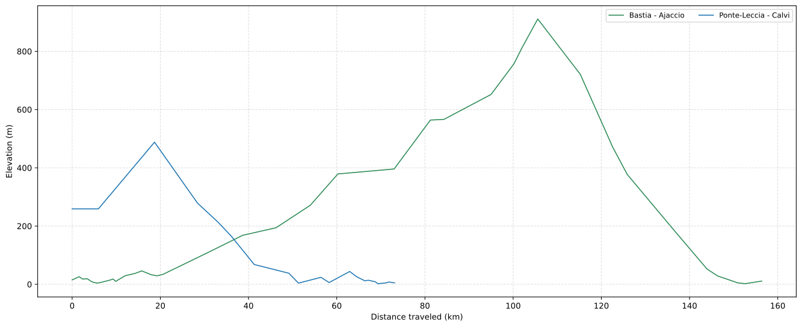
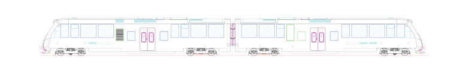
<div class="ppt-text" style="left:22%;top:83%;width:7%;height:6%;font-size:var(--content-title-size);transform:rotate(23.23deg);transform-origin:center;"><div class="ppt-p" style="text-align:left"><span style=""></span></div></div>
</div>

## Mix énergétique corse {.editorial data-part="3" data-subpart="3"}

<div class="slide-title">Mix énergétique corse</div>

<div class="ppt-canvas">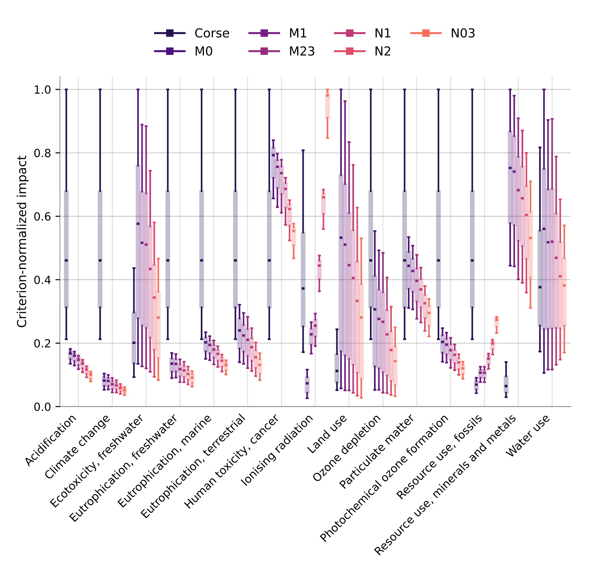
<div class="ppt-table-wrap" style="left:56%;top:13%;width:33%;height:24%;"><table class="ppt-table"><tr><td style="font-size:var(--content-size)">04/06/26</td><td style="font-size:var(--content-size)">gCO₂eq/kWh</td><td style="font-size:var(--content-size)">Production impactante</td></tr><tr><td style="font-size:var(--content-size)">Corse</td><td style="font-size:var(--content-size)">452</td><td style="font-size:var(--content-size)">40% fioul</td></tr><tr><td style="font-size:var(--content-size)">Italie</td><td style="font-size:var(--content-size)">147</td><td style="font-size:var(--content-size)">4% gaz</td></tr><tr><td style="font-size:var(--content-size)">France</td><td style="font-size:var(--content-size)">16</td><td style="font-size:var(--content-size)">60% nucléaire</td></tr></table></div>
</div>

## Modélisation des AMG800 {.editorial data-part="3" data-subpart="3"}

<div class="slide-title">Modélisation des AMG800</div>

<div class="ppt-canvas">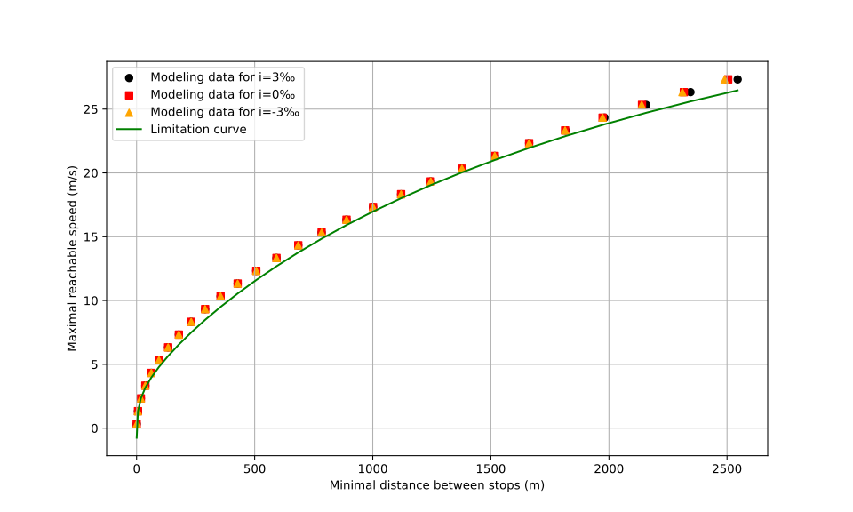
<div class="ppt-table-wrap" style="left:58%;top:21%;width:35%;height:19%;"><table class="ppt-table"><tr><td style="font-size:var(--content-size);font-weight:700">Ligne</td><td style="font-size:var(--content-size);font-weight:700">Energie sans regeneration (kWh)</td><td style="font-size:var(--content-size);font-weight:700">Energie avec regeneration (kWh)</td></tr><tr><td style="font-size:var(--content-size);font-weight:700">Balagne</td><td style="font-size:var(--content-size)">1,159</td><td style="font-size:var(--content-size)">787</td></tr><tr><td style="font-size:var(--content-size);font-weight:700">Centrale</td><td style="font-size:var(--content-size)">2,029</td><td style="font-size:var(--content-size)">1,268</td></tr></table></div></div>

## Réduction de l’impact du mix électrique corse {.editorial data-part="3" data-subpart="3"}

<div class="slide-title">Réduction de l’impact du mix électrique corse</div>

<div class="ppt-canvas"><div class="ppt-text" style="left:21%;top:83%;width:59%;height:7%;font-size:var(--content-title-size);"><div class="ppt-p" style="text-align:center"><span style="font-size:var(--content-title-size);font-weight:700">Perspectives</span><span style="font-size:var(--content-title-size)"> : Stratégies de décarbonation du mix électrique Corse</span></div></div>
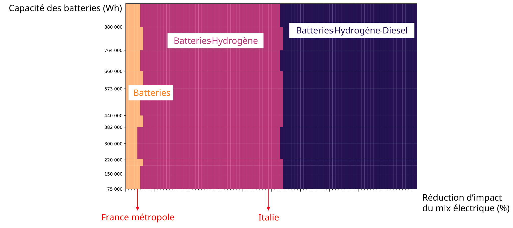
<div class="ppt-text" style="left:70%;top:66%;width:6%;height:5%;font-size:var(--content-size);"><div class="ppt-p" style="text-align:left"><span style="font-size:var(--content-size)">-10%</span></div></div>
<div class="ppt-text" style="left:51%;top:66%;width:6%;height:5%;font-size:var(--content-size);"><div class="ppt-p" style="text-align:left"><span style="font-size:var(--content-size)">-50%</span></div></div>
<div class="ppt-text" style="left:31%;top:66%;width:6%;height:5%;font-size:var(--content-size);"><div class="ppt-p" style="text-align:left"><span style="font-size:var(--content-size)">-90%</span></div></div></div>

## Stratégies de décarbonation du mix électrique corse {.editorial data-part="3" data-subpart="3"}

<div class="slide-title">Stratégies de décarbonation du mix électrique corse</div>

<div class="ppt-canvas"><div class="ppt-text" style="left:7%;top:96%;width:85%;height:4%;font-size:var(--content-title-size);"><div class="ppt-p" style="text-align:left"><span style="">EDF 2024</span></div></div>
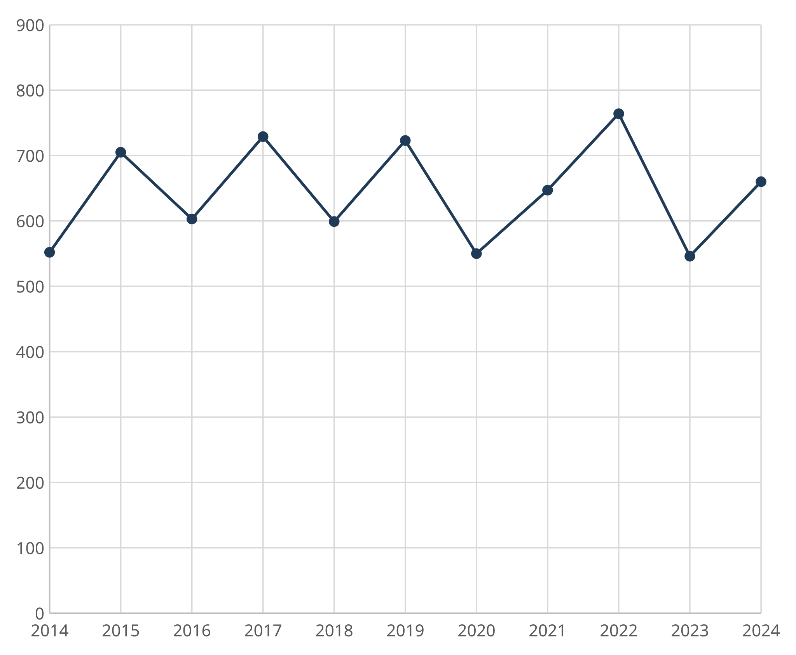
<div class="ppt-text" style="left:12%;top:7%;width:28%;height:8%;font-size:var(--content-size);"><div class="ppt-p" style="text-align:center"><span style="font-size:var(--content-size)">Evolution de l’impact CO2 de la production d’électricité en Corse</span></div></div>
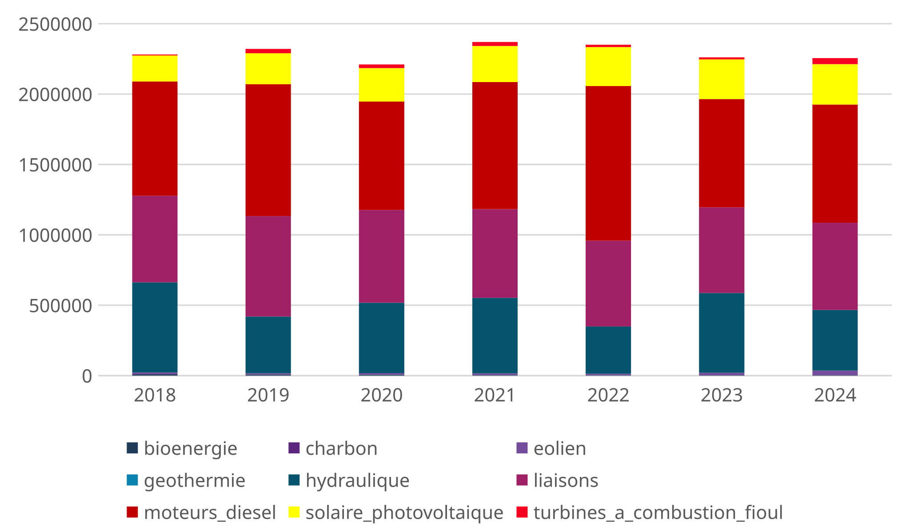
<div class="ppt-text" style="left:57%;top:9%;width:32%;height:5%;font-size:var(--content-size);"><div class="ppt-p" style="text-align:center"><span style="font-size:var(--content-size)">Modes de production d’électricité en Corse</span></div></div></div>

## Analyse de sensibilité globale {.editorial data-part="3" data-subpart="3"}

<div class="slide-title">Analyse de sensibilité globale</div>

<div class="ppt-canvas"><div class="ppt-text" style="left:53%;top:12%;width:45%;height:73%;font-size:var(--content-size);"><div class="ppt-p" style="text-align:left"><span style="font-size:var(--content-size)">Variabilité:</span></div><div class="ppt-p" style="text-align:left"><span style="font-size:var(--content-size)">Tirages </span><span style="font-size:var(--content-size)">sobol</span></div><div class="ppt-p" style="text-align:left">&nbsp;</div><div class="ppt-p" style="text-align:left">&nbsp;</div><div class="ppt-p" style="text-align:left">&nbsp;</div><div class="ppt-p" style="text-align:left">&nbsp;</div><div class="ppt-p" style="text-align:left">&nbsp;</div><div class="ppt-p" style="text-align:left">&nbsp;</div><div class="ppt-p" style="text-align:left">&nbsp;</div><div class="ppt-p" style="text-align:left">&nbsp;</div><div class="ppt-p" style="text-align:left">&nbsp;</div><div class="ppt-p" style="text-align:left">&nbsp;</div><div class="ppt-p" style="text-align:left">&nbsp;</div><div class="ppt-p" style="text-align:left"><span style="font-size:var(--content-size)">Incertitude:</span></div><div class="ppt-p" style="text-align:left"><span style="font-size:var(--content-size)">Tirages Monte-Carlo</span></div></div>
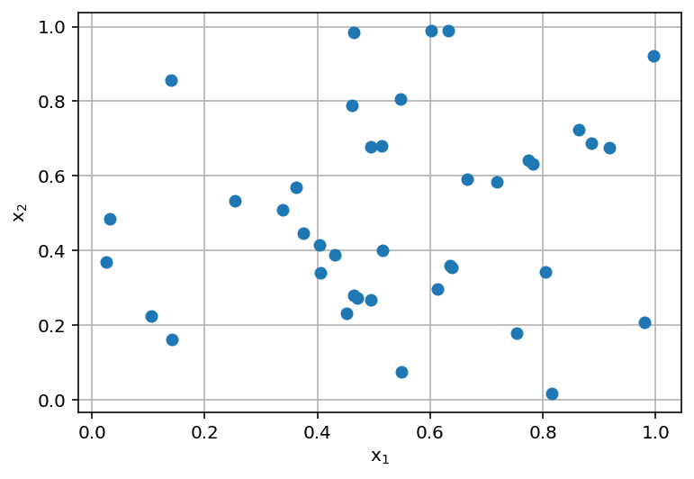
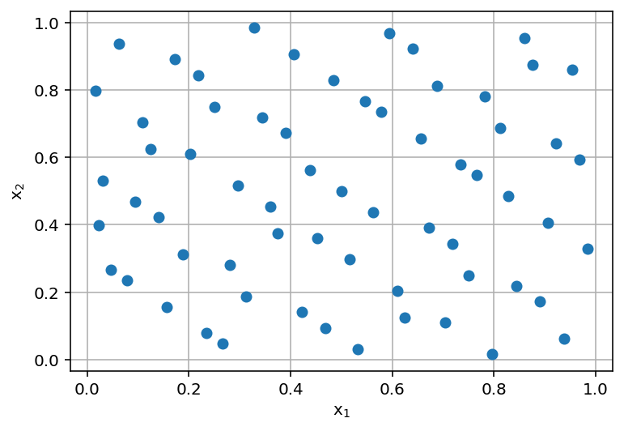</div>


## Sobol total : ensemble des paramètres {.editorial data-part="3" data-subpart="3"}

<div class="slide-title">Sobol total : ensemble des paramètres</div>

<div class="ppt-canvas">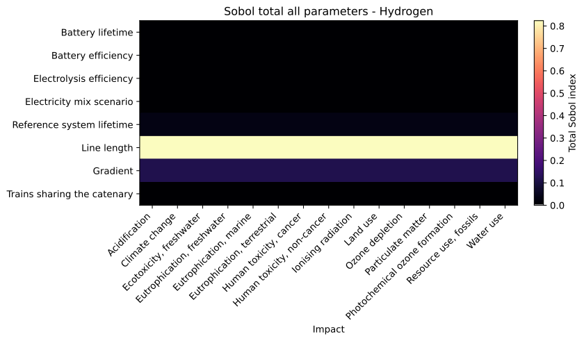
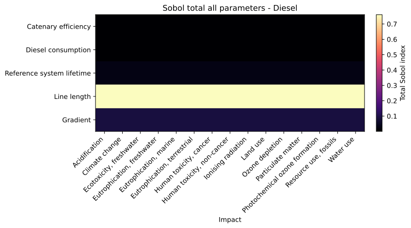
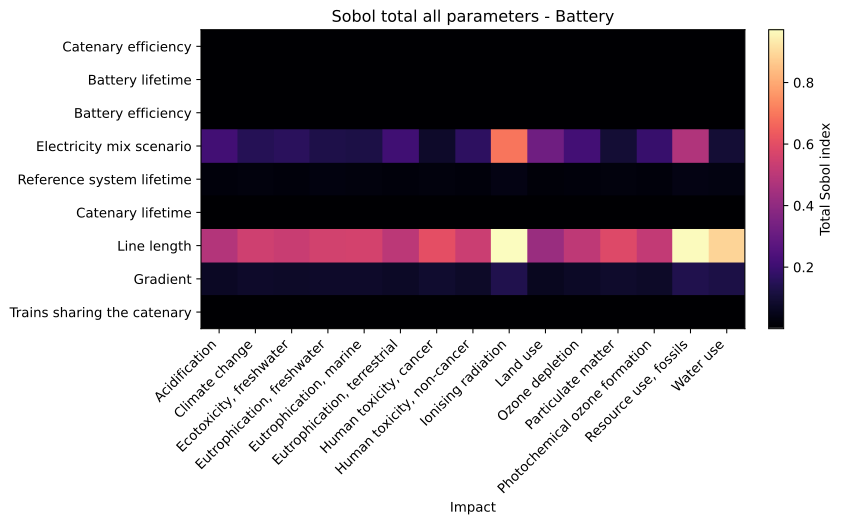
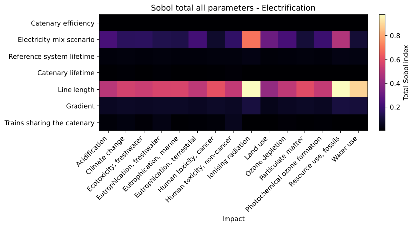</div>

## Sobol total : paramètres technologiques {.editorial data-part="3" data-subpart="3"}

<div class="slide-title">Sobol total : paramètres technologiques</div>

<div class="ppt-canvas">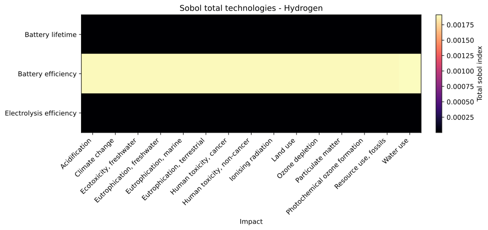
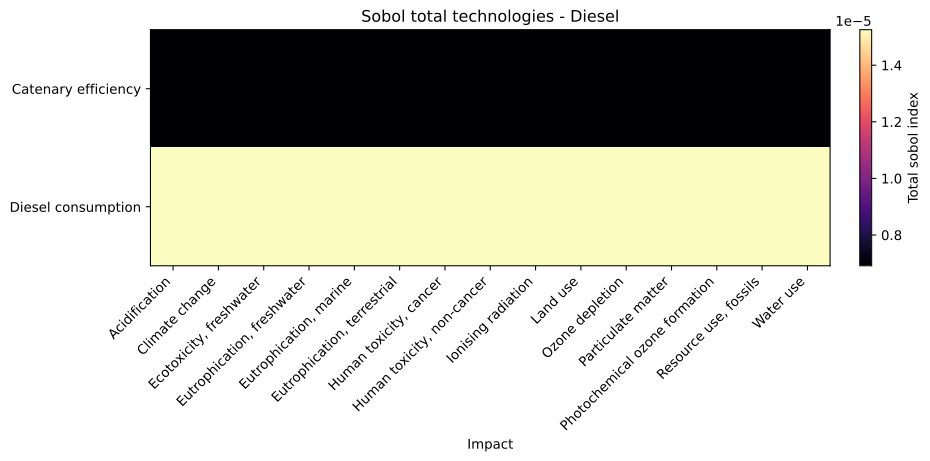
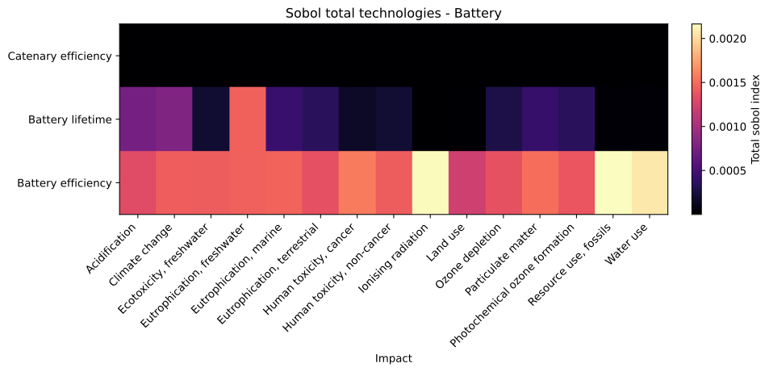
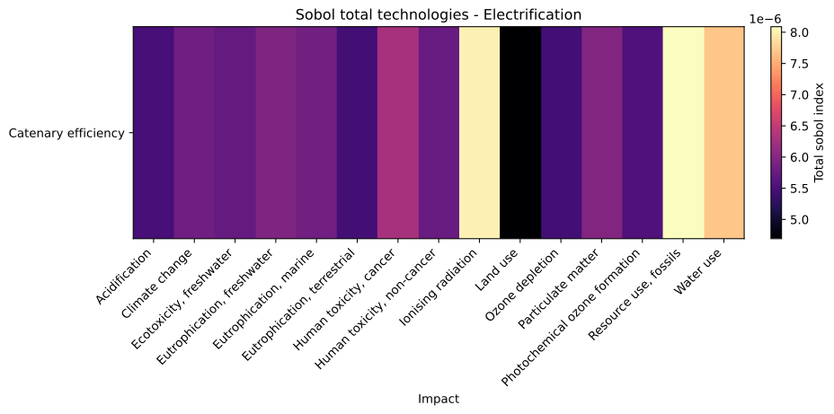</div>

## Zones d’incomparabilité {.editorial data-part="3" data-subpart="3"}

<div class="slide-title">Zones d’incomparabilité</div>

<div class="ppt-canvas">
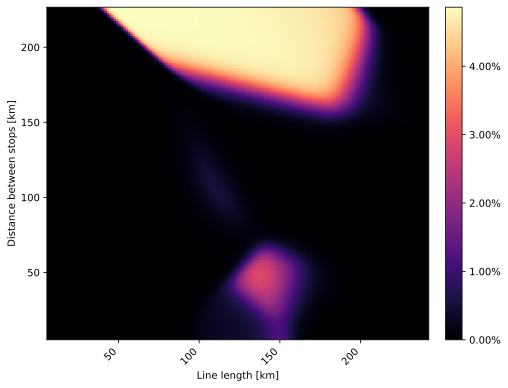
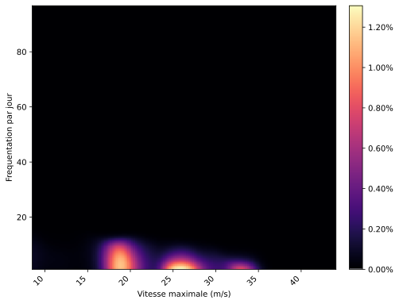
</div>


## {.editorial .part-divider data-part="4" data-subpart="1"}

<div class="divider-number">PARTIE 04</div>
<div class="divider-title">Conclusions et Perspectives</div>
<div class="divider-subtitle">Synthèse des contributions et perspectives scientifiques et opérationnels.</div>

## Conclusion {.editorial data-part="4" data-subpart="1"}

<div class="slide-title">Conclusion</div>
<div class="perspective-grid">
<div class="perspective-column"><div class="perspective-kicker">ORGANISATION DE LA DÉCISION</div><div class="perspective-title">Réorganisation des décisions publiques avec interactions publiques–privées</div><div class="perspective-list">Réduction des risques<br>Meilleure prise en compte de la temporalité<br>Organisation plus explicite des interventions</div></div>
<div class="perspective-column"><div class="perspective-kicker">RECOMMANDATION TECHNOLOGIQUE</div><div class="perspective-title">Méthodologie de réduction d’impact environnemental des trains</div><div class="perspective-list">Adaptable à différents roulements, matériels roulants et technologies<br>Multicritère<br>Facile à interpréter pour des non-experts<br>Transparente grâce à des données publiques<br>Extensible à d’autres domaines de mobilité</div></div>
</div>

## Perspectives {.editorial data-part="4" data-subpart="1"}

<div class="slide-title">Perspectives scientifiques et opérationnelles</div>
<div class="perspective-grid">
<div class="perspective-column"><div class="perspective-kicker">MÉTHODE</div><div class="perspective-list">ADMC: Sensibilité au choixde méthode<br>Sensibilité aux poids et à la normalisation<br>Réduction des incertitudes<br>Développement aux critères sociaux et économiques</div></div>
<div class="perspective-column"><div class="perspective-kicker">APPLICATIONS</div><div class="perspective-list">Extension aux lignes non électrifiées<br>Extension à d’autres systèmes de mobilité<br>Outil opérationnel d’aide à la décision régionale</div></div>
</div>

## {.end-slide data-part="4" data-subpart="1"}

<div class="end-title">Merci.</div>
<div class="end-subtitle">Questions & discussion</div>
<div class="end-footer"><span>Benoît Volant · CentraleSupélec · LGI · IKOS</span><span>bvolant@ikosconsulting.com</span></div>

## Limites planétaires {.appendix-slide}

<div class="appendix-label">ANNEXE A1</div>
<div class="appendix-title">Limites planétaires</div>
<div class="appendix-body"><div class="ppt-canvas" style="top:0;left:0;right:0;bottom:0;">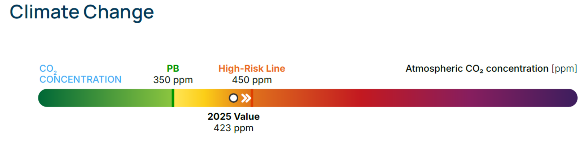
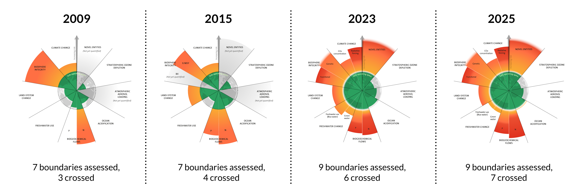</div></div>

## Critères d’impact environnementaux {.appendix-slide}

<div class="appendix-label">ANNEXE A2</div>
<div class="appendix-title">Critères d’impact environnementaux</div>
<div class="appendix-body"><div class="ppt-canvas" style="top:0;left:0;right:0;bottom:0;">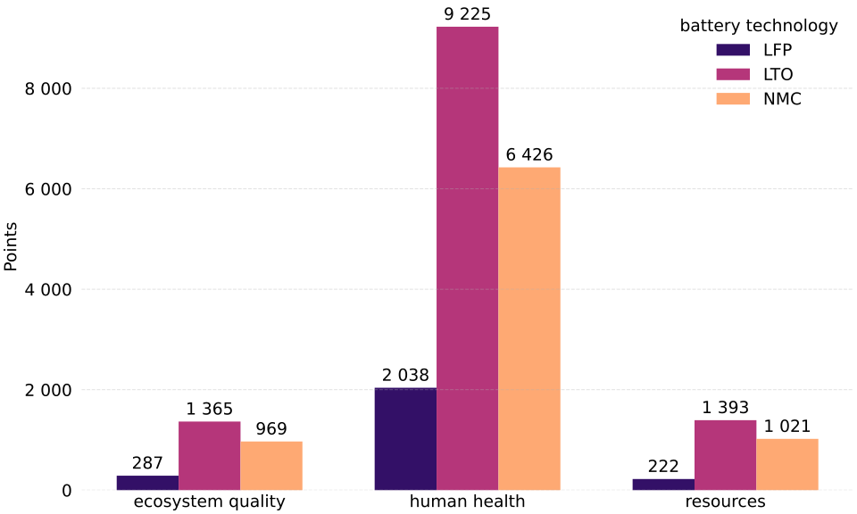
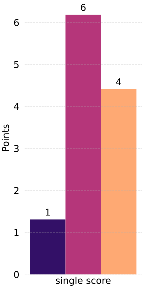
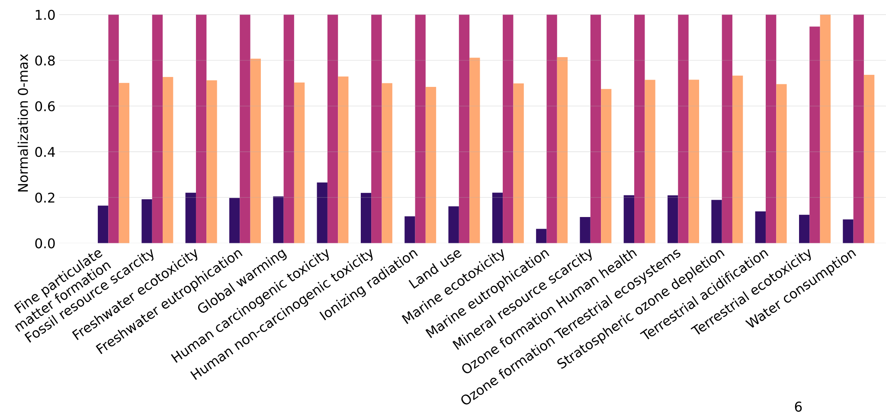
<div class="ppt-text" style="left:58%;top:2%;width:25%;height:5%;font-size:var(--content-size);"><div class="ppt-p" style="text-align:center"><span style="font-size:var(--content-size);font-weight:700">Impacts intermédiaires</span></div></div>
<div class="ppt-text" style="left:76%;top:86%;width:22%;height:5%;font-size:var(--content-size);"><div class="ppt-p" style="text-align:center"><span style="font-size:var(--content-size);font-weight:700">Score</span></div></div>
<div class="ppt-text" style="left:47%;top:88%;width:16%;height:5%;font-size:var(--content-size);"><div class="ppt-p" style="text-align:center"><span style="font-size:var(--content-size);font-weight:700">Dégâts </span></div></div>
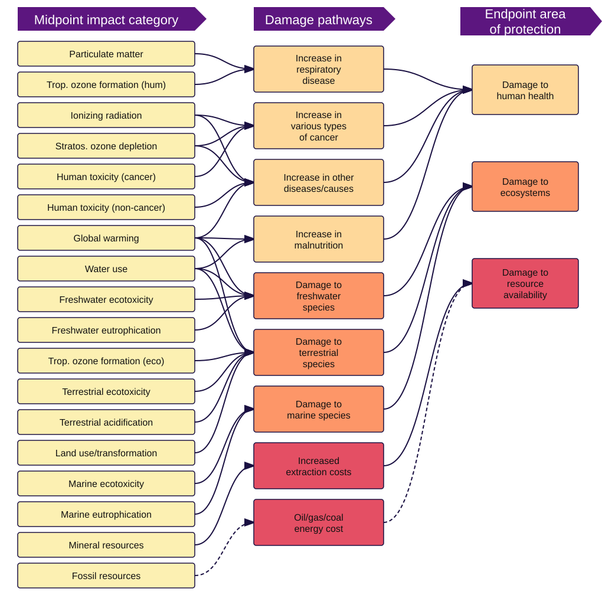</div></div>

<!-- Diapositives conservées du chapitre 3, hors du déroulé principal. -->

## Besoin d’une comparaison environnementale multicritère {.editorial .appendix-slide}

<div class="slide-title">Besoin d'une comparaison environnementale multicritère</div>

```{=html}
<div class="ppt-canvas">
  <div class="environmental-comparison-needs">
    <div class="comparison-need">
      <div class="comparison-need-label">Contexte</div>
      <h3>Complexe et prospectif</h3>
    </div>
    <div class="comparison-need">
      <div class="comparison-need-label">Exigences</div>
      <h3>Transparence et interprétabilité</h3>
    </div>
  </div>
  
</div>
```
## Formalisation de la méthodologie d’ACV {.editorial .appendix-slide .has-slide-references}

<div class="slide-title">Formalisation de la méthodologie d’ACV <span class="slide-subtitle">ISO 14040 · ISO 14044</span></div>

<div class="ppt-canvas acv-methodology">
<div class="methodology-steps" role="img" aria-label="Quatre phases de l’ACV : objectifs et champ de l’étude, inventaire, évaluation des impacts, interprétation. Des itérations relient les phases.">
<div class="methodology-step"><span>Objectifs et champ<br>de l’étude</span></div>
<div class="methodology-step"><span>Inventaire du<br>cycle de vie</span></div>
<div class="methodology-step"><span>Évaluation des impacts<br>du cycle de vie</span></div>
<div class="methodology-step"><span>Interprétation</span></div>
</div>
<div class="acv-phase-details">
<div><h3>Cadrer la comparaison</h3><p>Objectif, unité fonctionnelle<br>et frontières du système</p><p>Scénarios technologiques<br>et hypothèses communes</p><div class="acv-deliverable">Périmètre de l’étude</div></div>
<div><h3>Quantifier les flux</h3><p>Collecte des données :<br>matières, énergie, émissions</p><p>Fabrication, exploitation,<br>maintenance et fin de vie</p><div class="acv-deliverable">Inventaire des flux</div></div>
<div><h3>Caractériser les impacts</h3><p>Choix des catégories<br>et indicateurs d’impact</p><p>Classification des flux<br>et caractérisation</p><div class="acv-deliverable">Profil environnemental</div></div>
<div><h3>Éclairer la décision</h3><p>Contributions majeures,<br>sensibilité et cohérence</p><p>Limites, conclusions<br>et recommandations</p><div class="acv-deliverable">Résultats interprétés</div></div>
</div>
<div class="acv-iteration">↔ Démarche itérative : l’interprétation accompagne chaque phase et peut conduire à réviser les hypothèses, les données ou les modèles.</div>
</div>
<div class="slide-references" role="note"><span class="slide-reference-entry">ISO (2006). ISO 14040 - Management environnemental - Analyse du cycle de vie - Principes et cadre.</span><span class="slide-reference-entry">ISO (2006). ISO 14044 - Management environnemental - Analyse du cycle de vie - Exigences et lignes directrices.</span></div>

## Incertitudes d’approximation des modèles {.editorial .appendix-slide}

<div class="slide-title">Incertitudes d’approximation des modèles</div>

<div class="ppt-canvas">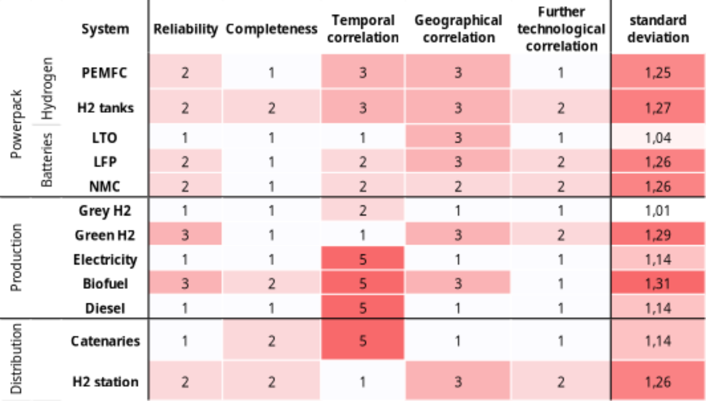</div>

## Incertitude des paramètres {.editorial .appendix-slide}

<div class="slide-title">Incertitude des paramètres</div>

<div class="ppt-canvas"></div>

## Rétrospectif : caténaires {.editorial .appendix-slide}

<div class="slide-title">Rétrospectif : caténaires</div>

<div class="ppt-canvas">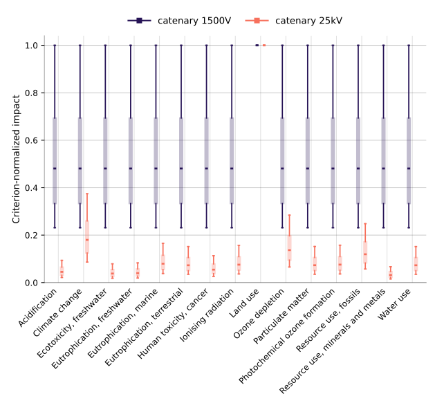

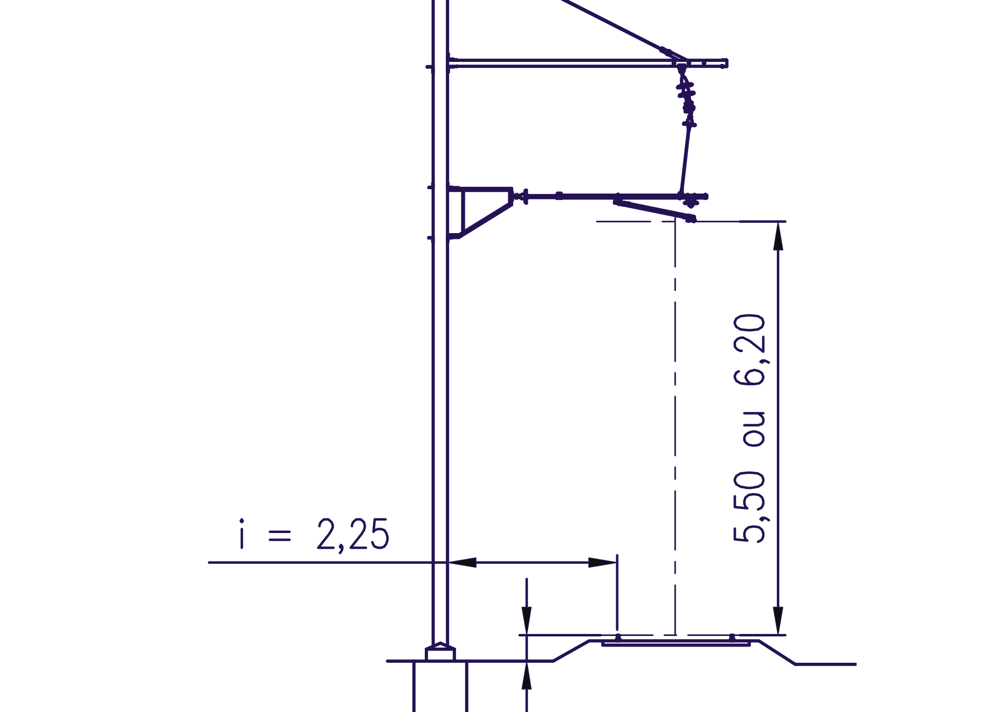</div>

## Prospectif : mix électrique {.editorial .appendix-slide}

<div class="slide-title">Prospectif : mix électrique</div>

<div class="ppt-canvas">
<div class="ppt-text" style="left:4%;top:20%;width:34%;height:6%;font-size:var(--content-size);"><div class="ppt-p" style="text-align:left"><span style="font-size:var(--content-size)">Prospectives: scenarios de projection (RTE) </span></div></div>
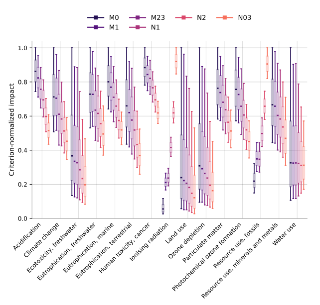</div>

## Batteries : revue bibliographique {.editorial .appendix-slide}

<div class="slide-title">Batteries : revue bibliographique</div>

<div class="ppt-canvas">

<div class="ppt-table-wrap" style="left:52%;top:62%;width:37%;height:24%;"><table class="ppt-table"><tr><td style=""></td><td style="color:#440F76;font-size:var(--content-size)">LTO</td><td style="color:#B73779;font-size:var(--content-size)">NMC</td><td style="color:#FD9668;font-size:var(--content-size)">LFP</td></tr><tr><td style="font-size:var(--content-size)">Masse</td><td style="font-size:var(--content-size)">1400 kg</td><td style="font-size:var(--content-size)">-</td><td style="font-size:var(--content-size)">-</td></tr><tr><td style="font-size:var(--content-size)">Energie kWh</td><td style="font-size:var(--content-size)">75</td><td style="font-size:var(--content-size)">220</td><td style="font-size:var(--content-size)">191</td></tr><tr><td style="font-size:var(--content-size)">Puissance kW</td><td style="font-size:var(--content-size)">300 à 600</td><td style="font-size:var(--content-size)">220 à 440</td><td style="font-size:var(--content-size)">191 à 383</td></tr></table></div></div>

## Batteries : dimensionnement à masse constante {.editorial .appendix-slide}

<div class="slide-title">Batteries : dimensionnement à masse constante</div>

<div class="ppt-canvas">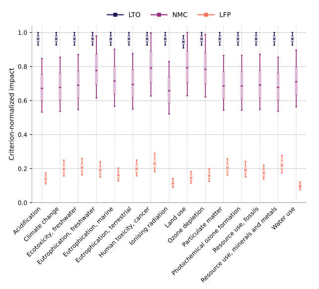
<div class="ppt-table-wrap" style="left:56%;top:17%;width:37%;height:24%;"><table class="ppt-table"><tr><td style=""></td><td style="color:#440F76;font-size:var(--content-size)">LTO</td><td style="color:#B73779;font-size:var(--content-size)">NMC</td><td style="color:#FD9668;font-size:var(--content-size)">LFP</td></tr><tr><td style="font-size:var(--content-size)">Masse</td><td style="font-size:var(--content-size)">1400 kg</td><td style="font-size:var(--content-size)">1400 kg</td><td style="font-size:var(--content-size)">1400 kg</td></tr><tr><td style="font-size:var(--content-size)">Energie kWh</td><td style="font-size:var(--content-size)">75</td><td style="font-size:var(--content-size)">220</td><td style="font-size:var(--content-size)">191</td></tr><tr><td style="font-size:var(--content-size)">Puissance kW</td><td style="font-size:var(--content-size)">300 à 600</td><td style="font-size:var(--content-size)">220 à 440</td><td style="font-size:var(--content-size)">191 à 383</td></tr></table></div>
<div class="ppt-text" style="left:61%;top:51%;width:28%;height:18%;font-size:var(--content-title-size);"><div class="ppt-p" style="text-align:left"><span style="font-size:var(--content-title-size);font-weight:700">Comparaison brute des technologies, à ce stade pas de prise en compte:</span></div><div class="ppt-p" style="text-align:left"><span style="font-size:var(--content-title-size)">Infrastructures ferroviaires </span></div><div class="ppt-p" style="text-align:left"><span style="font-size:var(--content-title-size)">Exploitation des trains</span></div></div></div>

## ORIEnT : modélisation des vitesses {.editorial .appendix-slide}

<div class="slide-title">ORIEnT : modélisation des vitesses</div>

<div class="ppt-canvas">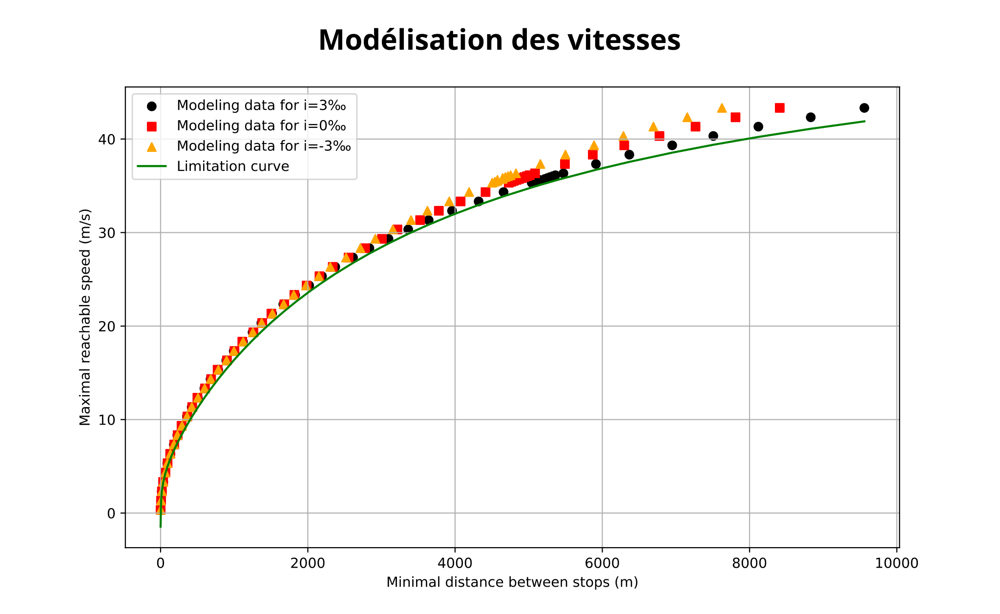</div>

## ORIEnT : modélisation du roulement {.editorial .appendix-slide}

<div class="slide-title">ORIEnT : modélisation du roulement</div>

<div class="ppt-canvas"><div class="ppt-table-wrap" style="left:30%;top:27%;width:40%;height:63%;"><table class="ppt-table"><tr><td style="font-size:var(--content-size);font-weight:700">Phase</td><td style="font-size:var(--content-size);font-weight:700">Variable limitante</td><td style="font-size:var(--content-size);font-weight:700">Contrainte</td></tr><tr><td style="font-size:var(--content-size);font-weight:700">Accélération</td><td style="font-size:var(--content-size)">Distance entre arrêts</td><td style=""></td></tr><tr><td style=""></td><td style="font-size:var(--content-size)">a max</td><td style="font-size:var(--content-size)">a &lt; 0,3 m/s²</td></tr><tr><td style=""></td><td style="font-size:var(--content-size)">P max</td><td style="font-size:var(--content-size)">Pmax (1,6 MW pour le Régiolis)</td></tr><tr><td style="font-size:var(--content-size);font-weight:700">Croisière</td><td style="font-size:var(--content-size)">P max, i</td><td style=""></td></tr><tr><td style=""></td><td style="font-size:var(--content-size)">Distance entre arrêts</td><td style=""></td></tr><tr><td style="font-size:var(--content-size);font-weight:700">Décélération</td><td style="font-size:var(--content-size)">V max</td><td style=""></td></tr><tr><td style=""></td><td style="font-size:var(--content-size)">a min</td><td style=""></td></tr><tr><td style=""></td><td style="font-size:var(--content-size)">P min (optionnel)</td><td style=""></td></tr></table></div></div>

## ORIEnT : paramètres technologiques et ligne {.editorial .appendix-slide}

<div class="slide-title">ORIEnT : paramètres technologiques et ligne</div>

<div class="ppt-canvas">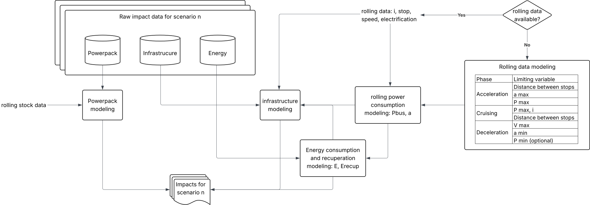
</div>

## Illustration d’un classement multicritère {.editorial .appendix-slide}

<div class="slide-title">Illustration d’un classement multicritère</div>

<div class="ppt-canvas"><div class="ppt-table-wrap" style="left:27%;top:5%;width:50%;height:31%;"><table class="ppt-table"><tr><td style=""></td><td style="background:#FFF2CC;color:#000000;font-size:var(--content-size)">Weight</td><td style="background:#FFF2CC;color:#000000;font-size:var(--content-size)">0,24</td><td style="background:#FFF2CC;color:#000000;font-size:var(--content-size)">0,27</td><td style="background:#FFF2CC;color:#000000;font-size:var(--content-size)">0,18</td><td style="background:#FFF2CC;color:#000000;font-size:var(--content-size)">0,09</td><td style="background:#FFF2CC;color:#000000;font-size:var(--content-size)">0,21</td></tr><tr><td style=""></td><td style="background:#DDEBF7;color:#000000;font-size:var(--content-size)">Criteria</td><td style="background:#DDEBF7;color:#000000;font-size:var(--content-size)">Cost</td><td style="background:#DDEBF7;color:#000000;font-size:var(--content-size)">Ecosystem diversity</td><td style="background:#DDEBF7;color:#000000;font-size:var(--content-size)">Resource scarcity</td><td style="background:#DDEBF7;color:#000000;font-size:var(--content-size)">Human health</td><td style="background:#DDEBF7;color:#000000;font-size:var(--content-size)">Social impact</td></tr><tr><td style="background:#FCE4D6;color:#000000;font-size:var(--content-size)">Alternatives</td><td style="background:#FCE4D6;color:#000000;font-size:var(--content-size)">Diesel</td><td style="font-size:var(--content-size)">6</td><td style="font-size:var(--content-size)">10</td><td style="font-size:var(--content-size)">4</td><td style="font-size:var(--content-size)">7</td><td style="font-size:var(--content-size)">4</td></tr><tr><td style=""></td><td style="background:#FCE4D6;color:#000000;font-size:var(--content-size)">Biofuel</td><td style="font-size:var(--content-size)">10</td><td style="font-size:var(--content-size)">9</td><td style="font-size:var(--content-size)">5</td><td style="font-size:var(--content-size)">1</td><td style="font-size:var(--content-size)">9</td></tr><tr><td style=""></td><td style="background:#FCE4D6;color:#000000;font-size:var(--content-size)">Hybrid</td><td style="font-size:var(--content-size)">6</td><td style="font-size:var(--content-size)">7</td><td style="font-size:var(--content-size)">3</td><td style="font-size:var(--content-size)">2</td><td style="font-size:var(--content-size)">5</td></tr><tr><td style=""></td><td style="background:#FCE4D6;color:#000000;font-size:var(--content-size)">Batteries</td><td style="font-size:var(--content-size)">6</td><td style="font-size:var(--content-size)">3</td><td style="font-size:var(--content-size)">5</td><td style="font-size:var(--content-size)">4</td><td style="font-size:var(--content-size)">9</td></tr><tr><td style=""></td><td style="background:#FCE4D6;color:#000000;font-size:var(--content-size)">Hydrogen</td><td style="font-size:var(--content-size)">10</td><td style="font-size:var(--content-size)">2</td><td style="font-size:var(--content-size)">2</td><td style="font-size:var(--content-size)">8</td><td style="font-size:var(--content-size)">3</td></tr><tr><td style=""></td><td style="background:#FCE4D6;color:#000000;font-size:var(--content-size)">Electrification</td><td style="font-size:var(--content-size)">5</td><td style="font-size:var(--content-size)">3</td><td style="font-size:var(--content-size)">10</td><td style="font-size:var(--content-size)">6</td><td style="font-size:var(--content-size)">7</td></tr></table></div>

<div class="ppt-table-wrap" style="left:76%;top:49%;width:15%;height:24%;"><table class="ppt-table"><tr><td style="font-size:var(--content-size);font-weight:700">Scenario</td><td style="font-size:var(--content-size);font-weight:700">Rank</td></tr><tr><td style="font-size:var(--content-size)">Diesel</td><td style="font-size:var(--content-size)">5</td></tr><tr><td style="font-size:var(--content-size)">Biofuel</td><td style="font-size:var(--content-size)">4</td></tr><tr><td style="font-size:var(--content-size)">Hybrid</td><td style="font-size:var(--content-size)">1</td></tr><tr><td style="font-size:var(--content-size)">Batteries</td><td style="font-size:var(--content-size)">3</td></tr><tr><td style="font-size:var(--content-size)">Hydrogen</td><td style="font-size:var(--content-size)">2</td></tr><tr><td style="font-size:var(--content-size)">Electrification</td><td style="font-size:var(--content-size)">6</td></tr></table></div></div>

## Validation ADEME : changement climatique {.editorial .appendix-slide}

<div class="slide-title">Validation ADEME : changement climatique</div>

<div class="ppt-canvas">

<div class="ppt-text" style="left:52%;top:8%;width:46%;height:4%;font-size:var(--content-size);"><div class="ppt-p" style="text-align:left"><span style="font-size:var(--content-size)">Comparaison des scénarios – changement climatique (gCO2eq pour 1 p.km)</span></div></div>
</div>
## Architecture modulaire des modèles {.editorial .appendix-slide}

<div class="slide-title">Architecture modulaire des modèles</div>

<div class="ppt-canvas">
</div>

## Indicateurs de réseau choisis {.editorial .appendix-slide .has-slide-references #indicateurs-complets-14}

<div class="slide-title">Indicateurs de réseau choisis</div>

:::: {.ppt-canvas}

::: {.network-indicators}

| Indicateur | Interprétation | Formule |
|:--|:--|:--|
| **Nombre d’entrées et de sorties** | Nombre de liens entrants et sortants du nœud | $\Omega_i^{-}\;;\quad\Omega_i^{+}$ |
| **Nombre d’entrées et de sorties pondérées** | Somme des poids des liens entrants et sortants | $\displaystyle\varphi_i^{-}=\sum\nolimits_{j=1}^{n}g_{ji}\;;\quad\varphi_i^{+}=\sum\nolimits_{j=1}^{n}g_{ij}$ |
| **Centralité normalisée** | Nombre de connexions du nœud, rapporté aux maxima du réseau | $\displaystyle\Omega_i=\frac{\Omega_i^{+}}{\max_k\Omega_k^{+}}+\frac{\Omega_i^{-}}{\max_k\Omega_k^{-}}$ |
| **Poids total du nœud normalisé** | Part du nœud dans la somme des poids entrants et sortants | $\displaystyle\varphi_i=\frac{\varphi_i^{+}+\varphi_i^{-}}{\sum_{k=1}^{n}\varphi_k^{+}+\sum_{k=1}^{n}\varphi_k^{-}}$ |
| **Centralité d’intermédiarité** | Importance du nœud dans les plus courts chemins reliant les autres nœuds | $\displaystyle c_i^{\mathrm{bet}}=\frac{2}{(n-1)(n-2)}\sum_{\substack{(j,k)\,:\,j\ne i,\,k\ne i}}\frac{\nu_g(i:j,k)}{\nu_g(j,k)}$ |
| **Centralité de proximité normalisée** | Inverse de la distance moyenne du nœud aux autres nœuds | $\displaystyle C_c(i)=\frac{n-1}{\sum\nolimits_{j\ne i}^{n}\rho(i,j)}$ |
| **Centralité harmonique** | Moyenne des inverses des distances aux autres nœuds | $\displaystyle C_h(i)=\frac{1}{n-1}\sum\nolimits_{j\ne i}^{n}\frac{1}{\rho(i,j)}$ |

<div class="network-indicators-key">$n$ : nombre de nœuds · $g_{ij}$ : poids du lien de $i$ vers $j$ · $\rho(i,j)$ : distance géodésique.<br>$\nu_g(i:j,k)/\nu_g(j,k)$ : fraction des plus courts chemins entre $j$ et $k$ passant par $i$.</div>

:::
::::

<div class="slide-references" role="note" aria-label="Référence">Bloch, F., Jackson, M. O., &amp; Tebaldi, P. (2023). Centrality measures in networks. Social Choice and Welfare, 61(2), 413–453.</div>

## Indicateurs de réseau : résultats {.editorial .appendix-slide .has-slide-references #indicateurs-complets-15}

<div class="slide-title">Indicateurs de réseau : résultats</div>

```{=html}
<div class="ppt-canvas">
<div class="indicator-focus-label" aria-live="polite">Tous les acteurs</div>
<span class="fragment indicator-focus-step" data-fragment-index="0" data-actor-focus="region" aria-hidden="true"></span>
<span class="fragment indicator-focus-step" data-fragment-index="1" data-actor-focus="top" aria-hidden="true"></span>
<span class="fragment indicator-focus-step" data-fragment-index="2" data-actor-focus="dgitm" aria-hidden="true"></span>
<span class="fragment indicator-focus-step" data-fragment-index="3" data-actor-focus="all" aria-hidden="true"></span>
<div class="indicator-results-frame"><table class="indicator-results-table" aria-label="Indicateurs par acteur">
<colgroup><col style="width:5%"><col style="width:25%"><col style="width:7.7778%"><col style="width:7.7778%"><col style="width:7.7778%"><col style="width:7.7778%"><col style="width:7.7778%"><col style="width:7.7778%"><col style="width:7.7778%"><col style="width:7.7778%"><col style="width:7.7778%"></colgroup><thead>
<tr><th data-cell="A1" style="background-color:transparent;color:#000000;font-weight:700;border-left:2px solid #000000;border-right:2px solid #000000;border-top:2px solid #000000;border-bottom:2px solid #000000" rowspan="2" colspan="1" scope="col">ID acteur</th><th data-cell="B1" style="background-color:transparent;color:#000000;font-weight:700;border-left:2px solid #000000;border-right:2px solid #000000;border-top:2px solid #000000;border-bottom:2px solid #000000" rowspan="2" colspan="1" scope="col">Nom de l’acteur</th><th data-cell="C1" style="background-color:transparent;color:#000000;font-weight:700;border-left:2px solid #000000;border-right:2px solid #000000;border-top:2px solid #000000;border-bottom:2px solid #000000" rowspan="2" colspan="1" scope="col">Nombre d’entrées Ω+</th><th data-cell="D1" style="background-color:transparent;color:#000000;font-weight:700;border-left:2px solid #000000;border-right:2px solid #000000;border-top:2px solid #000000;border-bottom:2px solid #000000" rowspan="2" colspan="1" scope="col">Nombre de sorties Ω-</th><th data-cell="E1" style="background-color:transparent;color:#000000;font-weight:700;border-left:2px solid #000000;border-right:2px solid #000000;border-top:2px solid #000000;border-bottom:2px solid #000000" rowspan="2" colspan="1" scope="col">Sorties pondérées φ+</th><th data-cell="F1" style="background-color:transparent;color:#000000;font-weight:700;border-left:2px solid #000000;border-right:2px solid #000000;border-top:2px solid #000000;border-bottom:2px solid #000000" rowspan="2" colspan="1" scope="col">Entrées pondérées φ-</th><th data-cell="G1" style="background-color:transparent;color:#000000;font-weight:700;border-left:2px solid #000000;border-right:2px solid #000000;border-top:2px solid #000000;border-bottom:2px solid #000000" rowspan="2" colspan="1" scope="col">Poids normalisé Φ</th><th data-cell="H1" style="background-color:transparent;color:#000000;font-weight:700;border-left:2px solid #000000;border-right:2px solid #000000;border-top:2px solid #000000;border-bottom:2px solid #000000" rowspan="2" colspan="1" scope="col">Centralité normalisée Ω</th><th data-cell="I1" style="background-color:transparent;color:#000000;font-weight:700;border-left:2px solid #000000;border-right:2px solid #000000;border-top:2px solid #000000;border-bottom:2px solid #000000" rowspan="2" colspan="1" scope="col">Centralité d&#x27;intermédiarité Cbet </th><th data-cell="J1" style="background-color:transparent;color:#000000;font-weight:700;border-left:2px solid #000000;border-right:2px solid #000000;border-top:2px solid #000000;border-bottom:2px solid #000000" rowspan="2" colspan="1" scope="col">Centralité de proximité normalisée Cc</th><th data-cell="K1" style="background-color:transparent;color:#000000;font-weight:700;border-left:2px solid #000000;border-right:2px solid #000000;border-top:2px solid #000000" scope="col">Centralité harmonique </th></tr>
<tr><th data-cell="K2" style="background-color:transparent;color:#000000;font-weight:700;border-left:2px solid #000000;border-right:2px solid #000000;border-bottom:2px solid #000000" scope="col">Ch</th></tr>
</thead><tbody>
<tr><td data-cell="A3" style="background-color:transparent;color:#000000;font-weight:700;border-left:2px solid #000000;border-right:2px solid #000000;border-top:2px solid #000000;border-bottom:2px solid #000000">A1</td><td data-cell="B3" style="background-color:transparent;color:#1D4971;font-weight:700;border-left:2px solid #000000;border-right:2px solid #000000;border-top:2px solid #000000;border-bottom:2px solid #000000">Région</td><td data-cell="C3" style="background-color:#F8696B;color:#000000;font-weight:400;border-left:2px solid #000000;border-top:2px solid #000000">16</td><td data-cell="D3" style="background-color:#F8696B;color:#000000;font-weight:400;border-top:2px solid #000000">17</td><td data-cell="E3" style="background-color:#F8696B;color:#000000;font-weight:400;border-top:2px solid #000000">45</td><td data-cell="F3" style="background-color:#F8696B;color:#000000;font-weight:400;border-top:2px solid #000000">56</td><td data-cell="G3" style="background-color:#F8696B;color:#000000;font-weight:700;border-top:2px solid #000000">0,1</td><td data-cell="H3" style="background-color:#F8696B;color:#000000;font-weight:400;border-top:2px solid #000000">1,94</td><td data-cell="I3" style="background-color:#F8696B;color:#000000;font-weight:400;border-top:2px solid #000000">0,101</td><td data-cell="J3" style="background-color:#F8696B;color:#000000;font-weight:400;border-top:2px solid #000000">0,944</td><td data-cell="K3" style="background-color:#F8696B;color:#000000;font-weight:400;border-top:2px solid #000000">16,5</td></tr>
<tr><td data-cell="A4" style="background-color:transparent;color:#000000;font-weight:700;border-left:2px solid #000000;border-right:2px solid #000000;border-top:2px solid #000000;border-bottom:2px solid #000000">A2</td><td data-cell="B4" style="background-color:transparent;color:#1D4971;font-weight:700;border-left:2px solid #000000;border-right:2px solid #000000;border-top:2px solid #000000;border-bottom:2px solid #000000">Ministère chargé des transports</td><td data-cell="C4" style="background-color:#FCAA78;color:#000000;font-weight:400;border-left:2px solid #000000">14</td><td data-cell="D4" style="background-color:#FDB87B;color:#000000;font-weight:400">14</td><td data-cell="E4" style="background-color:#FDBD7C;color:#000000;font-weight:400">36</td><td data-cell="F4" style="background-color:#FCB27A;color:#000000;font-weight:400">40</td><td data-cell="G4" style="background-color:#FDB47A;color:#000000;font-weight:700">0,075</td><td data-cell="H4" style="background-color:#FCAE79;color:#000000;font-weight:400">1,65</td><td data-cell="I4" style="background-color:#FED881;color:#000000;font-weight:400">0,028</td><td data-cell="J4" style="background-color:#FCB179;color:#000000;font-weight:400">0,85</td><td data-cell="K4" style="background-color:#FCAA78;color:#000000;font-weight:400">15,5</td></tr>
<tr><td data-cell="A5" style="background-color:transparent;color:#000000;font-weight:700;border-left:2px solid #000000;border-right:2px solid #000000;border-top:2px solid #000000;border-bottom:2px solid #000000">A5</td><td data-cell="B5" style="background-color:transparent;color:#B71111;font-weight:700;border-left:2px solid #000000;border-right:2px solid #000000;border-top:2px solid #000000;border-bottom:2px solid #000000">Constructeur de matériel roulant</td><td data-cell="C5" style="background-color:#FECB7E;color:#000000;font-weight:400;border-left:2px solid #000000">13</td><td data-cell="D5" style="background-color:#FA8370;color:#000000;font-weight:400">16</td><td data-cell="E5" style="background-color:#FFD981;color:#000000;font-weight:400">33</td><td data-cell="F5" style="background-color:#FCA978;color:#000000;font-weight:400">42</td><td data-cell="G5" style="background-color:#FDB77A;color:#000000;font-weight:700">0,074</td><td data-cell="H5" style="background-color:#FBA076;color:#000000;font-weight:400">1,71</td><td data-cell="I5" style="background-color:#FFDF82;color:#000000;font-weight:400">0,023</td><td data-cell="J5" style="background-color:#FED07F;color:#000000;font-weight:400">0,81</td><td data-cell="K5" style="background-color:#FECB7E;color:#000000;font-weight:400">15</td></tr>
<tr><td data-cell="A6" style="background-color:transparent;color:#000000;font-weight:700;border-left:2px solid #000000;border-right:2px solid #000000;border-top:2px solid #000000;border-bottom:2px solid #000000">A11</td><td data-cell="B6" style="background-color:transparent;color:#B71111;font-weight:700;border-left:2px solid #000000;border-right:2px solid #000000;border-top:2px solid #000000;border-bottom:2px solid #000000">SNCF Réseau</td><td data-cell="C6" style="background-color:#FCAA78;color:#000000;font-weight:400;border-left:2px solid #000000">14</td><td data-cell="D6" style="background-color:#FDB87B;color:#000000;font-weight:400">14</td><td data-cell="E6" style="background-color:#F2E783;color:#000000;font-weight:400">29</td><td data-cell="F6" style="background-color:#FDBC7B;color:#000000;font-weight:400">38</td><td data-cell="G6" style="background-color:#FECF7F;color:#000000;font-weight:700">0,066</td><td data-cell="H6" style="background-color:#FCAE79;color:#000000;font-weight:400">1,65</td><td data-cell="I6" style="background-color:#FFE784;color:#000000;font-weight:400">0,018</td><td data-cell="J6" style="background-color:#FCB179;color:#000000;font-weight:400">0,85</td><td data-cell="K6" style="background-color:#FCAA78;color:#000000;font-weight:400">15,5</td></tr>
<tr><td data-cell="A7" style="background-color:transparent;color:#000000;font-weight:700;border-left:2px solid #000000;border-right:2px solid #000000;border-top:2px solid #000000;border-bottom:2px solid #000000">A3</td><td data-cell="B7" style="background-color:transparent;color:#1D4971;font-weight:700;border-left:2px solid #000000;border-right:2px solid #000000;border-top:2px solid #000000;border-bottom:2px solid #000000">Gouvernement français</td><td data-cell="C7" style="background-color:#FECB7E;color:#000000;font-weight:400;border-left:2px solid #000000">13</td><td data-cell="D7" style="background-color:#FDB87B;color:#000000;font-weight:400">14</td><td data-cell="E7" style="background-color:#FDBD7C;color:#000000;font-weight:400">36</td><td data-cell="F7" style="background-color:#FFDC81;color:#000000;font-weight:400">31</td><td data-cell="G7" style="background-color:#FECF7F;color:#000000;font-weight:700">0,066</td><td data-cell="H7" style="background-color:#FDBC7B;color:#000000;font-weight:400">1,59</td><td data-cell="I7" style="background-color:#FFDF82;color:#000000;font-weight:400">0,023</td><td data-cell="J7" style="background-color:#FED07F;color:#000000;font-weight:400">0,81</td><td data-cell="K7" style="background-color:#FECB7E;color:#000000;font-weight:400">15</td></tr>
<tr><td data-cell="A8" style="background-color:transparent;color:#000000;font-weight:700;border-left:2px solid #000000;border-right:2px solid #000000;border-top:2px solid #000000;border-bottom:2px solid #000000">A6</td><td data-cell="B8" style="background-color:transparent;color:#DE6614;font-weight:700;border-left:2px solid #000000;border-right:2px solid #000000;border-top:2px solid #000000;border-bottom:2px solid #000000">Producteurs et distributeurs d’électricité</td><td data-cell="C8" style="background-color:#FFEB84;color:#000000;font-weight:400;border-left:2px solid #000000">12</td><td data-cell="D8" style="background-color:#FFEB84;color:#000000;font-weight:400">12</td><td data-cell="E8" style="background-color:#FED07F;color:#000000;font-weight:400">34</td><td data-cell="F8" style="background-color:#FFDC81;color:#000000;font-weight:400">31</td><td data-cell="G8" style="background-color:#FED580;color:#000000;font-weight:700">0,064</td><td data-cell="H8" style="background-color:#FFE583;color:#000000;font-weight:400">1,41</td><td data-cell="I8" style="background-color:#FED380;color:#000000;font-weight:400">0,031</td><td data-cell="J8" style="background-color:#FFEB84;color:#000000;font-weight:400">0,773</td><td data-cell="K8" style="background-color:#FFEB84;color:#000000;font-weight:400">14,5</td></tr>
<tr><td data-cell="A9" style="background-color:transparent;color:#000000;font-weight:700;border-left:2px solid #000000;border-right:2px solid #000000;border-top:2px solid #000000;border-bottom:2px solid #000000">A4</td><td data-cell="B9" style="background-color:transparent;color:#1D4971;font-weight:700;border-left:2px solid #000000;border-right:2px solid #000000;border-top:2px solid #000000;border-bottom:2px solid #000000">Union européenne</td><td data-cell="C9" style="background-color:#FECB7E;color:#000000;font-weight:400;border-left:2px solid #000000">13</td><td data-cell="D9" style="background-color:#FDB87B;color:#000000;font-weight:400">14</td><td data-cell="E9" style="background-color:#FEC67D;color:#000000;font-weight:400">35</td><td data-cell="F9" style="background-color:#FFE583;color:#000000;font-weight:400">29</td><td data-cell="G9" style="background-color:#FED881;color:#000000;font-weight:700">0,063</td><td data-cell="H9" style="background-color:#FDBC7B;color:#000000;font-weight:400">1,59</td><td data-cell="I9" style="background-color:#FFDF82;color:#000000;font-weight:400">0,023</td><td data-cell="J9" style="background-color:#FED07F;color:#000000;font-weight:400">0,81</td><td data-cell="K9" style="background-color:#FECB7E;color:#000000;font-weight:400">15</td></tr>
<tr><td data-cell="A10" style="background-color:transparent;color:#000000;font-weight:700;border-left:2px solid #000000;border-right:2px solid #000000;border-top:2px solid #000000;border-bottom:2px solid #000000">A12</td><td data-cell="B10" style="background-color:transparent;color:#B71111;font-weight:700;border-left:2px solid #000000;border-right:2px solid #000000;border-top:2px solid #000000;border-bottom:2px solid #000000">Exploitant du réseau ferroviaire</td><td data-cell="C10" style="background-color:#FFEB84;color:#000000;font-weight:400;border-left:2px solid #000000">12</td><td data-cell="D10" style="background-color:#FFEB84;color:#000000;font-weight:400">12</td><td data-cell="E10" style="background-color:#ECE582;color:#000000;font-weight:400">28</td><td data-cell="F10" style="background-color:#FECE7F;color:#000000;font-weight:400">34</td><td data-cell="G10" style="background-color:#FFDE82;color:#000000;font-weight:700">0,061</td><td data-cell="H10" style="background-color:#FFE583;color:#000000;font-weight:400">1,41</td><td data-cell="I10" style="background-color:#FED17F;color:#000000;font-weight:400">0,032</td><td data-cell="J10" style="background-color:#FFEB84;color:#000000;font-weight:400">0,773</td><td data-cell="K10" style="background-color:#FFEB84;color:#000000;font-weight:400">14,5</td></tr>
<tr><td data-cell="A11" style="background-color:transparent;color:#000000;font-weight:700;border-left:2px solid #000000;border-right:2px solid #000000;border-top:2px solid #000000;border-bottom:2px solid #000000">A9</td><td data-cell="B11" style="background-color:transparent;color:#DE6614;font-weight:700;border-left:2px solid #000000;border-right:2px solid #000000;border-top:2px solid #000000;border-bottom:2px solid #000000">Acteurs industriels</td><td data-cell="C11" style="background-color:#E8E482;color:#000000;font-weight:400;border-left:2px solid #000000">11</td><td data-cell="D11" style="background-color:#FDB87B;color:#000000;font-weight:400">14</td><td data-cell="E11" style="background-color:#FFE283;color:#000000;font-weight:400">32</td><td data-cell="F11" style="background-color:#F5E883;color:#000000;font-weight:400">26</td><td data-cell="G11" style="background-color:#FFEA84;color:#000000;font-weight:700">0,057</td><td data-cell="H11" style="background-color:#FED781;color:#000000;font-weight:400">1,47</td><td data-cell="I11" style="background-color:#FFEA84;color:#000000;font-weight:400">0,016</td><td data-cell="J11" style="background-color:#E2E282;color:#000000;font-weight:400">0,739</td><td data-cell="K11" style="background-color:#E8E482;color:#000000;font-weight:400">14</td></tr>
<tr><td data-cell="A12" style="background-color:transparent;color:#000000;font-weight:700;border-left:2px solid #000000;border-right:2px solid #000000;border-top:2px solid #000000;border-bottom:2px solid #000000">A7</td><td data-cell="B12" style="background-color:transparent;color:#DE6614;font-weight:700;border-left:2px solid #000000;border-right:2px solid #000000;border-top:2px solid #000000;border-bottom:2px solid #000000">Producteurs d’hydrogène</td><td data-cell="C12" style="background-color:#FFEB84;color:#000000;font-weight:400;border-left:2px solid #000000">12</td><td data-cell="D12" style="background-color:#F0E683;color:#000000;font-weight:400">11</td><td data-cell="E12" style="background-color:#FFD981;color:#000000;font-weight:400">33</td><td data-cell="F12" style="background-color:#E9E482;color:#000000;font-weight:400">24</td><td data-cell="G12" style="background-color:#FCEA83;color:#000000;font-weight:700">0,056</td><td data-cell="H12" style="background-color:#F9E983;color:#000000;font-weight:400">1,35</td><td data-cell="I12" style="background-color:#DBE081;color:#000000;font-weight:400">0,011</td><td data-cell="J12" style="background-color:#FFEB84;color:#000000;font-weight:400">0,773</td><td data-cell="K12" style="background-color:#FFEB84;color:#000000;font-weight:400">14,5</td></tr>
<tr><td data-cell="A13" style="background-color:transparent;color:#000000;font-weight:700;border-left:2px solid #000000;border-right:2px solid #000000;border-top:2px solid #000000;border-bottom:2px solid #000000">A8</td><td data-cell="B13" style="background-color:transparent;color:#DE6614;font-weight:700;border-left:2px solid #000000;border-right:2px solid #000000;border-top:2px solid #000000;border-bottom:2px solid #000000">Constructeurs d’infrastructures</td><td data-cell="C13" style="background-color:#FFEB84;color:#000000;font-weight:400;border-left:2px solid #000000">12</td><td data-cell="D13" style="background-color:#E2E282;color:#000000;font-weight:400">10</td><td data-cell="E13" style="background-color:#FFD981;color:#000000;font-weight:400">33</td><td data-cell="F13" style="background-color:#E3E382;color:#000000;font-weight:400">23</td><td data-cell="G13" style="background-color:#F8E983;color:#000000;font-weight:700">0,055</td><td data-cell="H13" style="background-color:#EFE683;color:#000000;font-weight:400">1,29</td><td data-cell="I13" style="background-color:#F7E883;color:#000000;font-weight:400">0,014</td><td data-cell="J13" style="background-color:#FFEB84;color:#000000;font-weight:400">0,773</td><td data-cell="K13" style="background-color:#FFEB84;color:#000000;font-weight:400">14,5</td></tr>
<tr><td data-cell="A14" style="background-color:transparent;color:#000000;font-weight:700;border-left:2px solid #000000;border-right:2px solid #000000;border-top:2px solid #000000;border-bottom:2px solid #000000">A10</td><td data-cell="B14" style="background-color:transparent;color:#DE6614;font-weight:700;border-left:2px solid #000000;border-right:2px solid #000000;border-top:2px solid #000000;border-bottom:2px solid #000000">Producteurs de diesel</td><td data-cell="C14" style="background-color:#E8E482;color:#000000;font-weight:400;border-left:2px solid #000000">11</td><td data-cell="D14" style="background-color:#F0E683;color:#000000;font-weight:400">11</td><td data-cell="E14" style="background-color:#F8E983;color:#000000;font-weight:400">30</td><td data-cell="F14" style="background-color:#E9E482;color:#000000;font-weight:400">24</td><td data-cell="G14" style="background-color:#EFE683;color:#000000;font-weight:700">0,053</td><td data-cell="H14" style="background-color:#EFE683;color:#000000;font-weight:400">1,29</td><td data-cell="I14" style="background-color:#DBE081;color:#000000;font-weight:400">0,011</td><td data-cell="J14" style="background-color:#E2E282;color:#000000;font-weight:400">0,739</td><td data-cell="K14" style="background-color:#E8E482;color:#000000;font-weight:400">14</td></tr>
<tr><td data-cell="A15" style="background-color:transparent;color:#000000;font-weight:700;border-left:2px solid #000000;border-right:2px solid #000000;border-top:2px solid #000000;border-bottom:2px solid #000000">A13</td><td data-cell="B15" style="background-color:transparent;color:#1D4971;font-weight:700;border-left:2px solid #000000;border-right:2px solid #000000;border-top:2px solid #000000;border-bottom:2px solid #000000">DGITM</td><td data-cell="C15" style="background-color:#BCD780;color:#000000;font-weight:400;border-left:2px solid #000000">9</td><td data-cell="D15" style="background-color:#FFEB84;color:#000000;font-weight:400">12</td><td data-cell="E15" style="background-color:#D9E081;color:#000000;font-weight:400">25</td><td data-cell="F15" style="background-color:#F5E883;color:#000000;font-weight:400">26</td><td data-cell="G15" style="background-color:#E2E282;color:#000000;font-weight:700">0,05</td><td data-cell="H15" style="background-color:#E5E382;color:#000000;font-weight:400">1,24</td><td data-cell="I15" style="background-color:#C1D980;color:#000000;font-weight:400">0,009</td><td data-cell="J15" style="background-color:#B1D47F;color:#000000;font-weight:400">0,68</td><td data-cell="K15" style="background-color:#BCD780;color:#000000;font-weight:400">13</td></tr>
<tr><td data-cell="A16" style="background-color:transparent;color:#000000;font-weight:700;border-left:2px solid #000000;border-right:2px solid #000000;border-top:2px solid #000000;border-bottom:2px solid #000000">A14</td><td data-cell="B16" style="background-color:transparent;color:#4D7731;font-weight:700;border-left:2px solid #000000;border-right:2px solid #000000;border-top:2px solid #000000;border-bottom:2px solid #000000">Bureau d’études en ingénierie</td><td data-cell="C16" style="background-color:#BCD780;color:#000000;font-weight:400;border-left:2px solid #000000">9</td><td data-cell="D16" style="background-color:#E2E282;color:#000000;font-weight:400">10</td><td data-cell="E16" style="background-color:#C6DA80;color:#000000;font-weight:400">22</td><td data-cell="F16" style="background-color:#D1DD81;color:#000000;font-weight:400">20</td><td data-cell="G16" style="background-color:#BAD780;color:#000000;font-weight:700">0,041</td><td data-cell="H16" style="background-color:#D1DD81;color:#000000;font-weight:400">1,12</td><td data-cell="I16" style="background-color:#A4D07E;color:#000000;font-weight:400">0,006</td><td data-cell="J16" style="background-color:#B1D47F;color:#000000;font-weight:400">0,68</td><td data-cell="K16" style="background-color:#BCD780;color:#000000;font-weight:400">13</td></tr>
<tr><td data-cell="A17" style="background-color:transparent;color:#000000;font-weight:700;border-left:2px solid #000000;border-right:2px solid #000000;border-top:2px solid #000000;border-bottom:2px solid #000000">A16</td><td data-cell="B17" style="background-color:transparent;color:#1D4971;font-weight:700;border-left:2px solid #000000;border-right:2px solid #000000;border-top:2px solid #000000;border-bottom:2px solid #000000">EPSF</td><td data-cell="C17" style="background-color:#8FCA7D;color:#000000;font-weight:400;border-left:2px solid #000000">7</td><td data-cell="D17" style="background-color:#C6DA80;color:#000000;font-weight:400">8</td><td data-cell="E17" style="background-color:#9BCE7E;color:#000000;font-weight:400">15</td><td data-cell="F17" style="background-color:#E3E382;color:#000000;font-weight:400">23</td><td data-cell="G17" style="background-color:#A9D27F;color:#000000;font-weight:700">0,037</td><td data-cell="H17" style="background-color:#A9D27F;color:#000000;font-weight:400">0,88</td><td data-cell="I17" style="background-color:#F5E883;color:#000000;font-weight:400">0,014</td><td data-cell="J17" style="background-color:#87C87D;color:#000000;font-weight:400">0,63</td><td data-cell="K17" style="background-color:#8FCA7D;color:#000000;font-weight:400">12</td></tr>
<tr><td data-cell="A18" style="background-color:transparent;color:#000000;font-weight:700;border-left:2px solid #000000;border-right:2px solid #000000;border-top:2px solid #000000;border-bottom:2px solid #000000" rowspan="2" colspan="1">A18</td><td data-cell="B18" style="background-color:transparent;color:#1D4971;font-weight:700;border-left:2px solid #000000;border-right:2px solid #000000;border-top:2px solid #000000">Collectivités territoriales infrarégionales</td><td data-cell="C18" style="background-color:#E8E482;color:#000000;font-weight:400;border-left:2px solid #000000" rowspan="2" colspan="1">11</td><td data-cell="D18" style="background-color:#F0E683;color:#000000;font-weight:400" rowspan="2" colspan="1">11</td><td data-cell="E18" style="background-color:#63BE7B;color:#000000;font-weight:400" rowspan="2" colspan="1">6</td><td data-cell="F18" style="background-color:#FFE583;color:#000000;font-weight:400" rowspan="2" colspan="1">29</td><td data-cell="G18" style="background-color:#9CCE7E;color:#000000;font-weight:700" rowspan="2" colspan="1">0,035</td><td data-cell="H18" style="background-color:#EFE683;color:#000000;font-weight:400" rowspan="2" colspan="1">1,29</td><td data-cell="I18" style="background-color:#E3E382;color:#000000;font-weight:400" rowspan="2" colspan="1">0,012</td><td data-cell="J18" style="background-color:#E2E282;color:#000000;font-weight:400" rowspan="2" colspan="1">0,739</td><td data-cell="K18" style="background-color:#E8E482;color:#000000;font-weight:400" rowspan="2" colspan="1">14</td></tr>
<tr><td data-cell="B19" style="background-color:transparent;color:#1D4971;font-weight:700;border-left:2px solid #000000;border-right:2px solid #000000;border-bottom:2px solid #000000">(départements, EPCI, communes…)</td></tr>
<tr><td data-cell="A20" style="background-color:transparent;color:#000000;font-weight:700;border-left:2px solid #000000;border-right:2px solid #000000;border-top:2px solid #000000;border-bottom:2px solid #000000" rowspan="2" colspan="1">A17</td><td data-cell="B20" style="background-color:transparent;color:#1D4971;font-weight:700;border-left:2px solid #000000;border-right:2px solid #000000;border-top:2px solid #000000">Autres parties prenantes du territoire</td><td data-cell="C20" style="background-color:#63BE7B;color:#000000;font-weight:400;border-left:2px solid #000000" rowspan="2" colspan="1">5</td><td data-cell="D20" style="background-color:#7FC67C;color:#000000;font-weight:400" rowspan="2" colspan="1">3</td><td data-cell="E20" style="background-color:#9BCE7E;color:#000000;font-weight:400" rowspan="2" colspan="1">15</td><td data-cell="F20" style="background-color:#8DCA7D;color:#000000;font-weight:400" rowspan="2" colspan="1">9</td><td data-cell="G20" style="background-color:#6BC07B;color:#000000;font-weight:700" rowspan="2" colspan="1">0,024</td><td data-cell="H20" style="background-color:#63BE7B;color:#000000;font-weight:400" rowspan="2" colspan="1">0,47</td><td data-cell="I20" style="background-color:#6FC17B;color:#000000;font-weight:400" rowspan="2" colspan="1">0,001</td><td data-cell="J20" style="background-color:#63BE7B;color:#000000;font-weight:400" rowspan="2" colspan="1">0,586</td><td data-cell="K20" style="background-color:#63BE7B;color:#000000;font-weight:400" rowspan="2" colspan="1">11</td></tr>
<tr><td data-cell="B21" style="background-color:transparent;color:#1D4971;font-weight:700;border-left:2px solid #000000;border-right:2px solid #000000;border-bottom:2px solid #000000">Associations (usagers, environnement…)</td></tr>
<tr><td data-cell="A22" style="background-color:transparent;color:#000000;font-weight:700;border-left:2px solid #000000;border-right:2px solid #000000;border-top:2px solid #000000;border-bottom:2px solid #000000">A15</td><td data-cell="B22" style="background-color:transparent;color:#4D7731;font-weight:700;border-left:2px solid #000000;border-right:2px solid #000000;border-top:2px solid #000000;border-bottom:2px solid #000000">Régions de France</td><td data-cell="C22" style="background-color:#D2DE81;color:#000000;font-weight:400;border-left:2px solid #000000">10</td><td data-cell="D22" style="background-color:#63BE7B;color:#000000;font-weight:400">1</td><td data-cell="E22" style="background-color:#BAD780;color:#000000;font-weight:400">20</td><td data-cell="F22" style="background-color:#63BE7B;color:#000000;font-weight:400">2</td><td data-cell="G22" style="background-color:#63BE7B;color:#000000;font-weight:700">0,022</td><td data-cell="H22" style="background-color:#81C67C;color:#000000;font-weight:400">0,65</td><td data-cell="I22" style="background-color:#63BE7B;color:#000000;font-weight:400">0</td><td data-cell="J22" style="background-color:#C9DB80;color:#000000;font-weight:400">0,708</td><td data-cell="K22" style="background-color:#D2DE81;color:#000000;font-weight:400">13,5</td></tr>
</tbody></table></div>
</div>
```

<div class="slide-references" role="note" aria-label="Référence">Bloch, F., Jackson, M. O., &amp; Tebaldi, P. (2023). Centrality measures in networks. Social Choice and Welfare, 61(2), 413–453.</div>
