---
metadata-files:
  - references.yml
filters:
  - part-references.lua
format:
  revealjs:
    css: custom.css
    include-after-body: navigation.html
    slide-number: false
    progress: false
    controls: true
    transition: fade
    transition-speed: fast
    auto-animate: true
    auto-animate-duration: 0.3
    background-transition: fade
    center: false
    width: 1600
    height: 900
    margin: 0
---

## {.cover}

<div class="cover-kicker">SOUTENANCE DE THÈSE · 2026</div>
<div class="cover-title">Organisation des Parties Prenantes et Recommandation De Substitution Technologique Respectueuse de l’Environnement : Application à la Décarbonation Ferroviaire Régionale</div>
<div class="cover-subtitle">Méthodologie de réduction des risques des interactions publiques–privées<br>Méthodologie de recommandation de technologie de décarbonation</div>
<div class="cover-footer"><div><strong>Benoît Volant</strong><br>CentraleSupélec · LGI · IKOS</div><div>Franck Marle · Yann Leroy · Jeanne-Marie Dalbavie</div></div>

## {.editorial .part-divider data-part="1" data-subpart="1"}

<div class="divider-number">PARTIE 01</div>
<div class="divider-title">Introduction</div>
<div class="divider-subtitle">Pourquoi la décarbonation ferroviaire régionale appelle un support à la décision transparent et interprétable.</div>

## Décision publique de décarbonation : cadres climatiques {.editorial data-part="1" data-subpart="1"}

<div class="slide-title">Décision publique de décarbonation : cadres climatiques</div>

<div class="ppt-canvas">

</div>

## Décarbonation ferroviaire : changement technologique {.editorial data-part="1" data-subpart="1"}

<div class="slide-title">Décarbonation ferroviaire : changement technologique</div>

<div class="ppt-canvas">


</div>

## Décideurs et niveaux institutionnels {.editorial data-part="1" data-subpart="1"}

<div class="slide-title">Décideurs et niveaux institutionnels</div>

<div class="ppt-canvas">
</div>

## Contraintes des services techniques régionaux {.editorial data-part="1" data-subpart="1"}

<div class="slide-title">Contraintes des services techniques régionaux</div>

<div class="ppt-canvas"><div class="ppt-text" style="left:5%;top:67%;width:90%;height:27%;font-size:var(--content-size);"><div class="ppt-p" style="text-align:left"><span style="font-size:var(--content-size)">Le </span><span style="font-size:var(--content-size);font-weight:700">manque de ressources </span><span style="font-size:var(--content-size)">a été identifié comme leur principale contrainte.</span></div><div class="ppt-p" style="text-align:left"><span style="font-size:var(--content-size)">Besoin de </span><span style="font-size:var(--content-size);font-weight:700">transparence </span><span style="font-size:var(--content-size)">et de </span><span style="font-size:var(--content-size);font-weight:700">facilité d’interprétation</span></div></div>

<div class="ppt-text" style="left:9%;top:9%;width:82%;height:5%;font-size:var(--content-size);"><div class="ppt-p" style="text-align:left"><span style="font-size:var(--content-size)">Les services techniques de décarbonation des trains régionaux ont été interrogés à l&#x27;aide d&#x27;entretiens </span><span style="font-size:var(--content-size);font-weight:700">semi-structurés</span><span style="font-size:var(--content-size)">. </span></div></div></div>

## Risques des interactions publiques–privées {.editorial data-part="1" data-subpart="1"}

<div class="slide-title">Risques des interactions publiques–privées</div>

:::: {.ppt-canvas}
::: {.ppt-text .risk-list style="left:5%;top:15%;width:90%;height:73%;"}

1. **Asymétrie d’information et dépendance technique**  
   Dépendance aux données industrielles  
   Biais d’évaluation  
   Alliances imposées

2. **Lobbying et captation des décisions**  
   Avantage du premier entrant  
   Négociations opaques  
   Déséquilibre d’influence

3. **Inadéquation temporelle des interventions**  
   Participation trop précoce ou trop tardive  
   Sous-représentation aux moments clés

4. **Paralysie décisionnelle et fatigue participative**  
   Surcharge bureaucratique  
   Désengagement des acteurs

5. **Incohérences stratégiques et inefficacité financière**  
   Cloisonnement des connaissances  
   Contradictions internes  
   Gaspillage de ressources publiques

:::
::::

## Gap de littérature sur l’organisation de la décision {.editorial data-part="1" data-subpart="1" refs="literature-1,literature-2,literature-3,literature-4,literature-5,literature-6"}

<div class="slide-title">Gap de littérature sur l’organisation de la décision</div>


:::: {.ppt-canvas}

::: {.ppt-table-wrap .references-table style="left:3%;top:20%;width:45%;"}

| **N°** | **Approach** | **Reference** |
| :--- | :--- | :--- |
| **1** | Participatory approach and local governance | (Guillemot, 2012) |
| **2** | Graphical modeling and stakeholder zoning | (Bonin et al., 2001) |
| **3** | Organizational impact assessment for change | (Cameron et al., 2011) |
| **4** | Strategies for assessing And managing Organizational Stakeholders | (Savage et al., 1991) |
| **5** | Lobbying and asymmetric information | (Potters & van Winden, 1992b) |
| **6** | Business stakeholders modeling | (A. Tsvetkova et al., 2019) |

:::

::: {.ppt-table-wrap .references-table style="left:55%;top:20%;width:45%;"}

|  | **Stakeholders’ analysis** | **Stakeholders’ relationship organization** | **Decision process organization** |
| :--- | :--- | :--- | :--- |
| **Public stakeholders** | 2-3-5 | 1-2-4 | 1-2 |
| **Industry stakeholders** | 3-5-6 | 4 |  |

:::


::::

## {.editorial .part-divider data-part="2" data-subpart="1"}

<div class="divider-number">PARTIE 02</div>
<div class="divider-title">Organisation & parties prenantes</div>
<div class="divider-subtitle">Formaliser les interactions, mesurer l’influence des acteurs et positionner leurs interventions dans le processus de décision.</div>

## Formalisation de la méthodologie d’organisation de la décision {.editorial data-part="2" data-subpart="1"}

<div class="slide-title">Formalisation de la méthodologie d’organisation de la décision</div>

:::: {.ppt-canvas .methodology-content}

<!-- DIAPO 10 — Guide de modification
Textes : modifier le contenu entre les balises span.
Images : modifier src pour remplacer le fichier.
Position : left = distance depuis la gauche ; top = distance depuis le haut.
Dimensions : width = largeur ; height = hauteur, en % du canevas.

<!-- Bandeau : les quatre étapes de la méthodologie -->
<div class="methodology-steps" role="img" aria-label="Data collection, Modélisation, Analyse, Réorganisation : progression de gauche à droite.">
<div class="methodology-step"><span>Collecte de données</span></div>
<div class="methodology-step"><span>Modélisation</span></div>
<div class="methodology-step"><span>Analyse</span></div>
<div class="methodology-step"><span>Réorganisation</span></div>
</div>

<!-- Tableau de pondération : libellés, couleurs et poids -->
::: {.ppt-table-wrap style="left:22%;top:39%;width:9%;height:13%;"}

| <span style="font-weight:700">Type de relation</span> | <span style="font-weight:700">Poids</span> |
| :--- | :--- |
| <span style="color:#FFC000">Interdépendance</span> | <span style="font-weight:700">1</span> |
| <span style="color:#4472C4">Dépendance séquentielle</span> | <span style="font-weight:700">2</span> |
| <span style="color:#C00000">Réciprocité conflictuelle</span> | <span style="font-weight:700">3</span> |
| <span style="color:#70AD47">Réciprocité compatible</span> | <span style="font-weight:700">-1</span> |

:::

<!-- Matrice DSM : image centrale -->


<!-- Schéma des indicateurs -->


<!-- Schéma des clusters -->


<!-- Matrice de relation : image à gauche -->


<!-- Illustration de la réorganisation : image à droite -->
<div class="ppt-text" style="left:70%;top:35%;width:25%;height:5%;font-size:var(--content-size);">
<div class="ppt-p" style="text-align:center"><span style="font-size:var(--content-size)">Allocation temporelle</span></div>
</div>


<!-- Temporalité de la décision : schéma et libellé -->

<div class="ppt-text" style="left:11%;top:72%;width:16%;height:8%;font-size:var(--content-size);">

<!-- Libellés : matrice, pondération, DSM, regroupement et indicateurs -->
<div class="ppt-p" style="text-align:right"><span style="font-size:var(--content-size)">Temporalité de la décision</span></div>
</div>
<div class="ppt-text" style="left:0%;top:38%;width:16%;height:5%;font-size:var(--content-size);">
<div class="ppt-p" style="text-align:left"><span style="font-size:var(--content-size)">Matrice de relation</span></div>
</div>
<div class="ppt-text" style="left:19%;top:34%;width:14%;height:5%;font-size:var(--content-size);">
<div class="ppt-p" style="text-align:center"><span style="font-size:var(--content-size)">pondération</span></div>
</div>
<div class="ppt-text" style="left:35%;top:36%;width:14%;height:5%;font-size:var(--content-size);">
<div class="ppt-p" style="text-align:center"><span style="font-size:var(--content-size)">Design Structure Matrix (DSM)</span></div>
</div>
<div class="ppt-text" style="left:60%;top:59%;width:14%;height:5%;font-size:var(--content-size);">
<div class="ppt-p" style="text-align:left"><span style="font-size:var(--content-size)">Regroupement</span></div>
</div>
<div class="ppt-text" style="left:59%;top:29%;width:14%;height:5%;font-size:var(--content-size);">
<div class="ppt-p" style="text-align:left"><span style="font-size:var(--content-size)">Indicateurs</span></div>
</div>


::::

## Étapes de décision {.editorial data-part="2" data-subpart="1"}

<div class="slide-title">Étapes de décision</div>

<div class="ppt-canvas"></div>

## Modélisation du réseau d’acteurs {.editorial data-part="2" data-subpart="1" refs="tsvetkova-ouarda-2019"}

<div class="slide-title">Modélisation du réseau d’acteurs</div>

<!-- Grand tableau : une cellule par ligne ; bloc HTML brut pour conserver l'indentation. -->
```{=html}
<div class="ppt-canvas">
<div class="ppt-table-wrap actor-matrix-small" style="left:4%;top:6%;width:90%;height:66%;">
<table class="ppt-table">
  <tr>
    <td style=""></td>
    <td style="background:#D9D9D9;color:#000000;font-size:var(--content-size)">Region</td>
    <td style="background:#D9D9D9;color:#000000;font-size:var(--content-size)">Ministry in charge of transportation</td>
    <td style="background:#D9D9D9;color:#000000;font-size:var(--content-size)">French government</td>
    <td style="background:#D9D9D9;color:#000000;font-size:var(--content-size)">European union</td>
    <td style="background:#D9D9D9;color:#000000;font-size:var(--content-size)">Local authorities under regions <br>(departments, EPCI, cities…)</td>
    <td style="background:#D9D9D9;color:#000000;font-size:var(--content-size)">DGTIM</td>
    <td style="background:#D9D9D9;color:#000000;font-size:var(--content-size)">EPSF</td>
    <td style="background:#D9D9D9;color:#000000;font-size:var(--content-size)">SNCF Réseau</td>
    <td style="background:#D9D9D9;color:#000000;font-size:var(--content-size)">railway network operator</td>
    <td style="background:#D9D9D9;color:#000000;font-size:var(--content-size)">Rolling stock manufacturer</td>
    <td style="background:#D9D9D9;color:#000000;font-size:var(--content-size)">Industry actors</td>
    <td style="background:#D9D9D9;color:#000000;font-size:var(--content-size)">Infrastructures constructors</td>
    <td style="background:#D9D9D9;color:#000000;font-size:var(--content-size)">Electricity producers and distributors</td>
    <td style="background:#D9D9D9;color:#000000;font-size:var(--content-size)">Diesel producers</td>
    <td style="background:#D9D9D9;color:#000000;font-size:var(--content-size)">Hydrogen producers</td>
    <td style="background:#D9D9D9;color:#000000;font-size:var(--content-size)">Engineering consultancy</td>
    <td style="background:#D9D9D9;color:#000000;font-size:var(--content-size)">Régions de France</td>
    <td style="background:#D9D9D9;color:#000000;font-size:var(--content-size)">Other territory stakeholders<br>Associations (users, environnemental…)</td>

  </tr>
  <tr>
    <td style="background:#D9D9D9;color:#000000;font-size:var(--content-size)">Région</td>
    <td style="background:#BFBFBF;color:#000000;font-size:var(--content-size)"> </td>
    <td style="color:#FFC000;font-size:var(--content-size)">Regions align with national development plans<br> The concerned voters are different leading to conflicts of objectives</td>
    <td style=""></td>
    <td style="color:#C00000;font-size:var(--content-size)">The concerned voters are different leading to conflicts of objectives </td>
    <td style="color:#C00000;font-size:var(--content-size)">The concerned voters are different leading to conflicts of objectives </td>
    <td style="color:#C00000;font-size:var(--content-size)">DGITM development objectives for national trains can come into conflict with the regional objectives. These objectives can also synergize</td>
    <td style="color:#C00000;font-size:var(--content-size)">Region’s financial objectives are opposed to EPSF security objectives. Their objectives can also synergize</td>
    <td style="color:#FFC000;font-size:var(--content-size)">SNCF réseau exploit energy supply infrastructures according to the region&#x27;s choices<br>SNCF réseau advise Authorities on renewal and construction needs. Their budget evolves with these infrastructures.</td>
    <td style="color:#FFC000;font-size:var(--content-size)">The operator operate region&#x27;s trains<br>The operator advises the region on train decarbonation and associated infrastructures. The budget allocated by regions for operators evolves with the amount of trains affected. This induces a objective conflict.</td>
    <td style="color:#C00000;font-size:var(--content-size)">Sell trains to AOT<br>Advise AOT on rolling stock fleet renewal</td>
    <td style="color:#C00000;font-size:var(--content-size)">Influence territory stakeholders as a industrial and economic actor</td>
    <td style=""></td>
    <td style=""></td>
    <td style=""></td>
    <td style=""></td>
    <td style="color:#4472C4;font-size:var(--content-size)">Provide analysis data for technologies comparison</td>
    <td style="color:#4472C4;font-size:var(--content-size)"><br>Sharing ressources during the decision process</td>
    <td style="color:#C00000;font-size:var(--content-size)">Territory actors provide complaints and opinions to influence elected officials&#x27; decisions<br>Deciders are elected by local users, they are interested by their opinions</td>

  </tr>
  <tr>
    <td style="background:#D9D9D9;color:#000000;font-size:var(--content-size)">Ministry in charge of transportation</td>
    <td style="color:#C00000;font-size:var(--content-size)">Regions influence the government on coming strategic choices, they can block local investments.<br>Regions opinion is taken into account for national plans development<br>These authorities distribute fundings according to financing plans</td>
    <td style="background:#BFBFBF;color:#000000;font-size:var(--content-size)"> </td>
    <td style="color:#C00000;font-size:var(--content-size)">The ministry participates to financing plans and strategic lines developments </td>
    <td style=""></td>
    <td style="color:#FFC000;font-size:var(--content-size)">The ministry distributes fundings according to financing plans</td>
    <td style="color:#000000;font-size:var(--content-size)"> </td>
    <td style="color:#FFC000;font-size:var(--content-size)">EPSF participate to security rules elaboration on European and national levels</td>
    <td style="color:#FFC000;font-size:var(--content-size)">SNCF réseau follows railway devlopment laws and directives.<br>SNCF réseau exploite energy infrastructures for railway.<br>SNCF réseau advise Authorities on renewal and construction needs. Their budget evolves with these infrastructures.</td>
    <td style="color:#FFC000;font-size:var(--content-size)">The operator follows railway devlopment laws and directives.<br>The operator advise authorities on rolling stock fleet renewal, operating schedules and lines devlopment. Their budget evolves proportionnaly.</td>
    <td style="color:#C00000;font-size:var(--content-size)">Industrialized technologies influence action plans</td>
    <td style=""></td>
    <td style=""></td>
    <td style=""></td>
    <td style=""></td>
    <td style=""></td>
    <td style="color:#4472C4;font-size:var(--content-size)"> </td>
    <td style="color:#70AD47;font-size:var(--content-size)"> </td>
    <td style=""></td>

  </tr>
  <tr>
    <td style="background:#D9D9D9;color:#000000;font-size:var(--content-size)">French government</td>
    <td style=""></td>
    <td style="color:#FFC000;font-size:var(--content-size)">Transportation Minister follow its government directives</td>
    <td style="background:#BFBFBF;color:#000000;font-size:var(--content-size)"> </td>
    <td style="color:#C00000;font-size:var(--content-size)">The government influence European union evolution objectives according to their objectives</td>
    <td style="color:#FFC000;font-size:var(--content-size)">The government distributes fundings according to financing plans</td>
    <td style="color:#000000;font-size:var(--content-size)"> </td>
    <td style=""></td>
    <td style="color:#FFC000;font-size:var(--content-size)">SNCF réseau follows railway devlopment laws and directives.</td>
    <td style="color:#FFC000;font-size:var(--content-size)">The operator follows railway devlopment laws and directives.</td>
    <td style=""></td>
    <td style=""></td>
    <td style=""></td>
    <td style=""></td>
    <td style=""></td>
    <td style=""></td>
    <td style="color:#000000;font-size:var(--content-size)"> </td>
    <td style="color:#000000;font-size:var(--content-size)"> </td>
    <td style=""></td>

  </tr>
  <tr>
    <td style="background:#D9D9D9;color:#000000;font-size:var(--content-size)">European union</td>
    <td style="color:#C00000;font-size:var(--content-size)">The concerned voters are different leading to conflicts of objectives <br>The European union finances regional development projects</td>
    <td style="color:#FFC000;font-size:var(--content-size)">European union gives the strategic lines to follow</td>
    <td style=""></td>
    <td style="background:#BFBFBF;color:#000000;font-size:var(--content-size)"> </td>
    <td style="color:#FFC000;font-size:var(--content-size)">The European union distributes fundings according to financing plans</td>
    <td style="color:#000000;font-size:var(--content-size)"> </td>
    <td style=""></td>
    <td style=""></td>
    <td style=""></td>
    <td style=""></td>
    <td style=""></td>
    <td style=""></td>
    <td style=""></td>
    <td style=""></td>
    <td style=""></td>
    <td style="color:#000000;font-size:var(--content-size)"> </td>
    <td style="color:#000000;font-size:var(--content-size)"> </td>
    <td style=""></td>

  </tr>
  <tr>
    <td style="background:#D9D9D9;color:#000000;font-size:var(--content-size)">Local authorities under regions <br>(departments, EPCI, cities…)</td>
    <td style="color:#C00000;font-size:var(--content-size)">The region considers collectivities will for strategic plans creations and evolutions even though these entities have different electors and objectives</td>
    <td style="color:#FFC000;font-size:var(--content-size)">Local authorities follow directives and earn fundings<br>They can block projects on their territory if their will is ignored</td>
    <td style=""></td>
    <td style="color:#FFC000;font-size:var(--content-size)">Local authorities follow directives and earn fundings<br>Local authorities inform the European union on their evolution will</td>
    <td style="background:#BFBFBF;color:#000000;font-size:var(--content-size)"> </td>
    <td style="color:#FFC000;font-size:var(--content-size)">DGITM conveys transportation evolution plans to local authorities</td>
    <td style="color:#000000;font-size:var(--content-size)"> </td>
    <td style=""></td>
    <td style="color:#000000;font-size:var(--content-size)"> </td>
    <td style=""></td>
    <td style=""></td>
    <td style=""></td>
    <td style=""></td>
    <td style=""></td>
    <td style=""></td>
    <td style="color:#000000;font-size:var(--content-size)"> </td>
    <td style="color:#000000;font-size:var(--content-size)"> </td>
    <td style=""></td>

  </tr>
  <tr>
    <td style="background:#D9D9D9;color:#000000;font-size:var(--content-size)">DGTIM</td>
    <td style="color:#70AD47;font-size:var(--content-size)">Acquisition synergies exist between regions and DGITM</td>
    <td style="color:#FFC000;font-size:var(--content-size)">DGITM adds European unions’ evolution plans to norms and national objectives to develop local evolution plans </td>
    <td style=""></td>
    <td style=""></td>
    <td style="color:#000000;font-size:var(--content-size)"> </td>
    <td style="background:#BFBFBF;color:#000000;font-size:var(--content-size)"> </td>
    <td style="color:#000000;font-size:var(--content-size)"> </td>
    <td style="color:#FFC000;font-size:var(--content-size)">SNCF réseau exploite energy infrastructures for railway.<br>The operator advise authorities on rolling stock fleet renewal, operating schedules and lines devlopment. Their budget evolves proportionnaly.</td>
    <td style="color:#FFC000;font-size:var(--content-size)">The operator operate DGTIM&#x27;s trains<br>The operator advise authorities on rolling stock fleet renewal, operating schedules and lines devlopment. Their budget evolves proportionnaly.</td>
    <td style=""></td>
    <td style=""></td>
    <td style=""></td>
    <td style=""></td>
    <td style=""></td>
    <td style=""></td>
    <td style="color:#000000;font-size:var(--content-size)"> </td>
    <td style="color:#000000;font-size:var(--content-size)"> </td>
    <td style="color:#000000;font-size:var(--content-size)"> </td>

  </tr>
  <tr>
    <td style="background:#D9D9D9;color:#000000;font-size:var(--content-size)">EPSF</td>
    <td style="color:#C00000;font-size:var(--content-size)">EPSF certificates have a direct influence on rolling stock prices, development schedule and disponible technologies</td>
    <td style="color:#C00000;font-size:var(--content-size)">EPSF delivers authorizations defined in collaboration with the European agency for railway and the government<br>They security objectives can constrain authorities’ choices</td>
    <td style=""></td>
    <td style=""></td>
    <td style="color:#000000;font-size:var(--content-size)"> </td>
    <td style="color:#000000;font-size:var(--content-size)"> </td>
    <td style="background:#BFBFBF;color:#000000;font-size:var(--content-size)"> </td>
    <td style="color:#4472C4;font-size:var(--content-size)">EPSF:<br>– delivers security certificates<br>– controles autorisations compliances<br>– Follows security evolution needs</td>
    <td style=""></td>
    <td style="color:#C00000;font-size:var(--content-size)">EPSF controles railway security equipment</td>
    <td style=""></td>
    <td style=""></td>
    <td style="color:#000000;font-size:var(--content-size)"> </td>
    <td style="color:#000000;font-size:var(--content-size)"> </td>
    <td style="color:#000000;font-size:var(--content-size)"> </td>
    <td style="color:#000000;font-size:var(--content-size)"> </td>
    <td style="color:#000000;font-size:var(--content-size)"> </td>
    <td style="color:#000000;font-size:var(--content-size)"> </td>

  </tr>
  <tr>
    <td style="background:#D9D9D9;color:#000000;font-size:var(--content-size)">SNCF Réseau</td>
    <td style="color:#C00000;font-size:var(--content-size)">SNCF réseau builds railway infrastructures</td>
    <td style=""></td>
    <td style=""></td>
    <td style=""></td>
    <td style="color:#4472C4;font-size:var(--content-size)">Local infrastructure construction is under the supervision of local authorities</td>
    <td style="color:#000000;font-size:var(--content-size)"> </td>
    <td style="color:#000000;font-size:var(--content-size)"> </td>
    <td style="background:#BFBFBF;color:#000000;font-size:var(--content-size)"> </td>
    <td style="color:#4472C4;font-size:var(--content-size)">The operator pay a toll to SNCF réseau</td>
    <td style="color:#C00000;font-size:var(--content-size)">SNCF réseau informations and advises are linked to technologies development</td>
    <td style=""></td>
    <td style=""></td>
    <td style="color:#C00000;font-size:var(--content-size)">SNCF réseau informations and advises are linked to energies technologies development</td>
    <td style=""></td>
    <td style=""></td>
    <td style="color:#4472C4;font-size:var(--content-size)">Provide analysis data for technologies comparison</td>
    <td style="color:#4472C4;font-size:var(--content-size)">Provide analysis data for technologies comparison</td>
    <td style="color:#000000;font-size:var(--content-size)"> </td>

  </tr>
  <tr>
    <td style="background:#D9D9D9;color:#000000;font-size:var(--content-size)">railway network operator</td>
    <td style="color:#C00000;font-size:var(--content-size)">The operator handles rolling stocks exploitation following AOTs&#x27; rules. Their financial objectives can be opposed.</td>
    <td style="color:#000000;font-size:var(--content-size)"> </td>
    <td style="color:#000000;font-size:var(--content-size)"> </td>
    <td style="color:#000000;font-size:var(--content-size)"> </td>
    <td style="color:#000000;font-size:var(--content-size)"> </td>
    <td style="color:#C00000;font-size:var(--content-size)">The operator handles rolling stocks exploitation following AOTs&#x27; rules. Their financial objectives can be opposed.</td>
    <td style="color:#C00000;font-size:var(--content-size)">The operator comply with EPSF rules</td>
    <td style="color:#C00000;font-size:var(--content-size)">Infrastructures installed by SNCF réseau must correspond to trains energy technology but these actors financial objectives can be opposed</td>
    <td style="background:#BFBFBF;color:#000000;font-size:var(--content-size)"> </td>
    <td style="color:#C00000;font-size:var(--content-size)">Operator&#x27;s informations and advises are linked to energies &amp; technologies development</td>
    <td style=""></td>
    <td style=""></td>
    <td style=""></td>
    <td style=""></td>
    <td style=""></td>
    <td style="color:#4472C4;font-size:var(--content-size)">Provide analysis data for technologies comparison</td>
    <td style="color:#4472C4;font-size:var(--content-size)">Provide analysis data for technologies comparison</td>
    <td style="color:#000000;font-size:var(--content-size)"> </td>

  </tr>
  <tr>
    <td style="background:#D9D9D9;color:#000000;font-size:var(--content-size)">Rolling stock manufacturer</td>
    <td style="color:#C00000;font-size:var(--content-size)">The region buys rolling stocks. Their financial objectives can be opposed.</td>
    <td style="color:#C00000;font-size:var(--content-size)">TET rolling stock are bought by the ministry in accordance with transport evolution plans</td>
    <td style="color:#C00000;font-size:var(--content-size)">Evolution strategic plans &amp; norms influence these industries</td>
    <td style=""></td>
    <td style="color:#C00000;font-size:var(--content-size)">These industries development can be influenced by local authorities according to their objectives which can be opposed to industrials objectives</td>
    <td style="color:#C00000;font-size:var(--content-size)">DGTIM establishes transports evolution plans</td>
    <td style="color:#C00000;font-size:var(--content-size)">New rolling stock as to be certificated by EPSF</td>
    <td style=""></td>
    <td style="color:#C00000;font-size:var(--content-size)">The operator exploits trains build by Rolling stock manufacturers with opposed financial objectives</td>
    <td style="background:#BFBFBF;color:#C00000;font-size:var(--content-size)"> </td>
    <td style="color:#C00000;font-size:var(--content-size)">Manufacturer&#x27;s solutions are linked to the industry technological development</td>
    <td style=""></td>
    <td style=""></td>
    <td style=""></td>
    <td style=""></td>
    <td style="color:#4472C4;font-size:var(--content-size)">Provide analysis data for technologies comparison</td>
    <td style="color:#4472C4;font-size:var(--content-size)">Provide analysis data for technologies comparison</td>
    <td style="color:#000000;font-size:var(--content-size)"> </td>

  </tr>
  <tr>
    <td style="background:#D9D9D9;color:#000000;font-size:var(--content-size)">Industry actors</td>
    <td style="color:#C00000;font-size:var(--content-size)">Their financial objectives can be opposed.</td>
    <td style="color:#C00000;font-size:var(--content-size)">Evolution strategic plans &amp; norms influence these industries</td>
    <td style=""></td>
    <td style=""></td>
    <td style=""></td>
    <td style=""></td>
    <td style="color:#C00000;font-size:var(--content-size)"> </td>
    <td style="color:#FFC000;font-size:var(--content-size)">SNCF Réseau works with these industrials</td>
    <td style="color:#C00000;font-size:var(--content-size)"> </td>
    <td style="color:#C00000;font-size:var(--content-size)">Rolling stock manufacturers works with industry actors with opposed strategic development plans</td>
    <td style="background:#BFBFBF;color:#000000;font-size:var(--content-size)"> </td>
    <td style="color:#FFC000;font-size:var(--content-size)">provider</td>
    <td style="color:#FFC000;font-size:var(--content-size)">provider</td>
    <td style="color:#FFC000;font-size:var(--content-size)">provider</td>
    <td style="color:#FFC000;font-size:var(--content-size)">provider</td>
    <td style="color:#4472C4;font-size:var(--content-size)">Provide analysis data for technologies comparison</td>
    <td style="color:#4472C4;font-size:var(--content-size)">Provide analysis data for technologies comparison</td>
    <td style="color:#000000;font-size:var(--content-size)"> </td>

  </tr>
  <tr>
    <td style="background:#D9D9D9;color:#000000;font-size:var(--content-size)">Infrastructures constructors</td>
    <td style="color:#C00000;font-size:var(--content-size)">Their financial objectives can be opposed.</td>
    <td style=""></td>
    <td style=""></td>
    <td style=""></td>
    <td style=""></td>
    <td style=""></td>
    <td style="color:#C00000;font-size:var(--content-size)"> </td>
    <td style=""></td>
    <td style="color:#C00000;font-size:var(--content-size)"> </td>
    <td style="color:#C00000;font-size:var(--content-size)"> </td>
    <td style="color:#000000;font-size:var(--content-size)"> </td>
    <td style="background:#BFBFBF;color:#000000;font-size:var(--content-size)"> </td>
    <td style="color:#C00000;font-size:var(--content-size)">Electricity industrials need infrastructures</td>
    <td style="color:#000000;font-size:var(--content-size)"> </td>
    <td style=""></td>
    <td style="color:#4472C4;font-size:var(--content-size)">Cet industriel peut-être intéressé par l&#x27;impact environnemental des technologies de trains à énergie embarquée donc par l&#x27;outil d&#x27;AD<br>Provide analysis data for technologies comparison</td>
    <td style="color:#4472C4;font-size:var(--content-size)">Provide analysis data for technologies comparison</td>
    <td style="color:#000000;font-size:var(--content-size)"> </td>

  </tr>
  <tr>
    <td style="background:#D9D9D9;color:#000000;font-size:var(--content-size)">Electricity producers and distributors</td>
    <td style="color:#C00000;font-size:var(--content-size)">The region finances Electrical infrastructure construction . Their financial objectives can be opposed.</td>
    <td style=""></td>
    <td style=""></td>
    <td style=""></td>
    <td style="color:#C00000;font-size:var(--content-size)">Electrical infrastructures construction are financed by local authorities</td>
    <td style=""></td>
    <td style="color:#C00000;font-size:var(--content-size)"> </td>
    <td style=""></td>
    <td style="color:#FFC000;font-size:var(--content-size)">The operator works with these industrials</td>
    <td style="color:#C00000;font-size:var(--content-size)">Trains powered directly or indirectly by electricity democratization depends on the establishment of suitable production infrastructure </td>
    <td style="color:#000000;font-size:var(--content-size)"> </td>
    <td style="color:#000000;font-size:var(--content-size)"> </td>
    <td style="background:#BFBFBF;color:#000000;font-size:var(--content-size)"> </td>
    <td style="color:#000000;font-size:var(--content-size)"> </td>
    <td style="color:#C00000;font-size:var(--content-size)">Hydrogen production and environmental impact depend on electricity cost and availability</td>
    <td style="color:#4472C4;font-size:var(--content-size)">EDF est interessé par l&#x27;impact environnemental des technologies favorisant l&#x27;électricité pour connaître l&#x27;évolution de leurs infrastructure &amp; énergie demandée<br>Provide analysis data for technologies comparison</td>
    <td style="color:#4472C4;font-size:var(--content-size)">Provide analysis data for technologies comparison</td>
    <td style="color:#000000;font-size:var(--content-size)"> </td>

  </tr>
  <tr>
    <td style="background:#D9D9D9;color:#000000;font-size:var(--content-size)">Diesel producers</td>
    <td style="color:#C00000;font-size:var(--content-size)">Their financial objectives can be opposed.</td>
    <td style=""></td>
    <td style=""></td>
    <td style=""></td>
    <td style="color:#C00000;font-size:var(--content-size)">These industries development can be influenced by local authorities according to their objectives which can be opposed to industrials objectives</td>
    <td style=""></td>
    <td style="color:#C00000;font-size:var(--content-size)"> </td>
    <td style=""></td>
    <td style=""></td>
    <td style="color:#C00000;font-size:var(--content-size)">Diesel cost and environmental impact influence other technologies deployment</td>
    <td style="color:#000000;font-size:var(--content-size)"> </td>
    <td style="color:#000000;font-size:var(--content-size)"> </td>
    <td style="color:#000000;font-size:var(--content-size)"> </td>
    <td style="background:#BFBFBF;color:#000000;font-size:var(--content-size)"> </td>
    <td style="color:#C00000;font-size:var(--content-size)"> </td>
    <td style="color:#4472C4;font-size:var(--content-size)">Cet industriel est intéressé par l&#x27;impact environnemental des technologies de trains à énergie embarquée &amp; les infrastructures associées <br>Provide analysis data for technologies comparison</td>
    <td style="color:#4472C4;font-size:var(--content-size)">Provide analysis data for technologies comparison</td>
    <td style="color:#000000;font-size:var(--content-size)"> </td>

  </tr>
  <tr>
    <td style="background:#D9D9D9;color:#000000;font-size:var(--content-size)">Hydrogen producers</td>
    <td style="color:#C00000;font-size:var(--content-size)">Their financial objectives can be opposed.</td>
    <td style=""></td>
    <td style=""></td>
    <td style=""></td>
    <td style=""></td>
    <td style=""></td>
    <td style="color:#C00000;font-size:var(--content-size)"> </td>
    <td style=""></td>
    <td style=""></td>
    <td style="color:#C00000;font-size:var(--content-size)">Hydrogen trains success depends on hydrogen production cost, environmental impact and availability</td>
    <td style="color:#000000;font-size:var(--content-size)"> </td>
    <td style="color:#000000;font-size:var(--content-size)"> </td>
    <td style="color:#000000;font-size:var(--content-size)"> </td>
    <td style="color:#000000;font-size:var(--content-size)"> </td>
    <td style="background:#BFBFBF;color:#C00000;font-size:var(--content-size)"> </td>
    <td style=""></td>
    <td style="color:#4472C4;font-size:var(--content-size)">Provide analysis data for technologies comparison</td>
    <td style="color:#000000;font-size:var(--content-size)"> </td>

  </tr>
  <tr>
    <td style="background:#D9D9D9;color:#000000;font-size:var(--content-size)">Engineering consultancy</td>
    <td style="color:#4472C4;font-size:var(--content-size)">Regions refers to Engineering firms for advices on train decarbonation and associated infrastructures</td>
    <td style="color:#4472C4;font-size:var(--content-size)">The ministry refers to Engineering firms for advices on train decarbonation and associated infrastructures</td>
    <td style="color:#000000;font-size:var(--content-size)"> </td>
    <td style="color:#000000;font-size:var(--content-size)"> </td>
    <td style="color:#000000;font-size:var(--content-size)"> </td>
    <td style="color:#C00000;font-size:var(--content-size)"> </td>
    <td style="color:#C00000;font-size:var(--content-size)"> </td>
    <td style="color:#4472C4;font-size:var(--content-size)">Provide analysis data for technologies comparison</td>
    <td style="color:#4472C4;font-size:var(--content-size)">Provide analysis data for technologies comparison</td>
    <td style="color:#4472C4;font-size:var(--content-size)">Provide analysis data for technologies comparison</td>
    <td style="color:#4472C4;font-size:var(--content-size)">Provide analysis data for technologies comparison</td>
    <td style="color:#4472C4;font-size:var(--content-size)">Provide analysis data for technologies comparison</td>
    <td style="color:#000000;font-size:var(--content-size)"> </td>
    <td style="color:#4472C4;font-size:var(--content-size)">Provide analysis data for technologies comparison</td>
    <td style="color:#4472C4;font-size:var(--content-size)">Provide analysis data for technologies comparison</td>
    <td style="background:#BFBFBF;color:#000000;font-size:var(--content-size)"> </td>
    <td style="color:#4472C4;font-size:var(--content-size)">Provide analysis data for technologies comparison</td>
    <td style="color:#000000;font-size:var(--content-size)"> </td>

  </tr>
  <tr>
    <td style="background:#D9D9D9;color:#000000;font-size:var(--content-size)">Régions de France</td>
    <td style="color:#4472C4;font-size:var(--content-size)">Regions refers to Régions de France for advices on train decarbonation and associated infrastructures</td>
    <td style="color:#000000;font-size:var(--content-size)"> </td>
    <td style="color:#000000;font-size:var(--content-size)"> </td>
    <td style="color:#000000;font-size:var(--content-size)"> </td>
    <td style="color:#000000;font-size:var(--content-size)"> </td>
    <td style="color:#C00000;font-size:var(--content-size)"> </td>
    <td style="color:#C00000;font-size:var(--content-size)"> </td>
    <td style="color:#4472C4;font-size:var(--content-size)"> </td>
    <td style="color:#4472C4;font-size:var(--content-size)"> </td>
    <td style="color:#4472C4;font-size:var(--content-size)"> </td>
    <td style="color:#4472C4;font-size:var(--content-size)"> </td>
    <td style="color:#4472C4;font-size:var(--content-size)"> </td>
    <td style="color:#000000;font-size:var(--content-size)"> </td>
    <td style="color:#4472C4;font-size:var(--content-size)"> </td>
    <td style="color:#4472C4;font-size:var(--content-size)"> </td>
    <td style="color:#000000;font-size:var(--content-size)"> </td>
    <td style="background:#BFBFBF;color:#000000;font-size:var(--content-size)"> </td>
    <td style="color:#000000;font-size:var(--content-size)"> </td>

  </tr>
  <tr>
    <td style="background:#D9D9D9;color:#000000;font-size:var(--content-size)">Other territory stakeholders<br>Associations (users, environnemental…)</td>
    <td style="color:#000000;font-size:var(--content-size)"> </td>
    <td style="color:#000000;font-size:var(--content-size)"> </td>
    <td style="color:#000000;font-size:var(--content-size)"> </td>
    <td style="color:#000000;font-size:var(--content-size)"> </td>
    <td style="color:#000000;font-size:var(--content-size)"> </td>
    <td style="color:#C00000;font-size:var(--content-size)"> </td>
    <td style="color:#C00000;font-size:var(--content-size)">Un accident dû à un manquement de l&#x27;EPSF se répercutera sur les usager</td>
    <td style="color:#C00000;font-size:var(--content-size)"> </td>
    <td style="color:#C00000;font-size:var(--content-size)">L&#x27;exploitant gère la relation avec les passagers, paiement des tickets et information sur les retards</td>
    <td style="color:#C00000;font-size:var(--content-size)"> </td>
    <td style="color:#000000;font-size:var(--content-size)"> </td>
    <td style="color:#000000;font-size:var(--content-size)"> </td>
    <td style="color:#C00000;font-size:var(--content-size)">Electricity needs for territory stakeholders must be fulfilled</td>
    <td style="color:#000000;font-size:var(--content-size)"> </td>
    <td style="color:#000000;font-size:var(--content-size)"> </td>
    <td style="color:#000000;font-size:var(--content-size)"> </td>
    <td style="color:#000000;font-size:var(--content-size)"> </td>
    <td style="background:#BFBFBF;color:#000000;font-size:var(--content-size)"> </td>

  </tr>
</table>
</div>

<div class="ppt-table-wrap" style="left:12%;top:77%;width:74%;height:15%;">
<table class="ppt-table">
  <tr>
    <td style="font-size:var(--content-size);font-weight:700">Relation interdépendante</td>
    <td style="color:#FFC000;font-size:var(--content-size);font-weight:700">commune</td>
    <td style="color:#4472C4;font-size:var(--content-size);font-weight:700">séquentielle</td>
    <td style="color:#70AD47;font-size:var(--content-size);font-weight:700">compatible-réciproque</td>
    <td style="color:#C00000;font-size:var(--content-size);font-weight:700">contentieux-réciproque</td>

  </tr>
  <tr>
    <td style="font-size:var(--content-size);font-weight:700">Poids</td>
    <td style="font-size:var(--content-size);font-weight:700">1</td>
    <td style="font-size:var(--content-size);font-weight:700">2</td>
    <td style="font-size:var(--content-size);font-weight:700">-1</td>
    <td style="font-size:var(--content-size);font-weight:700">3</td>

  </tr>
</table>
</div></div>
```


## DSM du poids des relations entre acteurs {.editorial data-part="2" data-subpart="1"}

<div class="slide-title">DSM du poids des relations entre acteurs</div>

<div class="ppt-canvas">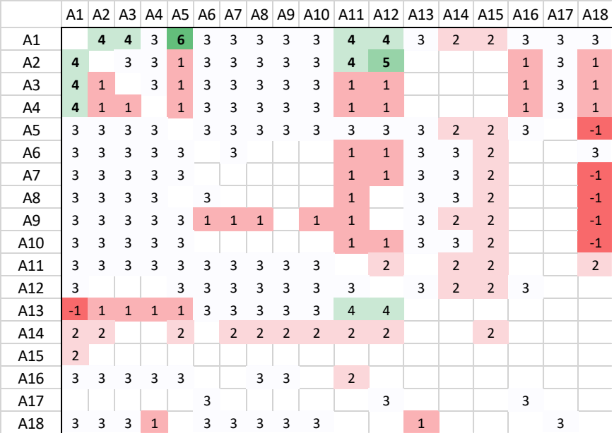</div>

## Indicateurs de réseau choisis {.editorial data-part="2" data-subpart="1" refs="bloch-2023"}

<div class="slide-title">Indicateurs de réseau choisis</div>

<div class="ppt-canvas"><div class="ppt-text" style="left:0%;top:0%;width:100%;height:6%;font-size:var(--content-title-size);"><div class="ppt-p" style="text-align:left"><span style="font-size:var(--content-title-size)">Indicateurs</span><span style=""> choisis</span></div></div>

</div>

## Indicateurs de réseau : détail {.editorial data-part="2" data-subpart="1" refs="bloch-2023"}

<div class="slide-title">Indicateurs de réseau : détail</div>

<div class="ppt-canvas">
</div>

## Clustering des acteurs {.editorial data-part="2" data-subpart="1" refs="bolla-2011,li-2023"}

<div class="slide-title">Clustering des acteurs</div>

<div class="ppt-canvas">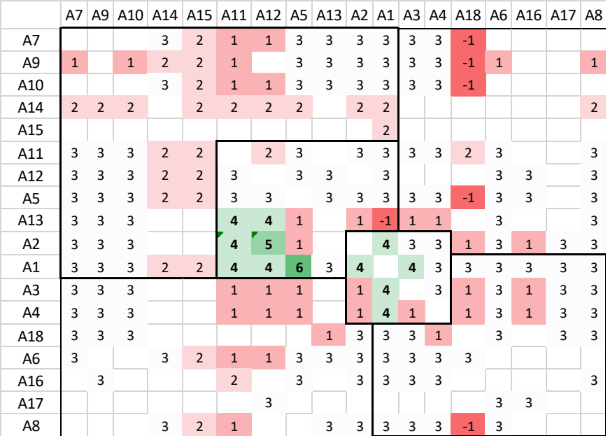
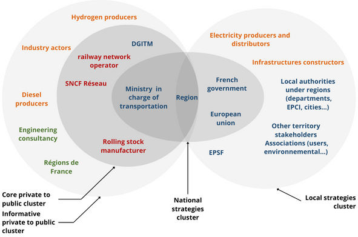
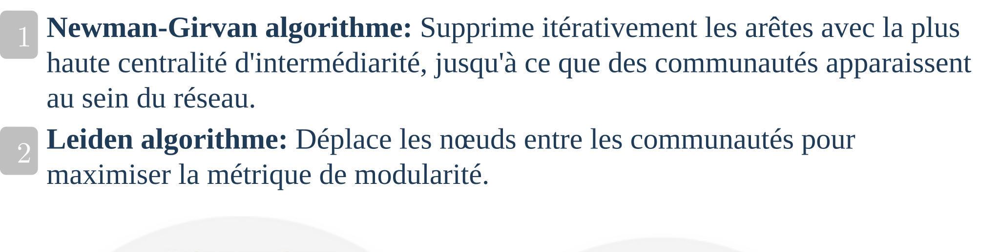


</div>

## Analyse de l’impact des acteurs sur la décision {.editorial data-part="2" data-subpart="2"}

<div class="slide-title">Analyse de l’impact des acteurs sur la décision</div>

<div class="ppt-canvas"><div class="ppt-text" style="left:0%;top:0%;width:100%;height:6%;font-size:var(--content-title-size);"><div class="ppt-p" style="text-align:left"><span style="font-size:var(--content-title-size)">Analyse de l’impact des acteurs sur la décision</span></div></div>
<div class="ppt-table-wrap" style="left:2%;top:7%;width:94%;height:87%;"><table class="ppt-table"><tr><td style="color:#000000;font-size:var(--content-size);font-weight:700">Acteur ID</td><td style="color:#000000;font-size:var(--content-size);font-weight:700">Nom de l’acteur</td><td style="color:#000000;font-size:var(--content-size);font-weight:700">Nombre d’entrées Ω+</td><td style="color:#000000;font-size:var(--content-size);font-weight:700">Nombre de sorties Ω-</td><td style="color:#000000;font-size:var(--content-size);font-weight:700">Sorties pondérées φ+</td><td style="color:#000000;font-size:var(--content-size);font-weight:700">Entrée pondérée φ-</td><td style="color:#000000;font-size:var(--content-size);font-weight:700">Poids normalize Φ</td><td style="color:#000000;font-size:var(--content-size);font-weight:700">Centralité normalisée Ω</td><td style="color:#000000;font-size:var(--content-size);font-weight:700">Centralité d&#x27;intermédiarité Cbet </td><td style="color:#000000;font-size:var(--content-size);font-weight:700">Centralité de proximité normalisée Cc</td><td style="color:#000000;font-size:var(--content-size);font-weight:700">Centralité harmonique <br>Ch</td></tr><tr><td style="color:#000000;font-size:var(--content-size);font-weight:700">A1</td><td style="color:#1D4971;font-size:var(--content-size);font-weight:700">Region</td><td style="background:#F8696B;color:#000000;font-size:var(--content-size)">16</td><td style="background:#F8696B;color:#000000;font-size:var(--content-size)">17</td><td style="background:#F8696B;color:#000000;font-size:var(--content-size)">45</td><td style="background:#F8696B;color:#000000;font-size:var(--content-size)">56</td><td style="background:#F8696B;color:#000000;font-size:var(--content-size);font-weight:700">0,100</td><td style="background:#F8696B;color:#000000;font-size:var(--content-size)">1,94</td><td style="background:#F8696B;color:#000000;font-size:var(--content-size)">0,101</td><td style="background:#F8696B;color:#000000;font-size:var(--content-size)">0,944</td><td style="background:#F8696B;color:#000000;font-size:var(--content-size)">16,5</td></tr><tr><td style="color:#000000;font-size:var(--content-size);font-weight:700">A2</td><td style="color:#1D4971;font-size:var(--content-size);font-weight:700">Ministry in charge of transportation</td><td style="background:#FCAA78;color:#000000;font-size:var(--content-size)">14</td><td style="background:#FDB87B;color:#000000;font-size:var(--content-size)">14</td><td style="background:#FDBD7C;color:#000000;font-size:var(--content-size)">36</td><td style="background:#FCB27A;color:#000000;font-size:var(--content-size)">40</td><td style="background:#FDB47A;color:#000000;font-size:var(--content-size);font-weight:700">0,075</td><td style="background:#FCAE79;color:#000000;font-size:var(--content-size)">1,65</td><td style="background:#FED881;color:#000000;font-size:var(--content-size)">0,028</td><td style="background:#FCB179;color:#000000;font-size:var(--content-size)">0,850</td><td style="background:#FCAA78;color:#000000;font-size:var(--content-size)">15,5</td></tr><tr><td style="color:#000000;font-size:var(--content-size);font-weight:700">A5</td><td style="color:#B71111;font-size:var(--content-size);font-weight:700">Rolling stock manufacturer</td><td style="background:#FECB7E;color:#000000;font-size:var(--content-size)">13</td><td style="background:#FA8370;color:#000000;font-size:var(--content-size)">16</td><td style="background:#FFD981;color:#000000;font-size:var(--content-size)">33</td><td style="background:#FCA978;color:#000000;font-size:var(--content-size)">42</td><td style="background:#FDB77A;color:#000000;font-size:var(--content-size);font-weight:700">0,074</td><td style="background:#FBA076;color:#000000;font-size:var(--content-size)">1,71</td><td style="background:#FFDF82;color:#000000;font-size:var(--content-size)">0,023</td><td style="background:#FED07F;color:#000000;font-size:var(--content-size)">0,810</td><td style="background:#FECB7E;color:#000000;font-size:var(--content-size)">15</td></tr><tr><td style="color:#000000;font-size:var(--content-size);font-weight:700">A11</td><td style="color:#B71111;font-size:var(--content-size);font-weight:700">SNCF Réseau</td><td style="background:#FCAA78;color:#000000;font-size:var(--content-size)">14</td><td style="background:#FDB87B;color:#000000;font-size:var(--content-size)">14</td><td style="background:#F2E783;color:#000000;font-size:var(--content-size)">29</td><td style="background:#FDBC7B;color:#000000;font-size:var(--content-size)">38</td><td style="background:#FECF7F;color:#000000;font-size:var(--content-size);font-weight:700">0,066</td><td style="background:#FCAE79;color:#000000;font-size:var(--content-size)">1,65</td><td style="background:#FFE784;color:#000000;font-size:var(--content-size)">0,018</td><td style="background:#FCB179;color:#000000;font-size:var(--content-size)">0,850</td><td style="background:#FCAA78;color:#000000;font-size:var(--content-size)">15,5</td></tr><tr><td style="color:#000000;font-size:var(--content-size);font-weight:700">A3</td><td style="color:#1D4971;font-size:var(--content-size);font-weight:700">French government</td><td style="background:#FECB7E;color:#000000;font-size:var(--content-size)">13</td><td style="background:#FDB87B;color:#000000;font-size:var(--content-size)">14</td><td style="background:#FDBD7C;color:#000000;font-size:var(--content-size)">36</td><td style="background:#FFDC81;color:#000000;font-size:var(--content-size)">31</td><td style="background:#FECF7F;color:#000000;font-size:var(--content-size);font-weight:700">0,066</td><td style="background:#FDBC7B;color:#000000;font-size:var(--content-size)">1,59</td><td style="background:#FFDF82;color:#000000;font-size:var(--content-size)">0,023</td><td style="background:#FED07F;color:#000000;font-size:var(--content-size)">0,810</td><td style="background:#FECB7E;color:#000000;font-size:var(--content-size)">15</td></tr><tr><td style="color:#000000;font-size:var(--content-size);font-weight:700">A6</td><td style="color:#DE6614;font-size:var(--content-size);font-weight:700">Electricity producers and distributors</td><td style="background:#FFEB84;color:#000000;font-size:var(--content-size)">12</td><td style="background:#FFEB84;color:#000000;font-size:var(--content-size)">12</td><td style="background:#FED07F;color:#000000;font-size:var(--content-size)">34</td><td style="background:#FFDC81;color:#000000;font-size:var(--content-size)">31</td><td style="background:#FED580;color:#000000;font-size:var(--content-size);font-weight:700">0,064</td><td style="background:#FFE583;color:#000000;font-size:var(--content-size)">1,41</td><td style="background:#FED380;color:#000000;font-size:var(--content-size)">0,031</td><td style="background:#FFEB84;color:#000000;font-size:var(--content-size)">0,773</td><td style="background:#FFEB84;color:#000000;font-size:var(--content-size)">14,5</td></tr><tr><td style="color:#000000;font-size:var(--content-size);font-weight:700">A4</td><td style="color:#1D4971;font-size:var(--content-size);font-weight:700">European union</td><td style="background:#FECB7E;color:#000000;font-size:var(--content-size)">13</td><td style="background:#FDB87B;color:#000000;font-size:var(--content-size)">14</td><td style="background:#FEC67D;color:#000000;font-size:var(--content-size)">35</td><td style="background:#FFE583;color:#000000;font-size:var(--content-size)">29</td><td style="background:#FED881;color:#000000;font-size:var(--content-size);font-weight:700">0,063</td><td style="background:#FDBC7B;color:#000000;font-size:var(--content-size)">1,59</td><td style="background:#FFDF82;color:#000000;font-size:var(--content-size)">0,023</td><td style="background:#FED07F;color:#000000;font-size:var(--content-size)">0,810</td><td style="background:#FECB7E;color:#000000;font-size:var(--content-size)">15</td></tr><tr><td style="color:#000000;font-size:var(--content-size);font-weight:700">A12</td><td style="color:#B71111;font-size:var(--content-size);font-weight:700">railway network operator</td><td style="background:#FFEB84;color:#000000;font-size:var(--content-size)">12</td><td style="background:#FFEB84;color:#000000;font-size:var(--content-size)">12</td><td style="background:#ECE582;color:#000000;font-size:var(--content-size)">28</td><td style="background:#FECE7F;color:#000000;font-size:var(--content-size)">34</td><td style="background:#FFDE82;color:#000000;font-size:var(--content-size);font-weight:700">0,061</td><td style="background:#FFE583;color:#000000;font-size:var(--content-size)">1,41</td><td style="background:#FED17F;color:#000000;font-size:var(--content-size)">0,032</td><td style="background:#FFEB84;color:#000000;font-size:var(--content-size)">0,773</td><td style="background:#FFEB84;color:#000000;font-size:var(--content-size)">14,5</td></tr><tr><td style="color:#000000;font-size:var(--content-size);font-weight:700">A9</td><td style="color:#DE6614;font-size:var(--content-size);font-weight:700">Industry actors</td><td style="background:#E8E482;color:#000000;font-size:var(--content-size)">11</td><td style="background:#FDB87B;color:#000000;font-size:var(--content-size)">14</td><td style="background:#FFE283;color:#000000;font-size:var(--content-size)">32</td><td style="background:#F5E883;color:#000000;font-size:var(--content-size)">26</td><td style="background:#FFEA84;color:#000000;font-size:var(--content-size);font-weight:700">0,057</td><td style="background:#FED781;color:#000000;font-size:var(--content-size)">1,47</td><td style="background:#FFEA84;color:#000000;font-size:var(--content-size)">0,016</td><td style="background:#E2E282;color:#000000;font-size:var(--content-size)">0,739</td><td style="background:#E8E482;color:#000000;font-size:var(--content-size)">14</td></tr><tr><td style="color:#000000;font-size:var(--content-size);font-weight:700">A7</td><td style="color:#DE6614;font-size:var(--content-size);font-weight:700">Hydrogen producers</td><td style="background:#FFEB84;color:#000000;font-size:var(--content-size)">12</td><td style="background:#F0E683;color:#000000;font-size:var(--content-size)">11</td><td style="background:#FFD981;color:#000000;font-size:var(--content-size)">33</td><td style="background:#E9E482;color:#000000;font-size:var(--content-size)">24</td><td style="background:#FCEA83;color:#000000;font-size:var(--content-size);font-weight:700">0,056</td><td style="background:#F9E983;color:#000000;font-size:var(--content-size)">1,35</td><td style="background:#DBE081;color:#000000;font-size:var(--content-size)">0,011</td><td style="background:#FFEB84;color:#000000;font-size:var(--content-size)">0,773</td><td style="background:#FFEB84;color:#000000;font-size:var(--content-size)">14,5</td></tr><tr><td style="color:#000000;font-size:var(--content-size);font-weight:700">A8</td><td style="color:#DE6614;font-size:var(--content-size);font-weight:700">Infrastructures constructors</td><td style="background:#FFEB84;color:#000000;font-size:var(--content-size)">12</td><td style="background:#E2E282;color:#000000;font-size:var(--content-size)">10</td><td style="background:#FFD981;color:#000000;font-size:var(--content-size)">33</td><td style="background:#E3E382;color:#000000;font-size:var(--content-size)">23</td><td style="background:#F8E983;color:#000000;font-size:var(--content-size);font-weight:700">0,055</td><td style="background:#EFE683;color:#000000;font-size:var(--content-size)">1,29</td><td style="background:#F7E883;color:#000000;font-size:var(--content-size)">0,014</td><td style="background:#FFEB84;color:#000000;font-size:var(--content-size)">0,773</td><td style="background:#FFEB84;color:#000000;font-size:var(--content-size)">14,5</td></tr><tr><td style="color:#000000;font-size:var(--content-size);font-weight:700">A10</td><td style="color:#DE6614;font-size:var(--content-size);font-weight:700">Diesel producers</td><td style="background:#E8E482;color:#000000;font-size:var(--content-size)">11</td><td style="background:#F0E683;color:#000000;font-size:var(--content-size)">11</td><td style="background:#F8E983;color:#000000;font-size:var(--content-size)">30</td><td style="background:#E9E482;color:#000000;font-size:var(--content-size)">24</td><td style="background:#EFE683;color:#000000;font-size:var(--content-size);font-weight:700">0,053</td><td style="background:#EFE683;color:#000000;font-size:var(--content-size)">1,29</td><td style="background:#DBE081;color:#000000;font-size:var(--content-size)">0,011</td><td style="background:#E2E282;color:#000000;font-size:var(--content-size)">0,739</td><td style="background:#E8E482;color:#000000;font-size:var(--content-size)">14</td></tr><tr><td style="color:#000000;font-size:var(--content-size);font-weight:700">A13</td><td style="color:#1D4971;font-size:var(--content-size);font-weight:700">DGITM</td><td style="background:#BCD780;color:#000000;font-size:var(--content-size)">9</td><td style="background:#FFEB84;color:#000000;font-size:var(--content-size)">12</td><td style="background:#D9E081;color:#000000;font-size:var(--content-size)">25</td><td style="background:#F5E883;color:#000000;font-size:var(--content-size)">26</td><td style="background:#E2E282;color:#000000;font-size:var(--content-size);font-weight:700">0,050</td><td style="background:#E5E382;color:#000000;font-size:var(--content-size)">1,24</td><td style="background:#C1D980;color:#000000;font-size:var(--content-size)">0,009</td><td style="background:#B1D47F;color:#000000;font-size:var(--content-size)">0,680</td><td style="background:#BCD780;color:#000000;font-size:var(--content-size)">13</td></tr><tr><td style="color:#000000;font-size:var(--content-size);font-weight:700">A14</td><td style="color:#4D7731;font-size:var(--content-size);font-weight:700">Engineering consultancy</td><td style="background:#BCD780;color:#000000;font-size:var(--content-size)">9</td><td style="background:#E2E282;color:#000000;font-size:var(--content-size)">10</td><td style="background:#C6DA80;color:#000000;font-size:var(--content-size)">22</td><td style="background:#D1DD81;color:#000000;font-size:var(--content-size)">20</td><td style="background:#BAD780;color:#000000;font-size:var(--content-size);font-weight:700">0,041</td><td style="background:#D1DD81;color:#000000;font-size:var(--content-size)">1,12</td><td style="background:#A4D07E;color:#000000;font-size:var(--content-size)">0,006</td><td style="background:#B1D47F;color:#000000;font-size:var(--content-size)">0,680</td><td style="background:#BCD780;color:#000000;font-size:var(--content-size)">13</td></tr><tr><td style="color:#000000;font-size:var(--content-size);font-weight:700">A16</td><td style="color:#1D4971;font-size:var(--content-size);font-weight:700">EPSF</td><td style="background:#8FCA7D;color:#000000;font-size:var(--content-size)">7</td><td style="background:#C6DA80;color:#000000;font-size:var(--content-size)">8</td><td style="background:#9BCE7E;color:#000000;font-size:var(--content-size)">15</td><td style="background:#E3E382;color:#000000;font-size:var(--content-size)">23</td><td style="background:#A9D27F;color:#000000;font-size:var(--content-size);font-weight:700">0,037</td><td style="background:#A9D27F;color:#000000;font-size:var(--content-size)">0,88</td><td style="background:#F5E883;color:#000000;font-size:var(--content-size)">0,014</td><td style="background:#87C87D;color:#000000;font-size:var(--content-size)">0,630</td><td style="background:#8FCA7D;color:#000000;font-size:var(--content-size)">12</td></tr><tr><td style="color:#000000;font-size:var(--content-size);font-weight:700">A18</td><td style="color:#1D4971;font-size:var(--content-size);font-weight:700">Local authorities under regions (departments, EPCI, cities…)</td><td style="background:#E8E482;color:#000000;font-size:var(--content-size)">11</td><td style="background:#F0E683;color:#000000;font-size:var(--content-size)">11</td><td style="background:#63BE7B;color:#000000;font-size:var(--content-size)">6</td><td style="background:#FFE583;color:#000000;font-size:var(--content-size)">29</td><td style="background:#9CCE7E;color:#000000;font-size:var(--content-size);font-weight:700">0,035</td><td style="background:#EFE683;color:#000000;font-size:var(--content-size)">1,29</td><td style="background:#E3E382;color:#000000;font-size:var(--content-size)">0,012</td><td style="background:#E2E282;color:#000000;font-size:var(--content-size)">0,739</td><td style="background:#E8E482;color:#000000;font-size:var(--content-size)">14</td></tr><tr><td style="color:#000000;font-size:var(--content-size);font-weight:700">A17</td><td style="color:#1D4971;font-size:var(--content-size);font-weight:700">Other territory stakeholdersAssociations (users, environmental…)</td><td style="background:#63BE7B;color:#000000;font-size:var(--content-size)">5</td><td style="background:#7FC67C;color:#000000;font-size:var(--content-size)">3</td><td style="background:#9BCE7E;color:#000000;font-size:var(--content-size)">15</td><td style="background:#8DCA7D;color:#000000;font-size:var(--content-size)">9</td><td style="background:#6BC07B;color:#000000;font-size:var(--content-size);font-weight:700">0,024</td><td style="background:#63BE7B;color:#000000;font-size:var(--content-size)">0,47</td><td style="background:#6FC17B;color:#000000;font-size:var(--content-size)">0,001</td><td style="background:#63BE7B;color:#000000;font-size:var(--content-size)">0,586</td><td style="background:#63BE7B;color:#000000;font-size:var(--content-size)">11</td></tr><tr><td style="color:#000000;font-size:var(--content-size);font-weight:700">A15</td><td style="color:#4D7731;font-size:var(--content-size);font-weight:700">Régions de France</td><td style="background:#D2DE81;color:#000000;font-size:var(--content-size)">10</td><td style="background:#63BE7B;color:#000000;font-size:var(--content-size)">1</td><td style="background:#BAD780;color:#000000;font-size:var(--content-size)">20</td><td style="background:#63BE7B;color:#000000;font-size:var(--content-size)">2</td><td style="background:#63BE7B;color:#000000;font-size:var(--content-size);font-weight:700">0,022</td><td style="background:#81C67C;color:#000000;font-size:var(--content-size)">0,65</td><td style="background:#63BE7B;color:#000000;font-size:var(--content-size)">0,000</td><td style="background:#C9DB80;color:#000000;font-size:var(--content-size)">0,708</td><td style="background:#D2DE81;color:#000000;font-size:var(--content-size)">13,5</td></tr></table></div>
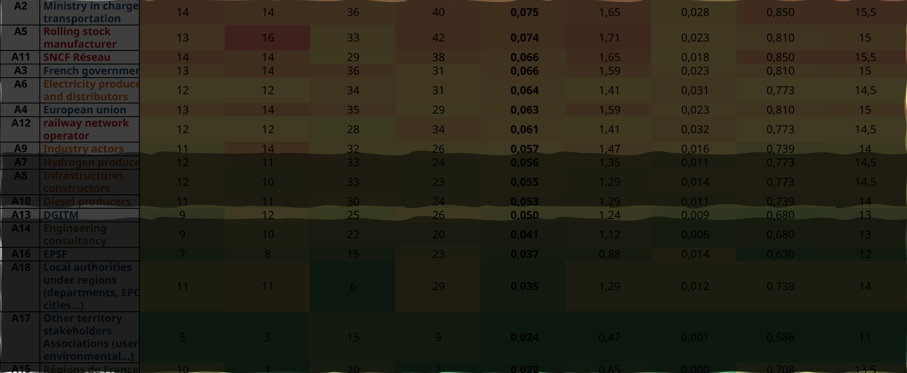
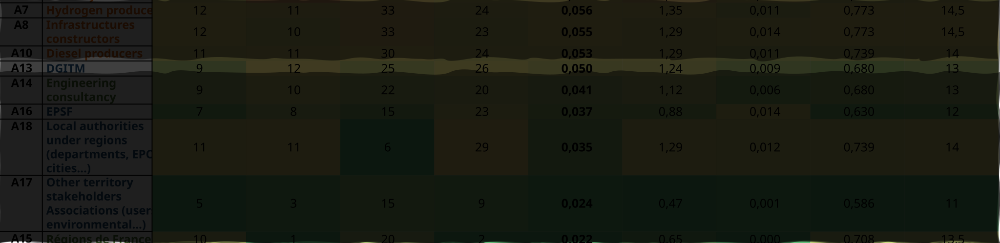
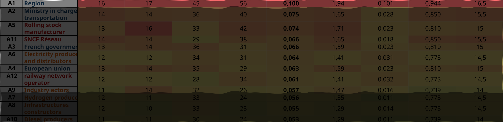
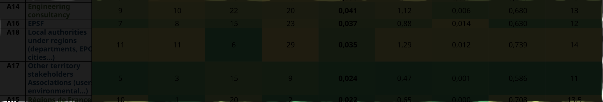</div>

## Poids et connexion des acteurs {.editorial data-part="2" data-subpart="2"}

<div class="slide-title">Poids et connexion des acteurs</div>

<div class="ppt-canvas"><div class="ppt-text" style="left:0%;top:0%;width:100%;height:6%;font-size:var(--content-title-size);"><div class="ppt-p" style="text-align:left"><span style="font-size:var(--content-title-size);font-weight:700">Poids</span><span style="font-size:var(--content-title-size)"> et </span><span style="font-size:var(--content-title-size);font-weight:700">connexion</span><span style="font-size:var(--content-title-size)"> des </span><span style="font-size:var(--content-title-size)">acteurs</span></div></div>
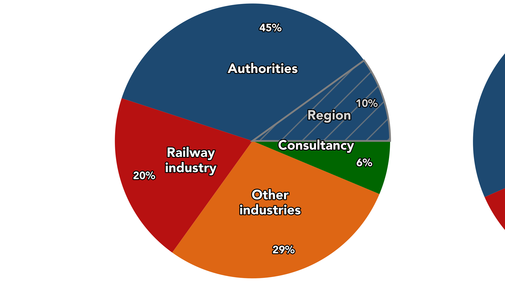
</div>

## Réorganisation du processus de décision {.editorial data-part="2" data-subpart="3"}

<div class="slide-title">Réorganisation du processus de décision</div>

<div class="ppt-canvas">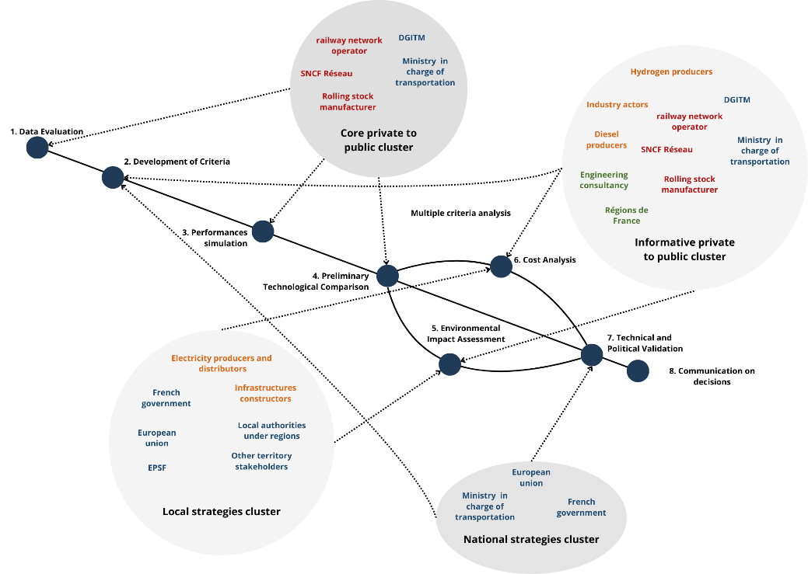
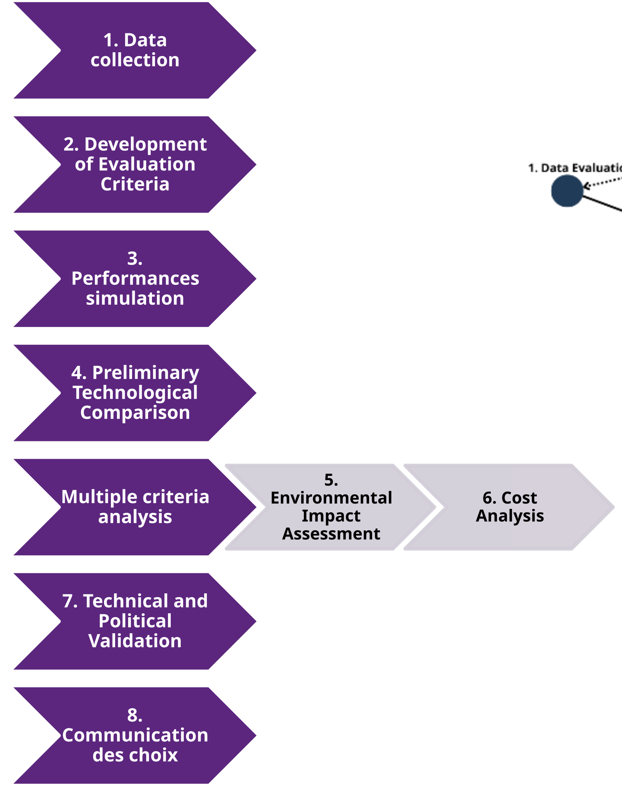</div>

## Apports de la méthode et perspectives {.editorial data-part="2" data-subpart="3"}

<div class="slide-title">Apports de la méthode et perspectives</div>

<div class="ppt-canvas"><div class="ppt-text" style="left:5%;top:15%;width:90%;height:73%;font-size:var(--content-title-size);"><div class="ppt-p" style="text-align:left"><span style="">Modélisation des réseaux de décision public-privé pour réduire les risques associés à leurs interactions </span></div><div class="ppt-p" style="text-align:left">&nbsp;</div><div class="ppt-p" style="text-align:left"><span style="">Analyse par étape de décision pour une modélisation plus précise de la temporalité de la décision</span></div><div class="ppt-p" style="text-align:left"><span style="">Agent Base Modeling pour un modélisation plus précise des acteurs</span></div><div class="ppt-p" style="text-align:left"><span style="">Sensibilité à la pondération</span></div></div></div>

## {.editorial .part-divider data-part="3" data-subpart="1"}

<div class="divider-number">PARTIE 03</div>
<div class="divider-title">ACV + MCDM</div>
<div class="divider-subtitle">Construire une comparaison environnementale prospective, paramétrique et multicritère des technologies de décarbonation.</div>

## Besoin d’une comparaison environnementale multicritère {.editorial data-part="3" data-subpart="1"}

<div class="slide-title">Besoin d’une comparaison environnementale multicritère</div>

<div class="ppt-canvas"><div class="ppt-text" style="left:5%;top:15%;width:34%;height:73%;font-size:var(--content-title-size);"><div class="ppt-p" style="text-align:left"><span style="">Complexe prospectif</span></div><div class="ppt-p" style="text-align:left"><span style="">Transparent, </span><span style="">interpétable</span></div></div>
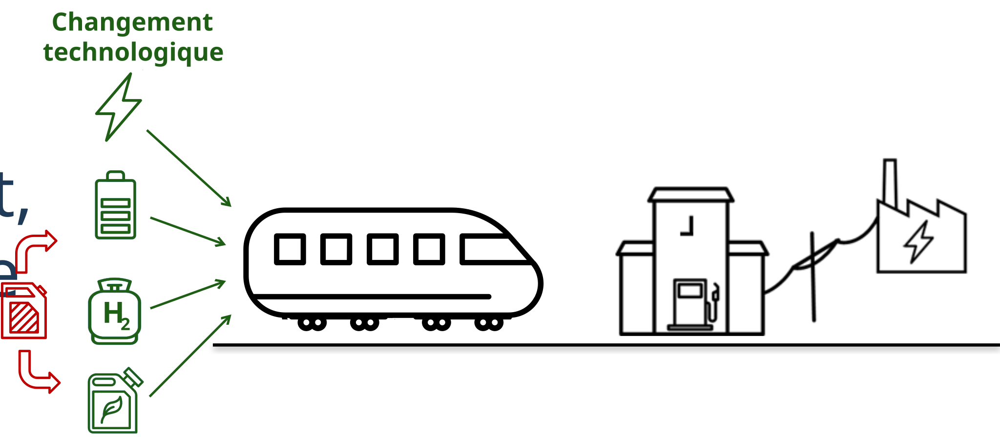</div>

## Tableau des scénarios de décarbonation {.editorial data-part="3" data-subpart="1"}

<div class="slide-title">Tableau des scénarios de décarbonation</div>

<div class="ppt-canvas"><div class="ppt-text" style="left:5%;top:15%;width:90%;height:73%;font-size:var(--content-title-size);"><div class="ppt-p" style="text-align:left"><span style="">Modules partagés entre différents scenarios</span></div><div class="ppt-p" style="text-align:left"><span style="">Analyse bibliographique et interview d’experts</span></div></div>
<div class="ppt-table-wrap" style="left:12%;top:50%;width:76%;height:36%;"><table class="ppt-table"><tr><td style="font-size:var(--content-size)">Scenario</td><td style="font-size:var(--content-size)">Système de conversion énergétique embarqué</td><td style="font-size:var(--content-size)">Production d’énergie</td><td style="font-size:var(--content-size)">Infrastructure d’alimentation</td></tr><tr><td style="font-size:var(--content-size)">Electrification direct</td><td style=""></td><td style=""></td><td style=""></td></tr><tr><td style="font-size:var(--content-size)">Batteries</td><td style=""></td><td style=""></td><td style=""></td></tr><tr><td style=""></td><td style=""></td><td style=""></td><td style=""></td></tr><tr><td style=""></td><td style=""></td><td style=""></td><td style=""></td></tr><tr><td style=""></td><td style=""></td><td style=""></td><td style=""></td></tr></table></div></div>

## Collecte de données et qualité des données {.editorial data-part="3" data-subpart="1"}

<div class="slide-title">Collecte de données et qualité des données</div>

<div class="ppt-canvas"><div class="ppt-text" style="left:1%;top:94%;width:91%;height:6%;font-size:var(--content-title-size);"><div class="ppt-p" style="text-align:left"><span style="">[11] </span><span style="">Carlesso</span><span style="">, A., </span><span style="">Pizzol</span><span style="">, L., </span><span style="">Marcomini</span><span style="">, A., &amp; </span><span style="">Semenzin</span><span style="">, E. (2024). </span><span style="font-style:italic">Data quality assessment of aggregated LCI datasets: A case study on fossil-based and bio-based plastic food packaging</span><span style="">. Journal of Industrial Ecology</span></div><div class="ppt-p" style="text-align:left"><span style="">[12</span><span style="">] Sobol, I. M. </span><span style="">(2001). </span><span style="">Global sensitivity indices for nonlinear mathematical models and their Monte Carlo estimates</span></div></div>

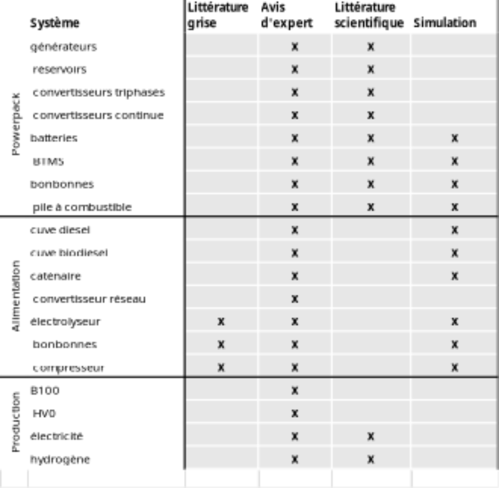</div>

## Méthodes d’évaluation environnementale {.editorial data-part="3" data-subpart="1"}

<div class="slide-title">Méthodes d’évaluation environnementale</div>

<div class="ppt-canvas"><div class="ppt-table-wrap" style="left:23%;top:17%;width:54%;height:60%;"><table class="ppt-table"><tr><td style="font-size:var(--content-size);font-weight:700">Method</td><td style="font-size:var(--content-size);font-weight:700">Scope</td><td style="font-size:var(--content-size);font-weight:700">Type</td></tr><tr><td style="font-size:var(--content-size)">LCA</td><td style="font-size:var(--content-size)">Product / service</td><td style="font-size:var(--content-size)">Quantitative, multi-criteria</td></tr><tr><td style="font-size:var(--content-size)">ERA</td><td style="font-size:var(--content-size)">Substance / local environment</td><td style="font-size:var(--content-size)">Risk-based</td></tr><tr><td style="font-size:var(--content-size)">EIA</td><td style="font-size:var(--content-size)">Project</td><td style="font-size:var(--content-size)">Procedural</td></tr><tr><td style="font-size:var(--content-size)">SEA</td><td style="font-size:var(--content-size)">Plans / programs</td><td style="font-size:var(--content-size)">Strategic</td></tr><tr><td style="font-size:var(--content-size)">MFA </td><td style="font-size:var(--content-size)">Product / territory / service</td><td style="font-size:var(--content-size)">Flow-based assessment</td></tr><tr><td style="font-size:var(--content-size)">EEIO Analysis</td><td style="font-size:var(--content-size)">Sector / economy</td><td style="font-size:var(--content-size)">Input-output environmental assessment</td></tr><tr><td style="font-size:var(--content-size)">Ecological Footprint</td><td style="font-size:var(--content-size)">Territory / population / activity</td><td style="font-size:var(--content-size)">Aggregated environmental assessment</td></tr></table></div></div>

## Types de modèles ACV {.editorial data-part="3" data-subpart="1"}

<div class="slide-title">Types de modèles ACV</div>

<div class="ppt-canvas">

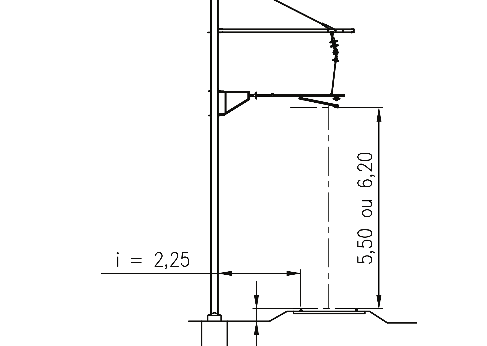
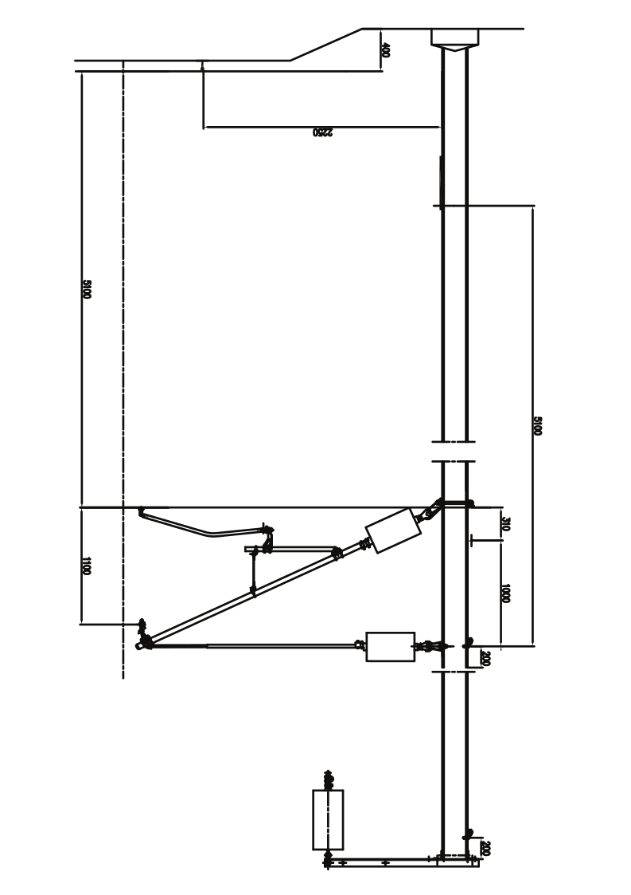

<div class="ppt-text" style="left:16%;top:0%;width:34%;height:6%;font-size:var(--content-size);"><div class="ppt-p" style="text-align:left"><span style="font-size:var(--content-size)">Retrospective</span><span style="font-size:var(--content-size)">: données historiques</span></div></div>
<div class="ppt-text" style="left:16%;top:44%;width:34%;height:6%;font-size:var(--content-size);"><div class="ppt-p" style="text-align:left"><span style="font-size:var(--content-size)">Prospectives: scenarios de projection (RTE) </span></div></div>
<div class="ppt-text" style="left:48%;top:19%;width:34%;height:6%;font-size:var(--content-size);"><div class="ppt-p" style="text-align:left"><span style="font-size:var(--content-size)">Bibliographique</span></div></div>
<div class="ppt-table-wrap" style="left:2%;top:22%;width:12%;height:45%;"><table class="ppt-table"><tr><td style="font-size:var(--content-size);font-weight:700">LCA type</td></tr><tr><td style="font-size:var(--content-size)">Attributional</td></tr><tr><td style="font-size:var(--content-size)">Prospective</td></tr><tr><td style="font-size:var(--content-size)">Parametric</td></tr><tr><td style="font-size:var(--content-size)">Retrospective</td></tr><tr><td style="font-size:var(--content-size)">Regionalized</td></tr><tr><td style="font-size:var(--content-size)">Bibliographic</td></tr></table></div></div>

## Rétrospectif : caténaires {.editorial data-part="3" data-subpart="1"}

<div class="slide-title">Rétrospectif : caténaires</div>

<div class="ppt-canvas">

</div>

## Prospectif : mix électrique {.editorial data-part="3" data-subpart="1"}

<div class="slide-title">Prospectif : mix électrique</div>

<div class="ppt-canvas">
<div class="ppt-text" style="left:4%;top:20%;width:34%;height:6%;font-size:var(--content-size);"><div class="ppt-p" style="text-align:left"><span style="font-size:var(--content-size)">Prospectives: scenarios de projection (RTE) </span></div></div>
</div>

## Batteries : revue bibliographique {.editorial data-part="3" data-subpart="1"}

<div class="slide-title">Batteries : revue bibliographique</div>

<div class="ppt-canvas">


<div class="ppt-table-wrap" style="left:52%;top:62%;width:37%;height:24%;"><table class="ppt-table"><tr><td style=""></td><td style="color:#440F76;font-size:var(--content-size)">LTO</td><td style="color:#B73779;font-size:var(--content-size)">NMC</td><td style="color:#FD9668;font-size:var(--content-size)">LFP</td></tr><tr><td style="font-size:var(--content-size)">Masse</td><td style="font-size:var(--content-size)">1400 kg</td><td style="font-size:var(--content-size)">-</td><td style="font-size:var(--content-size)">-</td></tr><tr><td style="font-size:var(--content-size)">Energie kWh</td><td style="font-size:var(--content-size)">75</td><td style="font-size:var(--content-size)">220</td><td style="font-size:var(--content-size)">191</td></tr><tr><td style="font-size:var(--content-size)">Puissance kW</td><td style="font-size:var(--content-size)">300 à 600</td><td style="font-size:var(--content-size)">220 à 440</td><td style="font-size:var(--content-size)">191 à 383</td></tr></table></div></div>

## Batteries : dimensionnement à masse constante {.editorial data-part="3" data-subpart="1"}

<div class="slide-title">Batteries : dimensionnement à masse constante</div>

<div class="ppt-canvas">
<div class="ppt-table-wrap" style="left:56%;top:17%;width:37%;height:24%;"><table class="ppt-table"><tr><td style=""></td><td style="color:#440F76;font-size:var(--content-size)">LTO</td><td style="color:#B73779;font-size:var(--content-size)">NMC</td><td style="color:#FD9668;font-size:var(--content-size)">LFP</td></tr><tr><td style="font-size:var(--content-size)">Masse</td><td style="font-size:var(--content-size)">1400 kg</td><td style="font-size:var(--content-size)">1400 kg</td><td style="font-size:var(--content-size)">1400 kg</td></tr><tr><td style="font-size:var(--content-size)">Energie kWh</td><td style="font-size:var(--content-size)">75</td><td style="font-size:var(--content-size)">220</td><td style="font-size:var(--content-size)">191</td></tr><tr><td style="font-size:var(--content-size)">Puissance kW</td><td style="font-size:var(--content-size)">300 à 600</td><td style="font-size:var(--content-size)">220 à 440</td><td style="font-size:var(--content-size)">191 à 383</td></tr></table></div>
<div class="ppt-text" style="left:61%;top:51%;width:28%;height:18%;font-size:var(--content-title-size);"><div class="ppt-p" style="text-align:left"><span style="font-size:var(--content-title-size);font-weight:700">Comparaison brute des technologies, à ce stade pas de prise en compte:</span></div><div class="ppt-p" style="text-align:left"><span style="font-size:var(--content-title-size)">Infrastructures ferroviaires </span></div><div class="ppt-p" style="text-align:left"><span style="font-size:var(--content-title-size)">Exploitation des trains</span></div></div></div>

## Propagation des incertitudes {.editorial data-part="3" data-subpart="1"}

<div class="slide-title">Propagation des incertitudes</div>

<div class="ppt-canvas">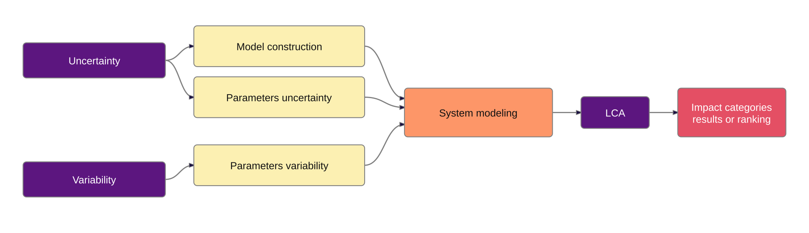</div>

## Incertitudes d’approximation des modèles {.editorial data-part="3" data-subpart="1"}

<div class="slide-title">Incertitudes d’approximation des modèles</div>

<div class="ppt-canvas"></div>

## Incertitude des paramètres {.editorial data-part="3" data-subpart="1"}

<div class="slide-title">Incertitude des paramètres</div>

<div class="ppt-canvas"></div>

## Outil paramétrique {.editorial data-part="3" data-subpart="1"}

<div class="slide-title">Outil paramétrique</div>

<div class="ppt-canvas">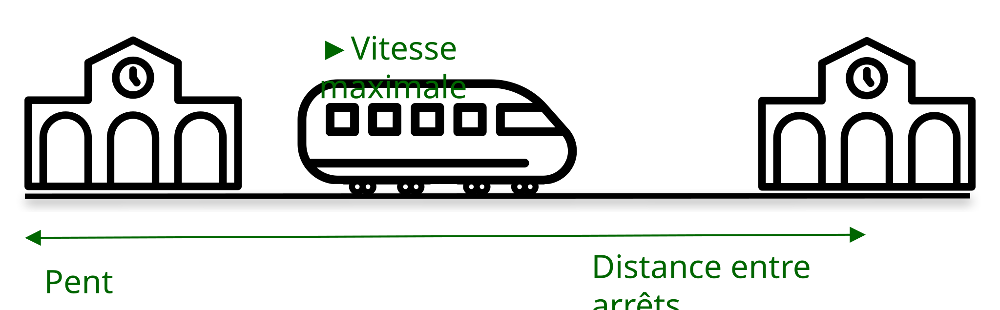</div>

## Architecture modulaire des modèles {.editorial data-part="3" data-subpart="1"}

<div class="slide-title">Architecture modulaire des modèles</div>

<div class="ppt-canvas">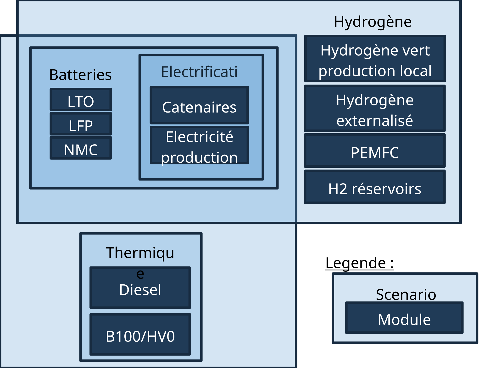
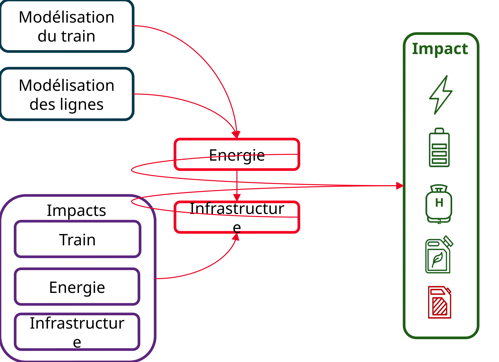</div>

## ORIEnT : modélisation des vitesses {.editorial data-part="3" data-subpart="1"}

<div class="slide-title">ORIEnT : modélisation des vitesses</div>

<div class="ppt-canvas"></div>

## ORIEnT : modélisation du roulement {.editorial data-part="3" data-subpart="1"}

<div class="slide-title">ORIEnT : modélisation du roulement</div>

<div class="ppt-canvas"><div class="ppt-table-wrap" style="left:30%;top:27%;width:40%;height:63%;"><table class="ppt-table"><tr><td style="font-size:var(--content-size);font-weight:700">Phase</td><td style="font-size:var(--content-size);font-weight:700">Variable limitante</td><td style="font-size:var(--content-size);font-weight:700">Contrainte</td></tr><tr><td style="font-size:var(--content-size);font-weight:700">Accélération</td><td style="font-size:var(--content-size)">Distance entre arrêts</td><td style=""></td></tr><tr><td style=""></td><td style="font-size:var(--content-size)">a max</td><td style="font-size:var(--content-size)">a &lt; 0,3 m/s²</td></tr><tr><td style=""></td><td style="font-size:var(--content-size)">P max</td><td style="font-size:var(--content-size)">Pmax (1,6 MW pour le Régiolis)</td></tr><tr><td style="font-size:var(--content-size);font-weight:700">Croisière</td><td style="font-size:var(--content-size)">P max, i</td><td style=""></td></tr><tr><td style=""></td><td style="font-size:var(--content-size)">Distance entre arrêts</td><td style=""></td></tr><tr><td style="font-size:var(--content-size);font-weight:700">Décélération</td><td style="font-size:var(--content-size)">V max</td><td style=""></td></tr><tr><td style=""></td><td style="font-size:var(--content-size)">a min</td><td style=""></td></tr><tr><td style=""></td><td style="font-size:var(--content-size)">P min (optionnel)</td><td style=""></td></tr></table></div></div>

## ORIEnT : paramètres technologiques et ligne {.editorial data-part="3" data-subpart="1"}

<div class="slide-title">ORIEnT : paramètres technologiques et ligne</div>

<div class="ppt-canvas">
</div>

## Illustration d’un classement multicritère {.editorial data-part="3" data-subpart="1"}

<div class="slide-title">Illustration d’un classement multicritère</div>

<div class="ppt-canvas"><div class="ppt-table-wrap" style="left:27%;top:5%;width:50%;height:31%;"><table class="ppt-table"><tr><td style=""></td><td style="background:#FFF2CC;color:#000000;font-size:var(--content-size)">Weight</td><td style="background:#FFF2CC;color:#000000;font-size:var(--content-size)">0,24</td><td style="background:#FFF2CC;color:#000000;font-size:var(--content-size)">0,27</td><td style="background:#FFF2CC;color:#000000;font-size:var(--content-size)">0,18</td><td style="background:#FFF2CC;color:#000000;font-size:var(--content-size)">0,09</td><td style="background:#FFF2CC;color:#000000;font-size:var(--content-size)">0,21</td></tr><tr><td style=""></td><td style="background:#DDEBF7;color:#000000;font-size:var(--content-size)">Criteria</td><td style="background:#DDEBF7;color:#000000;font-size:var(--content-size)">Cost</td><td style="background:#DDEBF7;color:#000000;font-size:var(--content-size)">Ecosystem diversity</td><td style="background:#DDEBF7;color:#000000;font-size:var(--content-size)">Resource scarcity</td><td style="background:#DDEBF7;color:#000000;font-size:var(--content-size)">Human health</td><td style="background:#DDEBF7;color:#000000;font-size:var(--content-size)">Social impact</td></tr><tr><td style="background:#FCE4D6;color:#000000;font-size:var(--content-size)">Alternatives</td><td style="background:#FCE4D6;color:#000000;font-size:var(--content-size)">Diesel</td><td style="font-size:var(--content-size)">6</td><td style="font-size:var(--content-size)">10</td><td style="font-size:var(--content-size)">4</td><td style="font-size:var(--content-size)">7</td><td style="font-size:var(--content-size)">4</td></tr><tr><td style=""></td><td style="background:#FCE4D6;color:#000000;font-size:var(--content-size)">Biofuel</td><td style="font-size:var(--content-size)">10</td><td style="font-size:var(--content-size)">9</td><td style="font-size:var(--content-size)">5</td><td style="font-size:var(--content-size)">1</td><td style="font-size:var(--content-size)">9</td></tr><tr><td style=""></td><td style="background:#FCE4D6;color:#000000;font-size:var(--content-size)">Hybrid</td><td style="font-size:var(--content-size)">6</td><td style="font-size:var(--content-size)">7</td><td style="font-size:var(--content-size)">3</td><td style="font-size:var(--content-size)">2</td><td style="font-size:var(--content-size)">5</td></tr><tr><td style=""></td><td style="background:#FCE4D6;color:#000000;font-size:var(--content-size)">Batteries</td><td style="font-size:var(--content-size)">6</td><td style="font-size:var(--content-size)">3</td><td style="font-size:var(--content-size)">5</td><td style="font-size:var(--content-size)">4</td><td style="font-size:var(--content-size)">9</td></tr><tr><td style=""></td><td style="background:#FCE4D6;color:#000000;font-size:var(--content-size)">Hydrogen</td><td style="font-size:var(--content-size)">10</td><td style="font-size:var(--content-size)">2</td><td style="font-size:var(--content-size)">2</td><td style="font-size:var(--content-size)">8</td><td style="font-size:var(--content-size)">3</td></tr><tr><td style=""></td><td style="background:#FCE4D6;color:#000000;font-size:var(--content-size)">Electrification</td><td style="font-size:var(--content-size)">5</td><td style="font-size:var(--content-size)">3</td><td style="font-size:var(--content-size)">10</td><td style="font-size:var(--content-size)">6</td><td style="font-size:var(--content-size)">7</td></tr></table></div>

<div class="ppt-table-wrap" style="left:76%;top:49%;width:15%;height:24%;"><table class="ppt-table"><tr><td style="font-size:var(--content-size);font-weight:700">Scenario</td><td style="font-size:var(--content-size);font-weight:700">Rank</td></tr><tr><td style="font-size:var(--content-size)">Diesel</td><td style="font-size:var(--content-size)">5</td></tr><tr><td style="font-size:var(--content-size)">Biofuel</td><td style="font-size:var(--content-size)">4</td></tr><tr><td style="font-size:var(--content-size)">Hybrid</td><td style="font-size:var(--content-size)">1</td></tr><tr><td style="font-size:var(--content-size)">Batteries</td><td style="font-size:var(--content-size)">3</td></tr><tr><td style="font-size:var(--content-size)">Hydrogen</td><td style="font-size:var(--content-size)">2</td></tr><tr><td style="font-size:var(--content-size)">Electrification</td><td style="font-size:var(--content-size)">6</td></tr></table></div></div>

## PROMETHEE : fonctions de préférence {.editorial data-part="3" data-subpart="1" refs="taherdoost-2023,wulf-2021"}

<div class="slide-title">PROMETHEE : fonctions de préférence</div>

<div class="ppt-canvas">
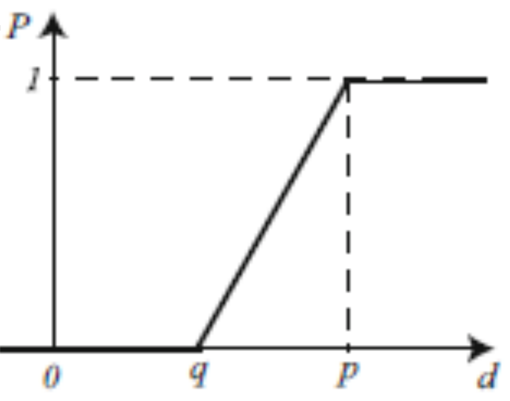
<div class="ppt-table-wrap" style="left:67%;top:9%;width:31%;height:82%;"><table class="ppt-table"><tr><td style="font-size:var(--content-size);font-weight:700">Impact Category</td><td style="font-size:var(--content-size);font-weight:700">Uncertainty Class</td><td style="font-size:var(--content-size);font-weight:700">Weak Preference Zone (q–p)</td></tr><tr><td style="font-size:var(--content-size)">Climate change</td><td style="font-size:var(--content-size)">1</td><td style="font-size:var(--content-size)">10–20%</td></tr><tr><td style="font-size:var(--content-size)">Ozone depletion</td><td style="font-size:var(--content-size)">1</td><td style="font-size:var(--content-size)">10–20%</td></tr><tr><td style="font-size:var(--content-size)">Cumulated energy demand</td><td style="font-size:var(--content-size)">1</td><td style="font-size:var(--content-size)">10–20%</td></tr><tr><td style="font-size:var(--content-size)">Resource depletion, water</td><td style="font-size:var(--content-size)">2</td><td style="font-size:var(--content-size)">30–40%</td></tr><tr><td style="font-size:var(--content-size)">Resource depletion, mineral</td><td style="font-size:var(--content-size)">2</td><td style="font-size:var(--content-size)">30–40%</td></tr><tr><td style="font-size:var(--content-size)">Particulate matter/respiratory inorganics</td><td style="font-size:var(--content-size)">2</td><td style="font-size:var(--content-size)">30–40%</td></tr><tr><td style="font-size:var(--content-size)">Ionizing radiation, human health</td><td style="font-size:var(--content-size)">2</td><td style="font-size:var(--content-size)">30–40%</td></tr><tr><td style="font-size:var(--content-size)">Photochemical ozone formation</td><td style="font-size:var(--content-size)">2</td><td style="font-size:var(--content-size)">30–40%</td></tr><tr><td style="font-size:var(--content-size)">Acidification</td><td style="font-size:var(--content-size)">2</td><td style="font-size:var(--content-size)">30–40%</td></tr><tr><td style="font-size:var(--content-size)">Terrestrial eutrophication</td><td style="font-size:var(--content-size)">2</td><td style="font-size:var(--content-size)">30–40%</td></tr><tr><td style="font-size:var(--content-size)">Aquatic eutrophication</td><td style="font-size:var(--content-size)">2</td><td style="font-size:var(--content-size)">30–40%</td></tr><tr><td style="font-size:var(--content-size)">Marine eutrophication</td><td style="font-size:var(--content-size)">2</td><td style="font-size:var(--content-size)">30–40%</td></tr><tr><td style="font-size:var(--content-size)">Ecotoxicity, freshwater</td><td style="font-size:var(--content-size)">3</td><td style="font-size:var(--content-size)">70–80%</td></tr><tr><td style="font-size:var(--content-size)">Human toxicity, cancer</td><td style="font-size:var(--content-size)">3</td><td style="font-size:var(--content-size)">70–80%</td></tr><tr><td style="font-size:var(--content-size)">Human toxicity, non-cancer</td><td style="font-size:var(--content-size)">3</td><td style="font-size:var(--content-size)">70–80%</td></tr></table></div>
<div class="ppt-table-wrap" style="left:21%;top:13%;width:29%;height:24%;"><table class="ppt-table"><tr><td style="font-size:var(--content-size)"> </td><td style="color:#FFFFFF;font-size:var(--content-size);font-weight:700"> </td><td style="background:#538135;color:#FFFFFF;font-size:var(--content-size);font-weight:700">Vitesse maximal km/h</td><td style=""></td><td style=""></td></tr><tr><td style="background:#203B57;color:#FFFFFF;font-size:var(--content-size);font-weight:700">Alternatives</td><td style=""></td><td style="background:#70AD47;color:#FFFFFF;font-size:var(--content-size);font-weight:700">54-</td><td style="background:#70AD47;color:#FFFFFF;font-size:var(--content-size);font-weight:700">72-94</td><td style="background:#70AD47;color:#FFFFFF;font-size:var(--content-size);font-weight:700">-130</td></tr><tr><td style="background:#44546A;color:#FFFFFF;font-size:var(--content-size);font-weight:700">Electrification  </td><td style=""></td><td style="background:#E7E8EA;color:#000000;font-size:var(--content-size);font-weight:700">1</td><td style="background:#E7E8EA;color:#000000;font-size:var(--content-size);font-weight:700">Incertitude</td><td style="background:#E7E8EA;color:#000000;font-size:var(--content-size);font-weight:700">2</td></tr><tr><td style="background:#44546A;color:#FFFFFF;font-size:var(--content-size);font-weight:700">Batteries</td><td style=""></td><td style="background:#E7E8EA;color:#000000;font-size:var(--content-size);font-weight:700">2</td><td style=""></td><td style="background:#E7E8EA;color:#000000;font-size:var(--content-size);font-weight:700">1</td></tr><tr><td style="background:#44546A;color:#FFFFFF;font-size:var(--content-size);font-weight:700">Diesel</td><td style=""></td><td style="background:#E7E8EA;color:#000000;font-size:var(--content-size);font-weight:700">3</td><td style="background:#E7E8EA;color:#000000;font-size:var(--content-size);font-weight:700">3</td><td style="background:#E7E8EA;color:#000000;font-size:var(--content-size);font-weight:700">3</td></tr></table></div></div>

## Cas d’étude : Corse {.editorial data-part="3" data-subpart="2"}

<div class="slide-title">Cas d’étude : Corse</div>

<div class="ppt-canvas">


<div class="ppt-text" style="left:22%;top:83%;width:7%;height:6%;font-size:var(--content-title-size);transform:rotate(23.23deg);transform-origin:center;"><div class="ppt-p" style="text-align:left"><span style="">SACOI3</span></div></div>
</div>

## Mix énergétique corse {.editorial data-part="3" data-subpart="2"}

<div class="slide-title">Mix énergétique corse</div>

<div class="ppt-canvas">
<div class="ppt-table-wrap" style="left:56%;top:13%;width:33%;height:24%;"><table class="ppt-table"><tr><td style="font-size:var(--content-size)">04/06/26</td><td style="font-size:var(--content-size)">gCO₂eq/kWh</td><td style="font-size:var(--content-size)">Production impactante</td></tr><tr><td style="font-size:var(--content-size)">Corse</td><td style="font-size:var(--content-size)">452</td><td style="font-size:var(--content-size)">40% fioul</td></tr><tr><td style="font-size:var(--content-size)">Italie</td><td style="font-size:var(--content-size)">147</td><td style="font-size:var(--content-size)">4% gaz</td></tr><tr><td style="font-size:var(--content-size)">France</td><td style="font-size:var(--content-size)">16</td><td style="font-size:var(--content-size)">60% nucléaire</td></tr></table></div>
</div>

## Modélisation des AMG800 {.editorial data-part="3" data-subpart="2"}

<div class="slide-title">Modélisation des AMG800</div>

<div class="ppt-canvas">
<div class="ppt-table-wrap" style="left:58%;top:21%;width:35%;height:19%;"><table class="ppt-table"><tr><td style="font-size:var(--content-size);font-weight:700">Ligne</td><td style="font-size:var(--content-size);font-weight:700">Energie sans regeneration (kWh)</td><td style="font-size:var(--content-size);font-weight:700">Energie avec regeneration (kWh)</td></tr><tr><td style="font-size:var(--content-size);font-weight:700">Balagne</td><td style="font-size:var(--content-size)">1,159</td><td style="font-size:var(--content-size)">787</td></tr><tr><td style="font-size:var(--content-size);font-weight:700">Centrale</td><td style="font-size:var(--content-size)">2,029</td><td style="font-size:var(--content-size)">1,268</td></tr></table></div></div>

## Réduction de l’impact du mix électrique corse {.editorial data-part="3" data-subpart="3"}

<div class="slide-title">Réduction de l’impact du mix électrique corse</div>

<div class="ppt-canvas"><div class="ppt-text" style="left:21%;top:83%;width:59%;height:7%;font-size:var(--content-title-size);"><div class="ppt-p" style="text-align:center"><span style="font-size:var(--content-title-size);font-weight:700">Perspectives</span><span style="font-size:var(--content-title-size)"> : Stratégies de décarbonation du mix électrique Corse</span></div></div>

<div class="ppt-text" style="left:70%;top:66%;width:6%;height:5%;font-size:var(--content-size);"><div class="ppt-p" style="text-align:left"><span style="font-size:var(--content-size)">-10%</span></div></div>
<div class="ppt-text" style="left:51%;top:66%;width:6%;height:5%;font-size:var(--content-size);"><div class="ppt-p" style="text-align:left"><span style="font-size:var(--content-size)">-50%</span></div></div>
<div class="ppt-text" style="left:31%;top:66%;width:6%;height:5%;font-size:var(--content-size);"><div class="ppt-p" style="text-align:left"><span style="font-size:var(--content-size)">-90%</span></div></div></div>

## Stratégies de décarbonation du mix électrique corse {.editorial data-part="3" data-subpart="3"}

<div class="slide-title">Stratégies de décarbonation du mix électrique corse</div>

<div class="ppt-canvas"><div class="ppt-text" style="left:7%;top:96%;width:85%;height:4%;font-size:var(--content-title-size);"><div class="ppt-p" style="text-align:left"><span style="">EDF 2024</span></div></div>

<div class="ppt-text" style="left:12%;top:7%;width:28%;height:8%;font-size:var(--content-size);"><div class="ppt-p" style="text-align:center"><span style="font-size:var(--content-size)">Evolution de l’impact CO2 de la production d’électricité en Corse</span></div></div>

<div class="ppt-text" style="left:57%;top:9%;width:32%;height:5%;font-size:var(--content-size);"><div class="ppt-p" style="text-align:center"><span style="font-size:var(--content-size)">Modes de production d’électricité en Corse</span></div></div></div>

## Validation : comparaison avec l’ADEME {.editorial data-part="3" data-subpart="4"}

<div class="slide-title">Validation : comparaison avec l’ADEME</div>

<div class="ppt-canvas">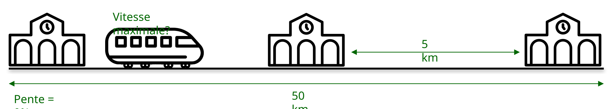
<div class="ppt-text" style="left:5%;top:11%;width:90%;height:8%;font-size:var(--content-size);"><div class="ppt-p" style="text-align:center"><span style="font-size:var(--content-size)">ADEME, SUNE Laure ; GINGKO 21, REBOURG Claire, DOLHEN Emil, HENNO Marc, TEULON Hélène.2025. </span></div><div class="ppt-p" style="text-align:center"><span style="font-size:var(--content-size);font-weight:700">Analyse de cycle de vie attributionnelle d’un trajet en train sur 100 km de ligne non-électrifiée, ACV comparative d&#x27;un trajet en train régional et d’un trajet en train de fret</span></div></div>
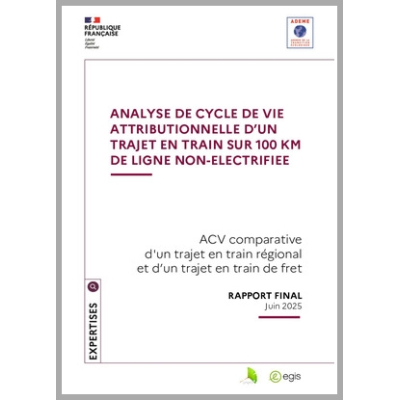</div>

## Validation ADEME : changement climatique {.editorial data-part="3" data-subpart="4"}

<div class="slide-title">Validation ADEME : changement climatique</div>

<div class="ppt-canvas">

<div class="ppt-text" style="left:52%;top:8%;width:46%;height:4%;font-size:var(--content-size);"><div class="ppt-p" style="text-align:left"><span style="font-size:var(--content-size)">Comparaison des scénarios – changement climatique (gCO2eq pour 1 p.km)</span></div></div>
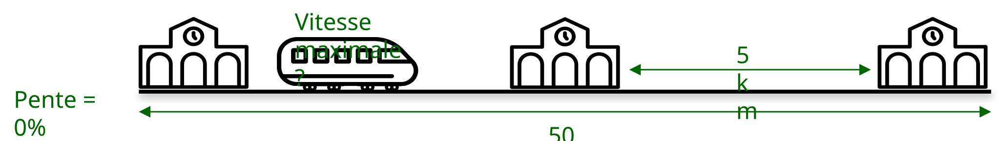</div>

## Analyse des résultats : impacts normalisés {.editorial data-part="3" data-subpart="4"}

<div class="slide-title">Analyse des résultats : impacts normalisés</div>

<div class="ppt-canvas"><div class="ppt-text" style="left:1%;top:62%;width:47%;height:19%;font-size:var(--content-size);"><div class="ppt-p" style="text-align:center"><span style="font-size:var(--content-size);font-weight:700">« Les résultats obtenus ne peuvent être généralisés à l’ensemble des configurations d’exploitation ferroviaire. » </span></div><div class="ppt-p" style="text-align:center">&nbsp;</div><div class="ppt-p" style="text-align:center"><span style="font-size:var(--content-size);font-weight:700">« Cette étude ne remplace pas la réalisation d’une ACV spécifique au système étudié. » </span></div></div>
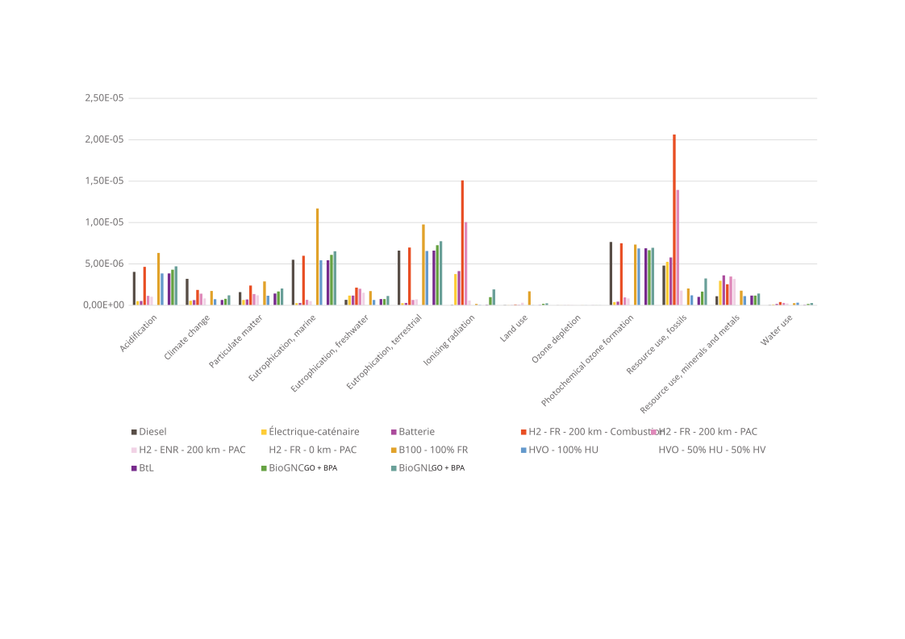
<div class="ppt-text" style="left:50%;top:13%;width:47%;height:5%;font-size:var(--content-size);"><div class="ppt-p" style="text-align:center"><span style="font-size:var(--content-size);font-weight:700">Comparaison des résultats d’impact normalisés en points (pt)</span></div></div>
<div class="ppt-table-wrap" style="left:2%;top:19%;width:45%;height:31%;"><table class="ppt-table"><tr><td style="font-size:var(--content-size);font-weight:700">Catégorie d’impact</td><td style="font-size:var(--content-size);font-weight:700">Scénario le plus impactant</td></tr><tr><td style="font-size:var(--content-size)">Changement climatique</td><td style="font-size:var(--content-size)">Diesel</td></tr><tr><td style="font-size:var(--content-size)">Utilisation des ressources fossiles</td><td style="font-size:var(--content-size)">Hydrogène produit par électrolyse avec le mix électrique français</td></tr><tr><td style="font-size:var(--content-size)">Micro-particules</td><td style="font-size:var(--content-size)">Biocarburant B100</td></tr><tr><td style="font-size:var(--content-size)">Utilisation des ressources minérales et métalliques</td><td style="font-size:var(--content-size)">Hydrogène, batteries et caténaires</td></tr></table></div>
</div>

## Analyse des résultats : effet de la vitesse maximale {.editorial data-part="3" data-subpart="4"}

<div class="slide-title">Analyse des résultats : effet de la vitesse maximale</div>

<div class="ppt-canvas">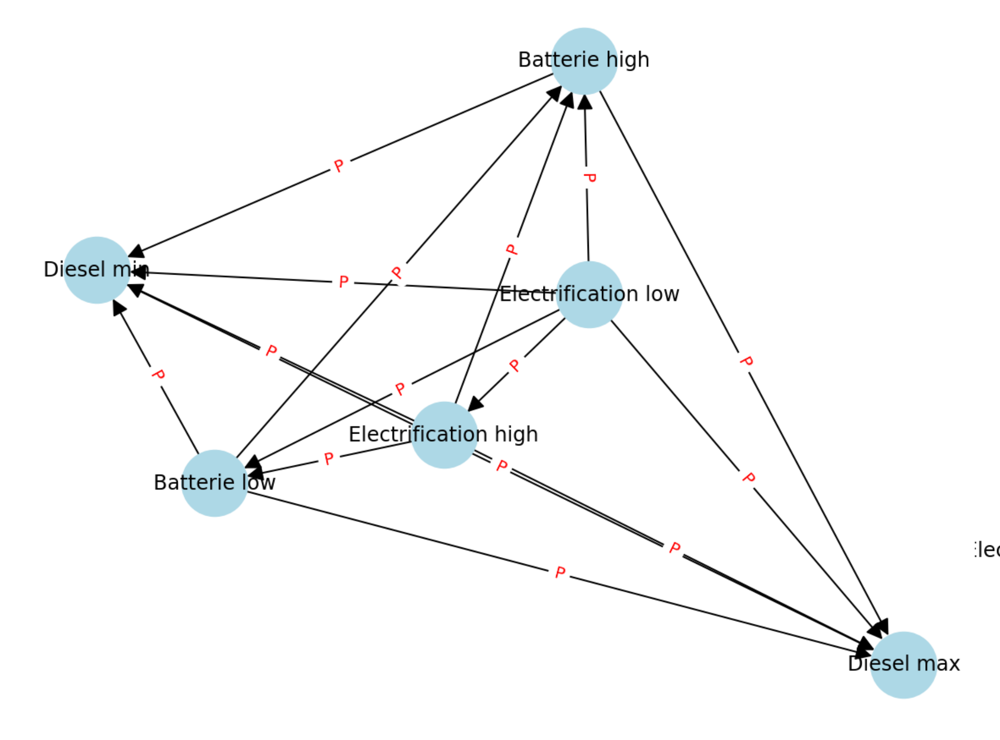
<div class="ppt-table-wrap" style="left:50%;top:37%;width:48%;height:52%;"><table class="ppt-table"><tr><td style=""></td><td style=""></td></tr><tr><td style="font-size:var(--content-size)">Vmax = 54 m/s</td><td style="font-size:var(--content-size)">Vmax = 130 m/s</td></tr></table></div>
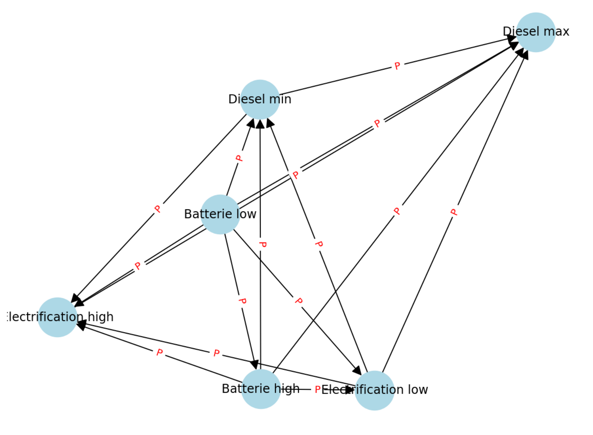</div>

## Analyse de sensibilité globale {.editorial data-part="3" data-subpart="4"}

<div class="slide-title">Analyse de sensibilité globale</div>

<div class="ppt-canvas"><div class="ppt-text" style="left:53%;top:12%;width:45%;height:73%;font-size:var(--content-size);"><div class="ppt-p" style="text-align:left"><span style="font-size:var(--content-size)">Variabilité:</span></div><div class="ppt-p" style="text-align:left"><span style="font-size:var(--content-size)">Tirages </span><span style="font-size:var(--content-size)">sobol</span></div><div class="ppt-p" style="text-align:left">&nbsp;</div><div class="ppt-p" style="text-align:left">&nbsp;</div><div class="ppt-p" style="text-align:left">&nbsp;</div><div class="ppt-p" style="text-align:left">&nbsp;</div><div class="ppt-p" style="text-align:left">&nbsp;</div><div class="ppt-p" style="text-align:left">&nbsp;</div><div class="ppt-p" style="text-align:left">&nbsp;</div><div class="ppt-p" style="text-align:left">&nbsp;</div><div class="ppt-p" style="text-align:left">&nbsp;</div><div class="ppt-p" style="text-align:left">&nbsp;</div><div class="ppt-p" style="text-align:left">&nbsp;</div><div class="ppt-p" style="text-align:left"><span style="font-size:var(--content-size)">Incertitude:</span></div><div class="ppt-p" style="text-align:left"><span style="font-size:var(--content-size)">Tirages Monte-Carlo</span></div></div>

</div>

## Sobol total : ensemble des paramètres {.editorial data-part="3" data-subpart="4"}

<div class="slide-title">Sobol total : ensemble des paramètres</div>

<div class="ppt-canvas">


</div>

## Sobol total : paramètres technologiques {.editorial data-part="3" data-subpart="4"}

<div class="slide-title">Sobol total : paramètres technologiques</div>

<div class="ppt-canvas">


</div>

## ANOVA {.editorial data-part="3" data-subpart="4"}

<div class="slide-title">ANOVA</div>

<div class="ppt-canvas">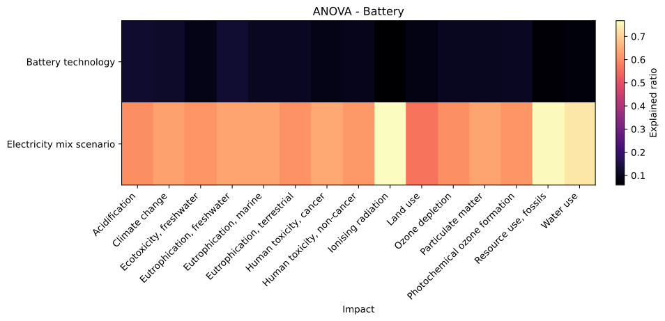
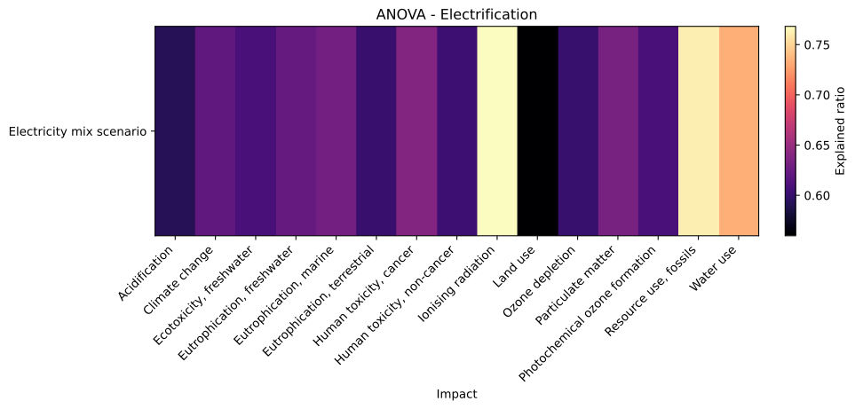
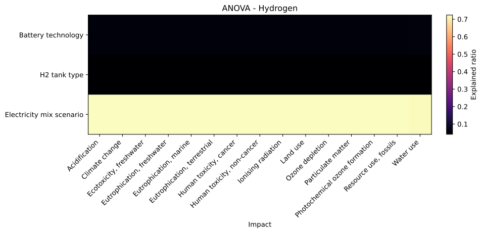</div>

## Évolution des classements {.editorial data-part="3" data-subpart="4"}

<div class="slide-title">Évolution des classements</div>

<div class="ppt-canvas">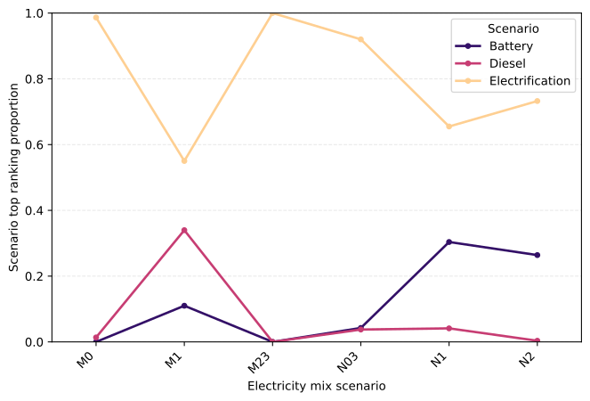
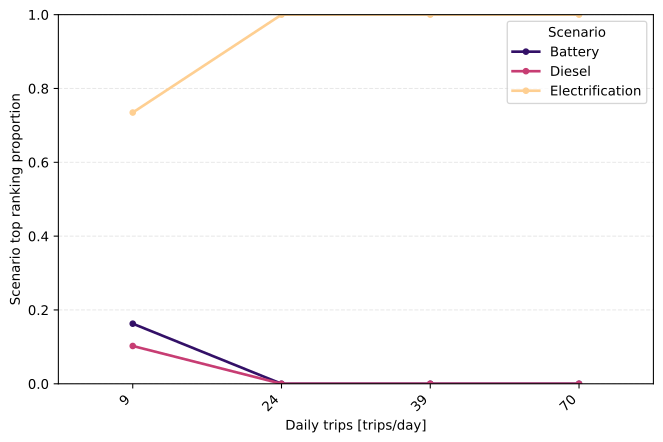</div>

## {.editorial .part-divider data-part="4" data-subpart="1"}

<div class="divider-number">PARTIE 04</div>
<div class="divider-title">Perspectives</div>
<div class="divider-subtitle">Synthèse des contributions et prolongements scientifiques et opérationnels.</div>

## Conclusion {.editorial data-part="4" data-subpart="1"}

<div class="slide-title">Conclusion</div>
<div class="perspective-grid">
<div class="perspective-column"><div class="perspective-kicker">ORGANISATION DE LA DÉCISION</div><div class="perspective-title">Réorganisation des décisions publiques avec interactions publiques–privées</div><div class="perspective-list">Réduction des risques<br>Meilleure prise en compte de la temporalité<br>Organisation plus explicite des interventions</div></div>
<div class="perspective-column"><div class="perspective-kicker">RECOMMANDATION TECHNOLOGIQUE</div><div class="perspective-title">Méthodologie de réduction d’impact environnemental des trains</div><div class="perspective-list">Adaptable à différents roulements, matériels roulants et technologies<br>Multicritère<br>Facile à interpréter pour des non-experts<br>Transparente grâce à des données publiques<br>Extensible à d’autres domaines de mobilité</div></div>
</div>

## Perspectives {.editorial data-part="4" data-subpart="1"}

<div class="slide-title">Perspectives scientifiques et opérationnelles</div>
<div class="perspective-grid">
<div class="perspective-column"><div class="perspective-kicker">MÉTHODE</div><div class="perspective-list">Economic indicators<br>MCDM — approfondissement méthodologique<br>Computational optimization<br>Uncertainty precision<br>Criteria development and weighting</div></div>
<div class="perspective-column"><div class="perspective-kicker">APPLICATIONS</div><div class="perspective-list">Extension aux lignes non électrifiées<br>Extension à d’autres systèmes de mobilité<br>Outil opérationnel d’aide à la décision régionale</div></div>
</div>

## {.end-slide data-part="4" data-subpart="1"}

<div class="end-title">Merci.</div>
<div class="end-subtitle">Questions & discussion</div>
<div class="end-footer"><span>Benoît Volant · CentraleSupélec · LGI · IKOS</span><span>bvolant@ikosconsulting.com</span></div>

## Limites planétaires {.appendix-slide}

<div class="appendix-label">ANNEXE A1</div>
<div class="appendix-title">Limites planétaires</div>
<div class="appendix-body"><div class="ppt-canvas" style="top:0;left:0;right:0;bottom:0;">
</div></div>

## Critères d’impact environnementaux {.appendix-slide}

<div class="appendix-label">ANNEXE A2</div>
<div class="appendix-title">Critères d’impact environnementaux</div>
<div class="appendix-body"><div class="ppt-canvas" style="top:0;left:0;right:0;bottom:0;">


<div class="ppt-text" style="left:58%;top:2%;width:25%;height:5%;font-size:var(--content-size);"><div class="ppt-p" style="text-align:center"><span style="font-size:var(--content-size);font-weight:700">Impacts intermédiaires</span></div></div>
<div class="ppt-text" style="left:76%;top:86%;width:22%;height:5%;font-size:var(--content-size);"><div class="ppt-p" style="text-align:center"><span style="font-size:var(--content-size);font-weight:700">Score</span></div></div>
<div class="ppt-text" style="left:47%;top:88%;width:16%;height:5%;font-size:var(--content-size);"><div class="ppt-p" style="text-align:center"><span style="font-size:var(--content-size);font-weight:700">Dégâts </span></div></div>
</div></div>
